# PitWall

## Documento de Requisitos de Software (SRS)

**Plataforma de telemetría e ingeniería de carrera para EA SPORTS™ F1® 25 y F1® 25: 2026 Season Pack**

| Campo | Valor |
|---|---|
| Identificador del documento | `PW-SRS-001` |
| Versión del documento | 1.1 |
| Estado | Aprobado para desarrollo |
| Fecha de emisión | 11 de septiembre de 2026 |
| Autor | Luis Miguel |
| Producto | PitWall |
| Versión de producto cubierta | MVP → V1 |
| Especificación UDP de referencia | `Data Output from F1® 25: 2026 Season Pack`, **Version 1.2** (Season 8 "Sports Update") |
| Especificación UDP secundaria | `Data Output from F1® 25 Game`, **v3** |
| Clasificación | Proyecto personal / fan project, sin afiliación con EA, Codemasters, la FIA ni Formula One |

---

## 2. Historial de versiones

| Versión | Fecha | Autor | Cambios |
|---|---|---|---|
| 0.1 | 2026-09-11 | Luis Miguel | Borrador inicial tras la fase de investigación. |
| 1.2 | 2026-09-12 | Luis Miguel | **RNF-052** reformulado: dejaba de ejemplo «descartar lo más antiguo» como política de la cola de telemetría, y esa política no es implementable en una cola de un productor y un consumidor cuyo índice de lectura pertenece al consumidor. El requisito pasa a exigir que cada cola declare una política **que su estructura pueda cumplir**, y remite el catálogo a `04-ARCHITECTURE.md` §4.3, donde `Qraw` queda como *descartar el más nuevo* (decidido al implementar F1.1-01). Los dos invariantes que no dependen de la cola —nunca bloquear al productor, contabilizar y avisar siempre— se conservan intactos. |
| 1.1 | 2026-09-11 | Luis Miguel | **Cambio de enfoque de producto: PitWall pasa a ser una aplicación de escritorio para Windows.** La interfaz se aloja en un control WebView2 dentro del propio `PitWall.exe`; el navegador y el acceso desde la LAN dejan de ser formas de uso soportadas (OUT-10, OUT-11). Nuevos requisitos RF-620…RF-633 (shell), RF-011b (configuración asistida del XML con consentimiento y copia de seguridad), RNF-008, RNF-016, RNF-098, RNF-099, SEC-19…SEC-21 y CU-23. Retirado CU-19. Criterios de aceptación del MVP: de 27 a **35** (la versión 1.0 afirmaba 37, pero enumeraba 27: error aritmético corregido). Nuevo ADR-016 sobre Docker. |
| 1.0 | 2026-09-11 | Luis Miguel | Versión completa. Incorpora la especificación oficial 2026 v1.2 verificada por descarga directa, el catálogo de casos de uso, requisitos funcionales y no funcionales, modelo conceptual, arquitectura conceptual y criterios de aceptación del MVP. Fija el stack (núcleo C++20/23 + frontend React/TypeScript). |

### 2.1. Convenios de control de cambios

- Este documento es la **fuente única de verdad para los requisitos**. Ningún requisito vive fuera de aquí.
- El `.md` es la fuente; el `.pdf` es un artefacto **generado**. Nunca se editan por separado.
- Todo requisito tiene un identificador inmutable (`RF-xxx`, `RNF-xxx`, `RN-xxx`, `CU-xxx`). Los identificadores **no se reutilizan**: un requisito eliminado se marca `DEPRECATED`, no se borra.
- Cualquier afirmación técnica sobre el protocolo UDP lleva una marca de trazabilidad `[Sn]` que apunta a la sección 37 (Fuentes).

---

## 3. Resumen ejecutivo

PitWall es una plataforma local de telemetría e ingeniería de carrera que consume la salida **UDP** de **EA SPORTS™ F1® 25** y de su expansión **F1® 25: 2026 Season Pack**, y la convierte en información accionable: live timing, telemetría en vivo, mapa de pista, análisis comparativo de vueltas, grabación y reproducción de sesiones, y —en fases posteriores— un módulo de ingeniero de carrera basado en reglas y matemáticas.

El proyecto se plantea explícitamente como **software de ingeniería mantenible**, no como un script. Tres decisiones estructurales lo definen:

1. **El decodificador está aislado del dominio.** Los `struct` específicos del juego jamás salen de la capa de decodificación. Por encima de ella existe un modelo normalizado (`NormalizedTelemetry`) idéntico para 2025 y 2026, de forma que una futura revisión del protocolo (o un formato 2027) afecte principalmente a un decoder nuevo y no al resto del sistema.
2. **La recepción UDP nunca se bloquea.** El hilo que lee del socket no toca disco, ni base de datos, ni red de salida. Todo lo demás cuelga de colas desacopladas con política de backpressure explícita.
3. **El replay es un ciudadano de primera clase desde el día uno.** La captura cruda de datagramas y su reemisión determinista es un requisito del MVP, no un añadido. Es la condición necesaria para poder desarrollar el 90 % del producto sin tener el juego abierto.

PitWall es una **aplicación de escritorio para Windows**. Un único `PitWall.exe` abre su propia ventana, empieza a escuchar la telemetría por sí solo y detecta la sesión sin que el usuario tenga que conectar nada. El núcleo se implementa en **C++20/23** —elección alineada con la naturaleza del problema (structs `packed` de tamaño fijo, little-endian, baja latencia, concurrencia explícita) y con el objetivo formativo del proyecto—; la interfaz es **React + TypeScript** renderizada **dentro de un control WebView2 alojado por el propio proceso**, no en un navegador.

El usuario nunca ve un navegador, un terminal, un puerto ni una URL. El transporte entre núcleo e interfaz existe, pero es un **detalle interno de implementación**, no una superficie pública del producto (ver `15-ADR.md`, ADR-002).

### 3.1. Cifra clave que condiciona el diseño

Con formato 2026 a 60 Hz, el juego emite aproximadamente **415 datagramas/s y 0,40 MiB/s**, es decir **~1,5 GB por hora** de UDP crudo. Ese número, derivado en la sección 12.6 a partir de los tamaños oficiales de paquete, gobierna las decisiones de buffering, persistencia y retención de todo el documento.

---

## 4. Visión del producto

> **Para** un piloto de F1 25 / 2026 Season Pack que quiere entender *por qué* es rápido o lento,
> **que** no dispone de las herramientas de análisis que usa un equipo real,
> **PitWall es** una aplicación de escritorio de telemetría e ingeniería de carrera que corre en su propio PC,
> **que** captura la salida UDP del juego, la normaliza, la muestra en vivo y la conserva para analizarla después,
> **a diferencia de** los overlays y dashboards existentes, que muestran valores instantáneos y olvidan la sesión,
> **nuestro producto** trata cada sesión como un conjunto de datos: se graba, se reproduce, se compara y se explica.

### 4.1. Principios de producto

| # | Principio | Implicación de diseño |
|---|---|---|
| P1 | **Nunca inventamos datos** | Toda métrica se etiqueta `RAW`, `DERIVED`, `ESTIMATED` o `UNAVAILABLE`. Un cero recibido con telemetría restringida es `UNAVAILABLE`, no cero. |
| P2 | **El dato crudo es sagrado** | Se conserva el datagrama original cuando aporta valor, para poder reprocesar sesiones con decoders o analítica mejorados. |
| P3 | **Latencia sobre completitud** | Ante saturación se degrada la resolución de lo que se muestra, no la recepción. |
| P4 | **Local primero, y de escritorio** | Un PC con Windows, sin servicios externos, sin cuenta, sin navegador y sin telemetría de producto propia. Se instala, se abre y funciona. |
| P5 | **El protocolo es un detalle** | El dominio no sabe qué año de formato UDP se está recibiendo. |
| P7 | **Cero pasos manuales en el uso normal** | Escuchar, detectar el formato, la sesión y el jugador ocurre solo. La configuración manual existe, pero es la excepción, no el camino. |
| P6 | **Explicable antes que inteligente** | Las conclusiones del módulo de ingeniero se derivan de fórmulas documentadas. La IA generativa, si llega, sólo traduce a lenguaje natural conclusiones ya calculadas. |

---

## 5. Objetivos

### 5.1. Objetivos de producto

| ID | Objetivo | Métrica de éxito |
|---|---|---|
| OBJ-01 | Recibir y decodificar sin pérdidas la salida UDP de F1 25 en formato 2025 y 2026 | 0 paquetes válidos descartados en una sesión de 1 h a 60 Hz |
| OBJ-02 | Detectar automáticamente el formato del protocolo sin configuración del usuario | Cambio 2025↔2026 en caliente gestionado en < 1 s |
| OBJ-03 | Mostrar live timing y telemetría con latencia imperceptible | p95 de UDP→píxel < 150 ms |
| OBJ-04 | Grabar cualquier sesión íntegra y reproducirla de forma determinista | Replay idéntico en orden y contenido |
| OBJ-05 | Permitir comparar dos vueltas alineadas por distancia | Delta calculado y graficado sobre ≥ 8 canales |
| OBJ-06 | Poder desarrollar sin el juego abierto | ≥ 90 % de la suite de pruebas ejecutable sin F1 25 |
| OBJ-07 | Ser instalable por un tercero en Windows | De cero a recibiendo datos en < 10 min siguiendo el README |

### 5.2. Objetivos técnicos y formativos

| ID | Objetivo |
|---|---|
| OBJ-T1 | Construir un decoder de protocolo binario trazable línea a línea con la especificación oficial |
| OBJ-T2 | Practicar concurrencia real: hilos dedicados, colas lock-free SPSC, backpressure medible |
| OBJ-T3 | Practicar C++ moderno: `std::span`, `std::bit_cast`, `constexpr`, RAII estricto, cero `new`/`delete` manuales |
| OBJ-T4 | Practicar diseño orientado a datos y presupuesto de latencia explícito |
| OBJ-T5 | Construir observabilidad interna (métricas y logs estructurados) desde la primera fase |

---

## 6. Objetivos fuera de alcance

Lo que este producto **no** es, y no será, salvo decisión explícita registrada en un ADR nuevo:

| ID | Fuera de alcance | Motivo |
|---|---|---|
| OUT-01 | Datos de la Fórmula 1 real (FastF1, OpenF1, Live Timing oficial) como fuente primaria | El producto es del videojuego. Se contemplan sólo como fuente **secundaria opcional** en fases futuras (ver RF-901). |
| OUT-02 | Modificación del juego, inyección en proceso, lectura de memoria | Fuera de la salida UDP oficial. Riesgo legal y de anticheat. |
| OUT-03 | Servicio en la nube, cuentas de usuario, tablas de clasificación online | Contradice P4. |
| OUT-04 | Reproducción de la identidad gráfica de la F1 o de las retransmisiones | Riesgo de marca (cubierto en 26.3). |
| OUT-05 | IA generativa o machine learning en el MVP | Contradice P6. |
| OUT-06 | Soporte de otros simuladores (iRacing, ACC, rFactor) | Puede caber en el diseño, pero no se compromete. |
| OUT-07 | Soporte de formatos UDP anteriores a 2025 (2024 y previos) | El juego los ofrece, pero multiplican el coste de mantenimiento sin caso de uso. Reevaluable. |
| OUT-08 | Control de hardware (motion platforms, D-BOX, LEDs) | El juego ya lo hace nativamente. |
| OUT-09 | Edición de setups o cualquier escritura hacia el juego | El protocolo UDP es unidireccional de salida. |
| **OUT-10** | **Uso desde un navegador como forma principal o soportada** | PitWall es una aplicación de escritorio. La interfaz vive dentro de su propia ventana (ADR-002). |
| **OUT-11** | **Acceso a la interfaz desde otro dispositivo de la LAN** | Contradice OUT-10 y P4. **No confundir** con la *recepción* de UDP por LAN desde una consola, que sí está soportada (RF-003). |
| **OUT-12** | **Docker o cualquier contenedor para ejecutar o distribuir el producto** | El usuario no debe instalar nada más que PitWall (ADR-016). |

---

## 7. Contexto

### 7.1. Contexto de sistema

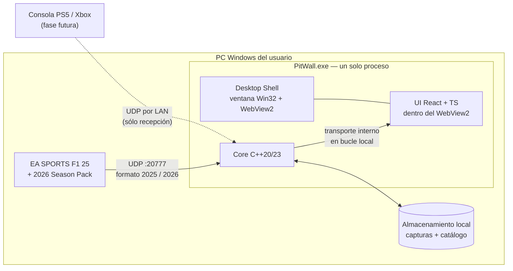

El recuadro `PitWall.exe` es **un único proceso**. No hay servidor que arrancar aparte, ni navegador,
ni nada que el usuario tenga que conectar.

### 7.2. Naturaleza del producto F1 25 / 2026 Season Pack

Un punto que condiciona todo el diseño y que conviene fijar sin ambigüedad:

> **El 2026 Season Pack NO es un juego independiente.** Es contenido descargable sobre F1 25. El mismo ejecutable emite, según la opción *UDP Format*, o bien el formato **2025** o bien el formato **2026**. `m_gameYear` reporta `25` o `26` según el modo. `[S1][S3]`

Consecuencias directas:

- La detección de formato **no puede** basarse en qué juego está instalado. Debe basarse en `m_packetFormat` del propio datagrama.
- Un mismo usuario puede alternar entre ambos formatos entre sesiones, e incluso durante la ejecución del juego, porque las opciones UDP se aplican con efecto inmediato. `[S1]`
- La documentación oficial 2026 se refiere internamente al producto como «F1 26» en el texto y los comentarios de los structs, mientras el aviso legal habla de «F1® 25 Game». Ambas denominaciones designan lo mismo. `[S1][S2]`

### 7.3. Restricción funcional relevante del formato

Jugar el 2026 Season Pack con *UDP Format* fijado en **2025** es posible, pero produce datos degradados: los coches con reglamento 2026 se reportan bajo `Formula` genérica, y se pierde por completo el paquete `CarTelemetry2` (Active Aero, Overtake Mode, flag de reglamento 2026) y el campo `m_ersHarvestLimitPerLap`. `[S1][S2][S9]`

Por tanto, PitWall **detecta** ambos formatos pero **recomienda activamente** el formato 2026 cuando identifica contenido 2026 recibido bajo formato 2025 (ver RF-104).

---

## 8. Stakeholders

| ID | Stakeholder | Interés | Influencia sobre el diseño |
|---|---|---|---|
| ST-01 | Usuario propietario / desarrollador | Que el proyecto sirva para analizar sus sesiones y para aprender C++ de sistemas | Alta. Define stack, alcance y ritmo. |
| ST-02 | Piloto usuario final | Ver y entender sus datos sin fricción | Alta sobre UX y latencia. |
| ST-03 | Ingeniero/observador acompañante | Ver la sesión junto al piloto, en la misma máquina o en un segundo monitor | Baja. **No** justifica acceso remoto a la interfaz (OUT-11). |
| ST-04 | Comunidad open source | Poder instalar, entender y contribuir | Media. Justifica documentación, licencias y disclaimer. |
| ST-05 | EA / Codemasters | Que se respete la licencia de la especificación y las marcas | Alta como restricción legal (26.3). |
| ST-06 | Mantenedor futuro del protocolo | Poder añadir un formato 2027 sin reescribir | Alta sobre la arquitectura del decoder. |

---

## 9. Actores

| ID | Actor | Tipo | Descripción |
|---|---|---|---|
| ACT-01 | **Piloto** | Humano primario | Conduce en el juego. Consume la información en vivo, típicamente de reojo o tras la sesión. |
| ACT-02 | **Ingeniero** | Humano primario | Persona distinta del piloto (o el mismo piloto tras la sesión) que analiza los datos: comparación de vueltas, estrategia, degradación. |
| ACT-03 | **Administrador** | Humano secundario | Configura puerto, IP, rutas de almacenamiento, retención, nivel de log. En la práctica suele ser el mismo usuario. |
| ACT-04 | **Espectador** | Humano secundario | Ve una sesión ajena desde el modo spectator del juego. |
| ACT-05 | **Sistema UDP (el juego)** | Sistema externo | EA SPORTS F1 25 emitiendo datagramas. No es interrogable: emite y olvida. |
| ACT-06 | **PitWall Core** | Sistema interno | El backend: recibe, decodifica, normaliza, mantiene estado, persiste, retransmite. |
| ACT-07 | **PitWall UI** | Sistema interno | El frontend React alojado en el WebView2 de la ventana: consume el bus interno y renderiza. |
| ACT-07b | **Desktop Shell** | Sistema interno | La ventana Win32 que aloja el WebView2, gestiona el ciclo de vida del proceso, la instancia única y el estado de la ventana. |
| ACT-08 | **Replay Engine** | Sistema interno | Actúa como ACT-05 simulado, reemitiendo capturas. Clave para desarrollo y pruebas. |
| ACT-09 | **Reloj del sistema** | Sistema externo | Fuente de tiempo monótono para medir latencias y ritmos de emisión. |

---

## 10. Glosario

Glosario resumido. La versión completa vive en `docs/18-GLOSSARY.md`.

| Término | Definición |
|---|---|
| **Datagrama** | Unidad de transporte UDP. En este dominio, exactamente un paquete de telemetría. |
| **Packet Format** | Campo `m_packetFormat` de la cabecera. Vale `2025` o `2026`. Determina el layout completo. `[S1][S4]` |
| **Packet ID** | Campo `m_packetId`. Identifica el tipo de paquete (0–15 en 2025, 0–16 en 2026). `[S2][S4]` |
| **Packet Version** | Campo `m_packetVersion`. Versión del layout de ese tipo concreto. Todos empiezan en 1. Actualmente todos valen 1 en ambos formatos. `[S1][S3]` |
| **Session UID** | `m_sessionUID`, `uint64`. Identificador único de sesión. |
| **Frame Identifier** | `m_frameIdentifier`. Identificador del fotograma. **Retrocede tras un flashback.** `[S1]` |
| **Overall Frame Identifier** | `m_overallFrameIdentifier`. Identificador global monótono. **No retrocede tras un flashback.** `[S1]` |
| **Vehicle Index** | Posición en los arrays de coches. Estable durante la sesión, sin significado fuera de ella. `[S1]` |
| **Your Telemetry** | Ajuste del juego (`Restricted` / `Public`) que decide si otros ven ciertos datos de tu coche. `[S1]` |
| **Broadcast Mode** | Modo de envío UDP a la subred completa, sin IP destino. `[S1]` |
| **Active Aero** | Sistema aerodinámico activo del reglamento 2026. Modos *Corner* y *Straight*. `[S2]` |
| **Overtake Mode** | Modo de sobrepaso del reglamento 2026, sustituye conceptualmente al DRS como recurso de ataque. `[S2]` |
| **Partial Mode** | Estado de pista en el que las zonas de Active Aero disponibles son las «parciales». Señalizado por eventos `PMEN`/`PMDI`. `[S1]` |
| **MADRING** | Circuito de Madrid, Track ID 42, introducido en el contenido 2026. `[S1]` |
| **Stint** | Tramo de vueltas consecutivas con el mismo juego de neumáticos. |
| **Delta** | Diferencia de tiempo acumulada entre dos vueltas, alineada por distancia recorrida. |
| **RAW / DERIVED / ESTIMATED / UNAVAILABLE** | Clasificación obligatoria de la procedencia de toda métrica (ver 19.6). |

---

## 11. Investigación técnica resumida

### 11.1. Método

1. Se localizó el hilo oficial de EA en el *F1 Games Game Info Hub* (id `12187347`) `[S5]`.
2. Se enumeraron y **descargaron directamente** todos los adjuntos vivos del hilo, en lugar de confiar en transcripciones de terceros.
3. Se convirtieron los PDF a texto y se ejecutó un **diff literal** entre los ficheros de `struct` de 2025 y 2026 para obtener la lista de cambios sin depender de memoria ni de resúmenes.
4. Se contrastó el ecosistema de librerías existentes (11.4) y los problemas prácticos reportados por la comunidad (14.5).

### 11.2. Documentación oficial localizada

| # | Fichero | Contenido | Vigencia |
|---|---|---|---|
| 4 | `Data Output from F1 25 v3.pdf` | Especificación completa formato 2025 | **Vigente** `[S3]` |
| 5 | `F1 25 Telemetry Output Structures.txt` | Structs C++ formato 2025 | **Vigente** `[S4]` |
| 8 | `2026 Season Pack Telemetry Output Structures (1).txt` | Structs C++ formato 2026 | Vigente con salvedad (11.3) `[S2]` |
| 9 | `Data Output from F1 25 2026 Season Pack (1).pdf` | Especificación 2026, revisión anterior | Superada |
| 10 | `Data Output from F1 25 2026 Season Pack (Season 8).pdf` | **Especificación 2026, Version 1.2** | **Vigente. Fuente de verdad.** `[S1]` |

**La versión de la especificación UDP oficial que utiliza este proyecto es la `Version 1.2` del documento `Data Output from F1® 25: 2026 Season Pack`**, cuya nota de revisión indica: *«Added F2 Driver IDs as part of the Season 8 "Sports Update"»*. `[S1]`

Diferencia entre revisiones 2026: la revisión Season 8 **sólo amplía el apéndice de Driver IDs**. Ningún `struct`, tamaño de paquete, enumerado de paquete ni frecuencia cambia respecto a la revisión anterior. Esto es una buena noticia de mantenimiento: confirma que EA publica revisiones de contenido sin romper el layout binario.

### 11.3. Discrepancia detectada entre fuentes oficiales

> ⚠️ **Hallazgo importante.** El fichero `.txt` de structs 2026 `[S2]` está **desactualizado respecto al PDF v1.2** `[S1]`.
>
> El PDF documenta, y el `.txt` **no** contiene:
> - La estructura `PartialModeEnabled { uint8 reason; }` dentro de la unión `EventDataDetails`.
> - Cuatro códigos de evento nuevos: `"PMEN"`, `"PMDI"`, `"OVEN"`, `"OVDI"`.
>
> **Regla de resolución adoptada:** ante conflicto entre fuentes oficiales, prevalece el **PDF de mayor versión** (v1.2). El `.txt` se usa como comodidad de transcripción, nunca como autoridad. Registrado como riesgo `RSK-03`.

### 11.4. Ecosistema de implementaciones existentes

Ninguna se adopta como dependencia. Se han estudiado como referencia de diseño y para validar decisiones.

| Proyecto | Lenguaje | Licencia | Soporte 2026 | Valor como referencia |
|---|---|---|---|---|
| `volodymyr-fed/F1Game.UDP` (NuGet 26.0.0) `[S6]` | C# / .NET 8-10 | MIT | **Sí**, layout 2026 explícito, incluye `CarTelemetry2DataPacket` | La mejor referencia actual. Confirma el patrón de mapeo directo `bytes → struct` y la convención de versionar la librería con el año del juego. |
| `racehub-io/f1-telemetry-client` `[S7]` | TypeScript | MIT | No (hasta F1 23) | Referencia de diseño de eventos y de API de cliente. Obsoleto para nuestro caso. |
| `@deltazeroproduction/f1-udp-parser` `[S8]` | TypeScript | — | Hasta F1 25 | Confirma cobertura del formato 2025 en el ecosistema JS. |
| `mathieu-lemay/f1-telemetry-rs` | Rust | — | No verificado para 2026 | Referencia de separación decoder/dominio en un lenguaje sin GC. |
| `f1-telemetry` (PyPI, jun-2026) | Python | — | Parcial | Referencia de arquitectura con serie temporal (InfluxDB). |
| `MacManley/f1-25-udp` | C++ (ESP32) | — | No | Confirma que el parseo por offsets fijos es viable en entornos muy restringidos. |

**Conclusión de la comparativa:** el protocolo es lo bastante simple y está lo bastante bien especificado como para que **implementar nuestro propio decoder sea preferible a depender de una librería**. Las razones se detallan en 34.2 y quedan registradas en `ADR-004`.

### 11.5. Verificación de frescura de fuentes

- Toda afirmación sobre el layout binario procede de ficheros **descargados el 2026-09-11** desde el dominio `forums.ea.com`.
- No se ha usado ningún artículo de blog, vídeo ni post de Reddit como fuente de una afirmación técnica sobre el protocolo, conforme a la regla de prioridad de fuentes.
- Las fuentes de comunidad se han empleado **exclusivamente** para descubrir problemas prácticos (14.5), y así se indica en cada caso.

---

## 12. Capacidades reales de F1 25 UDP

Esta sección describe lo que el juego **realmente ofrece**. El detalle exhaustivo campo a campo vive en `docs/03-UDP-PROTOCOL.md`.

### 12.1. Transporte

| Propiedad | Valor | Fuente |
|---|---|---|
| Protocolo | UDP, unidireccional juego → aplicación | `[S1]` |
| Codificación | **Little Endian** | `[S1][S3]` |
| Empaquetado | **Packed, sin padding** | `[S1][S3]` |
| Puerto por defecto | `20777` | `[S1]` |
| IP por defecto | `127.0.0.1` | `[S1]` |
| Send rate por defecto | `20` (Hz) | `[S1]` |
| Formato por defecto (con Season Pack, instalación nueva) | `2026` | `[S9]` |
| Broadcast | Soportado. Con broadcast no hace falta IP destino, sólo puerto. | `[S1]` |
| Formatos soportados por el juego | Sólo el actual **y los dos anteriores**: 2026, 2025, 2024 | `[S1]` |

### 12.2. Configuración

Dos vías, ambas oficiales `[S1]`:

**a) Menú del juego** — `Game Options → Settings → UDP Telemetry Settings`. Todas las opciones se pueden cambiar **durante la sesión con efecto inmediato**. Esto es un requisito de robustez, no una curiosidad: implica que el formato puede cambiar sin reiniciar nada.

**b) XML de configuración avanzada (sólo PC)**, en:

```
...\Documents\My Games\<game_folder>\hardwaresettings\hardware_settings_config.xml
```

```xml
<motion>
  ...
  <udp enabled="false" broadcast="false" ip="127.0.0.1" port="20777" sendRate="20"
       format="2026" yourTelemetry="restricted" onlineNames="off" />
  ...
</motion>
```

> **Advertencia oficial:** cualquier cambio hecho en el juego mientras corre **sobrescribe** las ediciones manuales del XML. `[S1]` Por tanto PitWall **puede leer** este fichero para autoconfigurarse, pero **no debe escribirlo** mientras el juego esté abierto (ver RF-011 y RNF-051).

> **Nota de verificación pendiente.** La especificación oficial documenta el atributo `sendRate` y su valor por defecto (`20`), pero **no enumera** el conjunto exacto de valores seleccionables en el menú. Las guías de terceros mencionan de forma consistente 20 Hz y 60 Hz `[S12][S13]`. PitWall **no depende** de conocer esa lista: mide el ritmo real observado (RF-801). Queda como pregunta abierta `Q-02`.

### 12.3. Cabecera común

Idéntica en 2025 y 2026, **29 bytes** `[S2][S4]`:

```c
struct PacketHeader
{
    uint16  m_packetFormat;            // 2025 o 2026
    uint8   m_gameYear;                // 25 o 26
    uint8   m_gameMajorVersion;        // "X.00"
    uint8   m_gameMinorVersion;        // "1.XX"
    uint8   m_packetVersion;           // versión de este tipo de paquete, empieza en 1
    uint8   m_packetId;                // tipo de paquete
    uint64  m_sessionUID;              // identificador único de sesión
    float   m_sessionTime;             // marca de tiempo de sesión
    uint32  m_frameIdentifier;         // fotograma (retrocede con flashback)
    uint32  m_overallFrameIdentifier;  // fotograma global (no retrocede con flashback)
    uint8   m_playerCarIndex;          // índice del coche del jugador
    uint8   m_secondaryPlayerCarIndex; // índice del segundo jugador (splitscreen), 255 si no hay
};
```

Que la cabecera sea **estable entre formatos** es la propiedad que hace viable la detección automática: se pueden leer con seguridad los 7 primeros bytes de cualquier datagrama sin saber aún su formato.

### 12.4. Catálogo de paquetes

Frecuencias y tamaños **oficiales** `[S1][S3]`. Todos los paquetes tienen `m_packetVersion = 1` en ambos formatos.

| ID | Paquete | Frecuencia | Tamaño 2025 (B) | Tamaño 2026 (B) | Ámbito |
|---|---|---|---|---|---|
| 0 | Motion | Rate del menú | 1349 | **1325** | Todos los coches |
| 1 | Session | 2 /s | 753 | **926** | Sesión |
| 2 | Lap Data | Rate del menú | 1285 | **1399** | Todos los coches |
| 3 | Event | Al ocurrir | 45 | 45 | Sesión / coche |
| 4 | Participants | cada 5 s | 1284 | **1470** | Todos los coches |
| 5 | Car Setups | 2 /s | 1133 | **1233** | Todos los coches |
| 6 | Car Telemetry | Rate del menú | 1352 | **1448** | Todos los coches |
| 7 | Car Status | Rate del menú | 1239 | **1445** | Todos los coches |
| 8 | Final Classification | 1 vez al final | 1042 | **1134** | Todos los coches |
| 9 | Lobby Info | 2 /s en lobby | 954 | **1062** | Lobby |
| 10 | Car Damage | 10 /s | 1041 | **1133** | Todos los coches |
| 11 | Session History | 20 /s ciclando coches | 1460 | 1460 | Un coche por datagrama |
| 12 | Tyre Sets | 20 /s ciclando coches | 231 | 231 | Un coche por datagrama |
| 13 | Motion Ex | Rate del menú | 273 | 273 | **Sólo coche del jugador** |
| 14 | Time Trial | 1 /s | 101 | **104** | Sólo Time Trial |
| 15 | Lap Positions | 1 /s | 1131 | **1231** | Todos los coches |
| 16 | **Car Telemetry 2** | Rate del menú | — | **269** | Todos los coches |

Observaciones que importan al diseño:

- **Session History y Tyre Sets no dependen del send rate.** Van siempre a 20/s ciclando entre coches. Con 24 coches, un coche concreto se actualiza aproximadamente **cada 1,2 s**. Nunca deben tratarse como fuente en vivo de alta frecuencia.
- **Motion Ex es exclusivo del coche del jugador.** No hay suspensión, slip ratio ni fuerzas por rueda para los rivales. Cualquier análisis que los requiera es imposible para IA y otros humanos, y así debe reflejarse en la UI (`UNAVAILABLE`).
- **Motion contiene todos los coches**, pero la documentación advierte que sólo se envía mientras el jugador tiene el control. `[S1]`
- Los paquetes de "rate del menú" se emiten **agrupados en el mismo fotograma** y nunca se separan entre fotogramas. `[S1]` Esto permite reconstruir «frames lógicos» por `m_frameIdentifier`.

### 12.5. Contenido del primer fotograma

Al conectarse, el primer fotograma transmitido contiene, todos con `m_sessionTime = 0.000` `[S1]`:

`Session`, `Participants`, `Car Setups`, `Lap Data`, `Motion`, `Car Telemetry`, `Car Status`, `Car Damage`, `Motion Ex`.

Es una cortesía de inicialización que PitWall aprovecha (RF-030): permite construir el estado inicial sin esperar los 5 s del ciclo de `Participants`.

### 12.6. Presupuesto de ancho de banda derivado

Cálculo `DERIVED` a partir de 12.4. Se asume overhead de 28 B por datagrama (cabeceras IPv4 + UDP) y 24 coches activos.

**Componente por fotograma (formato 2026):** Motion 1325 + Lap Data 1399 + Car Telemetry 1448 + Car Status 1445 + Motion Ex 273 + Car Telemetry 2 269 = **6159 B en 6 datagramas**.

**Componente de tasa fija (formato 2026):** Session 926×2 + Car Setups 1233×2 + Car Damage 1133×10 + Participants 1470÷5 + Session History 1460×20 + Tyre Sets 231×20 + Lap Positions 1231×1 ≈ **50 993 B/s en ~55 datagramas/s**.

| Send rate | Datagramas/s | Payload B/s | Total con overhead | MB/min | **GB/hora** |
|---|---|---|---|---|---|
| 10 Hz | ~115 | 112 583 | ~115 803 | 6,6 | **0,42** |
| 20 Hz | ~175 | 174 173 | ~179 073 | 10,2 | **0,64** |
| 30 Hz | ~235 | 235 763 | ~242 343 | 13,9 | **0,87** |
| 60 Hz | ~415 | 420 533 | ~432 153 | 24,7 | **1,56** |

Para el formato 2025 (22 coches, sin `CarTelemetry2`, 5 datagramas por fotograma) la cifra a 60 Hz es de aproximadamente **1,40 GB/hora**.

> **Consecuencia de diseño (crítica):** una sesión larga a 60 Hz genera del orden de **1,5 GB de UDP crudo por hora**. Guardar el crudo sin comprimir es inviable como política por defecto. Ver RF-402 (compresión zstd en streaming) y RNF-030 (retención).

### 12.7. Semántica de identificadores

| Identificador | Tipo | Estabilidad | Uso permitido |
|---|---|---|---|
| `m_sessionUID` | `uint64` | Estable durante toda la sesión | **Clave primaria de sesión.** Un cambio de valor implica sesión nueva. |
| `vehicleIdx` (índice de array) | `uint8` | **Sólo dentro de la sesión.** Oficialmente: *«During a session, each car is assigned a vehicle index. This will not change throughout the session»* `[S1]` | Correlación **intra-sesión** exclusivamente. **Prohibido** como identidad entre sesiones (RN-004). |
| `m_driverId` | `uint8` (2025) / `uint16` (2026) | Estable entre sesiones para pilotos del juego. `255`/`65535` = humano en red. | Identidad de piloto **sólo si no es humano en red**. |
| `m_networkId` | `uint8` (2025) / `uint16` (2026) | Estable dentro de la partida en red | Correlación de jugadores humanos dentro de una sesión online. No es una identidad global. |
| `m_teamId` | `uint8` (2025) / `uint16` (2026) | Estable, catálogo versionado por año (`Ferrari '24`, `Ferrari '26`…) | Identidad de equipo. Requiere tabla por formato. |
| `m_playerCarIndex` | `uint8` | Estable durante la sesión | Identificar «mi coche». |
| `m_secondaryPlayerCarIndex` | `uint8` | `255` si no hay segundo jugador | Splitscreen. |
| `m_frameIdentifier` | `uint32` | **Retrocede tras flashback** | Agrupar paquetes del mismo fotograma. **Nunca** como reloj monótono. |
| `m_overallFrameIdentifier` | `uint32` | **Monótono creciente** `[S1]` | **El único ordenador temporal fiable.** Base de la grabación. |
| `m_sessionTime` | `float` | **Retrocede tras flashback** | Tiempo de sesión presentable. No es reloj monótono. |
| `m_seasonLinkIdentifier` / `m_weekendLinkIdentifier` / `m_sessionLinkIdentifier` | `uint32` | Persisten entre guardados | Agrupar sesiones en fin de semana y temporada. |

---

## 13. Diferencias 2025 / 2026

Obtenidas por diff literal entre `[S4]` y `[S2]`, y contrastadas con el changelog oficial del PDF v1.2 `[S1]`.

### 13.1. Cambios estructurales

| # | Cambio | 2025 | 2026 | Impacto |
|---|---|---|---|---|
| D-01 | Número máximo de coches | 22 | **24** | Cambian casi todos los tamaños de paquete. Es el cambio de mayor alcance. |
| D-02 | Paquete nuevo `CarTelemetry2` (ID 16) | — | **269 B** | Active Aero, Overtake Mode, reglamento 2026, wrong way. |
| D-03 | Anchura de IDs | `uint8` | **`uint16`** | `m_driverId`, `m_networkId`, `m_teamId`. Centinela `255` → **`65535`**. |
| D-04 | G-forces en Motion | `float` ×3 | **`int16` ×3 cuantizados** | Dividir entre `1000.0f`. Motion 1349 → 1325 B. |
| D-05 | `m_engineTemperature` | `uint16` | **`uint8`** | Car Telemetry. |
| D-06 | Zonas de Active Aero en Session | — | **`ActiveAeroZone` full/partial, máx 8 cada una** | Base del mapa de zonas. |
| D-07 | Zonas de DRS explícitas en Session | — | **`DRSZone`, máx 4** | Antes había que inferirlas. |
| D-08 | `m_startReactionTime` en Session | — | **`float`, 0.0f si salidas asistidas** | Métrica nueva de salida. |
| D-09 | `m_ersHarvestLimitPerLap` en Car Status | — | **`float`** | Límite de recuperación por vuelta del reglamento 2026. |
| D-10 | `m_ersDeployMode == 3` | `overtake` | **`boost`** | Cambio semántico, mismo valor numérico. Trampa clásica. |
| D-11 | `severity` en evento `Collision` | — | **`uint8`: 0 bajo, 1 medio, 2 alto** | Permite filtrar incidentes. |
| D-12 | Assists nuevos en Session | — | ABS, Traction Control, línea hi-vis, línea para daltonismo, rewind prompt | Contexto de sesión. |
| D-13 | Códigos de evento nuevos | — | **`PMEN`, `PMDI`, `OVEN`, `OVDI`** | Partial Mode y Overtake Mode habilitados/deshabilitados por dirección de carrera. Sólo en el PDF v1.2, no en el `.txt` `[S1]`. |
| D-14 | Unión de evento `PartialModeEnabled` | — | **`uint8 reason`** (0 pista mojada, 1 safety car, 2 bandera roja) | Ídem. |
| D-15 | `Formula` | …9 = F1 Elimination | **+ 13 = F1 26** | Discriminar reglamento. |
| D-16 | Constante de marshal zones | `cs_maxMarshalsZonePerLap` | `cs_maxMarshalZonesPerLap` | Sólo renombrado. Sin impacto binario. |

### 13.2. Cambios de contenido

| Categoría | Novedad 2026 |
|---|---|
| Circuitos | **Track ID 42 = Madrid (MADRING)**. El resto se mantiene idéntico a 2025 (27 pistas incluidas las 3 inversas). `[S1][S3]` |
| Equipos | Bloque `476–499` para el año '26. Incluye **485 = Audi '26** y **486 = Cadillac '26**, los dos equipos nuevos. Se conservan los bloques '24 y '25. |
| Pilotos | Catálogo ampliado hasta ID **207**. La revisión Season 8 añade específicamente IDs de pilotos de F2. `[S1]` |
| Tipos de sesión, ruleset, superficies, penalizaciones, infracciones, botones | **Sin cambios** entre 2025 y 2026. |

### 13.3. Tabla comparativa de tamaños

| Paquete | 2025 | 2026 | Δ |
|---|---|---|---|
| Motion | 1349 | 1325 | **−24** |
| Session | 753 | 926 | +173 |
| Lap Data | 1285 | 1399 | +114 |
| Event | 45 | 45 | 0 |
| Participants | 1284 | 1470 | +186 |
| Car Setups | 1133 | 1233 | +100 |
| Car Telemetry | 1352 | 1448 | +96 |
| Car Status | 1239 | 1445 | +206 |
| Final Classification | 1042 | 1134 | +92 |
| Lobby Info | 954 | 1062 | +108 |
| Car Damage | 1041 | 1133 | +92 |
| Session History | 1460 | 1460 | 0 |
| Tyre Sets | 231 | 231 | 0 |
| Motion Ex | 273 | 273 | 0 |
| Time Trial | 101 | 104 | +3 |
| Lap Positions | 1131 | 1231 | +100 |
| Car Telemetry 2 | — | 269 | nuevo |

Motion es el único paquete que **encoge**, gracias a la cuantización de las g-forces (D-04), que compensa con creces los 2 coches añadidos. Session History, Tyre Sets y Motion Ex no cambian porque su tamaño no depende del número de coches.

### 13.4. Lección arquitectónica extraída del diff

Los cambios 2025→2026 se agrupan en exactamente cuatro patrones, y los cuatro son **cambios de decoder puro**:

1. Cambio de cardinalidad de un array (D-01).
2. Cambio de anchura o cuantización de un campo (D-03, D-04, D-05).
3. Adición de campos al final de un struct (D-06 … D-09, D-12).
4. Adición de un tipo de paquete o de evento completo (D-02, D-13, D-14).

Ninguno de ellos exige tocar el dominio si existe una capa de normalización. **Ésta es la justificación empírica de la arquitectura de la sección 20**, y no una preferencia estética.

El único cambio que sí tiene semántica de dominio es **D-10** (`ersDeployMode` 3: *overtake* → *boost*), y precisamente por eso debe resolverse **en el decoder**, mapeando cada formato a un enumerado propio del dominio.

---

## 14. Restricciones conocidas

### 14.1. Restricciones del protocolo

| ID | Restricción | Consecuencia |
|---|---|---|
| LIM-01 | UDP no garantiza entrega, orden ni unicidad | El sistema debe tolerar pérdida, reordenación y duplicados (RNF-020…022). |
| LIM-02 | No hay handshake ni petición: el juego emite y olvida | No se puede pedir un reenvío ni un estado inicial. Si se conecta tarde, se espera al siguiente ciclo. |
| LIM-03 | Sólo se soportan el formato actual y los dos anteriores | Un formato 2027 dejará fuera al 2024. Ver `docs/03-UDP-PROTOCOL.md`. |
| LIM-04 | `Motion` sólo se envía mientras el jugador tiene el control `[S1]` | En repeticiones y menús no hay posiciones. El mapa debe congelarse, no ponerse a cero. |
| LIM-05 | `Motion Ex` es exclusivo del coche del jugador | Suspensión, slip, fuerzas y camber son `UNAVAILABLE` para los demás coches, siempre. |
| LIM-06 | `Session History` y `Tyre Sets` ciclan a 20/s entre coches | Con 24 coches, ~1,2 s de latencia por coche. No sirven para vivo. |
| LIM-07 | Máximo 100 vueltas en `Session History` y 50 en `Lap Positions` | Sesiones muy largas truncan el histórico del juego. PitWall debe mantener el suyo. |
| LIM-08 | Los nombres se truncan con `…` (U+2026) a 32 caracteres `[S2]` | La UI no debe suponer nombres completos. |
| LIM-09 | El evento `Buttons` sólo refleja el mando, no volantes con software propio | No usable como fuente fiable de entradas. |

### 14.2. Restricciones de multijugador y privacidad

Con `Your Telemetry = Restricted` (**valor por defecto**), los siguientes campos llegan **a cero** para los coches de otros jugadores `[S1]`:

- **Car Status:** `m_fuelInTank`, `m_fuelCapacity`, `m_fuelMix`, `m_fuelRemainingLaps`, `m_frontBrakeBias`, `m_ersDeployMode`, `m_ersStoreEnergy`, `m_ersDeployedThisLap`, `m_ersHarvestedThisLapMGUK`, `m_ersHarvestedThisLapMGUH`, `m_enginePowerICE`, `m_enginePowerMGUK`.
- **Car Damage:** todos los daños de alerones, fondo, difusor, pontones, motor y caja; `m_tyresWear`, `m_tyresDamage`, `m_brakesDamage` (las cuatro ruedas); `m_drsFault`; todos los desgastes de componentes (`MGUH`, `ES`, `CE`, `ICE`, `MGUK`, `TC`).
- **Tyre Sets:** **el paquete completo** del coche del jugador ajeno.

> **Regla crítica (RN-001):** un cero en cualquiera de estos campos, cuando `m_yourTelemetry == 0` para ese participante, **no es un cero: es un desconocido**. Confundirlos produciría gráficas que muestran «0 % de desgaste» o «sin combustible» de forma falsa. Es el error más frecuente en las herramientas del ecosistema y PitWall lo trata como defecto bloqueante.

Además:
- Para ver el ID online de otros jugadores hace falta que **ellos** activen *Show online ID / gamertags*, con confirmación explícita. `[S1]`
- Los nombres varían por plataforma: en Xbox son **siempre** el nombre del piloto; en PlayStation el nombre LAN si es partida LAN, si no el del piloto; en PC el Steam ID. `[S1]`
- Todas estas opciones son modificables **en caliente** durante la sesión. `[S1]`

### 14.3. Restricciones de plataforma

| Aspecto | PC | Consola (PS5 / Xbox) |
|---|---|---|
| Salida UDP | Sí | Sí |
| `hardware_settings_config.xml` | **Sí** | **No.** Sólo menús. |
| D-BOX | Sí | No |
| Nombres de participante | Steam ID | Nombre de piloto / LAN |
| Destino UDP | `127.0.0.1` viable | **Obligatoriamente otra máquina de la LAN** |

La consecuencia práctica: en consola, PitWall **debe** escuchar en `0.0.0.0` y el usuario debe introducir la IP del PC en el juego. Es el motivo de RF-010 (bind configurable) y RNF-070.

### 14.4. Restricciones de escenario

- **Espectador**: `m_isSpectating` y `m_spectatorCarIndex` indican el coche observado. `m_playerCarIndex` deja de significar «mi coche» en el sentido habitual. La UI debe seguir al coche espectado.
- **Splitscreen**: `m_secondaryPlayerCarIndex != 255`. Existen dos «coches propios» y dos paneles MFD.
- **Time Trial**: modo con semántica propia (`m_timeTrialPBCarIdx`, `m_timeTrialRivalCarIdx` en Lap Data, más el paquete 14).
- **Juego pausado**: en partida online `m_gamePaused` y `m_networkPaused` por coche. En solitario el flujo simplemente cesa.

### 14.5. Problemas prácticos reportados por la comunidad

Usados **exclusivamente** como señales de riesgo a cubrir con pruebas, nunca como fuente de especificación.

| Observación | Fuente | Mitigación en PitWall |
|---|---|---|
| Tras el lanzamiento del 2026 Season Pack, herramientas de terceros dejaron de leer telemetría correctamente | `[S10]` | Detección de formato por cabecera y pantalla *UDP Diagnostics* que muestra formato, versiones y tamaños reales recibidos (RF-800). |
| Lecturas incorrectas en dispositivos Fanatec con el 2026 SP | `[S11]` | Fuera de alcance (OUT-08), pero refuerza no asumir que el formato configurado es el que llega. |
| «Datos desconocidos» causados por **otro software escuchando el mismo puerto** | `[S9]` | Diagnóstico explícito de datagramas no reconocidos, con conteo y volcado hexadecimal de los primeros bytes (RF-803). |

---
## 15. Casos de uso

### 15.1. Diagrama de contexto de casos de uso

```mermaid
graph TB
    P((Piloto))
    I((Ingeniero))
    A((Administrador))
    E((Espectador))
    G[/"Sistema UDP<br/>(el juego)"/]
    R[/"Replay Engine"/]

    subgraph PitWall
        C1["CU-01 Recibir telemetría"]
        C2["CU-02 Detectar formato"]
        C3["CU-03 Seguir sesión en vivo"]
        C4["CU-04 Ver live timing"]
        C5["CU-05 Ver telemetría del coche"]
        C6["CU-06 Ver mapa de pista"]
        C7["CU-07 Vigilar neumáticos y daños"]
        C8["CU-08 Grabar sesión"]
        C9["CU-09 Reproducir sesión"]
        C10["CU-10 Comparar vueltas"]
        C11["CU-11 Consultar histórico"]
        C12["CU-12 Diagnosticar UDP"]
        C13["CU-13 Configurar la aplicación"]
        C14["CU-14 Seguir Active Aero / Overtake"]
        C15["CU-15 Analizar stint y degradación"]
    end

    G --> C1
    R --> C1
    C1 --> C2
    P --> C3
    P --> C5
    P --> C14
    I --> C4
    I --> C6
    I --> C7
    I --> C10
    I --> C11
    I --> C15
    I --> C8
    I --> C9
    A --> C12
    A --> C13
    E --> C4
    E --> C6
```

### 15.2. Índice del catálogo

| ID | Nombre | Actor principal | Prioridad | Versión objetivo |
|---|---|---|---|---|
| CU-01 | Recibir y clasificar datagramas UDP | Sistema UDP | Crítica | MVP |
| CU-02 | Detectar y conmutar el formato de protocolo | PitWall Core | Crítica | MVP |
| CU-03 | Iniciar y seguir una sesión en vivo | Piloto | Crítica | MVP |
| CU-04 | Consultar la torre de tiempos en vivo | Ingeniero | Alta | MVP |
| CU-05 | Consultar la telemetría instantánea de un coche | Piloto | Alta | MVP |
| CU-06 | Visualizar el mapa de pista en tiempo real | Ingeniero | Alta | MVP |
| CU-07 | Vigilar el estado de neumáticos y daños | Ingeniero | Alta | MVP |
| CU-08 | Grabar una sesión completa | Ingeniero | Crítica | MVP |
| CU-09 | Reproducir una sesión grabada | Ingeniero | Crítica | MVP |
| CU-10 | Comparar dos vueltas | Ingeniero | Alta | MVP |
| CU-11 | Consultar el histórico de sesiones y vueltas | Ingeniero | Media | MVP |
| CU-12 | Diagnosticar la conexión UDP | Administrador | Alta | MVP |
| CU-13 | Configurar la aplicación | Administrador | Media | MVP |
| CU-14 | Seguir Active Aero y Overtake Mode (2026) | Piloto | Alta | MVP |
| CU-15 | Analizar un stint y su degradación | Ingeniero | Media | V1 |
| CU-16 | Gestionar un flashback sin corromper la grabación | PitWall Core | Alta | MVP |
| CU-17 | Manejar una transición de sesión | PitWall Core | Alta | MVP |
| CU-18 | Operar en sesión multijugador con datos restringidos | Ingeniero | Alta | MVP |
| CU-19 | *(retirado — acceso desde la LAN, ver OUT-11)* | — | — | — |
| CU-20 | Reprocesar una captura con un decoder actualizado | Administrador | Media | V1 |
| CU-21 | Exportar datos de una sesión | Ingeniero | Baja | V1 |
| CU-22 | Recibir avisos del ingeniero de carrera | Piloto | Media | Futuro |

### 15.3. Fichas detalladas

---

#### CU-01 — Recibir y clasificar datagramas UDP

| Campo | Contenido |
|---|---|
| **Identificador** | CU-01 |
| **Actor** | ACT-05 Sistema UDP (o ACT-08 Replay Engine) |
| **Objetivo** | Capturar cada datagrama emitido por el juego, validarlo y encolarlo para su procesamiento sin perder ninguno. |
| **Descripción** | El receptor mantiene un socket UDP abierto. Por cada datagrama recibido comprueba el tamaño mínimo, extrae la cabecera, valida `m_packetFormat`, `m_packetId` y `m_packetVersion`, y publica el datagrama en la cola de decodificación junto con una marca de tiempo monótona de recepción. |
| **Precondiciones** | El socket está enlazado (bind) al puerto configurado. El proceso tiene permiso de red. |
| **Desencadenante** | Llegada de un datagrama al socket. |
| **Flujo principal** | 1. El receptor lee el datagrama. 2. Estampa `t_recv` con reloj monótono. 3. Comprueba `len >= 29`. 4. Lee `m_packetFormat` y `m_packetId`. 5. Consulta la tabla de tamaños esperados del formato. 6. Comprueba `len == tamaño esperado`. 7. Incrementa contadores por tipo. 8. Encola `(bytes, t_recv, origen)`. |
| **Flujos alternativos** | **A1** `len < 29`: se descarta, `udp_packets_invalid_total{reason=truncated}`++. **A2** formato desconocido: se descarta el contenido pero se registra el valor observado y se muestra en Diagnostics. **A3** `m_packetId` fuera de rango: se descarta, se cuenta. **A4** tamaño distinto del esperado: se descarta, se cuenta y se registra el par `(id, tamaño observado, tamaño esperado)` — señal fuerte de revisión de protocolo. **A5** `m_packetVersion` distinto del soportado: se intenta decodificar de todos modos si el tamaño coincide, y se marca `WARN` una única vez por combinación. |
| **Excepciones** | **E1** La cola está llena: se aplica la política de backpressure (RNF-012); nunca se bloquea el hilo receptor. **E2** Error del socket: se registra, se cierra y se reintenta el bind con retroceso exponencial. |
| **Datos utilizados** | Bytes crudos, cabecera de 29 bytes, tabla de tamaños por formato. |
| **Paquetes UDP** | Todos. |
| **Postcondiciones** | El datagrama está en la cola de decodificación o contabilizado como inválido. Ningún datagrama válido se pierde silenciosamente. |
| **Prioridad** | Crítica |
| **Versión objetivo** | MVP |

---

#### CU-02 — Detectar y conmutar el formato de protocolo

| Campo | Contenido |
|---|---|
| **Identificador** | CU-02 |
| **Actor** | ACT-06 PitWall Core |
| **Objetivo** | Seleccionar el decoder correcto sin intervención del usuario, incluso si el formato cambia en caliente. |
| **Descripción** | El enrutador lee `m_packetFormat` de cada datagrama y selecciona el decoder registrado para ese formato. Si el formato cambia respecto al datagrama anterior, se emite un evento de dominio y se reinicia el estado de sesión. |
| **Precondiciones** | Existe al menos un decoder registrado. |
| **Desencadenante** | Llegada de un datagrama válido. |
| **Flujo principal** | 1. Leer `m_packetFormat`. 2. Buscar decoder en el registro. 3. Delegar la decodificación. 4. Publicar el paquete decodificado. |
| **Flujos alternativos** | **A1** El formato difiere del activo: se emite `ProtocolFormatChanged`, se cierra el estado de sesión actual (como si terminara la sesión), se abre uno nuevo y se notifica a la UI de forma visible. **A2** Formato conocido pero no soportado (p. ej. 2024): se cuenta, se avisa una vez y se descarta; la UI sugiere cambiar el ajuste *UDP Format* del juego. **A3** Formato completamente desconocido (p. ej. 2027): igual que A2, pero el mensaje sugiere actualizar PitWall. |
| **Excepciones** | **E1** Dos formatos distintos alternando de forma sostenida (dos instancias del juego, o software ajeno emitiendo al mismo puerto): se detecta el patrón, se avisa explícitamente y se ofrece filtrar por dirección IP de origen. |
| **Datos utilizados** | `m_packetFormat`, `m_gameYear`, `m_gameMajorVersion`, `m_gameMinorVersion`. |
| **Paquetes UDP** | Todos (sólo la cabecera). |
| **Postcondiciones** | Cada datagrama ha sido enrutado al decoder correcto o contabilizado como no soportado. |
| **Prioridad** | Crítica |
| **Versión objetivo** | MVP |

---

#### CU-03 — Iniciar y seguir una sesión en vivo

| Campo | Contenido |
|---|---|
| **Identificador** | CU-03 |
| **Actor** | ACT-01 Piloto |
| **Objetivo** | Que la aplicación reconozca automáticamente que ha comenzado una sesión y empiece a mostrarla. |
| **Descripción** | Al recibir un `m_sessionUID` nuevo, o el evento `SSTA`, se crea una entidad `Session` con su contexto (circuito, tipo, reglamento, clima, número de vueltas) y se empieza a poblar el estado de participantes y coches. |
| **Precondiciones** | Recepción UDP activa. |
| **Desencadenante** | `m_sessionUID` distinto del actual, o evento `SSTA`. |
| **Flujo principal** | 1. Detectar UID nuevo. 2. Crear `Session`. 3. Esperar el paquete `Session` para el contexto de pista y reglas. 4. Esperar `Participants` para nombres, equipos y flags de telemetría. 5. Marcar la sesión como *activa*. 6. Notificar a la UI. |
| **Flujos alternativos** | **A1** PitWall arranca con una sesión ya en curso: no habrá primer fotograma de cortesía; se construye el estado según llegan los paquetes y se marca `partial = true`. **A2** Llega `Lobby Info` en lugar de `Session`: se entra en estado *lobby*, sin cronometraje. **A3** La sesión es Time Trial: se activa el modo TT con PB y rival. |
| **Excepciones** | **E1** Se recibe un UID nuevo antes de 2 s desde el anterior: probable rebote; se aplica histéresis antes de descartar la sesión previa. |
| **Datos utilizados** | `m_sessionUID`, `m_sessionType`, `m_trackId`, `m_formula`, `m_totalLaps`, `m_weather`, `m_numActiveCars`. |
| **Paquetes UDP** | 1 Session, 4 Participants, 3 Event (`SSTA`), 9 Lobby Info. |
| **Postcondiciones** | Existe una sesión activa con contexto poblado y participantes conocidos. |
| **Prioridad** | Crítica |
| **Versión objetivo** | MVP |

---

#### CU-04 — Consultar la torre de tiempos en vivo

| Campo | Contenido |
|---|---|
| **Identificador** | CU-04 |
| **Actor** | ACT-02 Ingeniero (también ACT-04 Espectador) |
| **Objetivo** | Ver la clasificación en tiempo real con tiempos, intervalos, neumáticos, paradas y penalizaciones. |
| **Descripción** | Tabla ordenada por posición con, por coche: posición, piloto, equipo, vuelta actual, último tiempo, mejor tiempo, sectores con código de color, intervalo al de delante, diferencia al líder, compuesto y edad de neumático, número de paradas, estado en pista, penalizaciones pendientes y banderas. |
| **Precondiciones** | Sesión activa con participantes conocidos. |
| **Desencadenante** | El usuario abre la pantalla *Timing Tower*. |
| **Flujo principal** | 1. La UI se suscribe al canal `timing`. 2. El backend emite instantáneas del estado de cronometraje a 5–10 Hz. 3. La UI reordena por `m_carPosition` y renderiza. 4. Los mejores tiempos personales y de sesión se resaltan. |
| **Flujos alternativos** | **A1** Safety Car o VSC activo: se muestra una banda de estado global y `m_safetyCarDelta`. **A2** Bandera roja: se congela el cronometraje y se marca visualmente. **A3** Sesión Time Trial: la torre se sustituye por comparación con PB y rival. |
| **Excepciones** | **E1** Un coche tiene `m_resultStatus` en `invalid`/`inactive`: se excluye de la torre, no se muestra en posición 0. **E2** Deltas no disponibles (fuera de carrera): se muestra `—`, nunca `0.000`. |
| **Datos utilizados** | Posición, tiempos de vuelta y sector, deltas, pit status, compuesto, penalizaciones, banderas. |
| **Paquetes UDP** | 2 Lap Data, 4 Participants, 7 Car Status, 1 Session, 3 Event, 11 Session History. |
| **Postcondiciones** | Ninguna alteración de estado. Caso de uso de sólo lectura. |
| **Prioridad** | Alta |
| **Versión objetivo** | MVP |

---

#### CU-05 — Consultar la telemetría instantánea de un coche

| Campo | Contenido |
|---|---|
| **Identificador** | CU-05 |
| **Actor** | ACT-01 Piloto |
| **Objetivo** | Ver en vivo las magnitudes del coche seleccionado. |
| **Descripción** | Panel con velocidad, RPM con luces, marcha, acelerador, freno, dirección, embrague, DRS, modo y carga de ERS, combustible, temperaturas de neumáticos y frenos, presiones y —para el coche propio— datos de `Motion Ex`. |
| **Precondiciones** | Sesión activa; el coche seleccionado está activo. |
| **Desencadenante** | El usuario abre *Telemetry* o *Driver Detail*. |
| **Flujo principal** | 1. La UI se suscribe al canal binario de alta frecuencia para el `vehicleIdx` seleccionado. 2. El backend emite muestras al ritmo negociado (por defecto 20 Hz a la UI, independientemente del ritmo UDP). 3. La UI renderiza indicadores y trazas deslizantes. |
| **Flujos alternativos** | **A1** El coche seleccionado es de otro jugador con telemetría restringida: los campos afectados se muestran como `Restricted` con estilo diferenciado. **A2** El coche no es el del jugador: los canales de `Motion Ex` se muestran como `Unavailable` de forma permanente y explicada. |
| **Excepciones** | **E1** No llegan muestras durante > 2 s: se congela el último valor conocido, se atenúa visualmente y se muestra la antigüedad del dato. |
| **Datos utilizados** | Toda la telemetría instantánea y el estado del coche. |
| **Paquetes UDP** | 6 Car Telemetry, 7 Car Status, 16 Car Telemetry 2, 13 Motion Ex, 10 Car Damage. |
| **Postcondiciones** | Sólo lectura. |
| **Prioridad** | Alta |
| **Versión objetivo** | MVP |

---

#### CU-06 — Visualizar el mapa de pista en tiempo real

| Campo | Contenido |
|---|---|
| **Identificador** | CU-06 |
| **Actor** | ACT-02 Ingeniero |
| **Objetivo** | Ver la posición relativa de todos los coches sobre el trazado. |
| **Descripción** | El trazado se **reconstruye a partir de la telemetría**, no de imágenes dibujadas a mano: se acumulan las posiciones del mundo del coche propio durante una vuelta válida, se proyectan a 2D y se normalizan. Sobre ese trazado se pintan todos los coches. |
| **Precondiciones** | Se ha recibido `Motion` con posiciones válidas. |
| **Desencadenante** | El usuario abre *Track Map*. |
| **Flujo principal** | 1. Si existe un trazado cacheado para `(trackId, formato)`, se carga. 2. Si no, se acumulan puntos `(X, Z)` del coche del jugador hasta completar una vuelta. 3. Se calcula la envolvente, se centra y se escala al lienzo. 4. Cada coche se dibuja en su posición proyectada, coloreado por equipo. 5. Se superponen sectores, zonas de marshal con su bandera y —en 2026— zonas de DRS y de Active Aero. |
| **Flujos alternativos** | **A1** Sin trazado cacheado ni vuelta completa: se muestra una nube de puntos progresiva con aviso de «reconstruyendo trazado». **A2** Circuito inverso (IDs 39, 40, 41): se trata como trazado distinto, con su propia caché. **A3** `Motion` deja de llegar (LIM-04): se congelan las posiciones y se atenúan. |
| **Excepciones** | **E1** Posiciones absurdas (coche fuera de la envolvente por un factor grande): se descarta el punto para la reconstrucción, pero se sigue pintando el coche. |
| **Datos utilizados** | `m_worldPositionX/Y/Z`, `m_lapDistance`, `m_sector`, zonas. |
| **Paquetes UDP** | 0 Motion, 2 Lap Data, 1 Session. |
| **Postcondiciones** | El trazado reconstruido se persiste en caché para futuras sesiones del mismo circuito. |
| **Prioridad** | Alta |
| **Versión objetivo** | MVP |

---

#### CU-07 — Vigilar el estado de neumáticos y daños

| Campo | Contenido |
|---|---|
| **Identificador** | CU-07 |
| **Actor** | ACT-02 Ingeniero |
| **Objetivo** | Detectar de un vistazo problemas de neumáticos, frenos o daños estructurales. |
| **Descripción** | Vista con las cuatro ruedas (orden RL, RR, FL, FR) mostrando desgaste, daño, ampollas, temperatura de superficie e interior, presión y temperatura de freno; más una silueta del coche con los daños por zona y el desgaste de componentes de motor. |
| **Precondiciones** | Sesión activa. |
| **Desencadenante** | El usuario abre *Tyres* o *Damage*. |
| **Flujo principal** | 1. Suscripción al canal de estado del coche. 2. Render de las cuatro esquinas con escala de color por umbrales configurables. 3. Render de daños por zona. 4. Historial deslizante de desgaste por vuelta. |
| **Flujos alternativos** | **A1** Coche ajeno con telemetría restringida: **todo** el bloque de daños y desgaste es `Restricted`; la vista lo indica y no dibuja escalas de color engañosas. **A2** `Tyre Sets` no disponible para ese coche: la sección de juegos de neumáticos se oculta con explicación. |
| **Excepciones** | **E1** Datos de `Tyre Sets` con más de 3 s de antigüedad (por el ciclado a 20/s, LIM-06): se muestra la marca de tiempo del dato. |
| **Datos utilizados** | Desgaste, daño, ampollas, temperaturas, presiones, daños de carrocería, desgaste de componentes. |
| **Paquetes UDP** | 10 Car Damage, 6 Car Telemetry, 12 Tyre Sets, 7 Car Status. |
| **Postcondiciones** | Sólo lectura. |
| **Prioridad** | Alta |
| **Versión objetivo** | MVP |

---

#### CU-08 — Grabar una sesión completa

| Campo | Contenido |
|---|---|
| **Identificador** | CU-08 |
| **Actor** | ACT-02 Ingeniero |
| **Objetivo** | Conservar la sesión íntegra para poder reproducirla y reanalizarla después. |
| **Descripción** | El grabador escribe dos artefactos en paralelo: un fichero de **captura cruda** (`.f1raw`) con los datagramas tal cual llegaron, y un **catálogo normalizado** con sesión, participantes, vueltas, sectores, stints, eventos y muestras de telemetría reducidas. |
| **Precondiciones** | Hay espacio en disco suficiente; la grabación está habilitada. |
| **Desencadenante** | Automático al detectar sesión nueva (configurable), o manual por el usuario. |
| **Flujo principal** | 1. Crear el fichero `.f1raw` con cabecera de captura (versión, fecha, formato observado, configuración). 2. Por cada datagrama, escribir un registro `(t_recv_ns, longitud, bytes)`. 3. Comprimir en streaming con zstd. 4. En paralelo, escribir el catálogo normalizado. 5. Al terminar la sesión, cerrar y consolidar los índices. |
| **Flujos alternativos** | **A1** El usuario detiene la grabación: se cierra limpiamente y el fichero queda utilizable. **A2** Se alcanza el límite de tamaño configurado: se rota a un fichero nuevo manteniendo continuidad lógica. **A3** Cambio de formato de protocolo a mitad: se cierra la captura y se abre otra, porque una captura pertenece a un único formato. |
| **Excepciones** | **E1** Disco lleno: se detiene sólo la grabación —jamás la recepción ni la UI—, se avisa en la interfaz y se registra `ERROR`. **E2** Caída del proceso: el fichero debe ser **legible hasta el último registro íntegro**; el formato usa registros autodelimitados para tolerarlo. |
| **Datos utilizados** | Datagramas crudos, marcas de tiempo monótonas, estado normalizado. |
| **Paquetes UDP** | Todos. |
| **Postcondiciones** | Existe una captura reproducible y una entrada en el catálogo de sesiones. |
| **Prioridad** | Crítica |
| **Versión objetivo** | MVP |

---

#### CU-09 — Reproducir una sesión grabada

| Campo | Contenido |
|---|---|
| **Identificador** | CU-09 |
| **Actor** | ACT-02 Ingeniero (y el desarrollador, como herramienta de trabajo) |
| **Objetivo** | Volver a ejecutar toda la aplicación sobre una captura, como si el juego estuviera emitiendo. |
| **Descripción** | El motor de replay lee el `.f1raw` y reinyecta los datagramas respetando su orden y sus intervalos originales, con velocidad configurable. La aplicación aguas abajo no distingue replay de directo. |
| **Precondiciones** | Existe una captura válida. |
| **Desencadenante** | El usuario selecciona una sesión y pulsa reproducir. |
| **Flujo principal** | 1. Abrir la captura y leer su cabecera. 2. Construir el índice temporal. 3. Reemitir cada datagrama respetando `Δt` escalado por el factor de velocidad. 4. Publicar el progreso a la UI. |
| **Flujos alternativos** | **A1** Velocidad 0,25× / 0,5× / 1× / 2× / 4×: se escala `Δt`. **A2** Velocidad máxima: se ignoran los tiempos y se inyecta tan rápido como el sistema procese, con backpressure. **A3** Búsqueda temporal (*seek*): se reconstruye el estado desde el último punto de sincronización anterior y se reinyecta en modo rápido y silencioso hasta el punto pedido. **A4** Pausa y avance fotograma a fotograma. **A5** Modo *inyección en socket*: en lugar de alimentar el pipeline interno, se emiten datagramas reales por UDP a `127.0.0.1`, lo que permite probar el receptor de extremo a extremo y también servir a otras aplicaciones. |
| **Excepciones** | **E1** Captura truncada: se reproduce hasta el último registro íntegro y se avisa. **E2** Captura de un formato no soportado por la versión actual: se rechaza con mensaje claro. |
| **Datos utilizados** | Fichero `.f1raw`. |
| **Paquetes UDP** | Todos los contenidos en la captura. |
| **Postcondiciones** | El estado de la aplicación refleja el momento reproducido. La captura no se modifica. |
| **Prioridad** | Crítica |
| **Versión objetivo** | MVP |

---

#### CU-10 — Comparar dos vueltas

| Campo | Contenido |
|---|---|
| **Identificador** | CU-10 |
| **Actor** | ACT-02 Ingeniero |
| **Objetivo** | Entender dónde y por qué una vuelta es más rápida que otra. |
| **Descripción** | Se seleccionan dos vueltas (misma sesión o distintas, mismo piloto o distintos) y se superponen sus canales **alineados por distancia recorrida**, no por tiempo. Se calcula la curva de delta acumulado. |
| **Precondiciones** | Ambas vueltas están completas, pertenecen al mismo circuito y tienen muestras suficientes. |
| **Desencadenante** | El usuario selecciona dos vueltas en *Lap Comparison*. |
| **Flujo principal** | 1. Cargar las muestras de ambas vueltas. 2. Remuestrear ambas a una rejilla común de distancia (paso configurable, por defecto 1 m). 3. Calcular delta acumulado por integración de la diferencia de tiempos en cada tramo. 4. Renderizar gráficas alineadas y sincronizadas: velocidad, acelerador, freno, dirección, marcha, RPM, ERS, DRS y —en 2026— Active Aero y Overtake Mode. 5. Marcar puntos de frenada, de aceleración plena y velocidades mínimas por curva. |
| **Flujos alternativos** | **A1** Las vueltas son de circuitos distintos: se bloquea la comparación con explicación. **A2** Una vuelta es inválida: se permite comparar, pero se marca con claridad. **A3** Vueltas de distinto formato de protocolo (2025 vs 2026): se comparan sólo los canales comunes al modelo normalizado, y se lista explícitamente lo omitido. **A4** Comparación de más de dos vueltas: soportada hasta 4 en V1. |
| **Excepciones** | **E1** Cobertura de distancia insuficiente (huecos por pérdida UDP): se interpola sólo si el hueco es menor que el umbral configurado; si no, se marca la zona como sin datos y **no** se dibuja línea. |
| **Datos utilizados** | Muestras de telemetría por distancia, tiempos de sector, estado del coche. |
| **Paquetes UDP** | 6 Car Telemetry, 2 Lap Data, 7 Car Status, 16 Car Telemetry 2, 0 Motion. |
| **Postcondiciones** | Sólo lectura. La comparación puede guardarse como marcador. |
| **Prioridad** | Alta |
| **Versión objetivo** | MVP |

---

#### CU-12 — Diagnosticar la conexión UDP

| Campo | Contenido |
|---|---|
| **Identificador** | CU-12 |
| **Actor** | ACT-03 Administrador |
| **Objetivo** | Entender qué está llegando realmente por el socket y por qué algo no funciona. |
| **Descripción** | Pantalla técnica con estado de conexión, datagramas/s, bytes/s, conteo por `packetId`, formato y versiones observadas, tamaños observados frente a esperados, paquetes inválidos por causa, pérdidas detectadas, marca de tiempo del último paquete, `sessionUID` y versión del juego. |
| **Precondiciones** | Ninguna. Funciona incluso sin recibir nada, que es precisamente cuando más se necesita. |
| **Desencadenante** | El usuario abre *UDP Diagnostics*. |
| **Flujo principal** | 1. El backend expone su registro de métricas. 2. La UI lo refresca a 2 Hz. 3. Se muestran los contadores y las tasas derivadas. |
| **Flujos alternativos** | **A1** No llega nada: se ofrece una lista de comprobación accionable (UDP activado en el juego, IP y puerto, firewall de Windows, otra aplicación ocupando el puerto). **A2** Llegan datagramas no reconocidos: se muestra su tamaño, su IP de origen y un volcado hexadecimal de los primeros 32 bytes. |
| **Excepciones** | — |
| **Datos utilizados** | Métricas internas. |
| **Paquetes UDP** | Todos, sólo a efectos de conteo. |
| **Postcondiciones** | Sólo lectura. |
| **Prioridad** | Alta |
| **Versión objetivo** | MVP |

---

#### CU-14 — Seguir Active Aero y Overtake Mode (2026)

| Campo | Contenido |
|---|---|
| **Identificador** | CU-14 |
| **Actor** | ACT-01 Piloto |
| **Objetivo** | Saber en todo momento el estado de los sistemas del reglamento 2026 y cuándo estarán disponibles. |
| **Descripción** | Indicadores del modo aerodinámico activo (*Corner* / *Straight*), disponibilidad y distancia hasta la siguiente activación; y del Overtake Mode: disponibilidad, estado activo y distancia de activación. Sobre el mapa se dibujan las zonas de Active Aero (completas y parciales) y las de DRS. |
| **Precondiciones** | Formato 2026 activo. |
| **Desencadenante** | Sesión con `m_2026Regulations == 1`. |
| **Flujo principal** | 1. Consumir `CarTelemetry2` para el coche seleccionado. 2. Consumir las zonas del paquete `Session`. 3. Renderizar estado y cuenta atrás de distancia. 4. Reaccionar a los eventos `PMEN`/`PMDI`/`OVEN`/`OVDI` mostrando el estado de dirección de carrera. |
| **Flujos alternativos** | **A1** Formato 2025 activo: toda la vista se muestra `Unavailable` con el motivo («requiere formato UDP 2026») y un enlace a la ayuda de configuración. **A2** Coche pre-2026 dentro de una sesión 2026 (`m_2026Regulations == 0`): se indica que ese coche no dispone de los sistemas. **A3** Partial mode activo: el mapa conmuta a las zonas parciales. |
| **Excepciones** | **E1** Zonas incoherentes (`zoneStart > zoneEnd`): se descarta la zona y se registra `WARN`. |
| **Datos utilizados** | `m_activeAeroMode`, `m_activeAeroAvailable`, `m_activeAeroActivationDistance`, `m_overtakeAvailable`, `m_overtakeActive`, `m_overtakeActivationDistance`, `m_2026Regulations`, zonas de sesión. |
| **Paquetes UDP** | 16 Car Telemetry 2, 1 Session, 3 Event. |
| **Postcondiciones** | Sólo lectura. |
| **Prioridad** | Alta |
| **Versión objetivo** | MVP |

---

#### CU-16 — Gestionar un flashback sin corromper la grabación

| Campo | Contenido |
|---|---|
| **Identificador** | CU-16 |
| **Actor** | ACT-06 PitWall Core |
| **Objetivo** | Que un flashback no produzca vueltas fantasma, deltas absurdos ni una grabación irreproducible. |
| **Descripción** | El evento `FLBK` informa del `flashbackFrameIdentifier` y del `flashbackSessionTime` a los que se ha retrocedido. Tras él, `m_frameIdentifier` y `m_sessionTime` retroceden, pero `m_overallFrameIdentifier` **no**. El motor de estado debe invalidar el tramo de datos posterior al punto de retroceso. |
| **Precondiciones** | Sesión activa con flashbacks habilitados. |
| **Desencadenante** | Evento `FLBK`. |
| **Flujo principal** | 1. Recibir `FLBK` con el fotograma y el tiempo de destino. 2. Marcar en el histórico un **corte de rama**: las muestras con `frameIdentifier > flashbackFrameIdentifier` de la rama actual pasan a `superseded = true`. 3. Incrementar el contador `branchId` de la sesión. 4. Continuar registrando en la rama nueva. 5. Recalcular vueltas y deltas afectados. |
| **Flujos alternativos** | **A1** Flashbacks encadenados: cada uno crea una rama nueva; el modelo lo soporta por diseño. **A2** Flashback durante la grabación: la captura cruda **no se altera nunca** —contiene la verdad de lo emitido, incluido el flashback—; la ramificación es un concepto del catálogo normalizado. |
| **Excepciones** | **E1** Se detecta retroceso de `m_frameIdentifier` **sin** evento `FLBK` previo (pérdida del datagrama de evento): se infiere el flashback por el propio retroceso y se registra `WARN`. Este flujo es obligatorio, porque el evento puede perderse como cualquier datagrama UDP. |
| **Datos utilizados** | `flashbackFrameIdentifier`, `flashbackSessionTime`, `m_frameIdentifier`, `m_overallFrameIdentifier`. |
| **Paquetes UDP** | 3 Event (`FLBK`), cabecera de todos. |
| **Postcondiciones** | El histórico es coherente: ninguna vuelta cuenta dos veces y ningún delta se calcula sobre datos superados. |
| **Prioridad** | Alta |
| **Versión objetivo** | MVP |

---

#### CU-18 — Operar en sesión multijugador con datos restringidos

| Campo | Contenido |
|---|---|
| **Identificador** | CU-18 |
| **Actor** | ACT-02 Ingeniero |
| **Objetivo** | Que la aplicación sea honesta sobre lo que no puede saber. |
| **Descripción** | En sesiones online, la mayoría de rivales tendrá `Your Telemetry = Restricted`. La aplicación debe distinguir por coche qué campos son fiables y presentar el resto como restringidos. |
| **Precondiciones** | Sesión online (`m_networkGame == 1`). |
| **Desencadenante** | Recepción de `Participants` con `m_yourTelemetry == 0` en algún coche. |
| **Flujo principal** | 1. Registrar por participante su nivel de telemetría. 2. Marcar los campos de la lista de 14.2 como `UNAVAILABLE` para esos coches. 3. La UI los renderiza con estilo de «restringido» y explica el motivo al pasar el cursor. 4. Los módulos de análisis excluyen esos coches de los cálculos que dependan de dichos campos. |
| **Flujos alternativos** | **A1** El rival cambia su ajuste a *Public* en mitad de la sesión: la aplicación lo detecta en el siguiente `Participants` (≤ 5 s) y habilita los campos hacia adelante, **sin** rellenar retroactivamente el pasado. **A2** `m_showOnlineNames == 0`: se muestra el nombre disponible sin intentar deducir la identidad real. |
| **Excepciones** | **E1** Un coche restringido presenta un valor **no nulo** en un campo restringido: se acepta el valor (el ajuste pudo cambiar), pero se registra la anomalía. |
| **Datos utilizados** | `m_yourTelemetry`, `m_showOnlineNames`, `m_networkGame`, `m_aiControlled`. |
| **Paquetes UDP** | 4 Participants, 9 Lobby Info, 7 Car Status, 10 Car Damage, 12 Tyre Sets. |
| **Postcondiciones** | Ningún dato restringido se presenta como real. |
| **Prioridad** | Alta |
| **Versión objetivo** | MVP |

---

#### Fichas restantes (resumen)

Las fichas de CU-11, CU-13, CU-15, CU-17, CU-20, CU-21, CU-22 y CU-23 siguen el mismo formato y se desarrollan en `docs/13-BACKLOG.md` junto a sus historias. Su resumen operativo:

| ID | Flujo esencial | Paquetes | Prioridad | Versión |
|---|---|---|---|---|
| CU-11 Histórico | Listar sesiones del catálogo, filtrar por circuito/tipo/fecha, abrir el detalle de vueltas | catálogo local | Media | MVP |
| CU-13 Configuración | Editar puerto, bind, rutas, retención, umbrales y nivel de log; validar y persistir | — | Media | MVP |
| CU-15 Stint | Ajustar una recta de degradación por stint y proyectar el cruce con la ventana de parada | 2, 7, 10, 12 | Media | V1 |
| CU-17 Transición | Cerrar la sesión anterior, consolidar su clasificación final y abrir la nueva | 1, 3, 8 | Alta | MVP |
| ~~CU-19 LAN~~ | **Retirado.** Contradice OUT-10 y OUT-11 tras el cambio a aplicación de escritorio | — | — | — |
| CU-20 Reproceso | Re-ejecutar el pipeline sobre un `.f1raw` con decoder o analítica nuevos y regenerar el catálogo | todos | Media | V1 |
| CU-21 Exportación | Exportar vueltas o sesiones a CSV y Parquet | catálogo | Baja | V1 |
| CU-22 Ingeniero | Emitir avisos derivados por reglas: bloqueo de rueda, sobrecalentamiento, degradación, ventana de parada | 2, 6, 7, 10, 13 | Media | Futuro |
| **CU-23 Primer arranque** | Abrir la ventana, escuchar de inmediato y —si no llega nada— explicar qué falta configurar en el juego, con opción asistida de escribir `hardware_settings_config.xml` previo consentimiento y copia de seguridad | — | **Alta** | **MVP** |

---

## 16. Requisitos funcionales

Prioridad según MoSCoW: **MUST**, **SHOULD**, **COULD**, **WON'T NOW**.
Fase: `F1` (MVP), `F2` (Alpha), `F3` (Beta/V1), `F4` (futuro).

### 16.1. RF-0xx — Recepción UDP

| ID | Descripción y justificación | Prior. | Deps | Criterios de aceptación | Paquetes | Fase |
|---|---|---|---|---|---|---|
| **RF-001** | Abrir un socket UDP y recibir datagramas de forma continua. Es la base de todo el producto. | MUST | — | El socket se enlaza al arrancar; con el juego emitiendo, el contador de datagramas crece de forma sostenida. | Todos | F1 |
| **RF-002** | El puerto de escucha debe ser configurable, con `20777` por defecto (valor por defecto del juego `[S1]`). | MUST | RF-001 | Cambiar el puerto en la configuración y reiniciar hace que se reciba en el puerto nuevo. | — | F1 |
| **RF-003** | La dirección de bind debe ser configurable (`127.0.0.1`, `0.0.0.0` o una IP concreta). Necesario para consolas y LAN (14.3). | MUST | RF-001 | Con bind `0.0.0.0` se reciben datagramas de otra máquina de la LAN. | — | F1 |
| **RF-004** | Validar que cada datagrama tiene al menos 29 bytes antes de leer la cabecera. Evita lecturas fuera de límites. | MUST | RF-001 | Un datagrama de 10 bytes no provoca fallo y se cuenta como truncado. | Todos | F1 |
| **RF-005** | Validar que el tamaño del datagrama coincide **exactamente** con el esperado para `(formato, packetId)`. | MUST | RF-004 | Un datagrama con un byte de más se rechaza y se contabiliza con el par de tamaños. | Todos | F1 |
| **RF-006** | Tolerar `m_packetVersion` desconocido: intentar decodificar si el tamaño coincide, avisando una sola vez. Permite sobrevivir a un parche menor de EA. | SHOULD | RF-005 | Con versión falsificada a 2 y tamaño correcto, se decodifica y se emite exactamente un `WARN`. | Todos | F2 |
| **RF-007** | Registrar por datagrama una marca de tiempo de **reloj monótono** en el instante de recepción. Es la base del replay fiel y de la medición de latencia. | MUST | RF-001 | Las marcas son estrictamente no decrecientes incluso si cambia la hora del sistema. | Todos | F1 |
| **RF-008** | Contabilizar datagramas por `packetId`, formato, tamaño y causa de invalidez. | MUST | RF-005 | Los contadores son consultables y coherentes con lo emitido en una prueba con captura conocida. | Todos | F1 |
| **RF-009** | Registrar la IP y el puerto de origen de cada datagrama y permitir filtrar por origen. Resuelve el caso real de dos emisores en el mismo puerto `[S9]`. | SHOULD | RF-001 | Con dos emisores simultáneos, activar el filtro deja pasar sólo uno. | Todos | F2 |
| **RF-010** | Soportar la recepción en modo broadcast del juego. | SHOULD | RF-003 | Con broadcast activado en el juego, PitWall recibe sin configurar la IP de destino. | Todos | F2 |
| **RF-011** | Leer `hardware_settings_config.xml` (si existe) para **detectar** la configuración del juego y explicar al usuario qué falta. | **MUST** | — | Con el XML presente, la pantalla de estado muestra el puerto, la IP y el formato configurados en el juego. | — | F1 |
| **RF-011b** | Ofrecer **configuración asistida**: escribir el bloque `<udp>` del XML por el usuario, **sólo** con consentimiento explícito, **con copia de seguridad previa** del fichero y **sólo con el juego cerrado**. | SHOULD | RF-011 | Se crea `hardware_settings_config.xml.pitwall-backup-<fecha>`; con el juego abierto la acción se bloquea con explicación (el juego sobrescribe el XML al cerrarse `[S1]`). | — | F2 |
| **RF-012** | Detectar la ausencia de datagramas durante al menos N segundos (`net.silenceTimeoutMs`, 2 s por defecto) y pasar a estado *desconectado*. UDP no tiene conexión: *desconectado* significa que PitWall había observado tráfico y lleva al menos N s sin observar un datagrama nuevo. | MUST | RF-001 | Al parar el emisor, el estado cambia en ≤ 3 s y la UI lo refleja. | — | F1 |

### 16.2. RF-1xx — Protocolo y decodificación

| ID | Descripción y justificación | Prior. | Deps | Criterios de aceptación | Paquetes | Fase |
|---|---|---|---|---|---|---|
| **RF-100** | Decodificar el `PacketHeader` de 29 bytes común a ambos formatos. | MUST | RF-004 | Los 12 campos coinciden con los de un fixture verificado byte a byte. | Todos | F1 |
| **RF-101** | Seleccionar el decoder según `m_packetFormat` mediante un registro, **sin condicionales dispersos por el código**. | MUST | RF-100 | Añadir un decoder nuevo no requiere modificar el receptor ni el dominio; se comprueba con una revisión del diff. | Todos | F1 |
| **RF-102** | Implementar el decoder completo del formato **2025**: paquetes 0–15. | MUST | RF-101 | Los 16 tipos se decodifican; `static_assert` de tamaño para cada struct. | 0–15 | F1 |
| **RF-103** | Implementar el decoder completo del formato **2026**: paquetes 0–16. | MUST | RF-101 | Los 17 tipos se decodifican; `static_assert` de tamaño para cada struct. | 0–16 | F1 |
| **RF-104** | Detectar contenido de reglamento 2026 recibido bajo formato 2025 y recomendar el cambio de ajuste (7.3). | SHOULD | RF-102 | Con `Formula` genérica y contenido 2026, la UI muestra la recomendación. | 1, 4 | F2 |
| **RF-105** | Notificar y gestionar el cambio de formato en caliente cerrando el estado y abriendo uno nuevo. | MUST | RF-101 | Una captura sintética que conmuta de 2025 a 2026 no produce estado mezclado. | Todos | F1 |
| **RF-106** | Decodificar la unión `EventDataDetails` interpretando **sólo** el miembro correspondiente al código de evento recibido. | MUST | RF-100 | Cada uno de los 25 códigos produce el tipo de evento de dominio correcto. | 3 | F1 |
| **RF-107** | Soportar los códigos de evento 2026 `PMEN`, `PMDI`, `OVEN`, `OVDI` y la unión `PartialModeEnabled`, documentados sólo en el PDF v1.2 (11.3). | MUST | RF-106 | Fixtures sintéticos de los 4 códigos se decodifican correctamente. | 3 | F1 |
| **RF-108** | Desescalar los valores cuantizados del formato 2026: g-forces ÷ 1000,0 y direcciones normalizadas ÷ 32767,0. | MUST | RF-103 | Un valor `int16` conocido produce el `float` esperado con tolerancia 1e-4. | 0 | F1 |
| **RF-109** | Mapear los centinelas «sin valor» a ausencia explícita: `255`/`65535` en IDs, `255` en índices y `-1` en `trackId` y banderas. | MUST | RF-102, RF-103 | Ningún centinela llega al dominio como número: llega como ausencia. | 1, 2, 4, 7, 9, 14 | F1 |
| **RF-110** | Mantener catálogos versionados por formato de equipos, pilotos, circuitos, nacionalidades, modos de juego, penalizaciones e infracciones. | MUST | RF-102, RF-103 | Un `teamId` 486 en 2026 resuelve a «Cadillac '26»; el mismo valor en 2025 resuelve a desconocido, no a un equipo erróneo. | 1, 4, 9, 14 | F1 |
| **RF-111** | Un `id` desconocido en cualquier catálogo debe resolverse a un valor «desconocido» presentable, **nunca** provocar un fallo. | MUST | RF-110 | Un `trackId` 99 muestra «Circuito desconocido (99)». | Todos | F1 |
| **RF-112** | No copiar más datos de los necesarios: la decodificación opera sobre una vista del buffer recibido. | SHOULD | RF-100 | La medición de asignaciones por datagrama es 0 en el camino caliente. | Todos | F2 |

### 16.3. RF-2xx — Normalización y estado de sesión

| ID | Descripción y justificación | Prior. | Deps | Criterios de aceptación | Paquetes | Fase |
|---|---|---|---|---|---|---|
| **RF-200** | Definir un modelo de dominio normalizado independiente del formato UDP. Es el eje de la mantenibilidad (13.4). | MUST | RF-102, RF-103 | Ningún tipo del dominio menciona un año ni un nombre `m_`. Verificable por búsqueda. | — | F1 |
| **RF-201** | Normalizar 2025 y 2026 al mismo modelo, marcando como ausentes los canales que un formato no proporciona. | MUST | RF-200 | Una captura 2025 produce entidades válidas con Active Aero marcado `UNAVAILABLE`. | Todos | F1 |
| **RF-202** | Mantener el estado vivo de la sesión: contexto, participantes, coches, vueltas, stints y estado de dirección de carrera. | MUST | RF-201 | Tras 5 min de replay, el estado coincide con el esperado del fixture. | 1, 2, 4, 7 | F1 |
| **RF-203** | Detectar el inicio de una sesión por cambio de `m_sessionUID` **y** por evento `SSTA`, aplicando histéresis. | MUST | RF-202 | Un cambio de UID crea sesión nueva; un rebote en < 2 s no la duplica. | 1, 3 | F1 |
| **RF-204** | Detectar el fin de sesión por `SEND` o por clasificación final, y consolidar el resultado. | MUST | RF-202 | La sesión queda cerrada con su clasificación completa. | 3, 8 | F1 |
| **RF-205** | Reconstruir vueltas completas por coche a partir del avance de `m_currentLapNum` y `m_lapDistance`. | MUST | RF-202 | El número de vueltas detectadas coincide con `Session History` al final de la sesión. | 2, 11 | F1 |
| **RF-206** | Detectar y modelar stints por cambio de compuesto o parada en boxes. | MUST | RF-205 | Los stints detectados coinciden con `m_tyreStintsHistoryData`. | 2, 7, 11, 12 | F1 |
| **RF-207** | Gestionar los flashbacks mediante ramas, sin borrar datos y sin contar vueltas dos veces (CU-16). | MUST | RF-205 | Tras un flashback en el fixture, el recuento de vueltas es correcto y el delta no salta. | 3, todos | F1 |
| **RF-208** | Inferir el flashback por retroceso de `m_frameIdentifier` si el evento `FLBK` se pierde. | SHOULD | RF-207 | Con el evento eliminado de la captura, la rama se crea igualmente. | Todos | F2 |
| **RF-209** | Agrupar los paquetes del mismo fotograma por `m_frameIdentifier` para publicar instantáneas coherentes. | SHOULD | RF-202 | Ninguna instantánea mezcla telemetría de dos fotogramas distintos. | 0, 2, 6, 7, 13, 16 | F2 |
| **RF-210** | Marcar cada campo con su procedencia: `RAW`, `DERIVED`, `ESTIMATED` o `UNAVAILABLE`. | MUST | RF-200 | Todo canal expuesto por el WebSocket lleva su marca. | Todos | F1 |
| **RF-211** | Aplicar la política de telemetría restringida por participante (14.2, RN-001). | MUST | RF-210 | Con `m_yourTelemetry == 0`, los 30 campos de la lista se emiten como `UNAVAILABLE`, no como 0. | 4, 7, 10, 12 | F1 |
| **RF-212** | Mantener el estado de dirección de carrera: banderas, Safety Car, VSC, bandera roja, DRS habilitado y —en 2026— Partial y Overtake Mode. | MUST | RF-202 | Los cambios de estado se reflejan en ≤ 500 ms desde el evento. | 1, 3 | F1 |
| **RF-213** | Mantener un histórico propio de vueltas que no dependa de los límites del juego (LIM-07). | SHOULD | RF-205 | Una sesión de 120 vueltas conserva las 120. | 2 | F2 |
| **RF-214** | Descartar duplicados exactos por `(overallFrameIdentifier, packetId)`. | SHOULD | RF-202 | Duplicar cada datagrama en la captura no altera el estado resultante. | Todos | F2 |
| **RF-215** | Tolerar paquetes fuera de orden descartando los obsoletos por `m_overallFrameIdentifier`, salvo eventos, que siempre se procesan. | MUST | RF-202 | Una captura barajada dentro de una ventana de 100 ms produce el mismo estado final. | Todos | F1 |

### 16.4. RF-3xx — Transporte interno hacia la interfaz

> **Nota de alcance.** Todo lo de esta sección es **infraestructura interna del proceso**, no una API
> pública ni un producto web (OUT-10). El usuario nunca ve un puerto, una URL ni un cliente. Se
> conserva un transporte en bucle local porque simplifica la arquitectura y permite tramas binarias
> nativas, no porque exista un caso de uso remoto (ADR-002, ADR-006).

| ID | Descripción y justificación | Prior. | Deps | Criterios de aceptación | Paquetes | Fase |
|---|---|---|---|---|---|---|
| **RF-300** | Exponer un transporte en bucle local (`127.0.0.1`) para la interfaz alojada en el WebView2, en un **puerto efímero** asignado por el sistema y comunicado a la UI por el shell. | MUST | RF-202 | La UI recibe estado en < 1 s. El puerto **no** es fijo ni configurable ni se muestra al usuario. | — | F1 |
| **RF-301** | Publicar el estado de cronometraje a un ritmo configurable (por defecto 10 Hz), desacoplado del ritmo UDP. | MUST | RF-300 | Con UDP a 60 Hz, el canal de timing emite a 10 Hz ±10 %. | 2, 4, 7 | F1 |
| **RF-302** | Publicar la telemetría de alta frecuencia en **formato binario compacto**, no JSON, para el coche o coches suscritos. | MUST | RF-300 | El tamaño por muestra es al menos 5× menor que su equivalente JSON. | 6, 7, 13, 16 | F1 |
| **RF-303** | Permitir que el cliente se suscriba y desuscriba por canal y por `vehicleIdx`. | MUST | RF-300 | Sin suscripciones activas no se emite telemetría de alta frecuencia. | — | F1 |
| **RF-304** | Aplicar *coalescing*: si el cliente no consume, se descartan las muestras intermedias y se envía la más reciente. Nunca se acumula retraso. | MUST | RF-302 | Con un cliente artificialmente lento, la latencia del último dato no crece de forma ilimitada. | — | F1 |
| **RF-305** | Emitir eventos de dominio (banderas, incidentes, penalizaciones, adelantamientos, Safety Car) como mensajes discretos y fiables, sin coalescing. | MUST | RF-300 | Ningún evento se pierde bajo carga; se verifica con el conteo del fixture. | 3 | F1 |
| **RF-306** | Reconexión automática del cliente con reenvío de una instantánea completa del estado. | MUST | RF-300 | Al reiniciar la UI a mitad de sesión, se repuebla íntegramente en < 2 s. | — | F1 |
| **RF-307** | Rechazar toda conexión que no proceda del WebView2 alojado por el propio proceso, mediante un **token de un solo uso** generado al arrancar. | MUST | RF-300 | Una conexión externa al puerto sin token es rechazada y contabilizada. | — | F1 |
| **RF-308** | Servir los recursos estáticos de la interfaz **sin servidor HTTP**, mediante el mapeo de nombre de host virtual del WebView2 a la carpeta de recursos del ejecutable. | MUST | RF-620 | La interfaz carga sin que exista ningún socket HTTP escuchando. | — | F1 |
| **RF-309** | *(retirado — multicliente. Contradice OUT-10; sólo existe un cliente: la propia ventana.)* | WON'T NOW | — | — | — | — |

### 16.5. RF-4xx — Grabación, replay y persistencia

| ID | Descripción y justificación | Prior. | Deps | Criterios de aceptación | Paquetes | Fase |
|---|---|---|---|---|---|---|
| **RF-400** | Grabar los datagramas crudos en un formato propio `.f1raw` con registros autodelimitados. | MUST | RF-007 | Una captura de 5 min se reproduce y produce exactamente el mismo estado final. | Todos | F1 |
| **RF-401** | La cabecera de la captura registra versión de formato, fecha, formato UDP observado, versión del juego y configuración de recepción. | MUST | RF-400 | La cabecera es legible por una herramienta independiente. | — | F1 |
| **RF-402** | Comprimir la captura en streaming con **zstd**. Sin ello, 1,5 GB/h (12.6) hacen inviable la retención. | MUST | RF-400 | La captura ocupa al menos 3× menos que sin comprimir, con impacto < 2 % de CPU. | — | F1 |
| **RF-403** | Un fallo del proceso debe dejar la captura legible hasta el último registro íntegro. | MUST | RF-400 | Truncar el fichero por la mitad permite reproducir hasta ese punto. | — | F1 |
| **RF-404** | Grabación automática opcional al detectar sesión nueva. | SHOULD | RF-400 | Con la opción activa, cada sesión genera su captura sin intervención. | — | F2 |
| **RF-405** | Reproducir una captura respetando orden e intervalos originales. | MUST | RF-400 | El histograma de `Δt` del replay a 1× coincide con el original dentro de ±5 ms p95. | Todos | F1 |
| **RF-406** | Velocidades de reproducción 0,25× / 0,5× / 1× / 2× / 4× / máxima. | MUST | RF-405 | Las seis velocidades funcionan y el progreso avanza de forma proporcional. | — | F1 |
| **RF-407** | Pausa, reanudación y avance fotograma a fotograma. | SHOULD | RF-405 | Se puede detener y avanzar de uno en uno. | — | F2 |
| **RF-408** | Búsqueda temporal reconstruyendo el estado desde el punto de sincronización anterior. | SHOULD | RF-405 | Saltar al minuto 30 de una captura de 60 min tarda < 5 s y produce estado correcto. | — | F2 |
| **RF-409** | Modo de replay que **inyecta datagramas reales por UDP**, para probar el receptor de extremo a extremo. | SHOULD | RF-405 | Con este modo, el receptor sin modificar recibe y procesa la sesión. | Todos | F2 |
| **RF-410** | Mantener un catálogo persistente de sesiones, participantes, vueltas, sectores, stints y eventos. | MUST | RF-202 | Tras reiniciar, la lista de sesiones y sus vueltas siguen disponibles. | — | F1 |
| **RF-411** | Persistir las muestras de telemetría en un formato columnar comprimido apto para análisis. | MUST | RF-410 | Cargar una vuelta concreta de una sesión de 1 h tarda < 500 ms. | 6, 7, 0, 16 | F1 |
| **RF-412** | Política de retención configurable: por antigüedad, por tamaño total y por sesión marcada como protegida. | SHOULD | RF-410 | Superado el límite, se eliminan las capturas más antiguas no protegidas y se registra la acción. | — | F2 |
| **RF-413** | Reprocesar una captura con el decoder o la analítica actuales, regenerando el catálogo sin tocar el crudo. | SHOULD | RF-400, RF-410 | Reprocesar una sesión de 2026 con una versión posterior produce un catálogo actualizado. | Todos | F3 |
| **RF-414** | Exportar vueltas y sesiones a CSV y Parquet. | COULD | RF-411 | El fichero exportado se abre correctamente en una herramienta externa. | — | F3 |

### 16.6. RF-5xx — Análisis de vueltas

| ID | Descripción y justificación | Prior. | Deps | Criterios de aceptación | Paquetes | Fase |
|---|---|---|---|---|---|---|
| **RF-500** | Almacenar cada vuelta como una serie de muestras indexada por **distancia** además de por tiempo. | MUST | RF-411 | Cada vuelta tiene una serie de distancia monótona creciente. | 2, 6 | F1 |
| **RF-501** | Remuestrear dos vueltas a una rejilla común de distancia con paso configurable. | MUST | RF-500 | Dos vueltas del mismo circuito producen series de idéntica longitud. | — | F1 |
| **RF-502** | Calcular el delta acumulado entre dos vueltas por integración de la diferencia de velocidad sobre la distancia. | MUST | RF-501 | El delta al final de la vuelta coincide con la diferencia de tiempos oficial dentro de ±50 ms. | 2, 6 | F1 |
| **RF-503** | Graficar al menos velocidad, acelerador, freno, dirección, marcha, RPM, ERS y DRS alineados por distancia, con cursor sincronizado. | MUST | RF-501 | Mover el cursor en una gráfica lo mueve en todas. | 6, 7 | F1 |
| **RF-504** | Graficar además Active Aero y Overtake Mode cuando la vuelta es de formato 2026. | MUST | RF-503 | Una vuelta 2026 muestra los dos canales; una 2025 los muestra `UNAVAILABLE`. | 16 | F1 |
| **RF-505** | Detectar puntos de frenada y de aceleración plena a partir de umbrales documentados. | SHOULD | RF-500 | Los puntos detectados en un fixture coinciden con la inspección manual ±5 m. | 6 | F2 |
| **RF-506** | Calcular velocidad mínima por curva, máxima por recta y tiempo ganado o perdido por tramo. | SHOULD | RF-502 | Los valores calculados son estables entre ejecuciones. | 6 | F2 |
| **RF-507** | Comparar la trazada de dos vueltas sobre el mapa. | COULD | RF-500, CU-06 | Las dos trazadas se superponen con colores distintos. | 0 | F3 |
| **RF-508** | Comparar hasta 4 vueltas simultáneamente. | COULD | RF-503 | Cuatro vueltas se muestran sin degradar la interactividad. | — | F3 |
| **RF-509** | Toda métrica derivada documenta entradas, fórmula, frecuencia y limitaciones (28 del enunciado, sección 19.6). | MUST | RF-505 | Cada métrica tiene su ficha en `docs/05-DATA-MODEL.md`. | — | F1 |

### 16.7. RF-6xx — Aplicación de escritorio e interfaz

#### 16.7.1. RF-62x — Shell de escritorio

Éstos son los requisitos que materializan la experiencia objetivo: instalar, abrir, y que funcione.

| ID | Descripción y justificación | Prior. | Deps | Criterios de aceptación | Fase |
|---|---|---|---|---|---|
| **RF-620** | PitWall es un **único ejecutable de escritorio para Windows** que abre su propia ventana nativa. No requiere navegador, terminal ni servidor externo. | MUST | — | Doble clic en `PitWall.exe` abre una ventana de la aplicación. No se abre ningún navegador. | F1 |
| **RF-621** | La interfaz se renderiza en un control **WebView2** alojado por el proceso, ocupando el área cliente de la ventana. | MUST | RF-620 | La interfaz React se muestra dentro de la ventana de PitWall. | F1 |
| **RF-622** | **La recepción UDP arranca sola** al abrir la aplicación. No existe ningún paso manual de «conectar» en el uso normal. | MUST | RF-001, RF-620 | Desde el arranque, el socket está enlazado sin ninguna acción del usuario. | F1 |
| **RF-623** | La aplicación **detecta por sí sola** que empiezan a llegar datos, y con ellos el formato, la sesión, el coche del jugador y el estado. | MUST | RF-101, RF-203 | Al abrir el juego con UDP activo, la interfaz pasa a estado *Recibiendo* en ≤ 2 s sin intervención. | F1 |
| **RF-624** | Si no llega nada, la aplicación **explica en su propia ventana** qué falta configurar, con la lista de comprobación y —si se puede leer el XML— el valor concreto que está mal. | MUST | RF-011 | Con el juego cerrado o con UDP desactivado, la ventana muestra la causa probable y los pasos. | F1 |
| **RF-625** | **Instancia única.** Un segundo arranque activa la ventana existente en lugar de abrir otra, porque dos procesos no pueden enlazar el mismo puerto UDP. | MUST | RF-620 | Ejecutar `PitWall.exe` dos veces deja una sola ventana, en primer plano. | F1 |
| **RF-626** | La ventana recuerda su posición, tamaño y estado de maximizada entre ejecuciones. | SHOULD | RF-620 | Cerrar maximizado y reabrir mantiene el estado. | F2 |
| **RF-627** | Consciencia de PPP por monitor (*per-monitor v2*): la interfaz se ve nítida al mover la ventana entre pantallas con escalados distintos. | SHOULD | RF-620 | Sin texto borroso al pasar de 100 % a 150 %. | F2 |
| **RF-628** | La barra de título respeta el tema del sistema (claro/oscuro). | COULD | RF-620 | Coherente con el tema de Windows. | F3 |
| **RF-629** | Cierre ordenado desde la ventana: se drenan las colas, se cierra la captura en curso y se libera el socket antes de terminar. | MUST | RF-620, RNF-055 | Cerrar con la X no deja una captura corrupta. | F1 |
| **RF-630** | Modo **siempre visible** opcional, para usar la ventana en un segundo monitor mientras se conduce. | COULD | RF-620 | Conmutable desde la interfaz. | F3 |
| **RF-631** | Los diálogos de apertura y guardado de ficheros usan los **diálogos nativos de Windows**, no los del motor web. | SHOULD | RF-620 | Abrir una captura usa el explorador de Windows. | F2 |
| **RF-632** | Al arrancar, comprobar la presencia del **WebView2 Runtime** y, si falta, explicarlo con un enlace de instalación en lugar de fallar en silencio. | MUST | RF-621 | En una máquina sin runtime, la aplicación muestra un mensaje accionable. | F1 |
| **RF-633** | Ningún elemento de la interfaz muestra al usuario un puerto, una URL, `localhost`, un WebSocket ni un identificador de proceso, salvo dentro de *UDP Diagnostics*. | MUST | RF-620 | Revisión de todas las pantallas. | F1 |

#### 16.7.2. RF-60x — Pantallas

| ID | Descripción y justificación | Prior. | Deps | Criterios de aceptación | Paquetes | Fase |
|---|---|---|---|---|---|---|
| **RF-600** | Pantalla de **estado** con el estado de recepción, el contexto detectado y la ayuda de resolución de problemas. Sustituye a la antigua «pantalla de conexión»: ya no hay nada que conectar. | MUST | RF-622, RF-624 | Un usuario nuevo llega a recibir datos siguiendo sólo esta pantalla. | — | F1 |
| **RF-601** | Torre de tiempos completa (CU-04). | MUST | RF-301 | Refleja la clasificación con ≤ 200 ms de retardo respecto al estado del backend. | 2, 4, 7 | F1 |
| **RF-602** | Panel de telemetría del coche (CU-05). | MUST | RF-302 | Todos los canales listados en 5.1 del enunciado están presentes o marcados `UNAVAILABLE`. | 6, 7, 13, 16 | F1 |
| **RF-603** | Mapa de pista con trazado reconstruido por telemetría (CU-06). | MUST | RF-302 | El trazado se reconstruye sin usar imágenes precargadas. | 0, 1 | F1 |
| **RF-604** | Vista de neumáticos y vista de daños (CU-07). | MUST | RF-301 | Las cuatro esquinas usan el orden RL, RR, FL, FR documentado `[S1]`. | 10, 6, 12 | F1 |
| **RF-605** | Pantalla de comparación de vueltas (CU-10). | MUST | RF-503 | Se pueden comparar dos vueltas de sesiones distintas. | — | F1 |
| **RF-606** | Pantalla *UDP Diagnostics* con todos los contadores de CU-12. | MUST | RF-008 | Muestra los 13 indicadores exigidos en el enunciado. | Todos | F1 |
| **RF-607** | Pantalla de histórico de sesiones. | MUST | RF-410 | Lista, filtra y abre sesiones pasadas. | — | F1 |
| **RF-608** | Controles de reproducción integrados en la interfaz. | MUST | RF-406 | Las seis velocidades son accesibles desde la UI. | — | F1 |
| **RF-609** | Pantalla de ajustes. | MUST | RF-002 | Los cambios se validan y persisten. | — | F1 |
| **RF-610** | Vista de estrategia con stints, degradación y ventana de parada. | SHOULD | RF-206 | Muestra los stints reales de la sesión. | 2, 12 | F3 |
| **RF-611** | Identidad visual propia de ingeniería de carrera, sin imitar la gráfica de la Fórmula 1 (26.3). | MUST | — | Revisión de diseño registrada; sin logotipos ni tipografías de la F1. | — | F1 |
| **RF-612** | Distinguir visualmente `RAW`, `DERIVED`, `ESTIMATED`, `UNAVAILABLE` y `RESTRICTED`. | MUST | RF-210 | Los cinco estados son distinguibles sin depender sólo del color. | — | F1 |
| **RF-613** | Las gráficas mantienen 60 fps con 20 000 puntos visibles. | SHOULD | RF-503 | Medido con las herramientas de desarrollo del WebView2. | — | F2 |

### 16.8. RF-7xx — Ingeniero de carrera (fases posteriores)

| ID | Descripción y justificación | Prior. | Deps | Criterios de aceptación | Paquetes | Fase |
|---|---|---|---|---|---|---|
| **RF-700** | Motor de reglas evaluado sobre el estado normalizado, con reglas declarativas y auditables. | SHOULD | RF-202 | Cada disparo registra la regla, las entradas y el instante. | — | F3 |
| **RF-701** | Detección de bloqueo de rueda y de patinaje mediante `m_wheelSlipRatio` de `Motion Ex` (sólo coche propio, LIM-05). | SHOULD | RF-700 | Detecta los eventos de un fixture con bloqueos conocidos. | 13 | F3 |
| **RF-702** | Estimación de degradación por stint mediante regresión sobre los tiempos de vuelta, excluyendo vueltas con tráfico o inválidas. | SHOULD | RF-206 | La pendiente estimada es estable y se declara `ESTIMATED`. | 2, 11 | F3 |
| **RF-703** | Detección de sobrecalentamiento de neumáticos y frenos por umbrales configurables. | SHOULD | RF-700 | Avisa al superar el umbral durante más de N segundos. | 6 | F3 |
| **RF-704** | Proyección de consumo de combustible y vueltas restantes. | SHOULD | RF-700 | Compara su estimación con `m_fuelRemainingLaps` y muestra ambas. | 7 | F3 |
| **RF-705** | Ventana de parada, undercut y overcut a partir del ritmo y la degradación. | COULD | RF-702 | Propone una ventana con su margen de error explícito. | 1, 2 | F4 |
| **RF-706** | Detección de tráfico por proximidad usando posiciones del mundo y deltas. | COULD | RF-700 | Marca las vueltas afectadas por tráfico. | 0, 2 | F4 |
| **RF-707** | Índice de consistencia por stint. | COULD | RF-702 | Calcula desviación típica de los tiempos limpios. | 2 | F4 |
| **RF-708** | Traducción de conclusiones a lenguaje natural mediante un modelo, **sobre resultados ya calculados**. | WON'T NOW | RF-700 | — | — | F4 |

### 16.9. RF-8xx — Observabilidad y operación

| ID | Descripción y justificación | Prior. | Deps | Criterios de aceptación | Paquetes | Fase |
|---|---|---|---|---|---|---|
| **RF-800** | Registro interno de métricas con contadores, medidores e histogramas. | MUST | RF-008 | Las métricas de la sección 27 existen y se actualizan. | — | F1 |
| **RF-801** | Medir el ritmo de emisión real observado (datagramas/s por tipo) y mostrarlo. Resuelve la incógnita del send rate (12.2). | MUST | RF-800 | El ritmo mostrado coincide con el configurado en el juego ±5 %. | Todos | F1 |
| **RF-802** | Detectar y contabilizar huecos en `m_overallFrameIdentifier` como estimación de pérdida. | SHOULD | RF-215 | Eliminar 1 de cada 100 datagramas de la captura produce una estimación coherente. | Todos | F2 |
| **RF-803** | Mostrar los datagramas no reconocidos con tamaño, origen y volcado hexadecimal de 32 bytes. | SHOULD | RF-009 | Enviar basura al puerto la muestra sin afectar al resto. | — | F2 |
| **RF-804** | Logs estructurados con niveles TRACE, DEBUG, INFO, WARN y ERROR, y nivel configurable en caliente. | MUST | — | Ninguna muestra individual se registra a INFO. | — | F1 |
| **RF-805** | Rotación de logs por tamaño y antigüedad. | SHOULD | RF-804 | Los logs no crecen sin límite. | — | F2 |
| **RF-806** | Exponer el estado de salud interno (profundidad de colas, descartes, clientes conectados). | SHOULD | RF-800 | Consultable desde *Diagnostics*. | — | F2 |

### 16.10. RF-9xx — Extensiones futuras

| ID | Descripción | Prior. | Fase |
|---|---|---|---|
| **RF-900** | Soporte de un formato UDP 2027 mediante un decoder nuevo, sin modificar el dominio. | SHOULD | F4 |
| **RF-901** | Enriquecimiento opcional con datos de la F1 real (p. ej. contexto de circuito), claramente separado y desactivado por defecto. | COULD | F4 |
| **RF-902** | Modo *pit wall* multi-dispositivo con varias pantallas sincronizadas. | COULD | F4 |
| **RF-903** | Superposición (overlay) sobre el juego. | WON'T NOW | — |

---

## 17. Requisitos no funcionales

### 17.1. Rendimiento y latencia

| ID | Requisito | Objetivo cuantificado | Verificación |
|---|---|---|---|
| **RNF-001** | Capacidad de recepción sostenida | ≥ 1000 datagramas/s sin pérdida, es decir **2,4× el pico real de 415/s** a 60 Hz (12.6) | Prueba de carga con generador sintético durante 30 min |
| **RNF-002** | Latencia de decodificación por datagrama | p99 < 50 µs | Histograma interno |
| **RNF-003** | Latencia recepción → estado actualizado | p95 < 5 ms | Histograma interno |
| **RNF-004** | Latencia UDP → píxel | p95 < 150 ms, p99 < 250 ms | Medición extremo a extremo con marca de tiempo en el mensaje |
| **RNF-005** | Frecuencia de refresco de la interfaz | 60 fps con 24 coches y una gráfica activa | Herramientas de desarrollo del WebView2 |
| **RNF-006** | Tiempo de arranque hasta escuchar | < 2 s | Medición en frío |
| **RNF-008** | Tiempo desde el doble clic hasta ventana visible y usable | < 3 s en frío | Medición en frío |
| **RNF-007** | Carga de una vuelta desde el histórico | < 500 ms para una sesión de 1 h | Banco de pruebas |

### 17.2. Recursos

| ID | Requisito | Objetivo | Verificación |
|---|---|---|---|
| **RNF-010** | CPU del núcleo en régimen permanente a 60 Hz | < 5 % de un núcleo moderno | Medición durante 30 min |
| **RNF-011** | Memoria residente del núcleo con sesión de 1 h en curso | < 300 MB | Medición |
| **RNF-012** | Memoria de las colas internas | Acotada por diseño; ninguna cola crece sin límite | Revisión de código y prueba de saturación |
| **RNF-013** | Asignaciones dinámicas en el camino caliente | **Cero** por datagrama en recepción y decodificación | Contador de asignaciones en compilación de prueba |
| **RNF-014** | Almacenamiento de una sesión de 1 h a 60 Hz | Crudo comprimido < 500 MB; catálogo normalizado < 150 MB | Medición sobre captura real |
| **RNF-015** | Memoria del WebView2 tras 1 h | < 800 MB, sin crecimiento monótono | Instantáneas de memoria |
| **RNF-016** | Memoria total del proceso (núcleo + shell + WebView2) tras 1 h | < 1,1 GB | Administrador de tareas y contadores propios |

### 17.3. Robustez frente a la red

| ID | Requisito | Comportamiento exigido |
|---|---|---|
| **RNF-020** | **Pérdida de paquetes** | El sistema continúa. Se estima la pérdida por huecos de `m_overallFrameIdentifier` y se muestra. Nunca se interpola sobre un hueco superior al umbral configurado. |
| **RNF-021** | **Paquetes fuera de orden** | Se descartan los obsoletos por `m_overallFrameIdentifier`. **Los eventos se procesan siempre**, porque son irrepetibles. |
| **RNF-022** | **Duplicados** | Se detectan por `(overallFrameIdentifier, packetId)` y se descartan sin efecto sobre el estado. |
| **RNF-023** | **Datagramas truncados** | Se descartan y se contabilizan. Nunca provocan lectura fuera de límites. |
| **RNF-024** | **Tamaño incorrecto** | Se descarta y se registra el par de tamaños. Un patrón sostenido dispara un aviso de posible revisión del protocolo. |
| **RNF-025** | **Datagrama malformado o malicioso** | Ningún contenido puede provocar caída, bucle infinito ni asignación no acotada. Se verifica con fuzzing (RNF-081). |
| **RNF-026** | **Ráfagas** | Un buffer de recepción del sistema operativo de al menos 4 MB absorbe ráfagas de hasta 200 ms. |

### 17.4. Almacenamiento y retención

| ID | Requisito | Objetivo |
|---|---|---|
| **RNF-030** | Retención configurable por antigüedad y por tamaño total, con límite por defecto de 50 GB |
| **RNF-031** | Las sesiones marcadas como protegidas nunca se eliminan automáticamente |
| **RNF-032** | La escritura a disco jamás bloquea la recepción; ocurre en su propio hilo con cola acotada |
| **RNF-033** | El formato de captura es autodescriptivo y versionado, legible por herramientas externas |
| **RNF-034** | La corrupción de una captura no impide leer las anteriores ni afecta al catálogo |

### 17.5. Evolución del protocolo

| ID | Requisito |
|---|---|
| **RNF-040** | Añadir soporte de un formato nuevo debe requerir: un decoder nuevo, su registro y sus catálogos. **Cero cambios** en dominio, estado, persistencia o interfaz. |
| **RNF-041** | Los tamaños esperados de paquete se declaran en un único lugar por formato y se verifican en tiempo de compilación. |
| **RNF-042** | Un `packetId` desconocido se ignora con contabilización, nunca provoca fallo. Esto permite recibir un paquete nuevo de EA sin actualizar. |
| **RNF-043** | Cada decoder declara explícitamente qué versiones de paquete soporta. |
| **RNF-044** | Las capturas registran el formato con el que se grabaron; una captura antigua sigue siendo reproducible tras actualizar. |

### 17.6. Concurrencia

| ID | Requisito |
|---|---|
| **RNF-050** | La recepción UDP ocurre en un hilo dedicado que **no realiza E/S de disco, ni de red de salida, ni toma bloqueos compartidos con consumidores lentos**. |
| **RNF-051** | La comunicación entre etapas usa colas de un productor y un consumidor, sin bloqueos en el camino caliente. |
| **RNF-052** | Cada cola declara su capacidad y su política de desbordamiento, y la política es la que su estructura puede cumplir sin romper su propio modelo de concurrencia. El catálogo por cola vive en `04-ARCHITECTURE.md` §4.3. Invariantes que no dependen de la cola: *bloquear al productor* **nunca**, *contabilizar y avisar* **siempre**. |
| **RNF-053** | El estado de sesión tiene un único propietario. Los demás módulos reciben instantáneas inmutables. |
| **RNF-054** | Ningún dato compartido mutable sin sincronización explícita. Verificado con ThreadSanitizer en integración continua. |
| **RNF-055** | El apagado es ordenado: se drenan las colas, se cierran las capturas y se libera el socket. |

### 17.7. Seguridad

| ID | Requisito |
|---|---|
| **RNF-060** | El receptor UDP trata todo dato entrante como **no confiable**. |
| **RNF-061** | Toda lectura del buffer está acotada por el tamaño real recibido. Sin aritmética de punteros sin comprobar. |
| **RNF-062** | Sin asignaciones dependientes de un valor recibido sin límite superior (p. ej. `m_numActiveCars` se acota a 24 antes de usarse como índice). |
| **RNF-063** | Ningún contenido recibido se ejecuta, interpreta ni usa para construir rutas de fichero. |
| **RNF-064** | Las rutas de fichero se validan contra recorrido de directorios y se restringen al directorio de datos configurado. |
| **RNF-065** | El transporte interno escucha **exclusivamente en `127.0.0.1`, en un puerto efímero**. No es configurable y **no existe opción de exponerlo a la red** (OUT-11). |
| **RNF-066** | Toda conexión al transporte interno exige un **token de un solo uso** generado al arrancar y entregado únicamente al WebView2 del propio proceso. |
| **RNF-067** | Límites por conexión: tamaño máximo de mensaje, número máximo de suscripciones y de conexiones. |
| **RNF-068** | Compilación con las protecciones del compilador activadas (`/GS`, `/guard:cf`, `/sdl` en MSVC) y sin desactivar advertencias del camino de parseo. |

### 17.8. Privacidad

| ID | Requisito |
|---|---|
| **RNF-070** | Todos los datos permanecen en el equipo del usuario. Sin telemetría de producto, sin llamadas de red salientes. |
| **RNF-071** | Los nombres de jugadores en línea se tratan como datos personales: no se publican, no se exportan por defecto y pueden anonimizarse al exportar. |
| **RNF-072** | La configuración de telemetría restringida de otros jugadores **se respeta siempre**. No se intenta inferir por otros medios lo que un jugador ha decidido no compartir. |
| **RNF-073** | Los ficheros de captura pueden contener nombres de jugadores; se advierte al usuario antes de compartir una captura. |

### 17.9. Mantenibilidad

| ID | Requisito |
|---|---|
| **RNF-080** | Cobertura de pruebas ≥ 80 % en decoder, normalizador y motor de estado. |
| **RNF-081** | Fuzzing continuo del decoder en integración continua, con corpus semilla de fixtures reales. |
| **RNF-082** | Cada struct del protocolo tiene un `static_assert` de tamaño frente a la constante oficial. |
| **RNF-083** | Ninguna función supera 60 líneas ni una complejidad ciclomática de 12 sin justificación registrada. |
| **RNF-084** | Los módulos tienen dependencias unidireccionales; el grafo se verifica automáticamente. |
| **RNF-085** | Todo requisito de la sección 16 tiene al menos una prueba que lo referencia por su ID. |
| **RNF-086** | Compilación limpia sin advertencias con `/W4` en MSVC y `-Wall -Wextra` en Clang. |

### 17.10. Instalación y compatibilidad

| ID | Requisito |
|---|---|
| **RNF-090** | Plataforma principal: **Windows 10/11 x64**. |
| **RNF-091** | El núcleo compila también en Linux x64, sin API específicas de plataforma fuera de una capa de aislamiento. |
| **RNF-092** | Instalación de desarrollo: clonar, configurar, compilar y ejecutar en < 10 min con dependencias declaradas por manifiesto. |
| **RNF-093** | Distribución: **instalador de Windows** que deja `PitWall.exe`, sus recursos y un acceso directo. Se ofrece además una variante portable en carpeta. |
| **RNF-094** | La **recepción** UDP funciona con `127.0.0.1` y con bind a la LAN desde otra máquina o consola. La **interfaz** nunca se sirve por red (OUT-11). |
| **RNF-095** | La interfaz se ejecuta en el **WebView2 Runtime** (Evergreen). Windows 11 lo trae de serie; en Windows 10 el instalador comprueba su presencia y ofrece instalarlo. No se soporta ni se prueba ningún navegador. |
| **RNF-098** | El producto instalado **no requiere** navegador, terminal, Docker, servidor ni runtime adicional al de WebView2. |
| **RNF-099** | La instalación no requiere privilegios de administrador salvo, en su caso, la instalación del WebView2 Runtime, que se solicita por separado y se explica. |
| **RNF-096** | Sin privilegios de administrador para ejecutarse. |
| **RNF-097** | Al fallar el bind, el mensaje de error indica la causa probable y la solución. |

### 17.11. Observabilidad

| ID | Requisito |
|---|---|
| **RNF-100** | Métricas internas con coste despreciable (< 1 % de CPU). |
| **RNF-101** | Los logs son estructurados y contienen sesión, formato, componente y correlación. |
| **RNF-102** | Los mensajes repetitivos se agregan para no inundar el log. |
| **RNF-103** | El nivel de log se cambia sin reiniciar. |

### 17.12. Escalabilidad

| ID | Requisito |
|---|---|
| **RNF-110** | Diseño preparado para 24 coches; el límite es un parámetro del formato, no una constante repartida por el código. |
| **RNF-111** | Preparado para recibir de varias fuentes UDP simultáneas en el futuro, sin rediseño del receptor. |
| **RNF-112** | El catálogo debe seguir siendo consultable con 500 sesiones almacenadas. |

---

## 18. Reglas de negocio

| ID | Regla | Justificación |
|---|---|---|
| **RN-001** | Un valor a cero en un campo sujeto a *Your Telemetry* de un participante con `m_yourTelemetry == 0` es **`UNAVAILABLE`**, nunca cero. | 14.2. Es la fuente de error más frecuente del ecosistema. |
| **RN-002** | `m_overallFrameIdentifier` es el **único** ordenador temporal admisible. `m_sessionTime` y `m_frameIdentifier` retroceden con flashback. | 12.7 |
| **RN-003** | Un cambio de `m_sessionUID` implica sesión nueva, aplicando una histéresis de 2 s frente a rebotes. | CU-03 |
| **RN-004** | `vehicleIdx` **no** es identidad fuera de la sesión. La identidad persistente se construye con `(driverId, teamId, raceNumber, nombre)` y sólo cuando no es humano en red. | 12.7 |
| **RN-005** | Una vuelta con `m_currentLapInvalid == 1` se marca inválida y **se excluye por defecto** de mejores tiempos y de los cálculos de degradación, pero **no se borra**. | Trazabilidad |
| **RN-006** | Tras un flashback, las muestras de la rama superada se conservan marcadas, no se eliminan. | CU-16, P2 |
| **RN-007** | El orden de los arrays de ruedas es siempre **RL, RR, FL, FR**. Toda la interfaz lo respeta. `[S1]` | Fuente oficial |
| **RN-008** | Los enumerados desconocidos se muestran como «Desconocido (valor)» y nunca se sustituyen por el primer valor del catálogo. | RF-111 |
| **RN-009** | El delta entre vueltas se calcula **por distancia**, jamás por tiempo transcurrido. | CU-10 |
| **RN-010** | Los datos de `Session History` y `Tyre Sets` llevan siempre su antigüedad, dado el ciclado a 20/s (LIM-06). | Honestidad del dato |
| **RN-011** | `m_ersDeployMode == 3` significa *overtake* en formato 2025 y *boost* en formato 2026. La traducción ocurre en el decoder. | D-10 |
| **RN-012** | Los canales de `Motion Ex` sólo existen para el coche del jugador. Para el resto son `UNAVAILABLE` permanente y explicado. | LIM-05 |
| **RN-013** | Ninguna métrica derivada se presenta sin su etiqueta de procedencia y su fórmula documentada. | P1, RF-509 |
| **RN-014** | La captura cruda es inmutable. Todo reproceso genera artefactos nuevos. | P2 |
| **RN-015** | Ante conflicto entre fuentes oficiales, prevalece el PDF de mayor versión. | 11.3 |

---
## 19. Modelo conceptual de datos

### 19.1. Diagrama de entidades

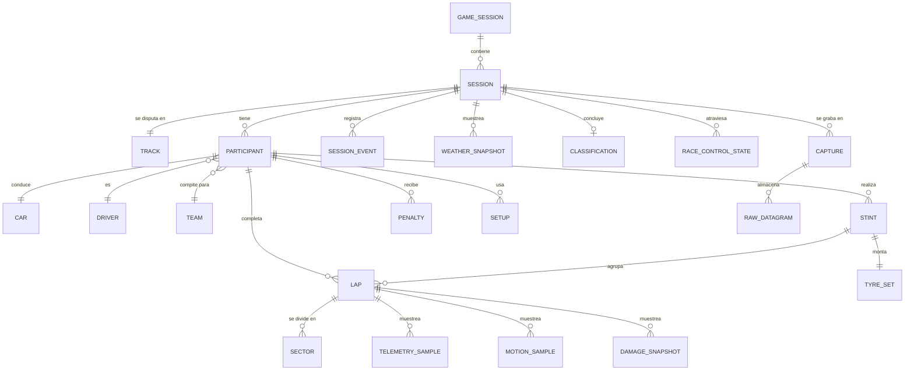

### 19.2. Entidades y su naturaleza temporal

La clasificación por frecuencia no es decorativa: **determina dónde y cómo se persiste cada entidad** (sección 22).

| Entidad | Naturaleza | Frecuencia | Fuente principal |
|---|---|---|---|
| `GameSession` | Estático de agrupación | Una vez | `m_weekendLinkIdentifier`, `m_seasonLinkIdentifier` |
| `Session` | Estático + baja frecuencia | Creación + 2/s | Session (1) |
| `Track` | Estático (catálogo) | — | `m_trackId` + catálogo local |
| `Driver` | Estático (catálogo) | — | `m_driverId` + catálogo local |
| `Team` | Estático (catálogo) | — | `m_teamId` + catálogo local |
| `Participant` | Estático por sesión, revisable | cada 5 s | Participants (4) |
| `Car` | Baja frecuencia | Rate del menú | Car Status (7) |
| `Setup` | Baja frecuencia | 2/s | Car Setups (5) |
| `Lap` | Derivada de eventos | Al completar vuelta | Lap Data (2), Session History (11) |
| `Sector` | Derivada | 3 por vuelta | Lap Data (2), Session History (11) |
| `Stint` | Derivada | Al cambiar neumático | Lap Data (2), Tyre Sets (12) |
| `TyreSet` | Baja frecuencia | ~1,2 s por coche | Tyre Sets (12) |
| `TelemetrySample` | **Alta frecuencia** | hasta 60/s × 24 coches | Car Telemetry (6), Car Status (7), Car Telemetry 2 (16) |
| `MotionSample` | **Alta frecuencia** | hasta 60/s × 24 coches | Motion (0) |
| `MotionExSample` | **Alta frecuencia**, sólo jugador | hasta 60/s | Motion Ex (13) |
| `DamageSnapshot` | Media frecuencia | 10/s | Car Damage (10) |
| `SessionEvent` | Evento discreto | Al ocurrir | Event (3) |
| `Penalty` | Evento discreto | Al ocurrir | Event (3) `PENA` |
| `WeatherSnapshot` | Baja frecuencia | 2/s | Session (1) |
| `RaceControlState` | Estado con transiciones | Al cambiar | Session (1), Event (3) |
| `Classification` | Estático final | Una vez | Final Classification (8) |
| `LapPositionMatrix` | Baja frecuencia | 1/s | Lap Positions (15) |
| `Capture` / `RawDatagram` | Alta frecuencia | Todos | Todos |

### 19.3. Volumen estimado por entidad (sesión de 1 h a 60 Hz, 24 coches)

| Entidad | Filas | Tamaño estimado sin comprimir | Con compresión columnar |
|---|---|---|---|
| `TelemetrySample` | 60 × 3600 × 24 ≈ 5,2 M | ~420 MB | **~35 MB** |
| `MotionSample` | 5,2 M | ~250 MB | **~25 MB** |
| `MotionExSample` | 216 k | ~50 MB | **~6 MB** |
| `DamageSnapshot` | 10 × 3600 × 24 ≈ 864 k | ~60 MB | **~5 MB** |
| `Lap` | < 2000 | < 1 MB | despreciable |
| `SessionEvent` | < 5000 | < 1 MB | despreciable |
| **Total catálogo normalizado** | | ~780 MB | **~70 MB** |
| **Captura cruda `.f1raw`** | ~1,5 M datagramas | ~1,5 GB | **~350–450 MB** (zstd) |

Este cálculo justifica RNF-014 y explica por qué la respuesta a «¿guardar crudo, normalizado o ambos?» es **ambos, pero con políticas de retención distintas** (sección 22.4).

### 19.4. Identidad y claves

| Entidad | Clave primaria | Notas |
|---|---|---|
| `Session` | `sessionUid` + `branchRoot` | El UID del juego basta salvo colisión entre capturas distintas; se le añade un identificador local. |
| `Participant` | `(sessionUid, vehicleIdx)` | **Nunca `vehicleIdx` solo** (RN-004). |
| `Lap` | `(sessionUid, vehicleIdx, lapNumber, branchId)` | `branchId` distingue ramas de flashback. |
| `TelemetrySample` | `(sessionUid, vehicleIdx, overallFrameIdentifier)` | `overallFrameIdentifier` es monótono (RN-002). |
| `Driver` / `Team` / `Track` | `(protocolFormat, id)` | Los catálogos son **por formato**: el mismo número significa cosas distintas en 2025 y 2026. |

### 19.5. Modelo normalizado frente a modelo del protocolo

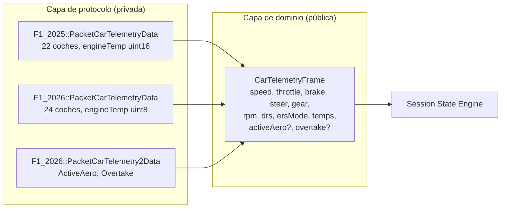

Los campos que sólo existen en un formato se modelan como **opcionales explícitos** (`std::optional` en el núcleo, `null` con marca `UNAVAILABLE` en el transporte), nunca como cero.

### 19.6. Taxonomía obligatoria de procedencia del dato

Toda magnitud expuesta lleva exactamente una de estas etiquetas:

| Etiqueta | Significado | Ejemplo |
|---|---|---|
| **`RAW`** | Valor tal como lo emite el juego, con la única transformación de unidades o desescalado documentada en la especificación. | `speed` en km/h desde Car Telemetry. |
| **`DERIVED`** | Calculado de forma determinista a partir de valores `RAW`, sin suposiciones sobre lo desconocido. | Delta entre vueltas, tiempo por sector acumulado, distancia entre coches. |
| **`ESTIMATED`** | Resultado de un modelo con incertidumbre: ajustes, regresiones, proyecciones. | Pendiente de degradación de un stint, ventana de parada, vueltas restantes de combustible calculadas por PitWall. |
| **`UNAVAILABLE`** | El juego no proporciona ese dato en este contexto. | `Motion Ex` de un rival; Active Aero en formato 2025. |
| **`RESTRICTED`** | Especialización de `UNAVAILABLE`: el dato existe pero su propietario ha decidido no compartirlo. | Desgaste de neumáticos de un rival con *Your Telemetry* restringida. |

Cada métrica `DERIVED` o `ESTIMATED` documenta obligatoriamente: **entradas, fórmula, frecuencia de cálculo y limitaciones** (RF-509). El catálogo completo vive en `docs/05-DATA-MODEL.md`.

---

## 20. Arquitectura conceptual

### 20.1. Evaluación del esquema de partida

El esquema propuesto inicialmente era correcto en su espina dorsal. Se mantiene, con **cuatro correcciones**:

| # | Problema del esquema original | Corrección adoptada |
|---|---|---|
| C1 | Presenta el flujo como una cadena lineal, lo que sugiere acoplamiento síncrono etapa a etapa | Se introducen **fronteras de hilo explícitas** con colas acotadas. La linealidad es lógica, no temporal. |
| C2 | El *Recorder* aparece después del *Session State Engine*, lo que implicaría grabar datos ya procesados | El grabador de crudo se conecta **inmediatamente después del receptor**, antes de decodificar. Grabar lo que llegó, no lo que entendimos (P2). |
| C3 | La base de datos cuelga del bus como un consumidor más, sin política de contrapresión | La persistencia es un consumidor **con cola propia y política de desbordamiento declarada**. Su saturación jamás puede propagarse hacia arriba. |
| C4 | No aparece el motor de replay, que en el esquema original sería un añadido | El *Replay Engine* es una **fuente alternativa** que entra por el mismo punto que el socket. Es el pilar de las pruebas (sección 30). |

### 20.2. Arquitectura adoptada

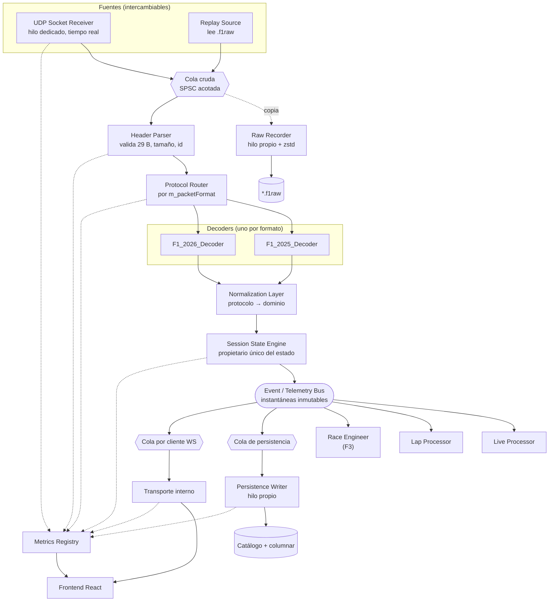

### 20.3. Fronteras de hilo

| Hilo | Responsabilidad | Prohibiciones absolutas |
|---|---|---|
| **T1 — Receiver** | `recvfrom` en bucle, validar tamaño mínimo, estampar tiempo monótono, encolar | E/S de disco, red saliente, bloqueos compartidos, asignación dinámica |
| **T2 — Pipeline** | Cabecera, enrutado, decodificación, normalización, estado, publicación en el bus | E/S de disco, red saliente |
| **T3 — Recorder** | Escribir y comprimir la captura cruda | Devolver contrapresión a T1 |
| **T4 — Persistence** | Escribir catálogo y series columnares | Devolver contrapresión a T2 |
| **T5 — Transporte** | Serializar y transmitir a la interfaz | Devolver contrapresión a T2 |
| **T6 — Analytics** (F3) | Reglas y cálculos pesados | Modificar el estado |

Regla estructural: **el flujo de contrapresión nunca sube.** Si T4 o T5 se atascan, descartan según su política declarada y lo contabilizan; jamás frenan a T2, y mucho menos a T1.

### 20.4. Justificación frente a las alternativas consideradas

| Alternativa | Descripción | Por qué se descarta |
|---|---|---|
| **Monohilo con bucle de eventos** | Todo en un hilo asíncrono | Simple, pero cualquier operación de disco o un cliente lento introducen jitter directamente en la recepción. Viola RNF-050. |
| **Actores con paso de mensajes generalizado** | Cada componente un actor con buzón | Escala bien conceptualmente, pero añade indirección y coste de asignación en el camino caliente para un problema de un único emisor. |
| **Pipeline con colas acotadas (adoptada)** | Hilos dedicados por etapa, SPSC, políticas explícitas | Ajusta al patrón real: un productor rápido y constante, varios consumidores de velocidades muy distintas. Es además la forma en que se diseñan las adquisiciones de telemetría reales. |
| **Todo en el frontend** | El backend sólo reenvía crudo | Traslada el parseo binario y el estado al motor web. Imposible cumplir RNF-004 y hace inviable la persistencia. |

### 20.5. Estructura del decoder de protocolo

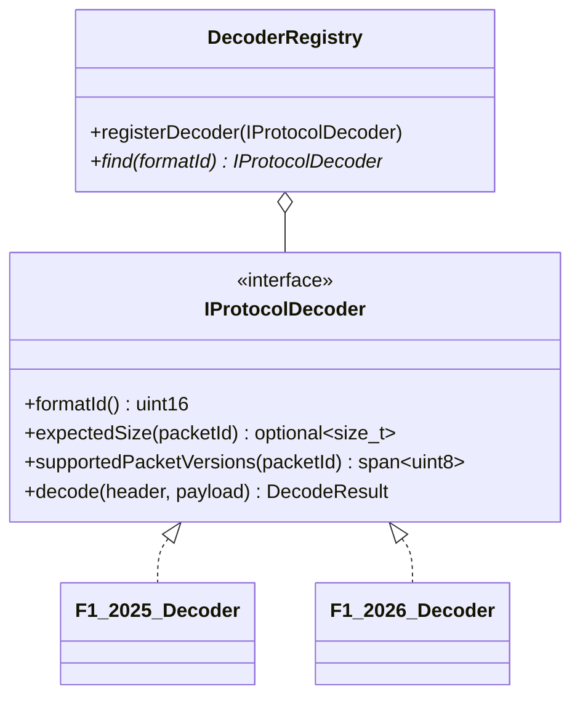

Propiedades exigidas:

- Un decoder **no conoce** al dominio; produce estructuras de su propio espacio de nombres.
- La normalización es una función libre por formato: `normalize(const F1_2026::PacketX&) -> domain::Y`. Es el único punto donde conviven ambos mundos.
- Los tamaños se declaran una sola vez y se verifican **en tiempo de compilación**:

```cpp
static_assert(sizeof(F1_2026::PacketCarTelemetryData) == 1448,
              "Tamano de Car Telemetry 2026 distinto del oficial");
```

Este `static_assert` es, literalmente, la prueba de protocolo pedida en la sección 16 del enunciado, y se ejecuta en cada compilación sin coste.

### 20.6. Cómo se absorbe un cambio de protocolo

| Cambio de EA | Qué se toca | Qué **no** se toca |
|---|---|---|
| Cambia el tamaño de un paquete | La constante y el struct del formato | Todo lo demás |
| Se añade un campo al final de un struct | El struct, la normalización y —si es útil— el modelo de dominio como opcional | Receptor, estado, persistencia, transporte |
| Sube el `m_packetVersion` de un paquete | La lista de versiones soportadas y, si cambió el layout, una variante del struct | Receptor, dominio |
| Aparece un `packetId` nuevo | Un struct, su normalización y su registro | Receptor (lo ignora por RNF-042 hasta entonces) |
| Aparece un **formato 2027** | Un decoder nuevo, sus catálogos y su registro | **Nada más** (RNF-040) |

---

## 21. Flujos principales

### 21.1. Flujo de un datagrama en directo

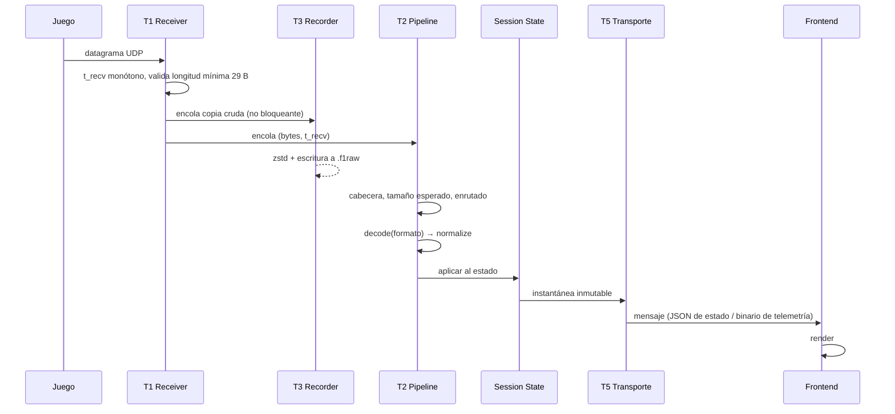

### 21.2. Flujo de arranque y detección

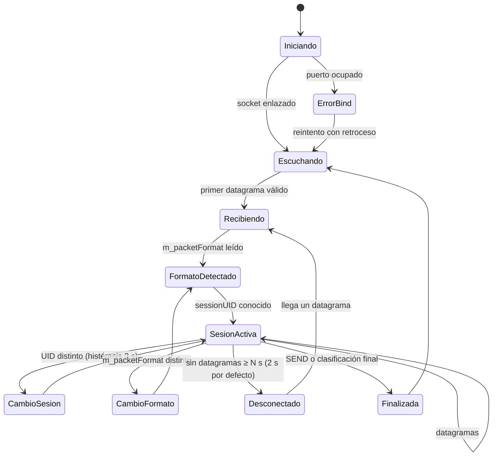

### 21.3. Flujo de flashback

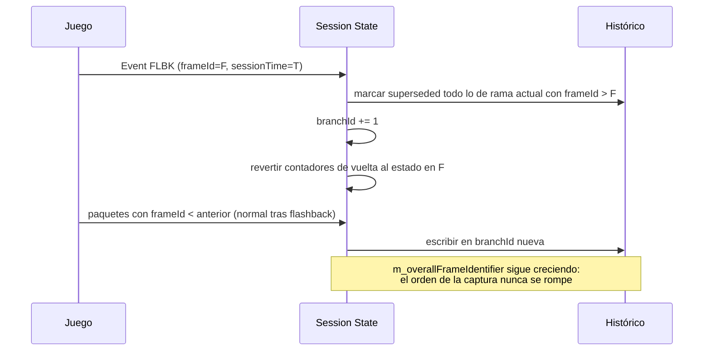

### 21.4. Flujo de cierre de vuelta

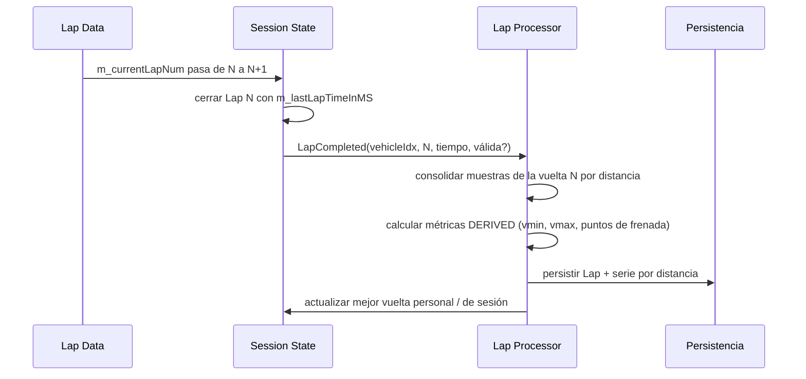

---

## 22. Requisitos de persistencia

### 22.1. Decisión: ¿crudo, normalizado o ambos?

**Ambos**, con propósitos y ciclos de vida distintos. El análisis:

| Opción | Ventajas | Inconvenientes | Veredicto |
|---|---|---|---|
| **A) Sólo UDP crudo** | Fidelidad absoluta; permite reprocesar todo con decoders futuros; formato trivial de escribir | Consultar «la vuelta 12 de Leclerc» exige reproducir la sesión entera; ~1,5 GB/h | Insuficiente por sí solo |
| **B) Sólo normalizado** | Consultas inmediatas, compacto, apto para análisis | Se pierde para siempre lo que el normalizador de hoy no entendió; un fallo del decoder es irreversible | Insuficiente por sí solo |
| **C) Ambos** | Fidelidad **y** consultabilidad; permite RF-413 (reproceso) | Más espacio y más código | **Adoptada** |

La clave que resuelve el coste de C es que **no tienen por qué retenerse igual de tiempo**: el crudo es el negativo fotográfico (voluminoso, se archiva o se descarta), el normalizado es la copia de trabajo (compacta, se conserva).

### 22.2. Capas de almacenamiento

| Capa | Contenido | Formato | Retención por defecto |
|---|---|---|---|
| **L0 — Captura cruda** | Datagramas tal cual, con marca de tiempo | `.f1raw` propio, registros autodelimitados, zstd | 10 sesiones más recientes o 20 GB |
| **L1 — Catálogo** | Sesiones, participantes, vueltas, sectores, stints, eventos, penalizaciones, clasificación | Base de datos embebida transaccional | Indefinida (< 1 MB por sesión) |
| **L2 — Series de alta frecuencia** | Muestras de telemetría, movimiento y daños | Columnar comprimido, particionado por sesión y coche | Configurable, por defecto 50 GB en total |
| **L3 — Caché derivada** | Trazados de circuito reconstruidos, vueltas remuestreadas, métricas por vuelta | Ficheros derivados, regenerables | Se puede borrar sin pérdida |

### 22.3. Formato de captura cruda `.f1raw`

Requisitos del formato (el diseño detallado está en `docs/07-RECORDING-AND-REPLAY.md`):

- Cabecera con número mágico, versión del formato, fecha UTC, formato UDP observado, versión del juego, configuración de recepción y campo reservado.
- Registro: `[uint32 longitud][uint64 t_recv_ns][uint16 origen][bytes]`. La longitud precede a los datos para permitir recuperación tras truncamiento (RF-403).
- Compresión zstd **por bloques**, no del fichero entero, para permitir búsqueda temporal (RF-408).
- Puntos de sincronización cada N segundos con el desplazamiento del bloque y una instantánea del estado, para acelerar el *seek*.

### 22.4. Requisitos transversales

| ID | Requisito |
|---|---|
| PER-01 | Ninguna escritura ocurre en T1 ni en T2. |
| PER-02 | Toda escritura pasa por una cola acotada con política de desbordamiento declarada. |
| PER-03 | El catálogo es transaccional: una caída no lo deja incoherente. |
| PER-04 | Las series de alta frecuencia se escriben por lotes, nunca fila a fila. |
| PER-05 | El esquema del catálogo está versionado y tiene migraciones idempotentes. |
| PER-06 | Toda captura registra la versión de PitWall que la generó. |
| PER-07 | El borrado por retención se registra en el log y es reversible durante 24 h (papelera). |
| PER-08 | El usuario puede marcar una sesión como protegida frente a retención. |

---

## 23. Requisitos de tiempo real

| ID | Requisito |
|---|---|
| RT-01 | El transporte a la interfaz separa **canales** con garantías distintas: `state` (fiable, ordenado, coalescible), `telemetry` (mejor esfuerzo, coalescible, binario), `events` (fiable, **no coalescible**). |
| RT-02 | El ritmo de emisión a la interfaz es independiente del ritmo UDP y negociable por el cliente. |
| RT-03 | Bajo saturación se reduce la frecuencia de las muestras, **nunca** se acumula retraso (RF-304). |
| RT-04 | Los eventos se entregan siempre: un incidente, una penalización o una bandera no pueden descartarse. |
| RT-05 | Cada mensaje lleva `overallFrameIdentifier` y una marca de tiempo del servidor, para que la interfaz pueda mostrar la antigüedad del dato. |
| RT-06 | La interfaz nunca extrapola posiciones ni valores más allá de un umbral configurable; pasado ese umbral, atenúa y avisa. |
| RT-07 | La telemetría de alta frecuencia se transmite en binario compacto con esquema versionado. |
| RT-08 | Al conectarse, un cliente recibe una instantánea completa antes que cualquier mensaje incremental. |
| RT-09 | El servidor tolera clientes lentos sin degradar a los rápidos: una cola por cliente. |
| RT-10 | La latencia extremo a extremo se mide de forma continua y se expone en *Diagnostics*. |

---

## 24. Requisitos de replay

| ID | Requisito |
|---|---|
| RP-01 | El replay es **indistinguible** del directo para todo lo que está aguas abajo del receptor. |
| RP-02 | Reproduce el orden original de forma exacta. |
| RP-03 | Reproduce los intervalos originales con error p95 < 5 ms a velocidad 1×. |
| RP-04 | Velocidades 0,25× / 0,5× / 1× / 2× / 4× / máxima. |
| RP-05 | Pausa, reanudación y avance fotograma a fotograma. |
| RP-06 | Búsqueda temporal apoyada en puntos de sincronización. |
| RP-07 | Modo de inyección real por socket UDP, para probar el receptor de extremo a extremo y para alimentar aplicaciones de terceros. |
| RP-08 | Reproducir dos veces la misma captura produce **exactamente** el mismo estado final. Es la propiedad que hace fiables las pruebas de regresión. |
| RP-09 | Una captura truncada se reproduce hasta el último registro íntegro, con aviso. |
| RP-10 | El replay indica su progreso, su velocidad efectiva y si va por detrás del ritmo objetivo. |
| RP-11 | Los fixtures de paquetes individuales se extraen de capturas reales mediante una herramienta del proyecto. |
| RP-12 | Existe un generador sintético capaz de producir casos imposibles de capturar de forma fiable: truncamientos, tamaños erróneos, formatos desconocidos, flashbacks encadenados, cambio de formato en caliente. |

---

## 25. Seguridad

Aunque el sistema sea local, el receptor UDP es una superficie de ataque real: **cualquier proceso de la máquina, y cualquier equipo de la LAN si se escucha en `0.0.0.0` para recibir de una consola, puede enviar bytes arbitrarios a ese puerto**.

El cambio a aplicación de escritorio **reduce** la superficie total: desaparece el servidor HTTP, desaparece la posibilidad de exponer la interfaz a la red, y el único consumidor del transporte interno es el WebView2 del propio proceso.

| ID | Requisito | Ataque que mitiga |
|---|---|---|
| SEC-01 | Todo dato entrante es no confiable, sin excepción | Base de todo lo demás |
| SEC-02 | Comprobación de tamaño mínimo antes de leer la cabecera | Lectura fuera de límites |
| SEC-03 | Comprobación de tamaño exacto antes de interpretar el cuerpo | Lectura fuera de límites, confusión de tipos |
| SEC-04 | Validación de `m_packetId` contra el rango del formato | Índice fuera de rango en tablas de despacho |
| SEC-05 | Validación de `m_packetVersion` | Interpretación errónea del layout |
| SEC-06 | Los contadores recibidos (`m_numActiveCars`, `m_numMarshalZones`, `m_numLaps`, `m_numWeatherForecastSamples`…) se **acotan al máximo del formato antes de usarse** | Desbordamiento de índice — el vector de ataque más probable |
| SEC-07 | Sin asignación dinámica cuyo tamaño dependa de un valor recibido | Agotamiento de memoria |
| SEC-08 | Las colas y buffers tienen capacidad máxima fija | Agotamiento de memoria |
| SEC-09 | El almacenamiento tiene límite configurado y comprobación previa a escribir | Agotamiento de disco |
| SEC-10 | Ningún byte recibido se usa para construir rutas de fichero | Recorrido de directorios |
| SEC-11 | Los nombres de participante se tratan como texto UTF-8 no confiable: se validan, se truncan y se escapan al renderizar | Inyección en la interfaz |
| SEC-12 | Ningún dato recibido se ejecuta, evalúa ni deserializa a código | Ejecución de código |
| SEC-13 | El transporte interno escucha sólo en `127.0.0.1`, en puerto efímero, sin opción de exponerlo | Exposición accidental |
| SEC-14 | Token de un solo uso exigido a toda conexión; sólo lo conoce el WebView2 propio | Que otro proceso local lea la telemetría |
| SEC-19 | El WebView2 se configura sin acceso a recursos remotos: la interfaz se sirve por mapeo de host virtual a la carpeta local, y la navegación fuera de ella se bloquea | Carga de contenido externo en el motor web |
| SEC-20 | Los enlaces externos se abren en el navegador del sistema, **nunca dentro del WebView2** | Suplantación dentro de la ventana de la aplicación |
| SEC-21 | La escritura asistida de `hardware_settings_config.xml` (RF-011b) exige consentimiento explícito, hace copia de seguridad previa y se niega con el juego abierto | Corromper la configuración del usuario |
| SEC-15 | Límites por conexión: tamaño de mensaje, suscripciones, conexiones totales | Denegación de servicio |
| SEC-16 | Fuzzing continuo del decoder con corpus semilla real | Descubrimiento de fallos de memoria |
| SEC-17 | Compilación con protecciones del compilador y ejecución de la suite bajo desinfectantes de dirección e hilos en integración continua | Errores de memoria y de concurrencia |
| SEC-18 | Sin privilegios elevados en ningún momento | Escalada de privilegios |

---

## 26. Privacidad, marcas y licencias

### 26.1. Datos personales tratados

| Dato | Origen | Tratamiento |
|---|---|---|
| Nombre o gamertag de otros jugadores | `m_name` de Participants y Lobby Info | Se muestra en local. No se exporta por defecto. Anonimizable al exportar. |
| Plataforma del jugador | `m_platform` | Sólo visualización. |
| Identificadores de red | `m_networkId` | Sólo correlación intra-sesión. Nunca se persiste como identidad. |

### 26.2. Compromisos de privacidad

| ID | Compromiso |
|---|---|
| PRV-01 | Ningún dato sale del equipo. Sin telemetría de producto ni comprobación de actualizaciones automática. |
| PRV-02 | El ajuste *Your Telemetry* de otros jugadores se respeta siempre; no se intenta inferir lo restringido por vías indirectas. |
| PRV-03 | Antes de compartir una captura, la aplicación advierte de que puede contener nombres de jugadores y ofrece anonimizarlos. |
| PRV-04 | La anonimización sustituye nombres por identificadores estables dentro de la captura. |
| PRV-05 | El usuario puede borrar cualquier sesión y sus datos derivados de forma completa y verificable. |

### 26.3. Marcas, licencias y aviso legal

Investigación resumida. **No sustituye a asesoramiento jurídico.**

| Elemento | Situación | Qué hacer |
|---|---|---|
| «EA SPORTS», «Codemasters», «F1», «Formula 1», «FIA» | Marcas registradas de sus titulares. El propio documento oficial recoge el aviso de Formula One Licensing BV y de la FIA `[S1]` | **No usar en el nombre del producto, ni en el dominio, ni en logotipos.** Referirlas sólo de forma nominativa y descriptiva («compatible con EA SPORTS F1 25»), con aviso de no afiliación. |
| Nombres de equipos y pilotos | Bajo licencia | Pueden mostrarse como **datos recibidos del juego**, resueltos desde catálogos numéricos. No distribuir el catálogo como contenido editorial de marca. |
| Logotipos, tipografías, colores corporativos, assets gráficos | Protegidos | **No incluir ninguno en el repositorio.** Los colores de coche que aporta el propio juego (`m_liveryColours`) sí pueden usarse: son un dato de la telemetría. |
| Identidad gráfica de las retransmisiones de F1 | Protegida | Diseño propio obligatorio (RF-611). |
| La especificación UDP de EA | Provista *«under license from EA for reference purposes only»* `[S1]` | **No redistribuir los PDF ni los `.txt` en un repositorio público.** Guardarlos localmente e **enlazar** al hilo oficial. En este proyecto residen en `spec/`, excluido del control de versiones. |
| Datos de sesiones de usuarios | Del usuario | No se recopilan. |

**Aviso legal propuesto para el repositorio:**

> PitWall es un proyecto no oficial creado por aficionados, sin afiliación, patrocinio ni respaldo de Electronic Arts Inc., Codemasters, la Fédération Internationale de l'Automobile ni Formula One World Championship Limited. «EA SPORTS», «F1», «FORMULA 1», «FIA» y los nombres de equipos, pilotos y circuitos son marcas de sus respectivos titulares y se emplean aquí únicamente de forma descriptiva para identificar la compatibilidad del software. Este proyecto no distribuye ningún activo del juego ni la documentación de la especificación UDP de EA, que debe obtenerse desde los canales oficiales.

**Licencias de dependencias:** toda dependencia se verifica antes de adoptarse y debe ser permisiva (MIT, BSD, Apache-2.0, BSL-1.0, zlib o dominio público). Se prohíben las licencias copyleft fuertes en el núcleo. El inventario vive en la sección 34.

---

## 27. Observabilidad

### 27.1. Niveles de log

| Nivel | Uso | Ejemplo |
|---|---|---|
| `TRACE` | Detalle por paquete. **Desactivado salvo depuración dirigida.** | «decodificado id=6 fmt=2026 len=1448» |
| `DEBUG` | Transiciones internas y decisiones | «decoder seleccionado: F1_2026» |
| `INFO` | Hitos del ciclo de vida | «sesión iniciada uid=… circuito=Madrid tipo=Race» |
| `WARN` | Anomalía tolerada | «tamaño inesperado id=7 recibido=1444 esperado=1445 (×12)» |
| `ERROR` | Fallo que degrada funcionalidad | «no se puede escribir la captura: disco lleno» |

**Prohibido registrar cada muestra a `INFO`.** Los mensajes repetitivos se agregan con contador y ventana temporal (RNF-102).

### 27.2. Métricas internas obligatorias

La columna *Estado* distingue lo que ya está conectado en el código de lo que la tabla exige a una
fase posterior: ✅ implementada · ◐ parcial · ⏳ planificada.

| Métrica | Tipo | Etiquetas | Estado |
|---|---|---|---|
| `udp_packets_received_total` | contador | `format`, `packet_id` | ◐ Contador global ✅ F1.1; etiquetas `format` y `packet_id` ⏳ F1.2 (requieren decodificador) |
| `udp_packets_invalid_total` | contador | `reason`: del receptor `truncated`, `oversized`, `socket_error`; del decodificador `bad_size`, `unknown_format`, `unknown_id`, `unknown_version` | ◐ Causas del receptor ✅ F1.1; causas del decodificador ⏳ F1.2 |
| `udp_packets_by_type` | contador | `packet_id` | ⏳ Requiere decodificador |
| `udp_bytes_received_total` | contador | — | ✅ F1.1 |
| `udp_packets_by_source_total` | contador | `source` (`a.b.c.d:puerto`, o `unregistered` si la tabla de orígenes estaba llena) | ✅ F1.1 (ver nota) |
| `udp_bytes_by_source_total` | contador | `source` (ídem) | ✅ F1.1 (ver nota) |
| `udp_packets_by_size_total` | contador | `bytes` (longitud exacta observada) | ✅ F1.1 (ver nota) |
| `udp_pool_exhaustion_total` | contador | — | ✅ F1.1. Veces que T1 pidió un buffer y no había ninguno libre: un **estado**, no un recuento de datagramas perdidos |
| `udp_datagrams_delivered_total` | contador | — | ✅ F1.1. Datagramas encolados en al menos una de las colas `Qraw`/`Qrec` |
| `udp_socket_receive_buffer_bytes` | medidor | — | ✅ F1.1. `SO_RCVBUF` **concedido** por el sistema, no el solicitado (RNF-026) |
| `udp_receiver_state` | medidor | 0 `listening`, 1 `receiving`, 2 `silent` | ✅ F1.1. Estado de la adquisición (RF-012). Describe lo **observado** en el socket, no una conexión: UDP no la tiene |
| `udp_silence_transitions_total` | contador | — | ✅ F1.1. Veces que se pasó de `receiving` a `silent` (RF-012). Ninguna otra transición lo incrementa |
| `udp_datagrams_per_second` | medidor | `packet_id` | ⏳ |
| `udp_estimated_loss_total` | contador | derivado de huecos de `overallFrameIdentifier` | ⏳ |
| `decoder_errors_total` | contador | `format`, `packet_id` | ⏳ |
| `decode_duration_ns` | histograma | `packet_id` | ⏳ |
| `pipeline_queue_depth` | medidor | `queue` | ⏳ |
| `pipeline_dropped_total` | contador | `queue`, `reason` | ◐ `queue=raw` y `queue=rec` con `reason=full` ✅ F1.1; el resto de colas ⏳ |
| `transport_connected` | medidor | 0 o 1: sólo la ventana propia | ⏳ |
| `transport_messages_sent_total` | contador | `channel` | ⏳ |
| `transport_coalesced_total` | contador | `channel` | ⏳ |
| `transport_rejected_total` | contador | `reason` (token inválido, origen ajeno) | ⏳ |
| `samples_persisted_total` | contador | `entity` | ⏳ |
| `recorder_queue_depth` | medidor | — | ⏳ |
| `recorder_bytes_written_total` | contador | `compressed`, `raw` | ⏳ |
| `end_to_end_latency_ms` | histograma | — | ⏳ |
| `session_active` | medidor | `format`, `session_type` | ⏳ |

**Métricas por origen y por tamaño** *(v1.3, F1.1-08/F1.1-09)*. Las tres métricas `*_by_source_total`
y `*_by_size_total` **no se actualizan a través de `MetricsRegistry`**: sus etiquetas sólo se conocen al
recibir, y registrar una métrica nueva toma un mutex y asigna, cosa que T1 no puede hacer (RNF-013).
T1 incrementa contadores **preasignados** (`SourceRegistry`, `DatagramSizeCounts`) y las
`MetricSample` etiquetadas se construyen **fuera del camino caliente**, con
`UdpReceiver::appendMetricSamples()`. La integración con *UDP Diagnostics* y con el volcado de la
aplicación consumirá esas muestras más adelante. Detalle en `06-REALTIME-PIPELINE.md` §2.2.2.

**Cobertura de RF-008.** No está completo: las etiquetas `format` y `packet_id` de
`udp_packets_received_total` requieren el decodificador y quedan para F1.2. Estado por tarea en
`11-IMPLEMENTATION-PLAN.md`, F1.1.

### 27.3. Requisitos

| ID | Requisito |
|---|---|
| OBS-01 | Las métricas son consultables desde la interfaz sin herramientas externas. |
| OBS-02 | El coste de instrumentación es < 1 % de CPU. |
| OBS-03 | Las métricas se exportan a fichero al cerrar la sesión, junto a la captura. |
| OBS-04 | El nivel de log se cambia en caliente. |
| OBS-05 | Los logs se rotan por tamaño y antigüedad. |
| OBS-06 | Todo log lleva marca de tiempo, componente, nivel y —cuando aplique— `sessionUid`. |

---

## 28. Compatibilidad

| Dimensión | Compromiso |
|---|---|
| **Formatos UDP** | 2025 y 2026 soportados plenamente. 2024 y anteriores fuera de alcance (OUT-07), pero el registro de decoders permite añadirlos. |
| **Versiones de juego** | Se registra `m_gameMajorVersion` y `m_gameMinorVersion`; un parche que no altere el layout no requiere cambios. |
| **Compatibilidad hacia atrás de capturas** | Toda captura generada por una versión anterior de PitWall debe seguir siendo reproducible (RNF-044). |
| **Compatibilidad del catálogo** | Migraciones de esquema versionadas e idempotentes. |
| **Sistema operativo** | Windows 10/11 x64 como plataforma principal; Linux x64 como objetivo de compilación secundario. |
| **Motor de interfaz** | **WebView2 Runtime (Evergreen)**, alojado por el propio proceso. Windows 11 lo incluye; en Windows 10 se comprueba y se ofrece instalarlo. No se soporta ningún navegador como forma de uso. |
| **Plataformas de juego** | PC directamente; PS5 y Xbox mediante recepción por LAN. |
| **Coexistencia** | PitWall no monopoliza el puerto: si el usuario necesita alimentar otra herramienta, se documenta el uso de broadcast o el reenvío desde el modo de inyección de replay. |

---

## 29. UI/UX

### 29.0. La ventana

PitWall se presenta como una **aplicación de escritorio de Windows**, no como una página. Eso
implica decisiones concretas:

| Aspecto | Decisión |
|---|---|
| Ventana | Nativa, redimensionable, con barra de título del sistema y su icono propio |
| Tamaño mínimo | 1280 × 720. Por debajo, la interfaz se reorganiza en lugar de recortarse |
| Arranque | La ventana aparece ya escuchando y ya mostrando estado. **Nada que conectar** |
| Menú | Barra de aplicación propia dentro del WebView2, no menú nativo de Windows |
| Ficheros | Diálogos nativos de Windows (RF-631) |
| Enlaces externos | Se abren en el navegador del sistema, nunca dentro de la ventana (SEC-20) |
| Cierre | Confirma si hay una grabación en curso; después cierra de forma ordenada |
| Vocabulario | Nunca aparecen las palabras «servidor», «puerto», «localhost» ni «WebSocket» fuera de *UDP Diagnostics* (RF-633) |

### 29.1. Identidad

Identidad propia inspirada en el muro de boxes y en el instrumental de ingeniería, explícitamente **no** en la gráfica televisiva de la Fórmula 1 (RF-611, 26.3).

- **Tono:** oscuro por defecto, alto contraste, legible de reojo bajo carga cognitiva.
- **Tipografía:** una familia de interfaz legible y una monoespaciada tabular para cifras. Las cifras que cambian usan **anchura tabular** para que no bailen.
- **Color:** semántico y con significado único. Nunca se codifica información **sólo** por color: se acompaña de forma, texto o posición (accesibilidad y RF-612).
- **Densidad:** alta en las vistas de ingeniería, baja en las vistas de conducción.

### 29.2. Pantallas

| # | Pantalla | Propósito | Fase |
|---|---|---|---|
| 1 | **Estado** (antes *Home / Connection*) | Qué se está recibiendo, qué se ha detectado y —si no llega nada— qué falta configurar en el juego | F1 |
| 2 | Live Session | Panorámica: estado de sesión, clima, dirección de carrera, resumen | F1 |
| 3 | Timing Tower | Clasificación completa (CU-04) | F1 |
| 4 | Driver Detail | Todo sobre un coche: telemetría, neumáticos, daños, stint | F1 |
| 5 | Telemetry | Trazas en vivo de alta frecuencia | F1 |
| 6 | Track Map | Mapa reconstruido con coches y zonas | F1 |
| 7 | Tyres | Cuatro esquinas, temperaturas, desgaste, juegos disponibles | F1 |
| 8 | Strategy | Stints, degradación, ventana de parada | F3 |
| 9 | Damage | Daños por zona y desgaste de componentes | F1 |
| 10 | Lap Comparison | Comparación por distancia con delta (CU-10) | F1 |
| 11 | Session History | Catálogo de sesiones y vueltas | F1 |
| 12 | Replay | Controles de reproducción y línea temporal | F1 |
| 13 | Settings | Configuración | F1 |
| 14 | **UDP Diagnostics** | Todo lo que llega por el socket (CU-12) | F1 |

### 29.3. Contenido obligatorio de *UDP Diagnostics*

Estado de conexión · datagramas/s · bytes/s · conteo por `packetId` · formato de paquete observado · versiones de paquete observadas · tamaños observados frente a esperados · paquetes inválidos por causa · pérdidas estimadas · marca de tiempo del último paquete · `sessionUID` · versión del juego · IP y puerto de origen · volcado hexadecimal de los no reconocidos.

Es la pantalla que más veces se usará durante el desarrollo. Se construye en la Fase 1, no al final.

### 29.4. Principios de interacción

| ID | Principio |
|---|---|
| UX-01 | Un dato desconocido se muestra como desconocido. Nunca `0`, nunca `—` sin explicación al pasar el cursor. |
| UX-02 | Todo dato lleva implícita su antigüedad; si supera el umbral, se atenúa. |
| UX-03 | Ningún elemento parpadea ni se anima de forma que distraiga durante la conducción. |
| UX-04 | Las vistas de conducción son legibles a 1 m de distancia. |
| UX-05 | Toda vista funciona con el juego cerrado, mostrando el último estado o el histórico. |
| UX-06 | Los colores de equipo proceden de `m_liveryColours` cuando están disponibles. |
| UX-07 | Teclado completo para las acciones frecuentes. |
| UX-08 | Ningún error técnico se muestra en crudo: siempre con causa probable y acción sugerida. |

---

## 30. Testing

### 30.1. Estrategia

La regla que gobierna toda la estrategia: **debe ser posible desarrollar y validar el 90 % del producto sin abrir el juego** (OBJ-06). Todo lo demás se deriva de ahí.

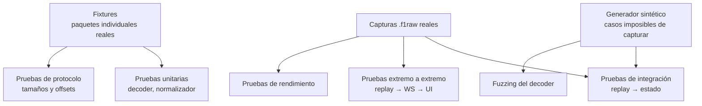

### 30.2. Niveles

| Nivel | Alcance | Criterio |
|---|---|---|
| **Protocolo** | `static_assert` de tamaño para cada struct de cada formato; comprobación de offsets de campos clave | Falla en compilación si algo se desvía de la especificación |
| **Unitario** | Decoders, normalizadores, cálculos derivados, máquina de estados | ≥ 80 % de cobertura (RNF-080) |
| **Integración** | Replay → decoder → normalizador → estado, con verificación del estado final | Determinista y repetible (RP-08) |
| **Extremo a extremo** | Replay → transporte interno → interfaz **dentro del WebView2**, automatizada por el protocolo de depuración remota del propio WebView2 | Las vistas críticas muestran los valores esperados |
| **Replay** | Fidelidad de orden y de intervalos | p95 de error de intervalo < 5 ms |
| **Fuzzing** | Datagramas arbitrarios contra el decoder | Cero caídas, cero errores de memoria, cero asignaciones no acotadas |
| **Rendimiento** | Carga sostenida y ráfagas | RNF-001 … RNF-005 |
| **Regresión de datos** | Una captura de referencia produce siempre el mismo catálogo | Comparación de resumen criptográfico del catálogo normalizado |

### 30.3. Casos obligatorios de casos borde

Cada uno con al menos un fixture o una captura sintética:

Juego cerrado · juego pausado · cambio de sesión · lobby · clasificación → carrera · flashback simple · flashbacks encadenados · flashback sin evento `FLBK` · reinicio de sesión · abandono · DNF · DSQ · Safety Car · VSC · bandera roja · espectador · abandono de jugador · incorporación de jugador · IA sustituyendo a jugador · pantalla partida · pérdida de UDP · paquete truncado · tamaño incorrecto · versión de paquete desconocida · formato desconocido · `sessionUID` duplicado · cambio 2025 ↔ 2026 en caliente · vuelta invalidada · entrada y salida de boxes · telemetría restringida · telemetría que pasa de restringida a pública a mitad de sesión.

### 30.4. Requisitos

| ID | Requisito |
|---|---|
| TST-01 | La suite completa se ejecuta sin el juego instalado. |
| TST-02 | Los fixtures se extraen de capturas reales mediante una herramienta del repositorio y se versionan. |
| TST-03 | Los fixtures se **anonimizan** antes de versionarse (PRV-03). |
| TST-04 | Cada requisito funcional referencia al menos una prueba por su identificador (RNF-085). |
| TST-05 | La integración continua ejecuta compilación, pruebas, desinfectantes y fuzzing corto en cada cambio. |
| TST-06 | Las pruebas de rendimiento se ejecutan de forma programada, no en cada cambio. |
| TST-07 | Una captura de referencia por formato (2025 y 2026) es obligatoria antes de cerrar la Fase 1. |

---

## 31. Criterios de aceptación del MVP

El MVP se considera terminado cuando **todos** los criterios siguientes se cumplen de forma objetiva y demostrable.

### 31.0. Aplicación de escritorio (6)

| # | Criterio | Cómo se demuestra |
|---|---|---|
| A-40 | Doble clic en `PitWall.exe` abre una ventana propia; no se abre ningún navegador | Observación en máquina limpia |
| A-41 | Al abrir la ventana, la recepción UDP ya está activa sin ninguna acción | Contadores de *Diagnostics* desde el arranque |
| A-42 | Al abrir el juego, la aplicación pasa a *Recibiendo* y detecta formato, sesión y jugador en ≤ 2 s, sin intervención | Cronometrado |
| A-43 | Sin UDP configurado, la ventana explica la causa concreta y los pasos para arreglarlo | Prueba con UDP desactivado en el juego |
| A-44 | Un segundo `PitWall.exe` activa la ventana existente y no abre otra | Observación |
| A-45 | Ninguna pantalla salvo *Diagnostics* muestra puerto, URL, `localhost` ni WebSocket | Revisión de las 8 pantallas |

### 31.1. Núcleo (8)

| # | Criterio | Cómo se demuestra |
|---|---|---|
| A-01 | Recibe UDP en el puerto configurable con bind configurable | Recepción desde `127.0.0.1` y desde otra máquina de la LAN |
| A-02 | Decodifica los 16 paquetes del formato 2025 | Pruebas de protocolo en verde + captura real procesada |
| A-03 | Decodifica los 17 paquetes del formato 2026 | Ídem |
| A-04 | Detecta el formato automáticamente y conmuta en caliente | Captura sintética con cambio de formato |
| A-05 | Ningún datagrama válido se descarta en 1 h a 60 Hz | Contadores al final de la sesión |
| A-06 | Ningún datagrama malformado provoca caída | Campaña de fuzzing de 1 h sin fallos |
| A-07 | La telemetría restringida se presenta como restringida, nunca como cero | Captura multijugador real o sintética |
| A-08 | Un flashback no corrompe el histórico ni duplica vueltas | Captura con flashback; recuento correcto |

### 31.2. Funcionalidad (11)

| # | Criterio |
|---|---|
| A-10 | La torre de tiempos muestra posición, vueltas, últimos tiempos, mejores tiempos, sectores, intervalos, neumáticos, paradas, penalizaciones y banderas |
| A-11 | El panel de telemetría muestra todos los canales disponibles del coche seleccionado |
| A-12 | Existe la vista de neumáticos y la de daños, con orden de ruedas RL, RR, FL, FR |
| A-13 | El mapa de pista se reconstruye desde telemetría, sin imágenes precargadas, y muestra los 24 coches |
| A-14 | En formato 2026, Active Aero y Overtake Mode se muestran con estado y distancia de activación |
| A-15 | Los eventos de sesión aparecen en un registro cronológico consultable |
| A-16 | Una sesión completa se graba automáticamente y aparece en el histórico |
| A-17 | Una sesión grabada se reproduce a las seis velocidades |
| A-18 | Dos vueltas se comparan alineadas por distancia con delta y al menos 8 canales |
| A-19 | La pantalla *UDP Diagnostics* muestra los 13 indicadores exigidos |
| A-20 | Todos los valores llevan su etiqueta de procedencia visible |

### 31.3. Calidad (10)

| # | Criterio | Umbral |
|---|---|---|
| A-30 | Latencia UDP → píxel | p95 < 150 ms |
| A-31 | CPU del núcleo a 60 Hz | < 5 % de un núcleo |
| A-32 | Memoria del núcleo tras 1 h | < 300 MB, sin crecimiento monótono |
| A-33 | Cobertura de decoder, normalizador y estado | ≥ 80 % |
| A-34 | Suite completa ejecutable sin el juego | 100 % |
| A-35 | Compilación limpia con `/W4` y desinfectantes | Sin advertencias ni hallazgos |
| A-36 | Instalación desde cero siguiendo el README | < 10 min |
| A-37 | Documentación de las 18 secciones al día | Revisión |
| A-38 | El instalador deja la aplicación funcionando en una máquina limpia con Windows 11 | Prueba en máquina virtual limpia |
| A-39 | En una máquina sin WebView2 Runtime, la aplicación lo explica en lugar de fallar | Prueba en Windows 10 limpio |

**El MVP no incluye:** ingeniero de carrera, estrategia, IA, exportación, reproceso de capturas, comparación de más de dos vueltas ni instalador (el MVP se distribuye como carpeta portable; el instalador es de la fase V1).

---

## 32. Riesgos

| ID | Riesgo | Prob. | Impacto | Exposición | Mitigación |
|---|---|---|---|---|---|
| **RSK-01** | EA publica una revisión que cambia el layout binario a mitad del desarrollo | Media | Alto | **Alta** | Decoders aislados y registrados; `static_assert` de tamaños; *Diagnostics* muestra tamaños observados frente a esperados y alerta ante un patrón sostenido. |
| **RSK-02** | Un formato 2027 deja obsoleto el 2025 en el juego | Baja (a 12 meses) | Medio | Media | RNF-040: añadir un decoder no toca el dominio. Las capturas antiguas siguen siendo reproducibles. |
| **RSK-03** | Las fuentes oficiales se contradicen (11.3) y se implementa la equivocada | **Alta** (ya ocurrida) | Medio | **Alta** | Regla RN-015: prevalece el PDF de mayor versión. Fixtures reales como árbitro final. |
| **RSK-04** | Sobrecoste de aprendizaje de C++ moderno y concurrencia | Media | Medio | Media | Plan de fases pedagógico (`docs/11-IMPLEMENTATION-PLAN.md`); herramientas de análisis desde la Fase 1; alcance del MVP acotado. |
| **RSK-05** | El volumen de almacenamiento desborda el disco | Media | Medio | Media | Compresión zstd, retención por defecto, límite comprobado antes de escribir, aviso en la interfaz. |
| **RSK-06** | Errores de memoria en el parseo binario | Media | **Alto** | **Alta** | Comprobación estricta de tamaños, `std::span` en lugar de punteros, fuzzing continuo, desinfectantes en integración continua. |
| **RSK-07** | Condiciones de carrera difíciles de reproducir | Media | Alto | Alta | Propiedad única del estado, colas de un productor y un consumidor, ThreadSanitizer, replay determinista para reproducir el fallo. |
| **RSK-08** | Sobreingeniería que retrasa el MVP | **Alta** | Medio | **Alta** | Definition of Done por fase; lo que no está en el MVP no se construye; los puntos de extensión se dejan preparados pero vacíos. |
| **RSK-09** | La interfaz no sostiene 60 fps con 24 coches y gráficas densas | Media | Medio | Media | Transporte binario, coalescing, biblioteca de gráficas de alto rendimiento, decimado por nivel de detalle. |
| **RSK-10** | Imposibilidad de probar escenarios raros por falta de capturas | Alta | Medio | Alta | Generador sintético (RP-12) como parte del MVP. |
| **RSK-11** | Uso indebido de marcas en un repositorio público | Baja | Alto | Media | Reglas de 26.3, aviso legal, `spec/` fuera del control de versiones. |
| **RSK-12** | Un jugador interpreta datos restringidos como reales y toma decisiones erróneas | Media | Medio | Media | RN-001 tratada como defecto bloqueante; distinción visual obligatoria. |
| **RSK-13** | El WebView2 Runtime no está presente en la máquina del usuario (Windows 10 antiguo) | Media | Medio | Media | Comprobación al arrancar (RF-632), instalador que lo verifica (RNF-095) y mensaje accionable. Como último recurso, distribución de versión fija del runtime. |
| **RSK-14** | El transporte binario de alta frecuencia se comporta peor dentro del WebView2 que en un navegador | Baja | Medio | Baja | Se conserva un socket en bucle local en lugar del paso de mensajes del WebView2, precisamente para tener tramas binarias nativas. Verificación medida en la fase F1.6b (Q-10). |
| **RSK-15** | La automatización de pruebas de extremo a extremo dentro del WebView2 resulta más frágil que en un navegador | Media | Bajo | Baja | Depuración remota del WebView2 verificada en F1.6b (Q-11). Alternativa: ejecutar las pruebas de interfaz contra la misma compilación servida en modo desarrollo. |

---

## 33. Suposiciones

| ID | Suposición | Si resulta falsa |
|---|---|---|
| **AS-01** | La cabecera de 29 bytes se mantendrá estable en futuros formatos | La detección automática requeriría heurística por tamaño; el impacto se limita al enrutador. |
| **AS-02** | `m_overallFrameIdentifier` es efectivamente monótono en todos los escenarios, incluidos reinicios de sesión | Habría que introducir un contador propio de recepción como ordenador principal. Se verificará en la Fase 1 con capturas reales. |
| **AS-03** | Todos los paquetes mantienen `m_packetVersion = 1` en ambos formatos | RF-006 ya cubre el caso; sólo cambia la advertencia. |
| **AS-04** | El juego emite a un ritmo estable y respeta la agrupación por fotograma | La agrupación de RF-209 pasaría a ser aproximada, sin afectar al resto. |
| **AS-05** | El disco del usuario admite escritura sostenida de ~10 MB/s | La grabación se degradaría; hay política de desbordamiento y aviso. |
| **AS-06** | Un único juego emite al puerto configurado | RF-009 (filtro por origen) resuelve el caso contrario. |
| **AS-07** | El usuario dispone de F1 25 con el 2026 Season Pack para las pruebas finales | El desarrollo sigue siendo posible con el generador sintético; sólo se retrasa la validación con datos reales. |
| **AS-08** | Los catálogos de equipos, pilotos y circuitos cambian con las temporadas, pero no su estructura | Bastaría regenerar tablas de datos, no código. |
| **AS-09** | Las capturas anonimizadas son suficientes como fixtures compartibles | Habría que generar todos los fixtures sintéticamente. |

---

## 34. Dependencias

### 34.1. Dependencias externas al proyecto

| Dependencia | Naturaleza | Riesgo |
|---|---|---|
| Especificación UDP oficial de EA | Documental, licenciada para referencia | Puede cambiar sin previo aviso (RSK-01) |
| EA SPORTS F1 25 + 2026 Season Pack | Fuente de datos | Necesario sólo para validación final |
| Toolchain de C++20/23 en Windows | Herramienta | Estable |

### 34.2. Decisión sobre el decoder: propio frente a librería

Análisis exigido por la sección 29 del enunciado.

| Criterio | Decoder propio | Librería existente |
|---|---|---|
| Soporte del formato 2026 | Completo, bajo nuestro control | Sólo una opción madura, y en C# `[S6]`, ajena a nuestro stack |
| Coste inicial | Alto: ~17 structs × 2 formatos | Bajo si existiera para C++ |
| Coste de mantenimiento | Medio, pero **predecible**: los cambios de EA son transcripciones directas (13.4) | Depende de un tercero; si abandona, el coste se dispara en el peor momento |
| Trazabilidad a la especificación | **Total**: cada struct es una transcripción verificable línea a línea | Indirecta |
| Ajuste al objetivo formativo (OBJ-T1, OBJ-T3) | **Máximo** | Nulo |
| Control de la seguridad de memoria | Total | Delegado |
| Licencia | Sin restricción | Verificable, pero una restricción más |

**Decisión: decoder propio.** La razón determinante no es el rendimiento ni el orgullo de artesano, sino que **no existe una librería madura de C++ con soporte del formato 2026**, y que el protocolo consiste en structs `packed` de tamaño fijo —exactamente el caso en que C++ ofrece una transcripción literal de la especificación verificada por el compilador. Registrado como `ADR-004`.

### 34.3. Dependencias técnicas previstas

Todas deben ser de licencia permisiva (26.3). La selección definitiva se cierra en `docs/15-ADR.md`; aquí se fija el **rol** y el **criterio**, no la marca.

| Rol | Criterio de selección | Candidatos evaluados |
|---|---|---|
| Sistema de construcción y dependencias | Manifiesto reproducible, buen soporte en Windows con MSVC | CMake + gestor de paquetes por manifiesto |
| Red asíncrona y transporte interno | Madurez, documentación, licencia permisiva, integración con el modelo de hilos | Biblioteca de E/S asíncrona consolidada con capa de sockets de mensajes |
| Registro de logs | Estructurado, asíncrono, bajo coste | Biblioteca de logging de cabeceras |
| Serialización JSON (control) | Sólo canal de control y configuración, no camino caliente | Biblioteca JSON permisiva |
| Compresión | Buena relación velocidad/ratio en streaming | zstd |
| Base de datos embebida (catálogo) | Transaccional, sin servidor, formato estable a largo plazo | SQLite |
| Motor analítico y columnar | Lectura y escritura columnar, consultas analíticas embebidas | DuckDB / Parquet |
| Pruebas | Expresivo, buena integración con CMake | Marco de pruebas de C++ permisivo |
| Anfitrión de la interfaz | WebView2 con SDK de C++, alojado por el shell (ADR-002 v2) | — |
| Frontend | React 19 + TypeScript + Vite | — |
| Gráficas de alta frecuencia | Capaz de 100 000 puntos a 60 fps, no basado en SVG | Biblioteca de gráficas sobre canvas |
| Estado del frontend | Ligero, sin repintados innecesarios | Gestor de estado minimalista |

### 34.4. Dependencias entre componentes internos

Grafo dirigido acíclico verificado automáticamente (RNF-084):

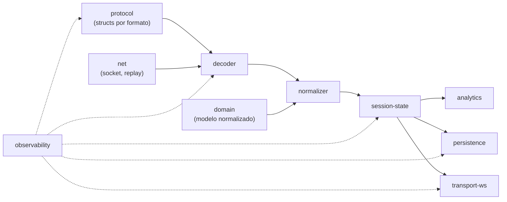

`domain` **no depende de nada**. `protocol` no depende de `domain`. Ésta es la propiedad que se verifica de forma automatizada, porque es la que se rompe primero cuando hay prisa.

---

## 35. Preguntas abiertas

| ID | Pregunta | Impacto | Cómo se resolverá | Plazo |
|---|---|---|---|---|
| **Q-01** | ¿`m_overallFrameIdentifier` es monótono también entre sesiones, o se reinicia? | Alto: es el ordenador temporal principal (RN-002) | Medición sobre capturas reales de dos sesiones consecutivas | Fase 1 |
| **Q-02** | ¿Cuál es la lista exacta de valores de *UDP Send Rate* del menú? | Bajo: se mide el ritmo real (RF-801) | Inspección en el juego | Fase 1 |
| **Q-03** | ¿Qué valores exactos toma `m_recommendedSession` en Tyre Sets? La especificación remite a un apéndice que no lo enumera explícitamente | Bajo | Observación empírica y contraste con tipos de sesión | Fase 2 |
| **Q-04** | ¿Emite el juego `Motion` con posiciones válidas durante el Safety Car y la vuelta de formación? | Medio: afecta al mapa | Captura real | Fase 2 |
| **Q-05** | ¿Cómo se comporta `m_sessionUID` ante un reinicio de sesión sin salir al menú? | Medio: afecta a RN-003 | Captura real | Fase 1 |
| **Q-06** | ¿Con 24 coches, el ciclado de `Session History` cubre a todos o prioriza a algunos? | Medio: afecta a la antigüedad mostrada (RN-010) | Medición de intervalos por `m_carIdx` | Fase 2 |
| **Q-07** | ¿Los eventos `PMEN`/`OVEN` son globales de la sesión o por vehículo? El PDF no lo detalla | Medio | Captura real en sesión 2026 | Fase 2 |
| **Q-08** | ¿Qué precisión tiene la reconstrucción del trazado en circuitos con cambios de elevación fuertes (Spa, Austria)? | Bajo | Prueba comparativa | Fase 3 |
| **Q-09** | ¿Conviene exponer un modo de reenvío para coexistir con otras herramientas en el mismo puerto? | Bajo | Decisión de producto | Fase 3 |
| **Q-10** | ¿Sostiene el WebView2 el caudal binario de telemetría a 60 Hz con el mismo rendimiento que un navegador? | Medio | Medición en la fase F1.6b con una captura real | Fase 1 |
| **Q-11** | ¿Permite la depuración remota del WebView2 automatizar las pruebas de extremo a extremo con las herramientas previstas? | Medio | Prueba de concepto en F1.6b | Fase 1 |
| **Q-12** | ¿Basta el runtime Evergreen o hará falta distribuir una versión fija para máquinas sin conexión? | Bajo | Prueba de instalación en Windows 10 limpio | Fase 4 |

---

## 36. Roadmap de alto nivel

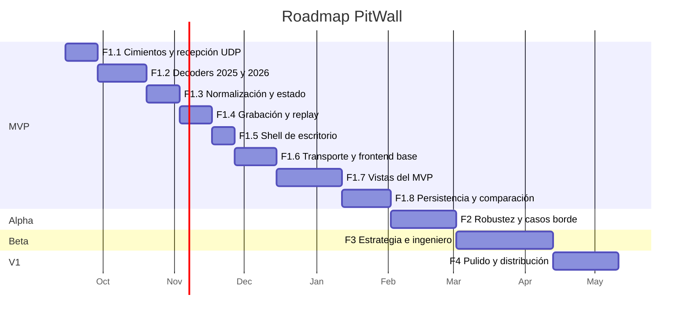

| Hito | Contenido | Criterio de salida |
|---|---|---|
| **MVP** | **Aplicación de escritorio con ventana propia**, recepción automática, ambos decoders, estado, grabación, replay, live timing, telemetría, mapa, neumáticos, daños, comparación de dos vueltas, diagnósticos | Los **35 criterios** de la sección 31 |
| **Alpha** | Todos los casos borde de 30.3 cubiertos; fuzzing continuo; retención; estado de ventana; configuración asistida del XML | Cero defectos críticos abiertos; 24 h de sesión continua sin degradación |
| **Beta** | Estrategia, stints, degradación, motor de reglas del ingeniero, exportación | Las reglas producen conclusiones verificables sobre capturas conocidas |
| **V1** | **Instalador de Windows**, comprobación del WebView2 Runtime, documentación de usuario, rendimiento pulido, accesibilidad | Un tercero instala y usa PitWall sin ayuda ni conocimientos técnicos |
| **Futuro** | Formato 2027, multi-dispositivo, traducción a lenguaje natural, fuente secundaria opcional | Por definir |

---

## 37. Fuentes y referencias

Todas las fuentes se consultaron el **11 de septiembre de 2026**. Las oficiales prevalecen en caso de conflicto (RN-015).

### Official

| ID | Título | Origen | Uso |
|---|---|---|---|
| **`[S1]`** | **`Data Output from F1® 25: 2026 Season Pack` — Version 1.2 (Season 8 "Sports Update")** | Adjunto 10 del hilo `forums.ea.com/blog/f1-games-game-info-hub-en/…/12187347` | **Fuente de verdad del formato 2026.** Structs, tamaños, frecuencias, FAQ, apéndices, datos restringidos, configuración UDP y XML, changelog 2025→2026. |
| `[S2]` | `2026 Season Pack Telemetry Output Structures.txt` | Adjunto 8 del mismo hilo | Transcripción de structs 2026. **Desactualizado respecto a `[S1]`** (11.3). |
| `[S3]` | `Data Output from F1® 25 Game` — v3 | Adjunto 4 del mismo hilo | Fuente de verdad del formato 2025: tamaños, frecuencias, apéndices, changelog 2024→2025. |
| `[S4]` | `F1 25 Telemetry Output Structures.txt` | Adjunto 5 del mismo hilo | Transcripción de structs 2025. Base del diff 2025↔2026. |
| `[S5]` | Hilo oficial *EA SPORTS™ F1®25: 2026 Season Pack UDP SPECIFICATION* | `forums.ea.com/blog/f1-games-game-info-hub-en/…/12187347` | Localización y versionado de los adjuntos. |
| `[S14]` | Hilo de discusión *[DISCUSSION] F1® 25 UDP SPECIFICATION* | `forums.ea.com/discussions/f1-25-general-discussion-en/…/12187351` | Canal oficial de preguntas sobre la especificación. |

### Libraries

| ID | Título | URL | Uso |
|---|---|---|---|
| `[S6]` | `F1Game.UDP` 26.0.0 — MIT, publicada 2026-06-18, .NET 8/9/10 | `nuget.org/packages/F1Game.UDP` · `github.com/volodymyr-fed/F1Game.UDP` | Única librería madura verificada con soporte del layout 2026. Referencia del patrón `bytes → struct` y de la convención de versionado por año. |
| `[S7]` | `@racehub-io/f1-telemetry-client` — MIT | `github.com/racehub-io/f1-telemetry-client` | Referencia de diseño de API de eventos. Sin soporte 2025/2026. |
| `[S8]` | `@deltazeroproduction/f1-udp-parser` | `npmjs.com/package/@deltazeroproduction/f1-udp-parser` | Cobertura del formato 2025 en TypeScript. |

### Reference implementations

| ID | Proyecto | Uso |
|---|---|---|
| `[S15]` | `mathieu-lemay/f1-telemetry-rs` | Separación decoder/dominio en lenguaje sin recolector de basura. |
| `[S16]` | `MacManley/f1-25-udp` (ESP32) | Viabilidad del parseo por offsets fijos en entornos muy restringidos. |
| `[S17]` | `f1-telemetry` (PyPI, jun-2026) | Arquitectura con base de datos de series temporales. |

### Community / Issues

Usadas **exclusivamente** para descubrir problemas prácticos, nunca como fuente de especificación (regla de prioridad de fuentes).

| ID | Referencia | Uso |
|---|---|---|
| `[S9]` | Guías de configuración de terceros sobre F1 25 / F1 26 UDP | Comportamiento del formato por defecto; degradación al usar formato 2025 con contenido 2026; puerto compartido por varias aplicaciones. |
| `[S10]` | Reporte *SF1000 telemetry not working after release of F1 26* — `forums.ea.com/idea/f1-25-bug-reports-en/…/13457278` | Señal de riesgo: herramientas rotas tras el Season Pack. |
| `[S11]` | Reporte *Fanatec incorrect telemetry reading [2026 SP]* — `forums.ea.com/idea/f1-25-bug-reports-en/…/13472195` | Señal de riesgo sobre lecturas incorrectas. |
| `[S12]` | Documentación de SIMRIG para F1 25 (PC) | Referencia de valores de send rate empleados en la práctica. |
| `[S13]` | Preguntas frecuentes de F1Laps sobre ajustes UDP de F1 25 / F1 26 | Ídem, y confirmación de la degradación con formato 2025. |

---

## Anexo A. Trazabilidad requisito → caso de uso → prueba

| Requisito | Casos de uso | Nivel de prueba |
|---|---|---|
| RF-001 … RF-012 | CU-01, CU-12 | Unitario, integración, rendimiento |
| RF-100 … RF-112 | CU-01, CU-02 | Protocolo, unitario, fuzzing |
| RF-200 … RF-215 | CU-03, CU-16, CU-17, CU-18 | Unitario, integración |
| RF-300 … RF-309 | CU-04, CU-05 | Integración, extremo a extremo |
| RF-620 … RF-633 | CU-23, CU-03 | Extremo a extremo, manual |
| RF-400 … RF-414 | CU-08, CU-09, CU-20, CU-21 | Integración, replay |
| RF-500 … RF-509 | CU-10, CU-15 | Unitario, extremo a extremo |
| RF-600 … RF-613 | CU-04 … CU-14 | Extremo a extremo |
| RF-700 … RF-708 | CU-15, CU-22 | Unitario |
| RF-800 … RF-806 | CU-12 | Integración |

---

## Anexo B. Resumen de decisiones fijadas por este documento

| # | Decisión | Sección | ADR |
|---|---|---|---|
| 1 | Especificación de referencia: 2026 Season Pack **v1.2** | 11.2 | — |
| 2 | Ante conflicto de fuentes oficiales, prevalece el PDF de mayor versión | 11.3, RN-015 | — |
| 3 | Núcleo en C++20/23; interfaz en React + TypeScript **alojada en WebView2 dentro de una aplicación de escritorio Windows** | 3, 20, 29.0 | ADR-001, **ADR-002** |
| 4 | Decoder propio en lugar de librería de terceros | 34.2 | ADR-004 |
| 5 | Arquitectura de pipeline con hilos dedicados y colas acotadas | 20.2, 20.3 | ADR-003 |
| 6 | Persistencia en dos capas: crudo **y** normalizado, con retenciones distintas | 22.1 | ADR-005 |
| 7 | Transporte **interno** hacia la interfaz, en bucle local y con canales de garantías distintas. **No es una interfaz pública** | 23, 16.4 | ADR-006 |
| 8 | Replay como requisito del MVP, no como añadido | 24 | ADR-007 |
| 9 | Taxonomía obligatoria `RAW`/`DERIVED`/`ESTIMATED`/`UNAVAILABLE`/`RESTRICTED` | 19.6 | — |
| 10 | Identidad visual propia; sin marcas ni assets de la F1 en el repositorio | 26.3 | — |
| 11 | **Sin navegador y sin acceso desde la LAN a la interfaz** | 6, 29.0 | ADR-002 |
| 12 | **Docker no se usa para ejecutar ni distribuir el producto**; sólo, opcionalmente, en integración continua | 6 | ADR-016 |
| 13 | Cero pasos manuales en el uso normal: escuchar y detectar ocurren solos | 4.1, 16.7.1 | ADR-002 |

---

*Fin del documento `PW-SRS-001` v1.1 — PitWall — 11 de septiembre de 2026*
