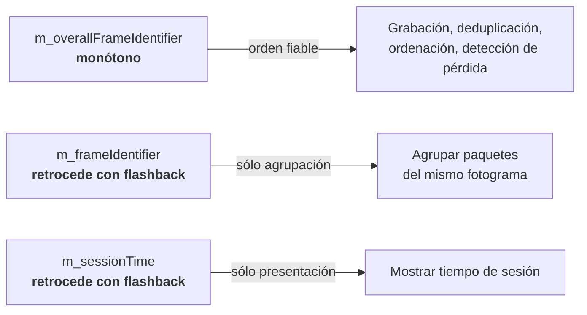
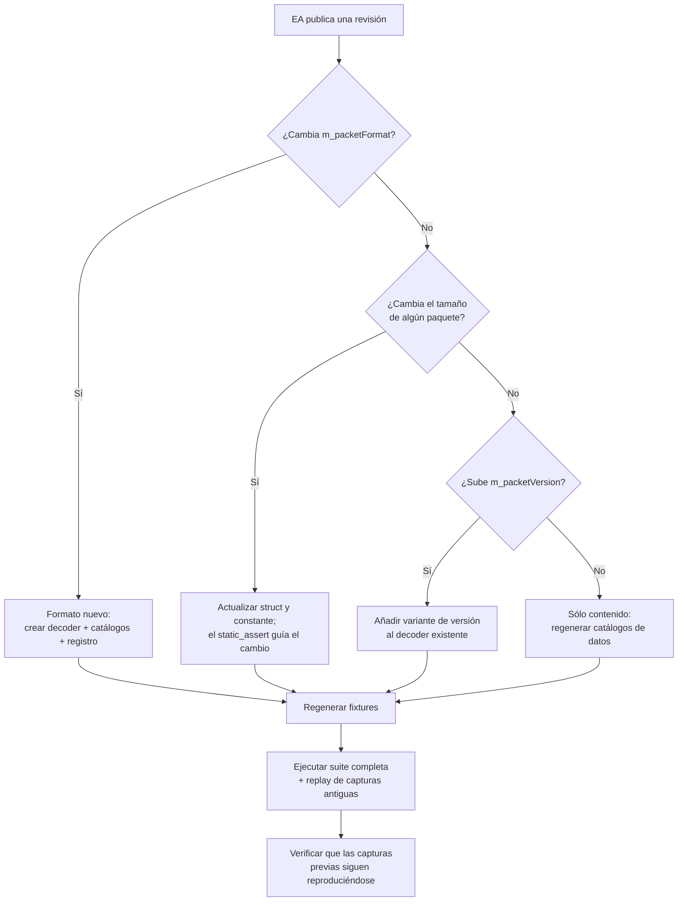

# Referencia del protocolo UDP

> **Fuentes de verdad.** Formato 2026: `Data Output from F1® 25: 2026 Season Pack` **v1.2** `[S1]`. Formato 2025: `Data Output from F1® 25 Game` **v3** `[S3]`. Ante conflicto entre fuentes oficiales prevalece el PDF de mayor versión (RN-015).
>
> Este documento es una **referencia de trabajo derivada** de la especificación oficial. No la sustituye ni la redistribuye. Los documentos originales deben obtenerse del hilo oficial de EA.

---

## 1. Fundamentos del transporte

| Propiedad | Valor |
|---|---|
| Protocolo | UDP, unidireccional juego → aplicación |
| Endianness | **Little Endian**, sin excepciones |
| Alineación | **Packed. Sin padding.** El tamaño de un struct es la suma exacta de sus campos |
| Puerto por defecto | 20777 |
| IP por defecto | 127.0.0.1 |
| Send rate por defecto | 20 |
| Un datagrama | Exactamente un paquete completo. Nunca fragmentado a nivel de aplicación |
| Formatos vivos | 2026 (actual), 2025, 2024. El juego soporta el actual y los **dos** anteriores |

### 1.1. Tipos primitivos

| Tipo | Bytes | Notas |
|---|---|---|
| `uint8` / `int8` | 1 | |
| `uint16` / `int16` | 2 | |
| `uint32` | 4 | |
| `float` | 4 | IEEE-754 simple precisión |
| `double` | 8 | IEEE-754 doble precisión. Usado sólo en `m_totalRaceTime` |
| `uint64` | 8 | Usado sólo en `m_sessionUID` |
| `char` | 1 | UTF-8, terminado en nulo dentro de un array de tamaño fijo |

### 1.2. Constantes por formato

| Constante | 2025 | 2026 |
|---|---|---|
| `cs_maxNumCarsInUDPData` | **22** | **24** |
| `cs_maxParticipantNameLen` | 32 | 32 |
| `cs_maxTyreStints` | 8 | 8 |
| `cs_maxNumTyreSets` | 13 + 7 = 20 | 13 + 7 = 20 |
| `cs_maxMarshalZonesPerLap` | 21 (`cs_maxMarshalsZonePerLap`) | 21 |
| `cs_maxWeatherForecastSamples` | 64 | 64 |
| `cs_maxSessionsInWeekend` | 12 | 12 |
| `cs_maxNumLapsInHistory` | 100 | 100 |
| `cs_maxNumLapsInLapPositionsHistoryPacket` | 50 | 50 |
| `cs_maxActiveAeroZonesPerLap` | — | **8** |
| `cs_maxDRSZones` | — | **4** |

**Regla de implementación:** estas constantes se declaran **una vez por formato** en su propio espacio de nombres. Ninguna aparece como literal en el código fuera de ese punto.

### 1.3. Orden de los arrays de rueda

Invariante en toda la especificación, en ambos formatos:

| Índice | Rueda |
|---|---|
| 0 | Trasera izquierda (RL) |
| 1 | Trasera derecha (RR) |
| 2 | Delantera izquierda (FL) |
| 3 | Delantera derecha (FR) |

Es un orden **poco intuitivo** —empieza por detrás y por la izquierda— y una fuente clásica de errores silenciosos que producen gráficas plausibles pero incorrectas. Regla RN-007.

---

## 2. PacketHeader

**29 bytes. Idéntico en 2025 y 2026.** Es la única parte del datagrama que puede leerse con seguridad antes de conocer el formato.

| Offset | Tipo | Campo | Descripción |
|---|---|---|---|
| 0 | `uint16` | `m_packetFormat` | 2025 o 2026 |
| 2 | `uint8` | `m_gameYear` | 25 o 26 |
| 3 | `uint8` | `m_gameMajorVersion` | «X.00» |
| 4 | `uint8` | `m_gameMinorVersion` | «1.XX» |
| 5 | `uint8` | `m_packetVersion` | Versión de este tipo de paquete; empieza en 1 |
| 6 | `uint8` | `m_packetId` | Tipo de paquete |
| 7 | `uint64` | `m_sessionUID` | Identificador único de sesión |
| 15 | `float` | `m_sessionTime` | Marca de tiempo de sesión, en segundos |
| 19 | `uint32` | `m_frameIdentifier` | Fotograma. **Retrocede tras flashback** |
| 23 | `uint32` | `m_overallFrameIdentifier` | Fotograma global. **No retrocede tras flashback** |
| 27 | `uint8` | `m_playerCarIndex` | Índice del coche del jugador |
| 28 | `uint8` | `m_secondaryPlayerCarIndex` | Segundo jugador (pantalla partida); **255** si no hay |

```cpp
static_assert(sizeof(PacketHeader) == 29, "cabecera de 29 bytes");
```

### 2.1. Semántica de los identificadores temporales



**Regla RN-002:** `m_overallFrameIdentifier` es el único ordenador temporal admisible.

---

## 3. Catálogo de paquetes

| ID | Nombre | Frec. | Tam. 2025 | Tam. 2026 | Bytes por coche 2025 | Bytes por coche 2026 | Ámbito | Ver. |
|---|---|---|---|---|---|---|---|---|
| 0 | Motion | menú | 1349 | 1325 | 60 | **54** | Todos | 1 |
| 1 | Session | 2/s | 753 | 926 | — | — | Sesión | 1 |
| 2 | Lap Data | menú | 1285 | 1399 | 57 | 57 | Todos | 1 |
| 3 | Event | evento | 45 | 45 | — | — | Variable | 1 |
| 4 | Participants | 5 s | 1284 | 1470 | 57 | **60** | Todos | 1 |
| 5 | Car Setups | 2/s | 1133 | 1233 | 50 | 50 | Todos | 1 |
| 6 | Car Telemetry | menú | 1352 | 1448 | 60 | **59** | Todos | 1 |
| 7 | Car Status | menú | 1239 | 1445 | 55 | **59** | Todos | 1 |
| 8 | Final Classification | final | 1042 | 1134 | 46 | 46 | Todos | 1 |
| 9 | Lobby Info | 2/s lobby | 954 | 1062 | 42 | **43** | Lobby | 1 |
| 10 | Car Damage | 10/s | 1041 | 1133 | 46 | 46 | Todos | 1 |
| 11 | Session History | 20/s ciclando | 1460 | 1460 | — | — | 1 coche | 1 |
| 12 | Tyre Sets | 20/s ciclando | 231 | 231 | — | — | 1 coche | 1 |
| 13 | Motion Ex | menú | 273 | 273 | — | — | **Sólo jugador** | 1 |
| 14 | Time Trial | 1/s | 101 | 104 | — | — | Time Trial | 1 |
| 15 | Lap Positions | 1/s | 1131 | 1231 | — | — | Todos | 1 |
| 16 | **Car Telemetry 2** | menú | — | **269** | — | **10** | Todos | 1 |

Las columnas «bytes por coche» son `DERIVED` y permiten una comprobación aritmética independiente de los tamaños: por ejemplo, Lap Data 2026 = 29 (cabecera) + 24 × 57 + 2 (índices de Time Trial) = **1399**. Esta comprobación se implementa como prueba, porque detecta al instante un error de transcripción de struct.

### 3.1. Los paquetes «rate del menú»

Son los que responden al ajuste *UDP Send Rate*: **0, 2, 6, 7, 13 y (en 2026) 16**. La especificación garantiza que en el fotograma en que se envían **van todos juntos y nunca se separan entre fotogramas** `[S1]`.

Consecuencia de diseño: se puede reconstruir un «fotograma lógico» agrupando por `m_frameIdentifier`, y publicar instantáneas coherentes en lugar de actualizaciones parciales (RF-209).

### 3.2. Los paquetes que ciclan

**Session History (11)** y **Tyre Sets (12)** se envían a 20/s, pero **cada datagrama corresponde a un único coche** (`m_carIdx`). Con 24 coches, un coche concreto se refresca cada **~1,2 s**.

Nunca deben usarse como fuente de tiempo real, y todo dato que provenga de ellos debe mostrar su antigüedad (RN-010).

### 3.3. Primer fotograma

Al conectarse, el primer fotograma contiene, todos con `m_sessionTime = 0.000` `[S1]`:

`Session` · `Participants` · `Car Setups` · `Lap Data` · `Motion` · `Car Telemetry` · `Car Status` · `Car Damage` · `Motion Ex`

---

## 4. Paquete 0 — Motion

**Propósito.** Física y posición de todos los coches. Base del mapa de pista y de la reconstrucción de trazado.

**Frecuencia.** Rate del menú. **Sólo se envía mientras el jugador tiene el control** `[S1]`.

### 4.1. `CarMotionData`

| Campo | 2025 | 2026 | Unidad | Nota |
|---|---|---|---|---|
| `m_worldPositionX/Y/Z` | `float` ×3 | `float` ×3 | metros | Espacio de mundo |
| `m_worldVelocityX/Y/Z` | `float` ×3 | `float` ×3 | m/s | |
| `m_worldForwardDirX/Y/Z` | `int16` ×3 | `int16` ×3 | normalizado | **÷ 32767,0** |
| `m_worldRightDirX/Y/Z` | `int16` ×3 | `int16` ×3 | normalizado | **÷ 32767,0** |
| `m_gForceLateral` | **`float`** | **`int16`** | g | En 2026: **÷ 1000,0** |
| `m_gForceLongitudinal` | **`float`** | **`int16`** | g | En 2026: **÷ 1000,0** |
| `m_gForceVertical` | **`float`** | **`int16`** | g | En 2026: **÷ 1000,0** |
| `m_yaw` / `m_pitch` / `m_roll` | `float` ×3 | `float` ×3 | radianes | |
| **Tamaño** | **60 B** | **54 B** | | |

### 4.2. Diferencia 2025 / 2026

La cuantización de las tres g-forces (D-04) ahorra 6 B por coche, lo que **compensa con creces** los dos coches añadidos: el paquete encoge de 1349 a 1325 B. Es el único paquete que se reduce.

> ⚠️ **Trampa.** Un decoder que reutilice la lectura de 2025 en 2026 leerá basura desde `m_gForceLateral` en adelante, y los valores de `yaw`, `pitch` y `roll` saldrán absurdos. El `static_assert` de tamaño lo detecta en compilación; el fixture lo detecta en pruebas.

### 4.3. Uso en PitWall

Mapa de pista en tiempo real · reconstrucción del trazado por acumulación de `(X, Z)` · comparación de trazadas · detección de proximidad para el análisis de tráfico · g-forces del coche propio.

**Sistema de coordenadas.** X y Z forman el plano del suelo; Y es la altura. La proyección 2D del mapa usa `(X, Z)` (`docs/08-FRONTEND-PLAN.md` §6).

---

## 5. Paquete 1 — Session

**Propósito.** Contexto completo: circuito, reglas, clima, asistencias, estructura del fin de semana y —en 2026— zonas de activación.

**Frecuencia.** 2/s. **Tamaño:** 753 B (2025) / **926 B (2026)**.

### 5.1. Estructuras auxiliares

```c
struct MarshalZone {
    float  m_zoneStart;   // fracción 0..1 de la vuelta
    int8   m_zoneFlag;    // -1 desconocido, 0 ninguna, 1 verde, 2 azul, 3 amarilla
};                        // 5 bytes

struct WeatherForecastSample {
    uint8  m_sessionType;
    uint8  m_timeOffset;             // minutos
    uint8  m_weather;                // 0 despejado … 5 tormenta
    int8   m_trackTemperature;       // °C
    int8   m_trackTemperatureChange; // 0 sube, 1 baja, 2 sin cambio
    int8   m_airTemperature;         // °C
    int8   m_airTemperatureChange;
    uint8  m_rainPercentage;         // 0-100
};                                   // 8 bytes
```

**Sólo 2026:**

```c
struct ActiveAeroZone { float m_zoneStart; float m_zoneEnd; };  // 8 bytes
struct DRSZone        { float m_zoneStart; float m_zoneEnd; };  // 8 bytes
```

### 5.2. Campos principales (comunes)

| Campo | Tipo | Notas |
|---|---|---|
| `m_weather` | `uint8` | 0 despejado, 1 nubes ligeras, 2 cubierto, 3 lluvia ligera, 4 lluvia fuerte, 5 tormenta |
| `m_trackTemperature` / `m_airTemperature` | `int8` | °C |
| `m_totalLaps` | `uint8` | |
| `m_trackLength` | `uint16` | metros |
| `m_sessionType` | `uint8` | Ver §21.5 |
| `m_trackId` | `int8` | **−1 desconocido.** Ver §21.3 |
| `m_formula` | `uint8` | Ver §21.6. **2026 añade `13 = F1 26`** |
| `m_sessionTimeLeft` / `m_sessionDuration` | `uint16` | segundos |
| `m_pitSpeedLimit` | `uint8` | km/h |
| `m_gamePaused` | `uint8` | Sólo partida en red |
| `m_isSpectating` / `m_spectatorCarIndex` | `uint8` | Modo espectador |
| `m_sliProNativeSupport` | `uint8` | |
| `m_numMarshalZones` + `m_marshalZones[21]` | | |
| `m_safetyCarStatus` | `uint8` | 0 ninguno, 1 completo, 2 virtual, 3 vuelta de formación |
| `m_networkGame` | `uint8` | 0 offline, 1 online |
| `m_numWeatherForecastSamples` + `m_weatherForecastSamples[64]` | | |
| `m_forecastAccuracy` | `uint8` | 0 perfecta, 1 aproximada |
| `m_aiDifficulty` | `uint8` | 0-110 |
| `m_seasonLinkIdentifier` / `m_weekendLinkIdentifier` / `m_sessionLinkIdentifier` | `uint32` | Persisten entre guardados |
| `m_pitStopWindowIdealLap` / `LatestLap` / `m_pitStopRejoinPosition` | `uint8` | **Sólo jugador** |
| Asistencias | `uint8` ×9 | steering, braking, gearbox, pit, pitRelease, ERS, DRS, dynamicRacingLine, dynamicRacingLineType |
| `m_gameMode` / `m_ruleSet` | `uint8` | §21.7, §21.8 |
| `m_timeOfDay` | `uint32` | Minutos desde medianoche |
| `m_sessionLength` | `uint8` | 0 ninguna, 2 muy corta … 7 completa |
| Unidades | `uint8` ×4 | Velocidad y temperatura, jugador principal y secundario |
| `m_numSafetyCarPeriods` / `VirtualSafetyCar` / `RedFlag` | `uint8` | Contadores de la sesión |
| Reglas de simulación | `uint8` ×~25 | `equalCarPerformance`, `recoveryMode`, `flashbackLimit`, `surfaceType`, `lowFuelMode`, `raceStarts`, `tyreTemperature`, `pitLaneTyreSim`, `carDamage`, `carDamageRate`, `collisions`, `collisionsOffForFirstLapOnly`, `mpUnsafePitRelease`, `mpOffForGriefing`, `cornerCuttingStringency`, `parcFermeRules`, `pitStopExperience`, `safetyCar`, `safetyCarExperience`, `formationLap`, `formationLapExperience`, `redFlags`, `affectsLicenceLevelSolo`, `affectsLicenceLevelMP` |
| `m_numSessionsInWeekend` + `m_weekendStructure[12]` | `uint8` | Tipos de sesión del fin de semana |
| `m_sector2LapDistanceStart` / `m_sector3LapDistanceStart` | `float` | metros. **Muy útil**: permite dibujar sectores en el mapa sin inferirlos |

### 5.3. Campos exclusivos de 2026

| Campo | Tipo | Notas |
|---|---|---|
| `m_activeAeroTrackStatus` | `uint8` | **0 = Full, 1 = Partial** |
| `m_numActiveAeroZonesFull` | `uint8` | |
| `m_activeAeroZonesFull[8]` | `ActiveAeroZone` | Zonas en modo completo |
| `m_numActiveAeroZonesPartial` | `uint8` | |
| `m_activeAeroZonesPartial[8]` | `ActiveAeroZone` | Zonas en modo parcial |
| `m_numDRSZones` | `uint8` | |
| `m_drsZones[4]` | `DRSZone` | **Zonas de DRS explícitas.** En 2025 había que inferirlas |
| `m_startReactionTime` | `float` | segundos. **0.0f si las salidas son asistidas** |
| `m_antiLockBrakesAssist` | `uint8` | 0 off, 1 on |
| `m_tractionControlAssist` | `uint8` | 0 off, 1 medio, 2 completo |
| `m_dynamicRacingLineHiVis` | `uint8` | |
| `m_dynamicRacingLineColourBlind` | `uint8` | 0 off, 1 protanopía, 2 deuteranopía, 3 tritanopía |
| `m_recurringRewindPrompt` | `uint8` | |

> **Sobre `m_startReactionTime`.** Un `0.0f` aquí es ambiguo: puede significar «salidas asistidas» o «reacción perfecta». La especificación indica lo primero. PitWall lo trata como `UNAVAILABLE` cuando `m_raceStarts == 1` (asistido), y como `RAW` en caso contrario.

### 5.4. Uso en PitWall

Contexto de sesión · clima y previsión · banderas por zona de marshal · estado de Safety Car · límites de sector para el mapa · zonas de DRS y Active Aero · reglas activas para explicar el comportamiento observado.

---

## 6. Paquete 2 — Lap Data

**Propósito.** Cronometraje de todos los coches. Es el corazón del live timing.

**Frecuencia.** Rate del menú. **57 B por coche en ambos formatos.**

### 6.1. `LapData`

| Campo | Tipo | Unidad | Notas |
|---|---|---|---|
| `m_lastLapTimeInMS` | `uint32` | ms | |
| `m_currentLapTimeInMS` | `uint32` | ms | |
| `m_sector1TimeMSPart` | `uint16` | ms | **Parte de milisegundos** |
| `m_sector1TimeMinutesPart` | `uint8` | min | **Parte de minutos enteros** |
| `m_sector2TimeMSPart` / `MinutesPart` | `uint16` / `uint8` | | Ídem |
| `m_deltaToCarInFrontMSPart` / `MinutesPart` | `uint16` / `uint8` | | |
| `m_deltaToRaceLeaderMSPart` / `MinutesPart` | `uint16` / `uint8` | | |
| `m_lapDistance` | `float` | m | **Puede ser negativo** antes de cruzar la línea |
| `m_totalDistance` | `float` | m | **Puede ser negativo** |
| `m_safetyCarDelta` | `float` | s | |
| `m_carPosition` | `uint8` | | |
| `m_currentLapNum` | `uint8` | | |
| `m_pitStatus` | `uint8` | | 0 ninguno, 1 entrando, 2 en zona de boxes |
| `m_numPitStops` | `uint8` | | |
| `m_sector` | `uint8` | | 0 S1, 1 S2, 2 S3 |
| `m_currentLapInvalid` | `uint8` | | 0 válida, 1 inválida |
| `m_penalties` | `uint8` | s | Penalización acumulada por añadir |
| `m_totalWarnings` | `uint8` | | |
| `m_cornerCuttingWarnings` | `uint8` | | |
| `m_numUnservedDriveThroughPens` | `uint8` | | |
| `m_numUnservedStopGoPens` | `uint8` | | |
| `m_gridPosition` | `uint8` | | |
| `m_driverStatus` | `uint8` | | 0 garaje, 1 vuelta rápida, 2 vuelta de entrada, 3 vuelta de salida, 4 en pista |
| `m_resultStatus` | `uint8` | | 0 inválido, 1 inactivo, 2 activo, 3 terminado, 4 no terminó, 5 descalificado, 6 no clasificado, 7 retirado |
| `m_pitLaneTimerActive` | `uint8` | | |
| `m_pitLaneTimeInLaneInMS` | `uint16` | ms | |
| `m_pitStopTimerInMS` | `uint16` | ms | Duración de la parada en sí |
| `m_pitStopShouldServePen` | `uint8` | | |
| `m_speedTrapFastestSpeed` | `float` | km/h | |
| `m_speedTrapFastestLap` | `uint8` | | **255 = sin registrar** |

**Nivel de paquete:** `m_timeTrialPBCarIdx` y `m_timeTrialRivalCarIdx` (`uint8`, **255 = inválido**).

### 6.2. La representación de tiempos en dos partes

Los sectores y los deltas se transmiten como **minutos enteros + milisegundos**, no como un único entero. La reconstrucción es:

```
tiempo_ms = m_XxxMinutesPart * 60000 + m_XxxMSPart
```

Es un detalle fácil de pasar por alto que produce tiempos correctos por debajo del minuto e incorrectos por encima —justo el caso de un sector largo o de un delta grande bajo Safety Car—. Se cubre con una prueba unitaria específica.

### 6.3. Uso en PitWall

Torre de tiempos completa · detección de cierre de vuelta · detección de entrada y salida de boxes · estado de piloto · penalizaciones · base de la indexación por distancia para el análisis de vueltas.

---

## 7. Paquete 3 — Event

**Propósito.** Sucesos discretos. **45 bytes fijos** en ambos formatos: 29 de cabecera + 4 de código + 12 de unión.

**Frecuencia.** Cuando ocurre el evento.

> **Regla crítica:** la unión debe interpretarse **exclusivamente** según el código de evento recibido. Leer el miembro equivocado produce valores plausibles y falsos.

### 7.1. Códigos de evento

| Código | Evento | Datos | 2025 | 2026 |
|---|---|---|---|---|
| `SSTA` | Sesión iniciada | — | ✔ | ✔ |
| `SEND` | Sesión terminada | — | ✔ | ✔ |
| `FTLP` | Vuelta rápida | `vehicleIdx`, `lapTime` (s, `float`) | ✔ | ✔ |
| `RTMT` | Retirada | `vehicleIdx`, `reason` | ✔ | ✔ |
| `DRSE` | DRS habilitado | — | ✔ | ✔ |
| `DRSD` | DRS deshabilitado | `reason`: 0 pista mojada, 1 safety car, 2 bandera roja, 3 vuelta mínima no alcanzada | ✔ | ✔ |
| `TMPT` | Compañero en boxes | `vehicleIdx` | ✔ | ✔ |
| `CHQF` | Bandera a cuadros | — | ✔ | ✔ |
| `RCWN` | Ganador | `vehicleIdx` | ✔ | ✔ |
| `PENA` | Penalización | `penaltyType`, `infringementType`, `vehicleIdx`, `otherVehicleIdx`, `time`, `lapNum`, `placesGained` | ✔ | ✔ |
| `SPTP` | Radar de velocidad | `vehicleIdx`, `speed` (km/h), `isOverallFastestInSession`, `isDriverFastestInSession`, `fastestVehicleIdxInSession`, `fastestSpeedInSession` | ✔ | ✔ |
| `STLG` | Semáforo | `numLights` | ✔ | ✔ |
| `LGOT` | Luces apagadas | — | ✔ | ✔ |
| `DTSV` | Drive-through cumplido | `vehicleIdx` | ✔ | ✔ |
| `SGSV` | Stop-go cumplido | `vehicleIdx`, `stopTime` (s) | ✔ | ✔ |
| `FLBK` | Flashback | `flashbackFrameIdentifier` (`uint32`), `flashbackSessionTime` (`float`) | ✔ | ✔ |
| `BUTN` | Botones | `buttonStatus` (`uint32`, campo de bits, §21.10) | ✔ | ✔ |
| `RDFL` | Bandera roja | — | ✔ | ✔ |
| `OVTK` | Adelantamiento | `overtakingVehicleIdx`, `beingOvertakenVehicleIdx` | ✔ | ✔ |
| `SCAR` | Safety Car | `safetyCarType`: 0 ninguno, 1 completo, 2 virtual, 3 formación · `eventType`: 0 desplegado, 1 regresando, 2 regresado, 3 reanudar | ✔ | ✔ |
| `COLL` | Colisión | `vehicle1Idx`, `vehicle2Idx`, **`severity`** (0 baja, 1 media, 2 alta) | ✔ (sin `severity`) | ✔ |
| **`PMEN`** | **Partial Mode habilitado** | `reason`: 0 pista mojada, 1 safety car, 2 bandera roja | — | **✔** |
| **`PMDI`** | **Partial Mode deshabilitado** | — | — | **✔** |
| **`OVEN`** | **Overtake Mode habilitado** | — | — | **✔** |
| **`OVDI`** | **Overtake Mode deshabilitado** | — | — | **✔** |

> ⚠️ Los cuatro últimos y la unión `PartialModeEnabled` **aparecen sólo en el PDF v1.2, no en el `.txt` oficial de structs** (`02-RESEARCH.md` §3.3). El changelog oficial los corrobora. Se implementan.

### 7.2. Razones de retirada (`RTMT` y `m_resultReason`)

| ID | Significado |
|---|---|
| 0 | Inválido |
| 1 | Retirado |
| 2 | Terminado |
| 3 | Daño terminal |
| 4 | Inactivo |
| 5 | No completó vueltas suficientes |
| 6 | Bandera negra |
| 7 | Bandera roja |
| 8 | Fallo mecánico |
| 9 | Sesión omitida |
| 10 | Sesión simulada |

### 7.3. `FLBK` y su tratamiento

Es el evento de mayor impacto arquitectónico. Ver `01-REQUIREMENTS.md` CU-16 y §21.3.

Puntos clave:
- Informa del **fotograma y el tiempo de destino**, no del origen.
- Tras él, `m_frameIdentifier` y `m_sessionTime` retroceden; `m_overallFrameIdentifier` no.
- **Puede perderse**, como cualquier datagrama UDP. El sistema debe inferir el flashback por el retroceso de `m_frameIdentifier` (RF-208).

### 7.4. Uso en PitWall

Registro cronológico de la sesión · banderas y estado de dirección de carrera · penalizaciones · incidentes con severidad · marcas en la línea temporal del replay · disparadores del motor de reglas.

---

## 8. Paquete 4 — Participants

**Propósito.** Quién está en la sesión. Es la fuente de la identidad y —crucialmente— del **nivel de telemetría** de cada participante.

**Frecuencia.** Cada 5 s. **57 B por coche (2025) / 60 B (2026).**

### 8.1. `ParticipantData`

| Campo | 2025 | 2026 | Notas |
|---|---|---|---|
| `m_aiControlled` | `uint8` | `uint8` | 1 = IA, 0 = humano |
| `m_driverId` | **`uint8`** | **`uint16`** | **255 / 65535 = humano en red** |
| `m_networkId` | **`uint8`** | **`uint16`** | Identificador de jugador en red |
| `m_teamId` | **`uint8`** | **`uint16`** | §21.2 |
| `m_myTeam` | `uint8` | `uint8` | |
| `m_raceNumber` | `uint8` | `uint8` | |
| `m_nationality` | `uint8` | `uint8` | §21.4 |
| `m_name[32]` | `char[32]` | `char[32]` | UTF-8, terminado en nulo. **Truncado con `…` (U+2026)** |
| `m_yourTelemetry` | `uint8` | `uint8` | **0 restringida, 1 pública** |
| `m_showOnlineNames` | `uint8` | `uint8` | |
| `m_techLevel` | `uint16` | `uint16` | Nivel tecnológico de F1 World |
| `m_platform` | `uint8` | `uint8` | 1 Steam, 3 PlayStation, 4 Xbox, 6 Origin, 255 desconocida |
| `m_numColours` | `uint8` | `uint8` | Colores válidos |
| `m_liveryColours[4]` | `LiveryColour` | `LiveryColour` | RGB, 3 B cada uno |

**Nivel de paquete:** `m_numActiveCars` (`uint8`).

### 8.2. Notas operativas

- `m_yourTelemetry` es **el campo más importante del paquete** para la corrección del producto: gobierna la regla RN-001.
- El truncado con `…` implica que un nombre mostrado puede no ser el completo. La interfaz no debe intentar «reconstruirlo».
- Los nombres varían por plataforma: Xbox siempre nombre de piloto; PlayStation nombre LAN en partida LAN; PC el Steam ID `[S1]`.
- `m_liveryColours` es la fuente **legítima** de los colores de equipo: es un dato de telemetría, no un asset de marca (`01-REQUIREMENTS.md` §26.3).

---

## 9. Paquete 5 — Car Setups

**Propósito.** Reglajes de todos los coches. **50 B por coche en ambos formatos.** Frecuencia 2/s.

| Grupo | Campos |
|---|---|
| Aerodinámica | `m_frontWing`, `m_rearWing` (`uint8`) |
| Diferencial | `m_onThrottle`, `m_offThrottle` (`uint8`, %) |
| Geometría | `m_frontCamber`, `m_rearCamber`, `m_frontToe`, `m_rearToe` (`float`) |
| Suspensión | `m_frontSuspension`, `m_rearSuspension`, `m_frontAntiRollBar`, `m_rearAntiRollBar`, `m_frontSuspensionHeight`, `m_rearSuspensionHeight` (`uint8`) |
| Frenos | `m_brakePressure`, `m_brakeBias` (`uint8`, %) |
| Motor | `m_engineBraking` (`uint8`, %) |
| Neumáticos | `m_rearLeftTyrePressure`, `m_rearRightTyrePressure`, `m_frontLeftTyrePressure`, `m_frontRightTyrePressure` (`float`, PSI) |
| Masa | `m_ballast` (`uint8`), `m_fuelLoad` (`float`) |

**Nivel de paquete:** `m_nextFrontWingValue` (`float`) — valor del alerón delantero tras la próxima parada, **sólo del jugador**.

> **Atención al orden.** Las presiones se declaran **RL, RR, FL, FR** como campos separados, respetando la convención del §1.3 pese a no ser un array.

---

## 10. Paquete 6 — Car Telemetry

**Propósito.** Telemetría instantánea de todos los coches. Frecuencia: rate del menú.

**60 B por coche (2025) / 59 B (2026).**

| Campo | 2025 | 2026 | Unidad |
|---|---|---|---|
| `m_speed` | `uint16` | `uint16` | km/h |
| `m_throttle` | `float` | `float` | 0,0–1,0 |
| `m_steer` | `float` | `float` | −1,0 (izq.) a 1,0 (der.) |
| `m_brake` | `float` | `float` | 0,0–1,0 |
| `m_clutch` | `uint8` | `uint8` | 0–100 |
| `m_gear` | `int8` | `int8` | 1-8, N = 0, R = −1 |
| `m_engineRPM` | `uint16` | `uint16` | rpm |
| `m_drs` | `uint8` | `uint8` | 0 off, 1 on |
| `m_revLightsPercent` | `uint8` | `uint8` | % |
| `m_revLightsBitValue` | `uint16` | `uint16` | bit 0 = LED más a la izquierda, bit 14 = más a la derecha |
| `m_brakesTemperature[4]` | `uint16` ×4 | `uint16` ×4 | °C |
| `m_tyresSurfaceTemperature[4]` | `uint8` ×4 | `uint8` ×4 | °C |
| `m_tyresInnerTemperature[4]` | `uint8` ×4 | `uint8` ×4 | °C |
| `m_engineTemperature` | **`uint16`** | **`uint8`** | °C |
| `m_tyresPressure[4]` | `float` ×4 | `float` ×4 | PSI |
| `m_surfaceType[4]` | `uint8` ×4 | `uint8` ×4 | §21.9 |

**Nivel de paquete:** `m_mfdPanelIndex` (`uint8`, **255 = MFD cerrado**), `m_mfdPanelIndexSecondaryPlayer` (`uint8`), `m_suggestedGear` (`int8`, 0 = sin sugerencia).

> ⚠️ **D-05.** `m_engineTemperature` pasa de `uint16` a `uint8`. Un solo byte, pero desplaza **todos los campos siguientes**: `m_tyresPressure` y `m_surfaceType` saldrían corruptos. Es exactamente el tipo de cambio que un decoder compartido entre formatos rompería en silencio.

---

## 11. Paquete 7 — Car Status

**Propósito.** Estado del coche: combustible, ERS, neumáticos montados, banderas. Frecuencia: rate del menú.

**55 B por coche (2025) / 59 B (2026).**

| Campo | Tipo | Unidad | Notas |
|---|---|---|---|
| `m_tractionControl` | `uint8` | | 0 off, 1 medio, 2 completo |
| `m_antiLockBrakes` | `uint8` | | |
| `m_fuelMix` | `uint8` | | 0 pobre, 1 estándar, 2 rica, 3 máxima. **Restringido** |
| `m_frontBrakeBias` | `uint8` | % | **Restringido** |
| `m_pitLimiterStatus` | `uint8` | | |
| `m_fuelInTank` | `float` | kg | **Restringido** |
| `m_fuelCapacity` | `float` | kg | **Restringido** |
| `m_fuelRemainingLaps` | `float` | vueltas | Valor del MFD. **Restringido** |
| `m_maxRPM` / `m_idleRPM` | `uint16` | rpm | |
| `m_maxGears` | `uint8` | | |
| `m_drsAllowed` | `uint8` | | |
| `m_drsActivationDistance` | `uint16` | m | **0 = DRS no disponible** |
| `m_actualTyreCompound` | `uint8` | | §21.11 |
| `m_visualTyreCompound` | `uint8` | | §21.11 |
| `m_tyresAgeLaps` | `uint8` | vueltas | |
| `m_vehicleFIAFlags` | `int8` | | **−1 desconocida**, 0 ninguna, 1 verde, 2 azul, 3 amarilla |
| `m_enginePowerICE` | `float` | W | **Restringido** |
| `m_enginePowerMGUK` | `float` | W | **Restringido** |
| `m_ersStoreEnergy` | `float` | J | **Restringido** |
| `m_ersDeployMode` | `uint8` | | 0 ninguno, 1 medio, 2 hotlap, **3 = `overtake` en 2025 / `boost` en 2026**. **Restringido** |
| `m_ersHarvestedThisLapMGUK` | `float` | J | **Restringido** |
| `m_ersHarvestedThisLapMGUH` | `float` | J | **Restringido** |
| **`m_ersHarvestLimitPerLap`** | `float` | J | **Sólo 2026.** Límite de recuperación del reglamento 2026 |
| `m_ersDeployedThisLap` | `float` | J | **Restringido** |
| `m_networkPaused` | `uint8` | | |

> **D-10, la trampa semántica.** El valor `3` de `m_ersDeployMode` no cambia de número, cambia de significado. Un decoder ingenuo mostraría «Overtake» en un coche de 2026 que en realidad está en «Boost». Por eso la traducción a enumerado de dominio ocurre **dentro del decoder** (RN-011), no en la interfaz.

---

## 12. Paquete 8 — Final Classification

**Propósito.** Resultado consolidado. Se envía **una vez al final**. 46 B por coche en ambos formatos.

| Campo | Tipo | Notas |
|---|---|---|
| `m_position`, `m_numLaps`, `m_gridPosition`, `m_points`, `m_numPitStops` | `uint8` | |
| `m_resultStatus` | `uint8` | Ver §6.1 |
| `m_resultReason` | `uint8` | Ver §7.2 |
| `m_bestLapTimeInMS` | `uint32` | ms |
| `m_totalRaceTime` | **`double`** | s, sin penalizaciones. **Único `double` del protocolo** |
| `m_penaltiesTime`, `m_numPenalties`, `m_numTyreStints` | `uint8` | |
| `m_tyreStintsActual[8]`, `m_tyreStintsVisual[8]`, `m_tyreStintsEndLaps[8]` | `uint8` ×8 | |

**Nivel de paquete:** `m_numCars` (`uint8`).

> **Se envía una sola vez.** Si ese datagrama se pierde, no hay reenvío (LIM-02). PitWall reconstruye una clasificación equivalente a partir de su propio estado y marca la diferencia si la recibida no coincide.

---

## 13. Paquete 9 — Lobby Info

**Propósito.** Jugadores en el lobby, antes de la sesión. 2/s mientras se está en el lobby. 42 B (2025) / 43 B (2026) por jugador.

| Campo | 2025 | 2026 | Notas |
|---|---|---|---|
| `m_aiControlled` | `uint8` | `uint8` | |
| `m_teamId` | **`uint8`** | **`uint16`** | **255 / 65535 = sin equipo seleccionado** |
| `m_nationality`, `m_platform` | `uint8` | `uint8` | |
| `m_name[32]` | `char[32]` | `char[32]` | |
| `m_carNumber` | `uint8` | `uint8` | |
| `m_yourTelemetry` | `uint8` | `uint8` | **Disponible ya en el lobby** |
| `m_showOnlineNames` | `uint8` | `uint8` | |
| `m_techLevel` | `uint16` | `uint16` | |
| `m_readyStatus` | `uint8` | `uint8` | 0 no listo, 1 listo, 2 espectando |

**Nivel de paquete:** `m_numPlayers` (`uint8`).

**Detalle aprovechable:** `m_yourTelemetry` está disponible **antes** de que empiece la sesión. PitWall puede advertir de antemano de qué coches tendrán datos restringidos.

---

## 14. Paquete 10 — Car Damage

**Propósito.** Daños y desgaste. **10/s.** 46 B por coche en ambos formatos.

| Campo | Tipo | Unidad | Restringido |
|---|---|---|---|
| `m_tyresWear[4]` | `float` ×4 | % | **Sí** |
| `m_tyresDamage[4]` | `uint8` ×4 | % | **Sí** |
| `m_brakesDamage[4]` | `uint8` ×4 | % | **Sí** |
| `m_tyreBlisters[4]` | `uint8` ×4 | % | No |
| `m_frontLeftWingDamage`, `m_frontRightWingDamage`, `m_rearWingDamage` | `uint8` | % | **Sí** |
| `m_floorDamage`, `m_diffuserDamage`, `m_sidepodDamage` | `uint8` | % | **Sí** |
| `m_drsFault`, `m_ersFault` | `uint8` | | `drsFault` **sí** |
| `m_gearBoxDamage`, `m_engineDamage` | `uint8` | % | **Sí** |
| `m_engineMGUHWear`, `m_engineESWear`, `m_engineCEWear`, `m_engineICEWear`, `m_engineMGUKWear`, `m_engineTCWear` | `uint8` | % | **Sí** |
| `m_engineBlown`, `m_engineSeized` | `uint8` | | No |

**Curiosidad relevante:** `m_tyreBlisters`, `m_ersFault`, `m_engineBlown` y `m_engineSeized` **no** figuran en la lista de campos restringidos de la especificación. Se muestran, por tanto, también para rivales con telemetría restringida. Es una asimetría real del juego que PitWall refleja tal cual, sin uniformizar.

---

## 15. Paquete 11 — Session History

**Propósito.** Histórico completo de vueltas y stints de **un** coche. **1460 B en ambos formatos** (no depende del número de coches).

**Frecuencia: 20/s ciclando entre coches** → ~1,2 s por coche con 24 participantes.

```c
struct LapHistoryData {          // 14 bytes
    uint32 m_lapTimeInMS;
    uint16 m_sector1TimeMSPart;   uint8 m_sector1TimeMinutesPart;
    uint16 m_sector2TimeMSPart;   uint8 m_sector2TimeMinutesPart;
    uint16 m_sector3TimeMSPart;   uint8 m_sector3TimeMinutesPart;
    uint8  m_lapValidBitFlags;
};

struct TyreStintHistoryData {    // 3 bytes
    uint8 m_endLap;              // 255 si es el neumático actual
    uint8 m_tyreActualCompound;
    uint8 m_tyreVisualCompound;
};
```

**Campo de bits `m_lapValidBitFlags`:**

| Bit | Máscara | Significado |
|---|---|---|
| 0 | `0x01` | Vuelta válida |
| 1 | `0x02` | Sector 1 válido |
| 2 | `0x04` | Sector 2 válido |
| 3 | `0x08` | Sector 3 válido |

**Nivel de paquete:** `m_carIdx`, `m_numLaps`, `m_numTyreStints`, `m_bestLapTimeLapNum`, `m_bestSector1LapNum`, `m_bestSector2LapNum`, `m_bestSector3LapNum`, más `m_lapHistoryData[100]` y `m_tyreStintsHistoryData[8]`.

**Comprobación aritmética:** 29 + 7 + 100 × 14 + 8 × 3 = **1460** ✔

**Límite:** 100 vueltas (LIM-07). PitWall mantiene su propio histórico sin ese techo (RF-213).

---

## 16. Paquete 12 — Tyre Sets

**Propósito.** Los 20 juegos de neumáticos (13 secos + 7 de lluvia) de **un** coche. **231 B en ambos formatos.** 20/s ciclando.

```c
struct TyreSetData {                  // 10 bytes
    uint8 m_actualTyreCompound;
    uint8 m_visualTyreCompound;
    uint8 m_wear;                     // %
    uint8 m_available;
    uint8 m_recommendedSession;       // ver apéndice de tipos de sesión
    uint8 m_lifeSpan;                 // vueltas restantes
    uint8 m_usableLife;               // vueltas recomendadas
    int16 m_lapDeltaTime;             // ms respecto al juego montado
    uint8 m_fitted;
};
```

**Nivel de paquete:** `m_carIdx`, `m_tyreSetData[20]`, `m_fittedIdx`.

**Comprobación:** 29 + 1 + 20 × 10 + 1 = **231** ✔

> **Restricción total.** La especificación indica que, con telemetría restringida, **todo el paquete** del coche afectado se pone a cero `[S1]`. No es un campo: es el paquete entero. La interfaz oculta la sección completa con explicación, en lugar de mostrar 20 juegos con 0 % de desgaste.

`m_recommendedSession` remite a un apéndice que la especificación no enumera explícitamente: pregunta abierta Q-03.

---

## 17. Paquete 13 — Motion Ex

**Propósito.** Física detallada. **273 B en ambos formatos. Exclusivo del coche del jugador.**

| Grupo | Campos | Unidad |
|---|---|---|
| Suspensión | `m_suspensionPosition[4]`, `m_suspensionVelocity[4]`, `m_suspensionAcceleration[4]` | |
| Ruedas | `m_wheelSpeed[4]`, `m_wheelSlipRatio[4]`, `m_wheelSlipAngle[4]` | |
| Fuerzas | `m_wheelLatForce[4]`, `m_wheelLongForce[4]`, `m_wheelVertForce[4]` | N |
| Chasis | `m_heightOfCOGAboveGround`, `m_frontAeroHeight`, `m_rearAeroHeight`, `m_frontRollAngle`, `m_rearRollAngle`, `m_chassisYaw`, `m_chassisPitch` | m / rad |
| Velocidad local | `m_localVelocityX/Y/Z` | m/s |
| Angular | `m_angularVelocityX/Y/Z`, `m_angularAccelerationX/Y/Z` | rad/s, rad/s² |
| Dirección | `m_frontWheelsAngle` | rad |
| Camber | `m_wheelCamber[4]`, `m_wheelCamberGain[4]` | rad |

**Comprobación:** 29 + 244 = **273** ✔

> **LIM-05, la limitación más importante del producto.** No existe `Motion Ex` para los rivales. Todo análisis de bloqueo de rueda, patinaje, deslizamiento o carga por rueda es **estructuralmente imposible** para IA y otros humanos. La interfaz lo declara `UNAVAILABLE` de forma permanente y explicada (RN-012), en lugar de dejar gráficas vacías sin motivo.

`m_wheelSlipRatio` es la entrada principal de la detección de bloqueo y patinaje del futuro módulo de ingeniero (RF-701).

---

## 18. Paquete 14 — Time Trial

**Propósito.** Conjuntos de referencia en contrarreloj. 1/s. **101 B (2025) / 104 B (2026).**

```c
struct TimeTrialDataSet {        // 24 B (2025) / 25 B (2026)
    uint8  m_carIdx;
    uint16 m_teamId;             // uint8 en 2025
    uint32 m_lapTimeInMS;
    uint32 m_sector1TimeInMS;
    uint32 m_sector2TimeInMS;
    uint32 m_sector3TimeInMS;
    uint8  m_tractionControl;
    uint8  m_gearboxAssist;
    uint8  m_antiLockBrakes;
    uint8  m_equalCarPerformance;  // 0 realista, 1 igualado
    uint8  m_customSetup;
    uint8  m_valid;
};
```

**Nivel de paquete:** `m_playerSessionBestDataSet`, `m_personalBestDataSet`, `m_rivalDataSet`.

**Comprobación:** 29 + 3 × 25 = **104** (2026) ✔ · 29 + 3 × 24 = **101** (2025) ✔

**Valor aprovechable:** las banderas de asistencias permiten comparar vueltas **en igualdad de condiciones**. Comparar una vuelta con control de tracción contra otra sin él es engañoso, y PitWall lo advierte.

---

## 19. Paquete 15 — Lap Positions

**Propósito.** Matriz de posiciones al inicio de cada vuelta, para construir el gráfico de evolución de carrera. 1/s. **1131 B (2025) / 1231 B (2026).**

```c
uint8 m_numLaps;
uint8 m_lapStart;                                  // índice de inicio, base 0
uint8 m_positionForVehicleIdx[50][24];             // 0 = sin registro
```

**Comprobación:** 29 + 2 + 50 × 24 = **1231** ✔

**Límite:** 50 vueltas por paquete. En carreras más largas se usa `m_lapStart` como ventana deslizante. PitWall acumula la matriz completa por su cuenta.

---

## 20. Paquete 16 — Car Telemetry 2 *(sólo 2026)*

**Propósito.** Sistemas del reglamento 2026. **269 B. 10 B por coche.** Rate del menú.

| Campo | Tipo | Descripción |
|---|---|---|
| `m_activeAeroMode` | `uint8` | **0 = Corner mode, 1 = Straight mode** |
| `m_activeAeroAvailable` | `uint8` | 0 no disponible, 1 disponible |
| `m_activeAeroActivationDistance` | `uint16` | **0 = no disponible**; si no, metros hasta la disponibilidad |
| `m_overtakeAvailable` | `uint8` | 0 no disponible, 1 disponible |
| `m_overtakeActive` | `uint8` | 0 no activo, 1 activo |
| `m_overtakeActivationDistance` | `uint16` | **0 = no disponible**; si no, metros hasta la disponibilidad |
| `m_2026Regulations` | `uint8` | **0 = coche pre-2026, 1 = reglamento 2026 aplicable** |
| `m_drivingWrongWay` | `uint8` | Circulando en sentido contrario |

**Comprobación:** 29 + 24 × 10 = **269** ✔

### 20.1. Notas de interpretación

- El **cero como centinela** en ambas distancias de activación es idéntico al patrón de `m_drsActivationDistance` en Car Status. Un 0 significa «no disponible», **no** «disponible ahora mismo, a 0 metros». Confundirlo produce una interfaz que anuncia activaciones inexistentes.
- `m_2026Regulations` permite que convivan coches con y sin reglamento 2026 en la misma sesión. La interfaz debe consultarlo **por coche**, no por sesión.
- `m_activeAeroMode` es el **modo actual**, mientras que las zonas del paquete Session describen **dónde** se puede usar. Son informaciones complementarias, no redundantes.
- `m_drivingWrongWay` es útil como filtro de calidad: las muestras tomadas circulando en sentido contrario deben excluirse de la reconstrucción del trazado y del análisis de vueltas.

---

## 21. Apéndices

### 21.1. Datos restringidos por *Your Telemetry*

Con `m_yourTelemetry == 0` (restringida, **valor por defecto**) en un participante, estos campos llegan **a cero** en su coche `[S1]`:

**Car Status (7):** `m_fuelInTank` · `m_fuelCapacity` · `m_fuelMix` · `m_fuelRemainingLaps` · `m_frontBrakeBias` · `m_ersDeployMode` · `m_ersStoreEnergy` · `m_ersDeployedThisLap` · `m_ersHarvestedThisLapMGUK` · `m_ersHarvestedThisLapMGUH` · `m_enginePowerICE` · `m_enginePowerMGUK`

**Car Damage (10):** `m_frontLeftWingDamage` · `m_frontRightWingDamage` · `m_rearWingDamage` · `m_floorDamage` · `m_diffuserDamage` · `m_sidepodDamage` · `m_engineDamage` · `m_gearBoxDamage` · `m_tyresWear[4]` · `m_tyresDamage[4]` · `m_brakesDamage[4]` · `m_drsFault` · `m_engineMGUHWear` · `m_engineESWear` · `m_engineCEWear` · `m_engineICEWear` · `m_engineMGUKWear` · `m_engineTCWear`

**Tyre Sets (12):** **el paquete completo**

> **RN-001.** Estos ceros son `RESTRICTED`, nunca cero. El decoder los marca como ausencia en el momento de normalizar, consultando el `m_yourTelemetry` vigente para ese `vehicleIdx`.

### 21.2. Team IDs

**Comunes a ambos formatos (genéricos y actuales):** 0 Mercedes · 1 Ferrari · 2 Red Bull Racing · 3 Williams · 4 Aston Martin · 5 Alpine · 6 RB · 7 Haas · 8 McLaren · 9 Sauber · 41 F1 Generic · 104 F1 Custom Team · 129 Konnersport · 142 APXGP '24 · 154 APXGP '25 · 155 Konnersport '24

**Bloque '24:** 158-168 (equipos de F2) · 185-194 (equipos de F1: Mercedes, Ferrari, Red Bull, Williams, Aston Martin, Alpine, RB, Haas, McLaren, Sauber)

**Bloque '25:** 465-475 (F2)

**Bloque '26 (sólo formato 2026):**

| ID | Equipo | ID | Equipo |
|---|---|---|---|
| 476 | Mercedes '26 | 484 | McLaren '26 |
| 477 | Ferrari '26 | **485** | **Audi '26** |
| 478 | Red Bull Racing '26 | **486** | **Cadillac '26** |
| 479 | Williams '26 | 489-499 | Equipos de F2 '26 |
| 480 | Aston Martin '26 | | |
| 481 | Alpine '26 | | |
| 482 | RB '26 | | |
| 483 | Haas '26 | | |

**Nota:** el bloque '26 tiene **11 equipos de F1** (476-486), que con 2 coches cada uno explica el aumento a 24 vehículos.

### 21.3. Track IDs

| ID | Circuito | ID | Circuito |
|---|---|---|---|
| 0 | Melbourne | 20 | Baku (Azerbaiyán) |
| 2 | Shanghái | 26 | Zandvoort |
| 3 | Sakhir (Bahréin) | 27 | Imola |
| 4 | Catalunya | 29 | Jeddah |
| 5 | Mónaco | 30 | Miami |
| 6 | Montreal | 31 | Las Vegas |
| 7 | Silverstone | 32 | Losail |
| 9 | Hungaroring | 39 | Silverstone (inverso) |
| 10 | Spa | 40 | Austria (inverso) |
| 11 | Monza | 41 | Zandvoort (inverso) |
| 12 | Singapur | **42** | **Madrid — sólo 2026** |
| 13 | Suzuka | | |
| 14 | Abu Dabi | | |
| 15 | Texas | | |
| 16 | Brasil | | |
| 17 | Austria | | |
| 19 | México | | |

**−1 = desconocido.** Los identificadores no son consecutivos: hay huecos (1, 8, 18, 21-25, 28, 33-38). Un decoder que asuma continuidad falla.

Los circuitos inversos son **trazados distintos** a efectos de reconstrucción del mapa y de comparación de vueltas.

### 21.4. Nationality IDs

Rango 1-90 con dos huecos (**60 y 67 no existen**). Lista completa en el apéndice oficial. Sin cambios entre 2025 y 2026.

### 21.5. Session types

| ID | Tipo | ID | Tipo |
|---|---|---|---|
| 0 | Desconocido | 10 | Sprint Shootout 1 |
| 1 | Práctica 1 | 11 | Sprint Shootout 2 |
| 2 | Práctica 2 | 12 | Sprint Shootout 3 |
| 3 | Práctica 3 | 13 | Sprint Shootout corta |
| 4 | Práctica corta | 14 | Sprint Shootout a una vuelta |
| 5 | Clasificación 1 | 15 | Carrera |
| 6 | Clasificación 2 | 16 | Carrera 2 |
| 7 | Clasificación 3 | 17 | Carrera 3 |
| 8 | Clasificación corta | 18 | Contrarreloj |
| 9 | Clasificación a una vuelta | | |

Se usa en `m_sessionType`, en `m_weekendStructure[]` y en `m_recommendedSession` de Tyre Sets.

### 21.6. Formula

| ID | Fórmula |
|---|---|
| 0 | F1 Moderna |
| 1 | F1 Clásica |
| 2 | F2 |
| 3 | F1 Genérica |
| 4 | Beta |
| 6 | Esports |
| 8 | F1 World |
| 9 | F1 Elimination |
| **13** | **F1 26 — sólo formato 2026** |

Ver `01-REQUIREMENTS.md` §7.3: jugar contenido 2026 con formato 2025 hace que los coches se reporten con una fórmula genérica.

### 21.7. Game Mode IDs

4 Grand Prix '23 · 5 Contrarreloj · 6 Pantalla partida · 7 Online personalizado · 15 Evento semanal online · 17 Modo historia (Braking Point) · 27 My Team Career '25 · 28 Driver Career '25 · 29 Career '25 Online · 30 Challenge Career '25 · 75 Modo historia (APXGP) · 127 Benchmark

### 21.8. Ruleset IDs

0 Práctica y clasificación · 1 Carrera · 2 Contrarreloj · 12 Eliminación

### 21.9. Surface types

| ID | Superficie | ID | Superficie |
|---|---|---|---|
| 0 | Asfalto | 6 | Arena |
| 1 | Piano | 7 | Hierba |
| 2 | Hormigón | 8 | Agua |
| 3 | Roca | 9 | Adoquín |
| 4 | Grava | 10 | Metal |
| 5 | Barro | 11 | Estriado |

Proviene de datos de física, por rueda. Útil para detectar salidas de pista e invalidaciones antes de que llegue el evento correspondiente.

### 21.10. Button flags (campo de bits de 32 bits)

| Máscara | Botón | Máscara | Botón |
|---|---|---|---|
| `0x00000001` | Cruz / A | `0x00002000` | Clic stick izquierdo |
| `0x00000002` | Triángulo / Y | `0x00004000` | Clic stick derecho |
| `0x00000004` | Círculo / B | `0x00008000` | Stick derecho izquierda |
| `0x00000008` | Cuadrado / X | `0x00010000` | Stick derecho derecha |
| `0x00000010` | Cruceta izquierda | `0x00020000` | Stick derecho arriba |
| `0x00000020` | Cruceta derecha | `0x00040000` | Stick derecho abajo |
| `0x00000040` | Cruceta arriba | `0x00080000` | Especial |
| `0x00000080` | Cruceta abajo | `0x00100000`–`0x80000000` | UDP Action 1 a 12 |
| `0x00000100` | Options / Menu | | |
| `0x00000200` / `0x00000400` | L1 / R1 | | |
| `0x00000800` / `0x00001000` | L2 / R2 | | |

Las **UDP Actions 1-12** son botones asignables en el juego específicamente para señalizar hacia aplicaciones externas: es un canal de mando ligero del piloto hacia PitWall (marcar una vuelta, cambiar de vista) sin salir del juego. Se contempla para fases posteriores.

Limitación: sólo refleja el mando; los volantes con software propio pueden no aparecer (LIM-09).

### 21.11. Compuestos de neumático

**`m_actualTyreCompound`:**

| Categoría | Valores |
|---|---|
| F1 Moderna | 16 = C5, 17 = C4, 18 = C3, 19 = C2, 20 = C1, 21 = C0, **22 = C6**, 7 = intermedio, 8 = lluvia |
| F1 Clásica | 9 = seco, 10 = lluvia |
| F2 | 11 = super blando, 12 = blando, 13 = medio, 14 = duro, 15 = lluvia |

**`m_visualTyreCompound`** (puede diferir del real):

| Categoría | Valores |
|---|---|
| F1 | 16 = blando, 17 = medio, 18 = duro, 7 = intermedio, 8 = lluvia |
| F2 '20 | 15 = lluvia, 19 = super blando, 20 = blando, 21 = medio, 22 = duro |

> **Colisión de valores.** El número `22` significa **C6** como compuesto real en F1 y **duro** como compuesto visual en F2. La interpretación depende de qué campo se lee y de la fórmula activa. Es un caso de manual para justificar por qué los enumerados se resuelven en el decoder con el contexto completo, y nunca con una tabla global.

### 21.12. Penalty types

0 Drive through · 1 Stop Go · 2 Penalización de parrilla · 3 Recordatorio · 4 Penalización de tiempo · 5 Aviso · 6 Descalificado · 7 Retirado de la vuelta de formación · 8 Temporizador de estacionamiento excesivo · 9 Reglamento de neumáticos · 10 Esta vuelta invalidada · 11 Esta y la siguiente invalidadas · 12 Esta vuelta invalidada sin razón · 13 Esta y la siguiente sin razón · 14 Esta y la anterior invalidadas · 15 Esta y la anterior sin razón · 16 Retirado · 17 Temporizador de bandera negra

### 21.13. Infringement types

55 valores (0-54). Incluyen bloqueo, colisiones, recorte de curva, ignorar banderas, exceso de velocidad en boxes, salida en falso (34 Jump start), infracciones bajo Safety Car, cambios de componentes y de parque cerrado, y ganancia ilegal de tiempo. Lista completa en el apéndice oficial.

Los identificadores 25-32 son especialmente útiles porque explican **por qué** se invalidó una vuelta: recorte de curva, salirse de pista, montar el muro, uso de flashback o reposición en pista.

### 21.14. Otros enumerados

| Enumerado | Valores |
|---|---|
| Platform | 1 Steam · 3 PlayStation · 4 Xbox · 6 Origin · 255 desconocida |
| Weather | 0 despejado · 1 nubes ligeras · 2 cubierto · 3 lluvia ligera · 4 lluvia fuerte · 5 tormenta |
| Safety Car status | 0 ninguno · 1 completo · 2 virtual · 3 vuelta de formación |
| Driver status | 0 garaje · 1 vuelta rápida · 2 vuelta de entrada · 3 vuelta de salida · 4 en pista |
| Result status | 0 inválido · 1 inactivo · 2 activo · 3 terminado · 4 no terminó · 5 descalificado · 6 no clasificado · 7 retirado |
| Pit status | 0 ninguno · 1 entrando · 2 en zona de boxes |
| Marshal zone flag / FIA flag | −1 desconocida · 0 ninguna · 1 verde · 2 azul · 3 amarilla |
| Session length | 0 ninguna · 2 muy corta · 3 corta · 4 media · 5 media larga · 6 larga · 7 completa |

---

## 22. Catálogo de valores especiales

Todos deben convertirse a **ausencia explícita** en el dominio (RF-109). Ninguno debe llegar a la interfaz como número.

| Valor | Campos | Significado |
|---|---|---|
| `255` | `m_secondaryPlayerCarIndex`, `m_mfdPanelIndex`, `m_speedTrapFastestLap`, `m_timeTrialPBCarIdx`, `m_timeTrialRivalCarIdx`, `m_endLap` (stints), `m_platform` | Sin valor / no aplica |
| `255` (2025) / `65535` (2026) | `m_driverId`, `m_networkId`, `m_teamId` | Humano en red / sin equipo |
| `−1` | `m_trackId`, `m_zoneFlag`, `m_vehicleFIAFlags` | Desconocido |
| `0` | `m_drsActivationDistance`, `m_activeAeroActivationDistance`, `m_overtakeActivationDistance` | **No disponible**, no «a 0 metros» |
| `0` | Campos de §21.1 con `m_yourTelemetry == 0` | **Restringido** |
| `0` | `m_startReactionTime` con salidas asistidas | No aplica |
| `0` | `m_positionForVehicleIdx[l][v]` | Sin registro para esa vuelta |
| `0` | `m_sessionType`, `m_resultReason`, `m_penaltyType`… | «Desconocido» / «inválido» |
| Negativo | `m_lapDistance`, `m_totalDistance` | Legítimo: aún no se ha cruzado la línea |

---

## 23. Estrategia de versionado y evolución

### 23.1. Los cuatro patrones de cambio observados

Derivados del análisis de dos transiciones anuales (2024→2025 y 2025→2026):

| Patrón | Ejemplo 2026 | Alcance |
|---|---|---|
| P1 — Cambia la cardinalidad de un array | 22 → 24 coches | Decoder |
| P2 — Cambia la anchura o la escala de un campo | IDs a `uint16`, g-forces cuantizadas, `engineTemperature` a `uint8` | Decoder |
| P3 — Se añaden campos al final de un struct | Zonas, `ersHarvestLimitPerLap`, `startReactionTime`, asistencias | Decoder + campo opcional en dominio |
| P4 — Aparece un paquete o un evento nuevo | `CarTelemetry2`, `PMEN`/`OVEN` | Decoder + entidad nueva |

**EA no ha reordenado campos existentes en ninguna de las dos transiciones.** Es una regularidad valiosa, pero el diseño no depende de que se mantenga.

### 23.2. Procedimiento ante un cambio de EA



### 23.3. Detección temprana

PitWall detecta un cambio de protocolo **antes de que el usuario se queje**:

| Señal | Interpretación |
|---|---|
| `unknown_format` creciendo | Formato nuevo publicado |
| `bad_size` sostenido en un `packetId` concreto | Layout cambiado en ese paquete |
| `unknown_id` creciendo | Paquete nuevo añadido |
| `unknown_version` creciendo | Versión de paquete incrementada |
| `m_gameMinorVersion` cambiado desde la última sesión | Parche aplicado; revisar el resto de señales |

Las cinco se muestran en *UDP Diagnostics* y disparan un aviso persistente en la interfaz.

### 23.4. Preparación para un formato 2027

Requisitos ya satisfechos por el diseño:

1. La cabecera de 29 B se lee sin conocer el formato (AS-01).
2. `RNF-042`: un `packetId` desconocido se ignora contabilizándolo, sin fallo.
3. `RNF-040`: el registro de decoders acepta uno nuevo sin tocar el dominio.
4. `RNF-044`: las capturas registran su formato y siguen siendo reproducibles.
5. La normalización con campos opcionales permite que un formato aporte más canales que otro sin romper la interfaz.

**El trabajo real ante un formato 2027 será:** transcribir sus structs, escribir su normalización, actualizar los catálogos de contenido y capturar fixtures nuevos. Estimación: 3-5 días, no una reescritura.

---

## Sources

### Official

| Título | Uso |
|---|---|
| `Data Output from F1® 25: 2026 Season Pack` v1.2 (Season 8), adjunto 10 del hilo `forums.ea.com/blog/f1-games-game-info-hub-en/…/12187347` | **Fuente de verdad del formato 2026.** Todos los structs, tamaños, frecuencias, apéndices, datos restringidos y eventos de este documento |
| `2026 Season Pack Telemetry Output Structures.txt`, adjunto 8 | Transcripción de structs 2026. **Incompleta**: le faltan `PartialModeEnabled` y 4 códigos de evento |
| `Data Output from F1® 25 Game` v3, adjunto 4 | Fuente de verdad del formato 2025 |
| `F1 25 Telemetry Output Structures.txt`, adjunto 5 | Structs 2025; base del diff |

Consultadas el 11 de septiembre de 2026. Ante conflicto prevalece el PDF de mayor versión (RN-015).

---

*Fin de `PW-UDP-003` v1.0*
