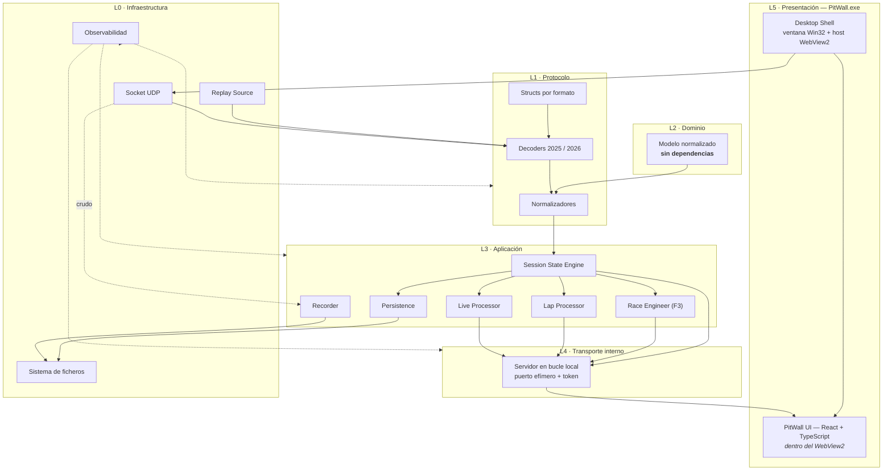
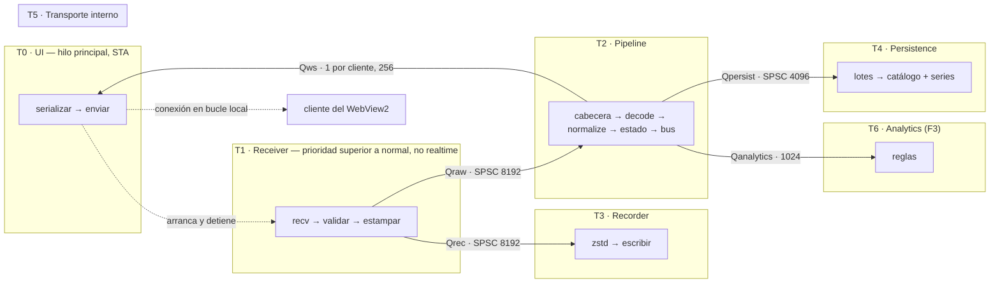
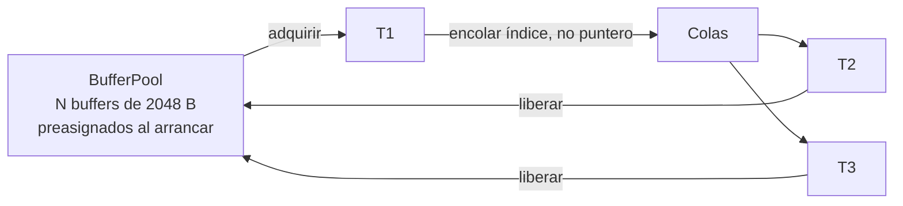
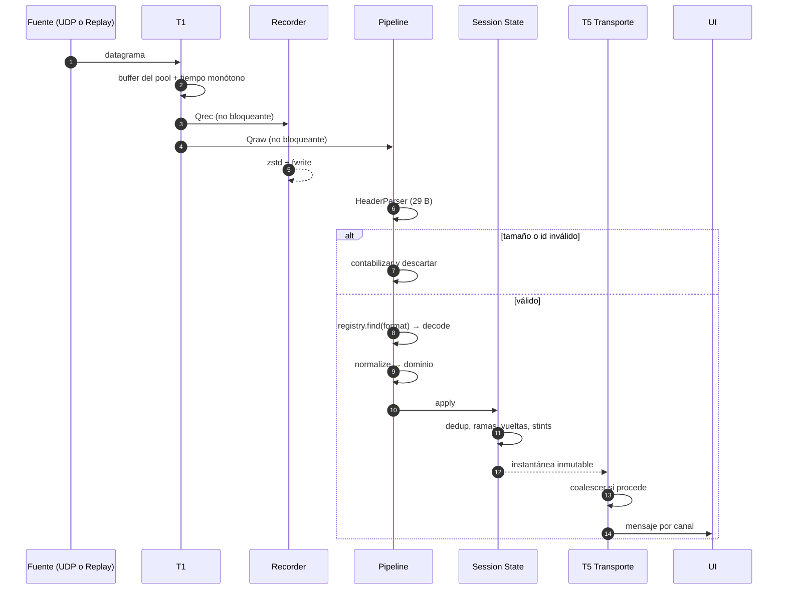

# Arquitectura

## 1. Fuerzas que gobiernan el diseño

Toda decisión de este documento responde a una de estas seis fuerzas. Cuando dos entran en conflicto, prevalece la de menor número.

| # | Fuerza | Origen |
|---|---|---|
| **F1** | **La recepción UDP no se bloquea jamás.** Un datagrama perdido es irrecuperable: no hay retransmisión (LIM-02) | RNF-050 |
| **F2** | **El protocolo cambia todos los años.** El dominio no puede saber qué año se está recibiendo | RNF-040 |
| **F3** | **Latencia percibida < 150 ms** de extremo a extremo | RNF-004 |
| **F4** | **El dato crudo debe conservarse** para poder reprocesar | P2 |
| **F5** | **Debe ser desarrollable sin el juego abierto** | OBJ-06 |
| **F6** | **Es una aplicación de escritorio, no un producto web.** Un ejecutable, una ventana, cero pasos manuales | ADR-002 v2 |

La cuarta y la quinta suelen olvidarse en este tipo de proyectos y son las que más condicionan la forma final: obligan a que la fuente de datos sea **intercambiable** y a que la grabación ocurra **antes** de entender nada.

La sexta llegó después, con el cambio de enfoque de producto (ADR-002 v2), y es la prueba de fuego de
esta arquitectura: **sólo afectó a la capa de presentación**. Ni el receptor, ni los decoders, ni el
dominio, ni el estado, ni la persistencia cambiaron una línea.

---

## 2. Vista de capas



**Regla de dependencia:** las flechas sólidas nunca apuntan hacia arriba. `L2 · Dominio` no depende de nada, ni siquiera de `L1`. Es `L1` quien conoce a `L2` para poder traducir hacia él.

**Todo el diagrama es un único proceso: `PitWall.exe`.** El shell es quien arranca el núcleo, no al
revés: la ventana existe desde el primer instante, y la recepción UDP se pone en marcha detrás de
ella sin que el usuario haga nada (RF-622).

Nótese que el servidor HTTP de recursos estáticos **ha desaparecido**: los ficheros de la interfaz se
sirven por mapeo de nombre de host virtual del WebView2 a la carpeta de recursos del ejecutable
(RF-308). Un componente menos que en la versión anterior de esta arquitectura.

---

## 3. Componentes

### 3.1. `net` — Fuentes de datagramas

| Responsabilidad | Detalle |
|---|---|
| `UdpReceiver` | Enlaza el socket, lee en bucle, estampa tiempo monótono, valida longitud mínima, encola |
| `ReplaySource` | Lee un `.f1raw` y produce la misma secuencia de eventos que `UdpReceiver` |
| `DatagramSource` | Interfaz común. **Nadie aguas abajo sabe cuál está activa** |

Que ambas implementen la misma interfaz es lo que hace realidad F5. No es un detalle de pruebas: es una decisión arquitectónica.

```cpp
// core/include/pw/net/received_datagram.hpp — lo que T1 pone en Qraw y Qrec
struct ReceivedDatagram {
    mem::BufferHandle handle{};                      // referencia al buffer del pool (16 B)
    std::uint64_t     recvTimeNs{0};                 // reloj monótono, al volver recvfrom (RF-007)
    Ipv4Endpoint      origin{};                      // IP y puerto exactos del emisor (RF-009)
    SourceIndex       source{kUnregisteredSource};   // índice estable en SourceRegistry (F1.1-09)
};
static_assert(sizeof(ReceivedDatagram) == 32);

// Contrato de ciclo de vida de una fuente (F1.1-12): la fuente NO crea hilos.
// Su dueño la ejecuta en un hilo propio y la para con el stop_token.
class IDatagramSource {
public:
    virtual ~IDatagramSource() = default;
    virtual void run(std::stop_token stop) = 0;   // vuelve tras request_stop() o al cerrarse el socket
};
```

*(v1.5: la versión anterior describía `start(DatagramSink&)` / `stop()`; el contrato real es
`run(std::stop_token)` ejecutado por un hilo externo. `UdpReceiver` lo cumple hoy sin heredar todavía
de la interfaz, que llegará con su segunda implementación, `ReplaySource`, en F1.4. Orden de parada y
precondición de `close()` en `06-REALTIME-PIPELINE.md` §2.4.)*

*(v1.3: el esquema anterior mostraba un `std::span` de bytes y un `SourceEndpoint`; lo que existe es lo
de arriba.)* Los campos de `ReceivedDatagram`:

| Campo | Qué es |
|---|---|
| `handle` | Referencia contada al buffer del pool. Los **bytes no viajan en el elemento**: se leen con `pool.bytes(handle)`, y su longitud útil con `pool.payloadSize(handle)`, para que no haya dos copias del mismo número |
| `recvTimeNs` | Marca monótona tomada en cuanto `recvfrom` devuelve, antes de cualquier otro trabajo |
| `origin` | El endpoint **exacto** del emisor, siempre presente |
| `source` | Índice **estable** del origen en `SourceRegistry` (0..7) mientras viva el receptor. `kUnregisteredSource` significa que la tabla de orígenes estaba **llena** cuando apareció ese emisor; el endpoint exacto sigue en `origin` |

`source` ocupa un byte del relleno que el struct ya tenía: el elemento de cola sigue midiendo **32 B**,
comprobado con `static_assert`. Tabla de orígenes y su política de tabla llena: `06-REALTIME-PIPELINE.md`
§2.2.2.

### 3.2. `protocol` — Structs por formato

Espacios de nombres separados y estancos: `pw::proto::f1_2025` y `pw::proto::f1_2026`. Contienen únicamente:

- Los `struct` con `#pragma pack(push, 1)`, transcritos de la especificación.
- Las constantes del formato.
- Los `static_assert` de tamaño.
- Las **tablas de catálogo del formato**: la correspondencia `id → dato oficial` de equipos, pilotos, circuitos, nacionalidades, modos, penalizaciones e infracciones, como datos `constexpr` (D4 de `05-DATA-MODEL.md`: el mismo número significa cosas distintas en 2025 y 2026).

**No contienen lógica.** No incluyen ninguna cabecera del dominio, no presentan datos y **no resuelven identificadores desconocidos**: un `id` que no está en la tabla no produce aquí ningún texto. Esa resolución tolerante es de `normalize` (§3.5). Un cambio de EA se refleja aquí y en ningún otro sitio de este módulo.

### 3.3. `decoder` — Validación y decodificación

| Responsabilidad | Detalle |
|---|---|
| `HeaderParser` | Lee los 29 bytes comunes. Único punto que lee sin conocer el formato |
| `DecoderRegistry` | Mapa `packetFormat → IProtocolDecoder*`. Registro estático al arrancar |
| `F1_2025_Decoder` / `F1_2026_Decoder` | Validan tamaño exacto y versión; producen una vista tipada sobre el buffer |

```cpp
// Un paquete cuyo (formato, id, versión, tamaño) ya se validó. Es una VISTA:
// no posee nada y vive lo que viva el buffer del que salió.
struct ValidatedPacket {
    std::uint16_t              format;    // m_packetFormat del que salió
    PacketId                   id;
    std::uint8_t               version;   // m_packetVersion observada
    const PacketHeader*        header;    // apunta DENTRO de payload
    std::span<const std::byte> payload;   // datagrama completo, tamaño ya exacto
};

class IProtocolDecoder {
public:
    virtual ~IProtocolDecoder() = default;
    virtual std::uint16_t formatId() const noexcept = 0;
    virtual std::optional<std::size_t> expectedSize(PacketId) const noexcept = 0;
    virtual bool supportsVersion(PacketId, std::uint8_t) const noexcept = 0;
    virtual Result<ValidatedPacket, DecodeStatus>
        decode(const PacketHeader&, std::span<const std::byte> payload) const noexcept = 0;
};
```

**El decoder no conoce `pw::domain` ni llama a `pw::normalize`.** Devuelve una `ValidatedPacket`, que es un struct trivialmente copiable de un puñado de bytes: **cero asignaciones por paquete** (RNF-013) y ninguna copia del datagrama. Quien la recibe obtiene el struct del protocolo con `viewAs<T>` (`06-REALTIME-PIPELINE.md` §4.1), cuya precondición de tamaño **ya está garantizada** por esta validación.

La traducción a dominio es de `normalize` (§3.5), que se implementa en F1.3. Es lo que mantiene la frontera del principio E2: `decoder` conoce `proto`, **no** `domain`; `normalize` es el único que conoce los dos.

> **Por qué una vista y no un sumidero con un método por paquete.** Un `sink` con un método por tipo tendría 17 métodos en 2026 y 16 en 2025 —33 en total—, y **la interfaz quedaría acoplada a los structs de cada formato**, que es justo lo que ADR-008 evita. La vista resuelve lo mismo con un struct y un método: el consumidor despacha por `id` y pide el tipo que le corresponde. Sin `variant`, sin borrado de tipos, sin `std::any`, sin RTTI y sin montón.

### 3.4. `domain` — Modelo normalizado

El módulo más importante y el más pequeño. Contiene los tipos que describen una sesión de carreras **sin referencia alguna al protocolo**: `Session`, `Participant`, `CarTelemetryFrame`, `LapRecord`, `SessionEvent`, `TyreState`, `RaceControlState`…

Reglas verificadas automáticamente:

1. No incluye ninguna cabecera de `protocol`, `decoder` ni `net`.
2. Ningún nombre de campo empieza por `m_`.
3. Ningún tipo menciona un año.
4. Los canales que un formato puede no proporcionar son `std::optional<T>` con una razón de ausencia asociada.

```cpp
enum class Provenance : std::uint8_t { Raw, Derived, Estimated, Unavailable, Restricted };

template <typename T>
class Channel {           // valor + procedencia, siempre juntos
    std::optional<T> value_;
    Provenance       provenance_;
public:
    bool known() const noexcept { return value_.has_value(); }
    Provenance provenance() const noexcept { return provenance_; }
    const T& value() const;              // lanza si !known()
};
```

`Channel<T>` es la materialización en código de la taxonomía obligatoria (`01-REQUIREMENTS.md` §19.6). Hace **imposible por construcción** exponer un valor sin su procedencia, que es preferible a confiar en la disciplina del programador.

### 3.5. `normalizer` — El puente

Funciones libres, sin estado, una por formato y tipo de paquete:

```cpp
namespace pw::normalize {
    void apply(const proto::f1_2026::PacketCarTelemetryData&,
               const ParticipantTelemetryPolicy&,
               domain::FrameBuilder&);
}
```

Es el **único** módulo que incluye a la vez cabeceras de `protocol` y de `domain`. Aquí ocurren:

- El desescalado de valores cuantizados (÷ 32767,0 y ÷ 1000,0).
- La conversión de centinelas a ausencia.
- La traducción de enumerados dependientes del formato (`ersDeployMode` 3: *overtake* / *boost*).
- La aplicación de la política de telemetría restringida por participante.
- La resolución de catálogos (`teamId` → nombre de equipo del año correcto) **y su fallback presentable**: un `id` que no está en la tabla del formato se resuelve a «Desconocido (n)», nunca a un fallo (RF-111). Las tablas viven en `proto` (§3.2); resolverlas y decidir qué se muestra, aquí.

### 3.6. `session-state` — El propietario del estado

Un único componente posee **toda** la verdad mutable. Nadie más la modifica.

| Responsabilidad | Detalle |
|---|---|
| Ciclo de vida de sesión | Detección de inicio, cambio y fin; histéresis anti-rebote |
| Estado de participantes y coches | Con su política de telemetría vigente |
| Reconstrucción de vueltas, sectores y stints | |
| Gestión de ramas de flashback | `branchId`, marcado de muestras superadas |
| Deduplicación y descarte de obsoletos | Por `overallFrameIdentifier` |
| Publicación de instantáneas | Estructuras **inmutables** compartidas por puntero contado |

Publicar instantáneas inmutables en lugar de exponer el estado elimina de raíz la clase de errores más difícil de depurar en este tipo de sistemas: dos hilos leyendo mientras uno escribe.

### 3.7. `processors` — Consumidores del bus

| Componente | Función | Fase |
|---|---|---|
| `LiveProcessor` | Prepara la vista de cronometraje y el estado en vivo | F1 |
| `LapProcessor` | Cierra vueltas, indexa por distancia, calcula métricas `DERIVED` | F1 |
| `RaceEngineer` | Motor de reglas sobre el estado | F3 |

Todos son **puros respecto al estado**: leen instantáneas y producen resultados. Ninguno escribe en `session-state`.

### 3.8. `recorder` y `persistence`

| Componente | Escribe | Entrada | Hilo |
|---|---|---|---|
| `RawRecorder` | `.f1raw` | Datagramas crudos, **antes de decodificar** | T3 |
| `CatalogWriter` | Catálogo transaccional | Entidades de baja frecuencia | T4 |
| `SeriesWriter` | Columnar comprimido | Muestras de alta frecuencia, por lotes | T4 |

Que `RawRecorder` se conecte antes del decoder es la corrección C2 del esquema original: **se graba lo que llegó, no lo que entendimos**. Si mañana el decoder resulta tener un fallo, la captura sigue siendo correcta.

### 3.9. `transport` — Transporte interno hacia la interfaz

> **No es una API pública.** Es el cable entre dos mitades del mismo proceso (ADR-002 v2).

| Responsabilidad | Detalle |
|---|---|
| Servidor en bucle local | **Exclusivamente `127.0.0.1`, puerto efímero** asignado por el sistema (SEC-13) |
| Autenticación | **Token de un solo uso** generado al arrancar; sólo lo conoce el WebView2 propio (SEC-14, RF-307) |
| Gestión de suscripciones | Por canal y por `vehicleIdx` |
| Cola por cliente | Aísla al consumidor lento (RT-09) |
| Coalescing | Descartar intermedios en canales de alta frecuencia (RF-304) |
| Serialización | JSON para control y estado; **binario compacto** para telemetría |

Lo que **ya no** hace, respecto a la versión anterior de esta arquitectura:

- No sirve ficheros por HTTP. De eso se encarga el mapeo de host virtual del WebView2 (RF-308).
- No escucha en un puerto fijo ni configurable.
- No admite conexiones de otros procesos ni de la red.
- No soporta multicliente: el único cliente posible es la ventana propia.

### 3.10. `shell` — La aplicación de escritorio

El componente que convierte un motor de telemetría en un producto.

| Responsabilidad | Detalle | Requisito |
|---|---|---|
| Ventana Win32 | Creación, bucle de mensajes, redimensionado, icono, cierre | RF-620 |
| Host de WebView2 | Crear el entorno, incrustar el control, ajustarlo al área cliente | RF-621 |
| Recursos de la interfaz | Mapeo de nombre de host virtual a la carpeta de recursos | RF-308 |
| Puente de arranque | Inyectar el puerto efímero y el token en la página antes de que cargue | RF-307 |
| Arranque del núcleo | Levantar los hilos y **poner a escuchar el UDP solo** | RF-622 |
| Instancia única | Mutex con nombre; un segundo arranque activa la ventana existente | RF-625 |
| Estado de ventana | Persistir posición, tamaño y maximizado | RF-626 |
| PPP | Consciencia por monitor v2 | RF-627 |
| Diálogos de fichero | Diálogos nativos de Windows expuestos a la interfaz | RF-631 |
| Enlaces externos | Interceptar la navegación y abrirla en el navegador del sistema | SEC-20 |
| Comprobación de runtime | Detectar la ausencia de WebView2 Runtime y explicarla | RF-632 |
| Cierre ordenado | Drenar colas, cerrar captura, liberar socket antes de salir | RF-629 |

`shell` es el **único módulo específico de Windows** del proyecto. El núcleo sigue compilando en
Linux sin él (RNF-091), lo que además permite ejecutar en integración continua todo lo que no es
interfaz. Otros módulos pueden tener **adaptadores de plataforma** acotados —`pw::net` los tiene para
Winsock y para la prioridad de T1—, siempre con su equivalente POSIX detrás de la misma interfaz.

### 3.11. `observability`

Registro de métricas de coste despreciable (contadores atómicos e histogramas de cubos fijos) más logging estructurado asíncrono. Es transversal y **no** participa en el grafo de dependencias funcionales.

---

## 4. Concurrencia

### 4.1. Modelo de hilos



**T0 es el hilo principal del proceso**, el que ejecuta `WinMain`, crea la ventana y bombea el bucle
de mensajes de Windows. El WebView2 exige un apartamento de un solo hilo (STA), así que T0 no puede
hacer trabajo pesado: crea el resto de hilos y se queda atendiendo mensajes.

Es también el hilo desde el que se **arranca la recepción** en cuanto la ventana existe (RF-622). Ni
el usuario ni la interfaz tienen que pedirlo.

### 4.2. Contrato de cada hilo

| Hilo | Puede | **No puede, bajo ninguna circunstancia** |
|---|---|---|
| **T0** | Bombear mensajes de Windows, redimensionar el WebView2, abrir diálogos nativos, arrancar y parar el núcleo | Bloquearse esperando a T1-T6 · Decodificar · Tocar el estado de sesión · Hacer E/S de disco pesada |
| **T1** | `recvfrom`, validar longitud, estampar tiempo, encolar | Tocar disco · Enviar por red · Asignar memoria · Tomar un mutex compartido con T2-T6 · Registrar log síncrono |
| **T2** | Decodificar, normalizar, mutar el estado, publicar | Tocar disco · Enviar por red · Bloquearse esperando a T3-T6 |
| **T3** | Comprimir y escribir la captura | Devolver contrapresión a T1 |
| **T4** | Escribir catálogo y series | Devolver contrapresión a T2 |
| **T5** | Serializar y transmitir | Devolver contrapresión a T2 |
| **T6** | Calcular | **Mutar el estado** |

### 4.3. Políticas de las colas

| Cola | Tipo | Capacidad | Desbordamiento | Justificación |
|---|---|---|---|---|
| `Qraw` | SPSC lock-free | 8192 | **Descartar el más nuevo** + contador | ~20 s de margen a 415 datagramas/s. Si se llena, algo va muy mal aguas abajo |
| `Qrec` | SPSC lock-free | 8192 | **Descartar el más nuevo** + contador + aviso | Preferible una captura con un hueco marcado a perder el directo |
| `Qpersist` | SPSC | 4096 | **Descartar muestras de alta frecuencia**; **nunca** eventos ni cierres de vuelta | La telemetría es densa y redundante; un evento es irrepetible |
| `Qws` (por cliente) | SPSC | 256 | **Coalescer**: sustituir la muestra pendiente por la nueva | Mantiene la latencia acotada por diseño |
| `Qanalytics` | SPSC | 1024 | Descartar el más antiguo | El análisis tolera perder muestras intermedias |

**Ninguna cola bloquea al productor. Nunca.** Toda pérdida se contabiliza y se muestra en *UDP Diagnostics*. Una pérdida silenciosa sería peor que la propia pérdida.

> **Por qué `Qraw` descarta el más nuevo y no el más antiguo** *(decidido en F1.1-01; la v1.1 de este
> documento decía «el más antiguo»)*.
>
> En una cola de un productor y un consumidor, el índice de lectura es **propiedad exclusiva del
> consumidor**, y esa exclusividad es justamente lo que permite prescindir de CAS en el camino
> caliente. Descartar el más antiguo significa avanzar ese índice: si lo avanzara el productor,
> tendría dos escritores y la cola dejaría de ser SPSC. Haría falta CAS sobre el índice de lectura
> **y** una marca de secuencia por ranura para que el consumidor detectase que le han sobrescrito la
> que estaba leyendo.
>
> Y hay una razón más fuerte que la complejidad: `Qraw` transporta `BufferHandle`, que son
> **referencias contadas**. Sobrescribir una ranura obliga a soltar la referencia que había en ella,
> y el productor no puede saber si el consumidor está leyendo justo ese buffer. La propiedad del
> elemento sobrescrito quedaría sin dueño definido, que es un fallo peor que la pérdida que se
> intentaba evitar.
>
> **Contrato del productor cuando `tryPush` falla:** deja intacto lo que ya hay en la cola, suelta la
> referencia que había retenido para ella, incrementa el contador de descartes de esa cola y sigue
> sin bloquearse.
>
> *Posibilidad futura, no requisito:* si las mediciones reales demostrasen que hace falta recuperar
> frescura, el consumidor puede saltar adelante cuando detecte retraso. Eso conserva el modelo SPSC
> porque el índice de lectura sigue teniendo un solo dueño. No se implementa hasta que una medición
> lo justifique.
>
> El mismo razonamiento estructural aplica a `Qanalytics`, que también figura como SPSC con
> «descartar el más antiguo». Se revisará al implementarla en F3; hoy no existe.

### 4.4. Gestión de memoria en el camino caliente



- Los buffers se preasignan al arrancar. **Cero asignaciones por datagrama** (RNF-013).
- 2048 B cubre con holgura el paquete mayor (1470 B en 2026) y absorbe un formato futuro más grande.
- Las colas transportan **índices** al pool, no punteros, lo que hace trivial detectar un uso tras liberación.
- Un buffer se libera cuando **ambos** consumidores (pipeline y recorder) lo han soltado: recuento de referencias sencillo.

### 4.5. Verificación de la concurrencia

| Técnica | Qué detecta |
|---|---|
| ThreadSanitizer en integración continua | Carreras de datos reales durante la suite |
| Replay determinista | Reproducción exacta del escenario que falló |
| Propiedad única del estado | Elimina por construcción la mayoría de carreras |
| Instantáneas inmutables | Elimina lecturas concurrentes con escritura |
| Métricas de profundidad de cola | Detecta contrapresión antes de que cause pérdida |

---

## 5. Flujo de eventos

### 5.1. Canales del bus

| Canal | Contenido | Garantía | Ritmo |
|---|---|---|---|
| `session` | Contexto, participantes, reglas | Fiable, coalescible | Al cambiar |
| `timing` | Estado de cronometraje de todos los coches | Fiable, coalescible | 5-10 Hz |
| `telemetry` | Muestras de alta frecuencia por coche suscrito | Mejor esfuerzo, coalescible, **binario** | Negociable, por defecto 20 Hz |
| `events` | Banderas, incidentes, penalizaciones, adelantamientos | **Fiable, no coalescible** | Al ocurrir |
| `diagnostics` | Métricas internas | Mejor esfuerzo | 2 Hz |
| `replay` | Progreso y control de reproducción | Fiable | Al cambiar |

La distinción entre coalescible y no coalescible es la decisión más importante del transporte: **una posición de coche antigua no vale nada, pero una penalización perdida es un defecto**.

### 5.2. Secuencia completa



---

## 6. Decisiones arquitectónicas y sus alternativas

### 6.1. Por qué el recorder va antes del decoder

| Opción | Consecuencia |
|---|---|
| Grabar tras decodificar | La captura hereda los fallos del decoder de hoy. Un formato mal transcrito produce una captura inservible **y ya no hay forma de recuperar el original**. |
| **Grabar antes de decodificar** | La captura es la verdad de lo emitido. Cualquier fallo del decoder se corrige y se **reprocesa** (RF-413). |

### 6.2. Por qué instantáneas inmutables y no acceso compartido

| Opción | Consecuencia |
|---|---|
| Mutex sobre el estado | T5 y T4 pueden bloquear a T2 al leer. Viola el contrato de T2 y arruina F3. |
| Copia por consumidor | Coste de copia por consumidor y por instante. |
| **Instantánea inmutable compartida** | Una construcción, muchos lectores sin bloqueo, liberación por recuento de referencias. |

### 6.3. Por qué binario y no JSON para la telemetría

Una muestra de telemetría de un coche tiene ~40 valores numéricos. En JSON con nombres son ~600 B; en binario compacto, ~90 B. A 20 Hz y 24 coches suscritos son **288 KB/s frente a 43 KB/s**, más el coste de análisis sintáctico dentro del WebView2 en cada muestra.

El estado de baja frecuencia sí va en JSON: es infrecuente, cambia de forma y la legibilidad durante el desarrollo compensa.

### 6.4. Por qué el shell arranca al núcleo, y no al revés

| Opción | Consecuencia |
|---|---|
| El núcleo arranca y luego abre una ventana | La ventana aparece tarde. Si el núcleo falla al arrancar —puerto ocupado, disco lleno— **no hay ninguna interfaz donde explicarlo**, que es justo cuando más falta hace |
| **El shell arranca primero y levanta el núcleo detrás** | La ventana existe desde el primer segundo. Un fallo de arranque se explica dentro de la aplicación (RF-624, RNF-097) |

Parece un detalle de orden de inicialización y no lo es: decide si el peor escenario del usuario
—«lo abro y no pasa nada»— tiene o no tiene dónde mostrarse.

### 6.5. Por qué un único hilo de pipeline

Con 415 datagramas/s y un presupuesto de 50 µs por decodificación (RNF-002), un hilo consume ~2 % de un núcleo. Paralelizar la decodificación introduciría reordenación —justo lo que el estado necesita evitar— a cambio de un ahorro irrelevante. Si algún día el presupuesto se agota, el punto natural de paralelización es por `packetId`, no por datagrama.

---

## 7. Puntos de extensión previstos

Preparados, **pero vacíos** hasta que se necesiten (RSK-08).

| Extensión | Punto de enganche | Coste estimado |
|---|---|---|
| Formato 2027 | `DecoderRegistry::registerDecoder` | 3-5 días |
| Fuente adicional (segundo juego, segunda consola) | Otra implementación de `IDatagramSource` | 1-2 días |
| Regla nueva del ingeniero | Registro de reglas del `RaceEngineer` | Horas |
| Exportador nuevo | Consumidor del bus | 1 día |
| Cliente alternativo (aplicación móvil) | Cliente del transporte interno. **Hoy fuera de alcance** (OUT-11): exigiría un ADR nuevo que reabra la exposición a la red | Independiente |
| Reenvío UDP a terceros | Consumidor de `Qrec` | 1 día |

---

## 8. Lo que esta arquitectura conscientemente **no** hace

| No hace | Por qué |
|---|---|
| Microservicios | Un proceso, un usuario, una máquina. La red entre componentes sólo añadiría latencia y fallos. |
| Inyección de dependencias generalizada | El grafo es estático y conocido. Un contenedor añadiría indirección sin beneficio. |
| Abstraer la base de datos tras un repositorio genérico | Las tres capas de almacenamiento son deliberadamente distintas. Uniformarlas destruiría lo que las hace adecuadas. |
| Event sourcing completo | La captura cruda ya cumple ese papel, y mejor: es el evento original, no una reinterpretación. |
| Plugins en tiempo de ejecución | Complejidad y superficie de ataque sin caso de uso. |
| **Producto web** | La interfaz vive dentro de la ventana del proceso. Ni navegador, ni URL, ni acceso desde la LAN (OUT-10, OUT-11, ADR-002 v2). |
| **Servidor HTTP** | Eliminado: los recursos se sirven por mapeo de host virtual del WebView2. |
| **Multicliente** | Sólo existe un cliente posible: la propia ventana. |
| **Electron o Tauri** | Uno pesa ~150 MB y añade un runtime de Node; el otro exige Rust como anfitrión. Con un núcleo en C++, WebView2 es el único que no añade un tercer lenguaje (ADR-002 v2). |
| **Docker** | Ni para ejecutar ni para distribuir. El juego emite a `127.0.0.1` y un contenedor no está en esa pila de red (ADR-016). |

---

## Sources

### Official

| Título | Uso |
|---|---|
| `Data Output from F1® 25: 2026 Season Pack` v1.2 | Frecuencias, agrupación por fotograma, tamaños que dimensionan colas y buffers |
| `Data Output from F1® 25 Game` v3 | Ídem para el formato 2025 |

### Reference implementations

| Proyecto | Uso |
|---|---|
| `volodymyr-fed/F1Game.UDP` (MIT) | Confirmación del patrón de registro de decoders y de mapeo directo de structs |
| `mathieu-lemay/f1-telemetry-rs` | Separación decoder/dominio sin recolector de basura |

Consultadas el 11 de septiembre de 2026.

---

*Fin de `PW-ARC-004` v1.2*
