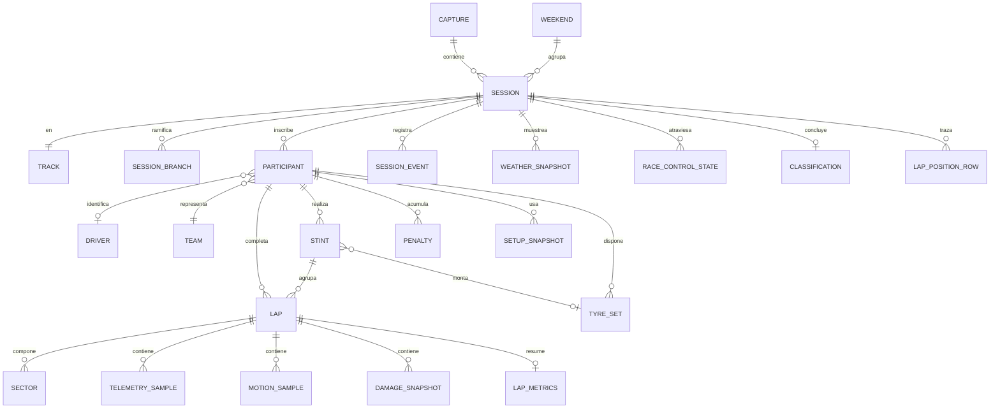
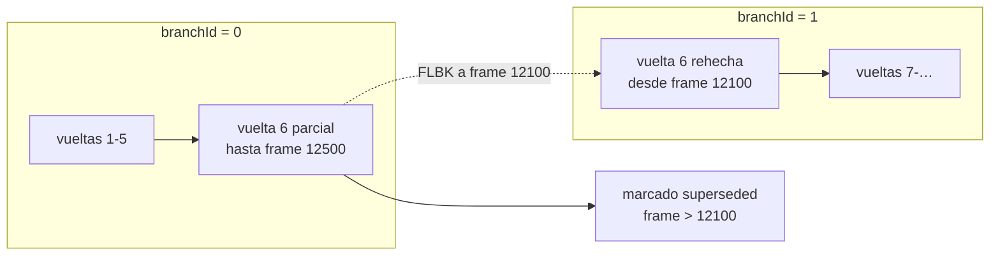

# Modelo de datos

## 1. Principios

| # | Principio |
|---|---|
| D1 | **Un valor nunca viaja sin su procedencia.** `RAW`, `DERIVED`, `ESTIMATED`, `UNAVAILABLE` o `RESTRICTED` |
| D2 | **La frecuencia determina el almacén.** Lo que cambia 60 veces por segundo no vive donde lo que cambia una vez por sesión |
| D3 | **El crudo es inmutable.** Todo reproceso genera artefactos nuevos, jamás modifica la captura |
| D4 | **Los catálogos son por formato.** El mismo número significa cosas distintas en 2025 y 2026 |
| D5 | **Los flashbacks ramifican, no borran** |
| D6 | **Toda métrica derivada documenta entradas, fórmula, frecuencia y limitaciones** |

---

## 2. Modelo conceptual



---

## 3. Entidades

### 3.1. Contenedores

#### `Capture`
Un fichero `.f1raw`. Puede contener varias sesiones consecutivas, pero **nunca dos formatos de protocolo distintos**.

| Campo | Tipo | Notas |
|---|---|---|
| `captureId` | UUID | |
| `path` | texto | Ruta relativa al directorio de datos |
| `createdAt` | timestamp UTC | |
| `protocolFormat` | entero | 2025 o 2026 |
| `gameVersion` | texto | `major.minor` observado |
| `pitwallVersion` | texto | Versión que la generó |
| `durationMs`, `datagramCount`, `bytesRaw`, `bytesCompressed` | enteros | |
| `protected` | booleano | Exenta de la retención automática |
| `integrity` | enum | `complete`, `truncated`, `corrupt` |

#### `Weekend`
Agrupación derivada de `m_weekendLinkIdentifier` y `m_seasonLinkIdentifier`. Permite ver «todas las sesiones de este fin de semana».

#### `Session`

| Campo | Tipo | Origen | Procedencia |
|---|---|---|---|
| `sessionKey` | texto | `sessionUid` + discriminador local | `DERIVED` |
| `sessionUid` | entero 64 | `m_sessionUID` | `RAW` |
| `captureId`, `weekendId` | referencia | | |
| `protocolFormat`, `gameYear` | entero | Cabecera | `RAW` |
| `sessionType`, `trackId`, `formula`, `ruleSet`, `gameMode` | entero | Session | `RAW` |
| `totalLaps`, `sessionDuration`, `trackLength`, `pitSpeedLimit` | entero | Session | `RAW` |
| `aiDifficulty`, `networkGame`, `equalCarPerformance` | | Session | `RAW` |
| `sector2Start`, `sector3Start` | real | Session | `RAW` |
| `assists` | objeto | Session (todas las asistencias) | `RAW` |
| `rules` | objeto | Session (daños, colisiones, safety car, parc fermé…) | `RAW` |
| `drsZones`, `activeAeroZonesFull`, `activeAeroZonesPartial` | lista | Session **2026** | `RAW` / `UNAVAILABLE` en 2025 |
| `startedAt`, `endedAt` | timestamp | Reloj local | `DERIVED` |
| `partial` | booleano | PitWall se conectó con la sesión ya empezada | `DERIVED` |
| `numSafetyCarPeriods`, `numVSCPeriods`, `numRedFlagPeriods` | entero | Session | `RAW` |

#### `SessionBranch`
Rama creada por un flashback (D5).

| Campo | Tipo | Notas |
|---|---|---|
| `branchId` | entero | 0 = rama original |
| `parentBranchId` | entero | |
| `createdAtFrame` | entero | `flashbackFrameIdentifier` |
| `createdAtOverallFrame` | entero | **Monótono**: sitúa la rama en la captura |
| `reason` | enum | `flashback_event`, `inferred_rewind` |

### 3.2. Identidad

#### `Participant`
Presencia de un competidor **en una sesión concreta**.

| Campo | Tipo | Notas |
|---|---|---|
| `sessionKey` + `vehicleIdx` | **clave primaria compuesta** | RN-004 |
| `aiControlled` | booleano | |
| `driverId` | entero \| nulo | **Nulo si 255/65535** (humano en red) |
| `networkId` | entero \| nulo | Válido sólo dentro de la sesión |
| `teamId` | entero | |
| `raceNumber`, `nationality`, `platform` | entero | |
| `displayName` | texto | Puede venir truncado con `…` |
| `myTeam` | booleano | |
| `telemetryLevel` | enum | `restricted` / `public`. **Gobierna RN-001** |
| `showOnlineNames` | booleano | |
| `techLevel` | entero | |
| `liveryColours` | lista RGB | Fuente legítima del color de equipo |
| `identityKey` | texto \| nulo | `DERIVED`: huella estable entre sesiones |

**`identityKey`** se construye como `hash(driverId, teamId, raceNumber, normalize(name))` **sólo cuando `driverId` no es nulo**. Para humanos en red no se genera identidad persistente (RN-004, PRV-02).

#### `Driver`, `Team`, `Track`
Catálogos locales con **clave compuesta `(protocolFormat, id)`** (D4). Contienen el nombre presentable y metadatos derivados (para `Track`: nombre, país, si es trazado inverso, referencia al trazado reconstruido).

### 3.3. Progreso

#### `Lap`

| Campo | Tipo | Procedencia |
|---|---|---|
| `sessionKey`, `vehicleIdx`, `lapNumber`, `branchId` | **clave primaria** | |
| `lapTimeMs` | entero \| nulo | `RAW` |
| `valid` | booleano | `RAW` (`m_currentLapInvalid`, `m_lapValidBitFlags`) |
| `invalidationReason` | enum \| nulo | `DERIVED` del evento `PENA` |
| `startOverallFrame`, `endOverallFrame` | entero | `DERIVED`. Delimitan las muestras |
| `startedAt`, `endedAt` | timestamp | `DERIVED` |
| `stintId` | referencia | `DERIVED` |
| `tyreCompoundActual`, `tyreCompoundVisual`, `tyreAgeLaps` | entero | `RAW` |
| `fuelAtStart`, `fuelAtEnd` | real \| nulo | `RAW` / `RESTRICTED` |
| `positionAtStart`, `positionAtEnd` | entero | `RAW` |
| `pitStatusDuringLap` | enum | `DERIVED` |
| `underSafetyCar`, `underVSC` | booleano | `DERIVED` |
| `trafficAffected` | booleano \| nulo | `ESTIMATED` (F3) |
| `sampleCount`, `distanceCoverage` | entero / real | `DERIVED`. Miden la calidad del dato |

`distanceCoverage` es la fracción de la vuelta con muestras. Una vuelta con cobertura < 0,95 **no se usa** para comparar sin advertirlo (CU-10 E1).

#### `Sector`
`(sessionKey, vehicleIdx, lapNumber, branchId, sectorIndex)` con `timeMs`, `valid`, `personalBest`, `sessionBest`.

**Nota de reconstrucción:** el tiempo de sector llega en dos partes (minutos + ms). La conversión es `minutos × 60000 + ms` (`03-UDP-PROTOCOL.md` §6.2).

#### `Stint`

| Campo | Tipo | Procedencia |
|---|---|---|
| `stintId` | UUID | |
| `sessionKey`, `vehicleIdx`, `stintIndex` | | |
| `startLap`, `endLap` | entero | `DERIVED` |
| `tyreCompoundActual`, `tyreCompoundVisual` | entero | `RAW` |
| `tyreSetIndex` | entero \| nulo | `RAW` / `RESTRICTED` |
| `degradationSlopeMsPerLap` | real \| nulo | **`ESTIMATED`** (§6.4) |
| `degradationR2`, `cleanLapCount` | real / entero | `DERIVED`. Calidad del ajuste |
| `avgLapTimeMs`, `bestLapTimeMs`, `consistencyStdDevMs` | entero / real | `DERIVED` |

#### `TyreSet`
Los 20 juegos por coche. **Todo el bloque es `RESTRICTED`** para rivales con telemetría restringida.

### 3.4. Eventos

#### `SessionEvent`

| Campo | Tipo |
|---|---|
| `eventId` | entero autoincremental |
| `sessionKey`, `branchId` | |
| `overallFrame`, `sessionTime`, `wallClock` | Los tres relojes |
| `code` | texto de 4 caracteres |
| `type` | enum de dominio |
| `primaryVehicleIdx`, `secondaryVehicleIdx` | entero \| nulo |
| `payload` | objeto | Campos específicos ya normalizados |

**Los eventos nunca se descartan** por contrapresión (§4.3 de `04-ARCHITECTURE.md`) ni por deduplicación agresiva: son irrepetibles.

#### `Penalty`
Vista especializada de los eventos `PENA`, con `penaltyType`, `infringementType`, `timeSeconds`, `lapNumber`, `placesGained`, `served`.

#### `RaceControlState`
Estado con transiciones, no muestreo: `safetyCarStatus`, `drsEnabled`, `redFlag`, y en 2026 `partialModeEnabled`, `overtakeModeEnabled`, con `fromOverallFrame` / `toOverallFrame`.

#### `WeatherSnapshot` y `WeatherForecast`
Condiciones observadas (2/s, decimadas al persistir) y la previsión completa con su `forecastAccuracy`.

### 3.5. Series de alta frecuencia

#### `TelemetrySample`

Clave: `(sessionKey, branchId, vehicleIdx, overallFrame)`.

| Grupo | Campos | Origen |
|---|---|---|
| Índices | `sessionTime`, `lapNumber`, `lapDistance`, `totalDistance` | Lap Data |
| Conducción | `speedKph`, `throttle`, `brake`, `steer`, `clutch`, `gear`, `engineRpm` | Car Telemetry |
| Sistemas | `drs`, `revLightsPercent`, `suggestedGear` | Car Telemetry |
| Térmica | `brakeTempC[4]`, `tyreSurfaceTempC[4]`, `tyreInnerTempC[4]`, `engineTempC` | Car Telemetry |
| Neumáticos | `tyrePressurePsi[4]`, `surfaceType[4]` | Car Telemetry |
| Energía | `ersStoreJ`, `ersDeployMode`, `ersDeployedThisLapJ`, `ersHarvestedMgukJ`, `ersHarvestedMguhJ`, `ersHarvestLimitJ` | Car Status |
| Combustible | `fuelKg`, `fuelRemainingLaps`, `fuelMix` | Car Status |
| Frenos | `frontBrakeBias` | Car Status |
| **2026** | `activeAeroMode`, `activeAeroAvailable`, `activeAeroActivationDistanceM`, `overtakeAvailable`, `overtakeActive`, `overtakeActivationDistanceM`, `regulations2026`, `drivingWrongWay` | Car Telemetry 2 |

Los campos de Energía, Combustible y Frenos son `RESTRICTED` para rivales con telemetría restringida.

#### `MotionSample`
`(sessionKey, branchId, vehicleIdx, overallFrame)` con posición, velocidad, direcciones normalizadas **ya desescaladas**, g-forces **ya desescaladas** y ángulos.

**Nota de normalización:** el desescalado ocurre en el normalizador. La capa de datos guarda **valores físicos**, nunca enteros cuantizados. Así una serie de 2025 y una de 2026 son directamente comparables.

#### `MotionExSample`
Sólo para el coche del jugador. Suspensión, velocidades y aceleraciones de suspensión, velocidad de rueda, slip ratio, slip angle, fuerzas lateral, longitudinal y vertical, alturas aerodinámicas, ángulos de balanceo, guiñada y cabeceo del chasis, camber y ganancia de camber.

**Para el resto de coches esta tabla simplemente no tiene filas.** No se rellena con nulos: la ausencia es estructural (LIM-05, RN-012).

#### `DamageSnapshot`
A 10/s. Desgaste y daño de neumáticos y frenos, ampollas, daños de carrocería, fallos de DRS y ERS, y desgaste de los seis componentes de motor.

#### `LapPositionRow`
`(sessionKey, lapNumber, vehicleIdx) → position`. Reconstruida desde el paquete 15, acumulando más allá del límite de 50 vueltas.

### 3.6. Derivados

#### `LapMetrics`
Una fila por vuelta, calculada al cerrarla.

| Métrica | Procedencia |
|---|---|
| `vMinKph`, `vMaxKph`, `vAvgKph` | `DERIVED` |
| `fullThrottlePct`, `brakingPct`, `coastingPct` | `DERIVED` |
| `brakingPoints[]`, `throttlePoints[]` | `DERIVED` |
| `cornerMinSpeeds[]` | `DERIVED` |
| `ersDeployedJ`, `ersHarvestedJ` | `DERIVED` |
| `drsActiveDistanceM`, `overtakeActiveDistanceM` | `DERIVED` |
| `maxTyreTempC`, `maxBrakeTempC` | `DERIVED` |
| `tyreWearDeltaPct[4]` | `DERIVED` |
| `fuelUsedKg` | `DERIVED` / `RESTRICTED` |
| `theoreticalBestMs` | `DERIVED` |

#### `TrackLayout`
Trazado reconstruido y cacheado por `(trackId, protocolFormat)`: puntos de la línea, longitud, envolvente, distancias de sector, zonas y una firma de calidad. Regenerable, borrable sin pérdida.

#### `LapComparison`
Resultado guardable de una comparación: las dos vueltas, el paso de la rejilla, la curva de delta y los tramos destacados.

---

## 4. Persistencia física

### 4.1. Las cuatro capas

| Capa | Tecnología | Contenido | Patrón de acceso |
|---|---|---|---|
| **L0** | `.f1raw` propio + zstd | Datagramas crudos | Escritura secuencial, lectura secuencial y con puntos de sincronización |
| **L1** | Base de datos embebida transaccional | Catálogo: sesiones, participantes, vueltas, sectores, stints, eventos, penalizaciones, clasificación, metadatos | Escritura frecuente y pequeña, lectura por consulta |
| **L2** | Columnar comprimido, particionado | Series de alta frecuencia | Escritura por lotes, lectura por rangos y columnas |
| **L3** | Ficheros derivados | Trazados, vueltas remuestreadas, métricas cacheadas | Regenerable |

### 4.2. Estructura de directorios

```
%LOCALAPPDATA%\PitWall\data\
├── captures\
│   └── 2026-09-11T18-32-05_madrid_race_2026\
│       ├── capture.f1raw            (L0, zstd por bloques)
│       └── capture.idx              (índice de sincronización)
├── catalog.db                       (L1)
├── series\                          (L2)
│   └── session=<sessionKey>\
│       ├── telemetry\vehicle=<idx>\part-0000.parquet
│       ├── motion\vehicle=<idx>\part-0000.parquet
│       ├── motion_ex\part-0000.parquet
│       └── damage\vehicle=<idx>\part-0000.parquet
├── derived\                         (L3)
│   ├── layouts\track=42_fmt=2026.json
│   └── laps\<sessionKey>\<vehicleIdx>\<lapNumber>.bin
└── logs\
```

El particionado por sesión y vehículo hace que «cargar la vuelta 12 de un coche» toque **un solo fichero**, sin escanear la sesión entera. Es lo que hace posible RNF-007 (< 500 ms).

### 4.3. Esquema del catálogo — índices

| Tabla | Índices |
|---|---|
| `session` | PK `sessionKey`; índice por `(trackId, sessionType, startedAt)`; índice por `weekendId` |
| `participant` | PK `(sessionKey, vehicleIdx)`; índice por `identityKey`; índice por `teamId` |
| `lap` | PK `(sessionKey, vehicleIdx, lapNumber, branchId)`; índice por `(sessionKey, lapTimeMs)` para mejores vueltas; índice por `stintId`; **índice parcial** sobre `valid = true` |
| `sector` | PK compuesta; índice por `(sessionKey, sectorIndex, timeMs)` |
| `stint` | PK `stintId`; índice por `(sessionKey, vehicleIdx)` |
| `session_event` | PK `eventId`; índice por `(sessionKey, overallFrame)`; índice por `(sessionKey, type)` |
| `capture` | PK `captureId`; índice por `createdAt`; índice por `protected` |

El índice parcial sobre vueltas válidas es la optimización que más se nota: casi todas las consultas de análisis empiezan por «vueltas limpias de este stint».

### 4.4. Estrategia de escritura

| Capa | Mecanismo | Justificación |
|---|---|---|
| L0 | Escritura secuencial con buffer de 256 KB, zstd nivel 3, vaciado cada 2 s o al llenar bloque | Nivel 3 es el punto de equilibrio: ~3,5× de ratio a un coste despreciable |
| L1 | Transacciones agrupadas cada 1 s o 500 filas; modo de registro de escritura anticipada | Evita una transacción por vuelta y sobrevive a una caída |
| L2 | Lotes de 10 000 filas o 30 s; un fichero por partición y sesión | Escribir Parquet fila a fila destruiría la compresión |
| L3 | Al calcularse; borrable en cualquier momento | |

**Ninguna escritura ocurre en T1 ni en T2** (PER-01).

### 4.5. Volúmenes y retención

Sesión de 1 h a 60 Hz con 24 coches:

| Capa | Sin comprimir | Almacenado |
|---|---|---|
| L0 | ~1,5 GB | **~400 MB** |
| L1 | ~5 MB | ~5 MB |
| L2 | ~780 MB | **~70 MB** |
| L3 | ~30 MB | ~30 MB |
| **Total** | | **~505 MB/hora** |

| Capa | Retención por defecto | Configurable |
|---|---|---|
| L0 | Las 10 capturas más recientes, o 20 GB | Sí |
| L1 | **Indefinida** | No (es minúscula y es el índice de todo) |
| L2 | 50 GB totales, por antigüedad | Sí |
| L3 | Borrable en cualquier momento; se regenera | Sí |

Las sesiones marcadas como protegidas quedan exentas (RNF-031). El borrado pasa por una papelera de 24 h (PER-07).

---

## 5. Ramas de flashback



Reglas:

1. Al recibir `FLBK` (o al inferirlo), `branchId` se incrementa.
2. Las muestras y vueltas de la rama anterior con `frameIdentifier > flashbackFrameIdentifier` se marcan `superseded = true`. **No se borran** (D5).
3. `overallFrame` **sigue creciendo**: el orden de la captura nunca se rompe.
4. Las consultas por defecto filtran `superseded = false`; la interfaz permite ver las ramas descartadas.
5. Los eventos ocurridos en una rama superada se conservan, marcados.

Que no se borre nada permite responder a «¿cuánto tiempo perdí en el intento que descarté?», que es justamente lo que un piloto quiere saber tras usar un flashback.

---

## 6. Catálogo de métricas derivadas

Cumplimiento de D6 y de RF-509. Toda métrica `DERIVED` o `ESTIMATED` documenta **entradas, fórmula, frecuencia y limitaciones**.

### 6.1. Delta entre vueltas

| Campo | Valor |
|---|---|
| **Procedencia** | `DERIVED` |
| **Entradas** | `speedKph` y `lapDistance` de ambas vueltas |
| **Fórmula** | Se remuestrean ambas a una rejilla común de distancia con paso `Δd` (por defecto 1 m). El tiempo en cada tramo es `t_i = Δd / v_i` con `v` en m/s. El delta acumulado en el punto `k` es `Σ(t_i^A − t_i^B)` para `i ≤ k` |
| **Frecuencia** | Al solicitar la comparación |
| **Limitaciones** | Requiere `distanceCoverage ≥ 0,95` en ambas. Con `v → 0` el tramo se descarta. Sólo entre vueltas del **mismo trazado** (los inversos cuentan como distintos). El delta final puede diferir del oficial en ±50 ms por el remuestreo |

### 6.2. Puntos de frenada

| Campo | Valor |
|---|---|
| **Procedencia** | `DERIVED` |
| **Entradas** | `brake`, `speedKph`, `lapDistance` |
| **Fórmula** | Primer punto en que `brake > 0,15` sostenido durante ≥ 3 muestras consecutivas tras un tramo con `brake < 0,05` |
| **Frecuencia** | Al cerrar la vuelta |
| **Limitaciones** | Los umbrales son configurables y **no son físicos**: dependen del estilo y del mando. Con send rate bajo la resolución espacial empeora (a 20 Hz y 300 km/h, ~4 m entre muestras) |

### 6.3. Velocidad mínima por curva

| Campo | Valor |
|---|---|
| **Procedencia** | `DERIVED` |
| **Entradas** | `speedKph`, `lapDistance` |
| **Fórmula** | Mínimos locales de la serie de velocidad suavizada, filtrados por prominencia mínima configurable y separación mínima |
| **Frecuencia** | Al cerrar la vuelta |
| **Limitaciones** | «Curva» aquí es un mínimo de velocidad, no una curva geométrica. Chicanes rápidas pueden no aparecer; frenadas por tráfico sí lo harán |

### 6.4. Degradación por stint

| Campo | Valor |
|---|---|
| **Procedencia** | **`ESTIMATED`** |
| **Entradas** | `lapTimeMs` de las vueltas del stint |
| **Fórmula** | Regresión lineal por mínimos cuadrados de `lapTimeMs` sobre el número de vuelta dentro del stint. La pendiente es la degradación en ms/vuelta |
| **Filtrado** | Se excluyen: vueltas inválidas, primera y última del stint, vueltas con entrada o salida de boxes, vueltas bajo Safety Car o VSC, y vueltas marcadas por tráfico |
| **Frecuencia** | Al cerrar cada vuelta del stint |
| **Limitaciones** | **Requiere ≥ 5 vueltas limpias.** Con menos no se publica. Se acompaña siempre de `R²`: por debajo de 0,5 se presenta como no concluyente. La carga de combustible descendente sesga la pendiente hacia abajo y **no se corrige** en el MVP; la corrección por combustible es un refinamiento de F3 |

### 6.5. Consumo y vueltas restantes

| Campo | Valor |
|---|---|
| **Procedencia** | **`ESTIMATED`** |
| **Entradas** | `fuelKg` al inicio y al final de cada vuelta completa |
| **Fórmula** | Consumo medio de las últimas N vueltas completas (N = 3 por defecto); vueltas restantes = `fuelKg / consumoMedio` |
| **Frecuencia** | Al cerrar la vuelta |
| **Limitaciones** | `RESTRICTED` para rivales. Ignora los cambios de `fuelMix`, el efecto del Safety Car y el rebufo. **Se muestra siempre junto a `m_fuelRemainingLaps` del propio juego**, y se explica que son dos estimaciones distintas y por qué difieren |

### 6.6. Consistencia

| Campo | Valor |
|---|---|
| **Procedencia** | `DERIVED` |
| **Entradas** | `lapTimeMs` de las vueltas limpias del stint |
| **Fórmula** | Desviación típica muestral |
| **Frecuencia** | Al cerrar la vuelta |
| **Limitaciones** | Requiere ≥ 4 vueltas limpias. No distingue una degradación regular de una conducción irregular; debe leerse junto a la pendiente de §6.4 |

### 6.7. Trazado del circuito

| Campo | Valor |
|---|---|
| **Procedencia** | `DERIVED` |
| **Entradas** | `worldPositionX`, `worldPositionZ`, `lapDistance` del coche del jugador |
| **Fórmula** | Acumulación de puntos de una vuelta válida completa, ordenados por `lapDistance`, simplificados con Ramer-Douglas-Peucker y normalizados a la envolvente |
| **Frecuencia** | Una vez por `(trackId, protocolFormat)`, cacheado |
| **Limitaciones** | Es una proyección 2D: **se pierde la elevación**. Requiere una vuelta con `distanceCoverage ≥ 0,98`. Se descartan las muestras con `drivingWrongWay` o con superficie distinta de asfalto o piano. La trazada obtenida es la **línea recorrida por el piloto**, no el eje del circuito |

### 6.8. Estimación de pérdida de paquetes

| Campo | Valor |
|---|---|
| **Procedencia** | `DERIVED` |
| **Entradas** | Secuencia de `overallFrameIdentifier` observados |
| **Fórmula** | Suma de los huecos entre valores consecutivos, dividida entre el rango total |
| **Frecuencia** | Continua |
| **Limitaciones** | **Sobrestima tras un flashback** si no se descuentan las ramas. Sólo es fiable para los paquetes de «rate del menú», que se emiten cada fotograma |

---

## 7. Consultas representativas

| Consulta | Capas | Índice que la sostiene |
|---|---|---|
| «Sesiones en Madrid de este mes» | L1 | `(trackId, sessionType, startedAt)` |
| «Mejor vuelta de cada piloto en esta sesión» | L1 | `(sessionKey, lapTimeMs)` + índice parcial de válidas |
| «Telemetría de la vuelta 12 del coche 4» | L1 → L2 | `startOverallFrame`/`endOverallFrame` → partición |
| «Comparar mi mejor vuelta de hoy con la de la semana pasada» | L1 → L2 → L3 | Caché de vueltas remuestreadas |
| «Todos los adelantamientos de la sesión» | L1 | `(sessionKey, type)` |
| «Degradación del stint 2 del coche 7» | L1 | `stintId` |
| «Reproducir la sesión desde el minuto 30» | L0 | Índice de sincronización |
| «Evolución de posiciones a lo largo de la carrera» | L1 | `lap_position_row` |

---

## 8. Migraciones y versionado

| Artefacto | Estrategia |
|---|---|
| Esquema del catálogo | Tabla `schema_version`; migraciones numeradas, idempotentes, sólo hacia adelante. Copia de seguridad automática antes de migrar |
| Formato `.f1raw` | Versión en la cabecera. Los lectores soportan **todas** las versiones anteriores (RNF-044). Los escritores producen sólo la actual |
| Esquema columnar | Añadir columnas es compatible hacia atrás; leer una partición antigua rellena las columnas nuevas como ausentes |
| Derivados L3 | **Se invalidan y regeneran** al cambiar la versión del algoritmo. Nunca se migran |

---

## Sources

### Official

| Título | Uso |
|---|---|
| `Data Output from F1® 25: 2026 Season Pack` v1.2 | Campos, unidades, valores especiales, frecuencias y datos restringidos que definen las entidades |
| `Data Output from F1® 25 Game` v3 | Ídem para 2025 |

Consultadas el 11 de septiembre de 2026.

---

*Fin de `PW-DAT-005` v1.0*
