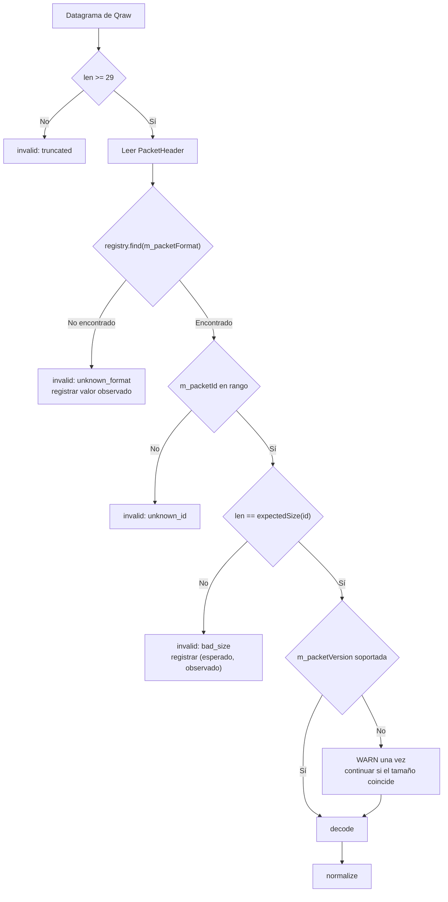
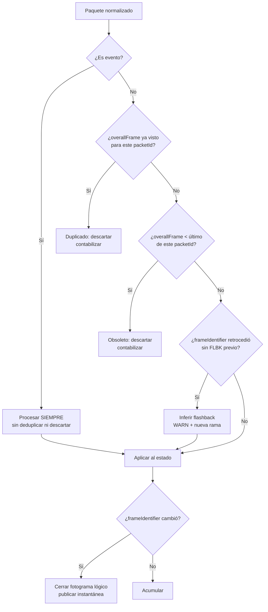
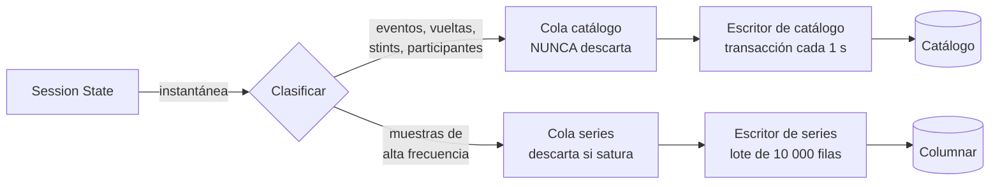
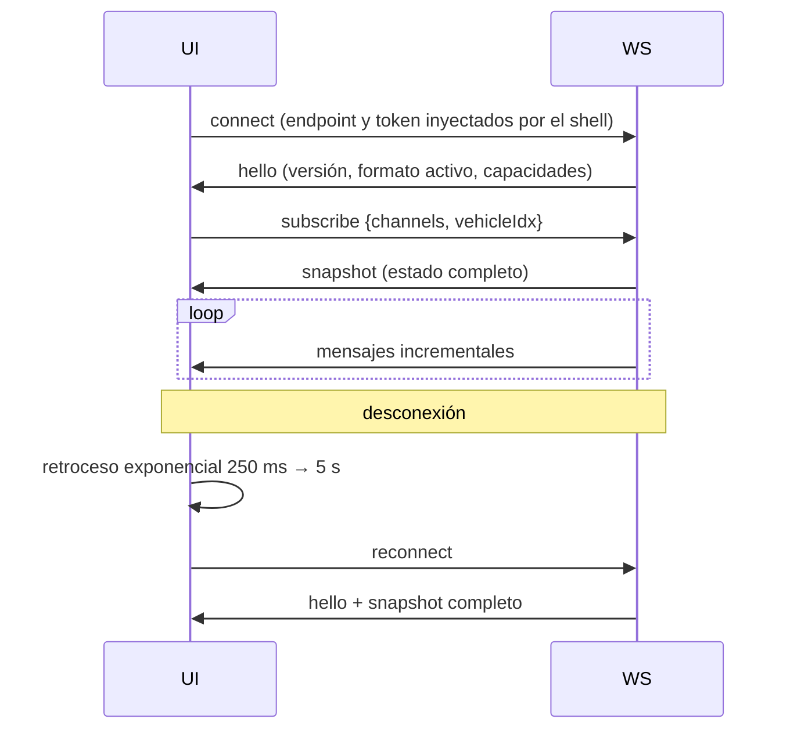
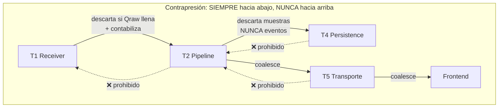
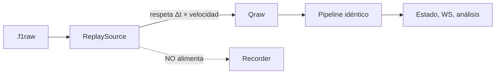

# Pipeline de tiempo real

## 1. Presupuesto de latencia

El presupuesto es el contrato. Cada etapa tiene un límite y una métrica que lo vigila.

| Etapa | Objetivo p95 | Objetivo p99 | Métrica |
|---|---|---|---|
| Red y pila del sistema operativo | 1 ms | 3 ms | — (no medible desde el proceso) |
| T1 · recepción y encolado | 20 µs | 100 µs | `recv_to_enqueue_ns` |
| Espera en `Qraw` | 200 µs | 2 ms | `queue_wait_ns{queue=raw}` |
| T2 · cabecera, decode, normalize | 50 µs | 150 µs | `decode_duration_ns` |
| T2 · aplicación al estado | 100 µs | 500 µs | `state_apply_ns` |
| Espera en `Qws` | 1 ms | 10 ms | `queue_wait_ns{queue=ws}` |
| T5 · serialización | 200 µs | 1 ms | `serialize_ns` |
| Transporte interno en bucle local | 1 ms | 5 ms | — |
| WebView2 · decodificación y estado | 5 ms | 15 ms | marca de rendimiento |
| WebView2 · renderizado | 16 ms | 33 ms | fotogramas |
| **Total UDP → píxel** | **< 150 ms** | **< 250 ms** | `end_to_end_latency_ms` |

El presupuesto tiene mucha holgura sobre la suma de las etapas. Es deliberado: el margen absorbe la planificación del sistema operativo en un PC que además está **ejecutando el juego**, que es el consumidor de recursos dominante y tiene prioridad legítima.

---

## 2. Etapa 1 — Recepción

### 2.1. Configuración del socket

| Parámetro | Valor | Motivo |
|---|---|---|
| Familia | IPv4 | El juego emite IPv4 |
| Bind | Configurable: `127.0.0.1`, `0.0.0.0` o IP concreta | Consola y LAN (RF-003) |
| Puerto | Configurable, 20777 por defecto | |
| `SO_RCVBUF` | **4 MB** | Absorbe ráfagas de ~200 ms a 60 Hz (RNF-026) |
| `SO_REUSEADDR` | Activado | Reinicio rápido tras cierre |
| `SO_BROADCAST` | Activado si procede | Modo broadcast (RF-010) |
| Modo | Bloqueante con espera acotada | Sencillo y suficiente para un socket |

> **Sobre `SO_RCVBUF`.** Es el ajuste más rentable de todo el sistema. El buffer por defecto de Windows (~64 KB) se llena en ~150 ms de emisión a 60 Hz si el proceso se queda sin planificar. Ampliarlo a 4 MB da ~10 s de margen. Cuesta una llamada al sistema y evita la mayoría de las pérdidas atribuibles al receptor.

### 2.2. Bucle de recepción

```cpp
void UdpReceiver::run(std::stop_token stop) {
    setThreadName("pw-udp-rx");
    raisePriorityAboveNormal();

    while (!stop.stop_requested()) {
        BufferHandle buf = pool_.acquire();          // preasignado, nunca asigna
        if (!buf) { metrics_.poolExhausted++; continue; }

        const auto n = socket_.receive(buf.span(), origin);
        if (n <= 0) { pool_.release(buf); continue; }

        const auto t = monotonicNowNs();             // ANTES de cualquier otra cosa

        metrics_.datagramsReceived++;
        metrics_.bytesReceived += n;

        if (n < kHeaderSize) {                       // 29 bytes
            metrics_.invalid[Reason::Truncated]++;
            pool_.release(buf);
            continue;
        }

        buf.setLength(n).setRecvTime(t).setOrigin(origin).addRef();
        if (!qRaw_.tryPush(buf))  { metrics_.dropped[Queue::Raw]++;  buf.release(); }
        if (!qRec_.tryPush(buf))  { metrics_.dropped[Queue::Rec]++;  buf.release(); }
    }
}
```

Propiedades del bucle:

- **Cero asignaciones.** El pool se dimensiona al arrancar.
- **Marca de tiempo lo antes posible.** Cualquier trabajo previo contamina la medición y la fidelidad del replay.
- **`tryPush` nunca bloquea.** Si una cola está llena, se descarta y se contabiliza.
- **La única validación aquí es la longitud mínima.** Todo lo demás es trabajo de T2. T1 debe volver al socket cuanto antes.

### 2.3. Prioridad del hilo

Se eleva por encima de la normal, **no a tiempo real**. Elevar a tiempo real un hilo que compite con el motor gráfico del juego provocaría tirones en el juego —el problema que precisamente queremos evitar— por un beneficio marginal.

---

## 3. Etapa 2 — Cabecera y enrutado



### 3.1. Por qué se valida el tamaño exacto y no el mínimo

Un datagrama de 1449 bytes cuando se esperan 1448 significa **una de dos cosas**: o el protocolo cambió, o alguien está enviando basura. En ambos casos, decodificarlo produciría datos plausibles y falsos.

Rechazar por tamaño exacto y **registrar el par (esperado, observado)** convierte un fallo silencioso en un diagnóstico accionable. Es la señal principal de detección temprana de un cambio de protocolo (`03-UDP-PROTOCOL.md` §23.3).

### 3.2. Detección de cambio de formato

```cpp
if (header.packetFormat != activeFormat_) {
    if (++formatChangeStreak_ >= kFormatChangeThreshold) {   // 3 datagramas
        log_.info("cambio de formato {} -> {}", activeFormat_, header.packetFormat);
        state_.closeCurrentSession(CloseReason::FormatChanged);
        recorder_.rotate();                 // una captura, un formato
        activeFormat_ = header.packetFormat;
        bus_.publish(ProtocolFormatChanged{activeFormat_});
        formatChangeStreak_ = 0;
    }
} else {
    formatChangeStreak_ = 0;
}
```

El umbral de 3 datagramas evita reaccionar a un datagrama espurio de otra aplicación que comparta puerto —un caso real reportado por la comunidad (`02-RESEARCH.md` §5)—.

---

## 4. Etapa 3 — Decodificación

### 4.1. Estrategia: vista tipada, sin copia

```cpp
DecodeResult F1_2026_Decoder::decode(const PacketHeader& h,
                                     std::span<const std::byte> payload,
                                     DomainSink& sink) const
{
    switch (static_cast<PacketId>(h.packetId)) {
    case PacketId::CarTelemetry: {
        const auto& p = viewAs<f1_2026::PacketCarTelemetryData>(payload);
        normalize::apply(p, h, policy_, sink);
        return DecodeResult::Ok;
    }
    // …
    default:
        return DecodeResult::UnknownId;
    }
}
```

`viewAs<T>` es la única operación delicada del sistema:

```cpp
template <typename T>
const T& viewAs(std::span<const std::byte> b) {
    static_assert(std::is_trivially_copyable_v<T>);
    static_assert(sizeof(T) == expectedSizeOf<T>);
    assert(b.size() == sizeof(T));            // ya garantizado por la validación previa
    return *std::launder(reinterpret_cast<const T*>(b.data()));
}
```

**Precondiciones que la hacen segura:**

1. El tamaño ya se validó **exactamente** en la etapa 2. Sin esa validación, esto sería una vulnerabilidad.
2. Los structs son `#pragma pack(1)` y trivialmente copiables.
3. El `static_assert` garantiza la correspondencia con la especificación.
4. La plataforma objetivo es little-endian (x86-64, ARM64 en modo LE).

> **Nota de portabilidad.** Un `reinterpret_cast` sobre un buffer es técnicamente comportamiento indefinido en C++ estricto, aunque funcione en MSVC, GCC y Clang sobre x86-64. Se ofrece una variante con `memcpy` a un `T` local, activable por una opción de compilación, que los compiladores optimizan al mismo código. **Las pruebas se ejecutan con ambas variantes** para garantizar resultados idénticos. Es una concesión deliberada al pragmatismo, documentada en lugar de escondida.

### 4.2. Coste

| Operación | Coste |
|---|---|
| Vista tipada | ~0 (sólo un puntero) |
| Normalización de un paquete de 24 coches | ~2-5 µs |
| Aplicación al estado | ~5-20 µs |
| **Por datagrama** | **~10-30 µs** |

A 415 datagramas/s: **~1,2 % de un núcleo**. El presupuesto de RNF-010 (< 5 %) tiene margen de sobra.

---

## 5. Etapa 4 — Normalización

Responsabilidades, en orden:

1. **Desescalar** valores cuantizados (÷ 32767,0 direcciones, ÷ 1000,0 g-forces en 2026).
2. **Convertir centinelas** en ausencia (`03-UDP-PROTOCOL.md` §22).
3. **Traducir enumerados** dependientes del formato al enumerado de dominio.
4. **Aplicar la política de telemetría restringida** por participante.
5. **Resolver catálogos** al año correcto.
6. **Reconstruir** los tiempos de dos partes: `minutos × 60000 + ms`.

```cpp
void normalize::apply(const f1_2026::PacketCarStatusData& p,
                      const PacketHeader& h,
                      const TelemetryPolicy& policy,
                      DomainSink& sink)
{
    for (std::uint8_t i = 0; i < f1_2026::kMaxCars; ++i) {
        const auto& s = p.m_carStatusData[i];
        domain::CarStatus out;

        // Siempre visible
        out.tyreAgeLaps   = Channel<uint8_t>::raw(s.m_tyresAgeLaps);
        out.drsAllowed    = Channel<bool>::raw(s.m_drsAllowed != 0);
        out.drsActivationDistanceM = s.m_drsActivationDistance == 0
            ? Channel<uint16_t>::unavailable(Reason::NotApplicable)
            : Channel<uint16_t>::raw(s.m_drsActivationDistance);

        // Sujeto a Your Telemetry
        if (policy.isRestrictedFor(i)) {
            out.fuelKg    = Channel<float>::restricted();
            out.ersStoreJ = Channel<float>::restricted();
            out.ersMode   = Channel<domain::ErsMode>::restricted();
            // … los 12 campos de la lista oficial
        } else {
            out.fuelKg    = Channel<float>::raw(s.m_fuelInTank);
            out.ersStoreJ = Channel<float>::raw(s.m_ersStoreEnergy);
            out.ersMode   = Channel<domain::ErsMode>::raw(mapErsMode2026(s.m_ersDeployMode));
        }

        // Sólo 2026
        out.ersHarvestLimitJ = Channel<float>::raw(s.m_ersHarvestLimitPerLap);

        sink.carStatus(i, out);
    }
}
```

```cpp
// D-10: el mismo número, distinto significado según el formato
constexpr domain::ErsMode mapErsMode2025(std::uint8_t v) {
    switch (v) { case 0: return ErsMode::None;   case 1: return ErsMode::Medium;
                 case 2: return ErsMode::Hotlap; case 3: return ErsMode::Overtake;
                 default: return ErsMode::Unknown; }
}
constexpr domain::ErsMode mapErsMode2026(std::uint8_t v) {
    switch (v) { case 0: return ErsMode::None;   case 1: return ErsMode::Medium;
                 case 2: return ErsMode::Hotlap; case 3: return ErsMode::Boost;
                 default: return ErsMode::Unknown; }
}
```

La versión de 2025 que devuelve `Overtake` y la de 2026 que devuelve `Boost` conviven sin condicionales fuera del decoder. Ése es todo el truco de RNF-040.

---

## 6. Etapa 5 — Motor de estado

### 6.1. Orden de aplicación



Los eventos se procesan siempre, antes de cualquier filtro (RT-04): un `PENA` con `overallFrame` antiguo sigue siendo una penalización real.

### 6.2. Agrupación en fotogramas lógicos

La especificación garantiza que los paquetes de «rate del menú» viajan juntos `[S1]`. Se acumulan hasta detectar el cambio de `frameIdentifier` y se publica una instantánea completa, evitando que la interfaz muestre velocidad del fotograma N y marcha del N−1.

**Guarda de seguridad:** si el fotograma no se cierra en 100 ms (por pérdida del último datagrama del grupo), se publica lo acumulado marcando el fotograma como parcial.

### 6.3. Detección de sesión

```cpp
if (h.sessionUid != current_.uid) {
    if (monotonicNowNs() - lastSessionChangeNs_ < 2'000'000'000ULL) {
        metrics_.sessionBounceSuppressed++;   // rebote: ignorar
    } else {
        closeSession(CloseReason::UidChanged);
        openSession(h.sessionUid, h.packetFormat);
        lastSessionChangeNs_ = monotonicNowNs();
    }
}
```

La histéresis de 2 s (RN-003) evita que un datagrama tardío de la sesión anterior, o un rebote del juego durante una transición, destruya el estado recién construido.

---

## 7. Etapa 6 — Persistencia



**Asimetría deliberada:** la cola del catálogo **jamás descarta**. Si se llena, se registra `ERROR` y se detiene la grabación normalizada —nunca la recepción—. Perder un cierre de vuelta o una penalización corrompe el histórico; perder una muestra de telemetría entre otras 5 millones no.

### 7.1. Decimado adaptativo

Si `Qseries` supera el 70 % de ocupación de forma sostenida, el escritor **reduce la resolución** de las muestras persistidas (60 → 30 → 20 Hz), registrando el cambio en los metadatos de la sesión para que el análisis posterior sepa a qué frecuencia se guardó cada tramo.

Degradar con honestidad es preferible a perder de forma opaca.

---

## 8. Etapa 7 — Transporte interno hacia la interfaz

> Recordatorio de alcance: esto es el cable entre dos mitades del mismo proceso, no una API pública
> (ADR-002 v2). Puerto efímero, token de un solo uso, un único cliente posible: la propia ventana.


### 8.1. Formato de mensaje

**Canal de control y estado (JSON):**

```json
{
  "ch": "timing",
  "of": 128455,
  "ts": 1789080000123,
  "seq": 4821,
  "data": { "cars": [ { "idx": 4, "pos": 3, "lap": 12,
                        "last": 92451, "best": 91980,
                        "gap": { "v": 1245, "p": "raw" },
                        "tyre": { "actual": 18, "age": 9 },
                        "fuel": { "p": "restricted" } } ] }
}
```

Nótese que `fuel` viaja **sin valor y con procedencia `restricted`**. El transporte hace estructuralmente imposible enviar un cero que la interfaz pudiera confundir con un dato real (RN-001).

**Canal de telemetría (binario):**

```
[u8  channel = 2]
[u8  schemaVersion]
[u16 vehicleIdx]
[u32 overallFrame]
[u32 sampleCount]
[u32 presenceMask]        // qué canales van presentes
[f32 ...]                 // sólo los canales presentes, en orden fijo
```

La máscara de presencia resuelve elegantemente el problema de los datos restringidos y de los canales exclusivos de un formato: **lo que no está, no se envía**, y el cliente sabe distinguir «ausente» de «cero».

### 8.2. Coalescing

```cpp
bool ClientQueue::pushTelemetry(TelemetryMsg&& m) {
    if (auto* pending = findPending(m.channel, m.vehicleIdx)) {
        *pending = std::move(m);            // sustituir, no acumular
        metrics_.coalesced++;
        return true;
    }
    return ring_.tryPush(std::move(m));
}
```

Efecto: la latencia del último dato **no crece** aunque el cliente sea lento. En el peor caso, el cliente ve menos muestras, siempre las más recientes.

Los mensajes del canal `events` **no** pasan por aquí (RT-04).

### 8.2.1. Un solo cliente, y aun así con cola

Podría parecer que con un único consumidor —la ventana propia— sobra toda esta maquinaria. No sobra:
el WebView2 **también** puede quedarse atrás, por una recolección de basura del motor, por un
redimensionado de ventana o porque el usuario acaba de arrastrar la ventana entre monitores. El
coalescing sigue siendo lo que impide que la latencia crezca en esos momentos.

### 8.3. Reconexión



Tras reconectar **siempre** se envía una instantánea completa (RT-08). No se intenta reconstruir por diferencias: es más simple, más robusto y el coste es de unos pocos kilobytes.

En la aplicación de escritorio esta ruta se ejercita menos que en una web —no hay pestañas que
recargar—, pero sigue siendo necesaria: el WebView2 puede reiniciar su proceso de renderizado, y en
desarrollo la recarga en caliente de Vite provoca exactamente el mismo escenario.

---

## 9. Contrapresión de extremo a extremo



### 9.1. Escenarios de degradación

| Escenario | Detección | Respuesta | Visible para el usuario |
|---|---|---|---|
| Disco lento | `recorder_queue_depth` alta | Descartar en `Qrec`, marcar hueco en la captura | Aviso «grabación degradada» |
| Disco lleno | Comprobación previa a escribir | Detener la grabación, continuar el directo | Aviso persistente |
| Interfaz lenta | `transport_coalesced_total` creciendo | Coalescer más agresivamente | Indicador de ritmo reducido |
| Interfaz atascada | Cola llena tras 5 s | Cerrar la conexión | La interfaz reconecta sola |
| Analítica lenta | `Qanalytics` llena | Descartar muestras intermedias | Métricas menos frecuentes |
| Pipeline saturado | `Qraw` llena | Descartar y contabilizar | **Aviso en rojo**: síntoma grave |
| Pool agotado | `poolExhausted` > 0 | Descartar en recepción | **Aviso en rojo**: no debería ocurrir |

Las dos últimas se destacan porque, con los presupuestos calculados, **no deberían suceder nunca**. Si ocurren, hay un defecto, y el sistema lo dice en lugar de disimularlo.

---

## 10. El pipeline en modo replay

La única diferencia es la fuente:



Diferencias respecto al directo:

1. `RawRecorder` **no** se conecta: no se regraba lo que ya está grabado.
2. Los datagramas llevan la marca de tiempo **original**, no la de reemisión: los análisis temporales siguen siendo correctos.
3. A velocidad máxima se ignoran los `Δt`; el propio mecanismo de contrapresión regula el ritmo.
4. La persistencia puede desactivarse (modo «sólo visualizar») o activarse (modo «reprocesar», RF-413).

Que el 100 % del pipeline sea idéntico es lo que hace que las pruebas de integración prueben **el sistema real** y no una maqueta.

---

## 11. Instrumentación

| Punto | Métrica |
|---|---|
| T1 · entrada | `udp_packets_received_total`, `udp_bytes_received_total` |
| T1 · validación | `udp_packets_invalid_total{reason}` |
| T1 · encolado | `recv_to_enqueue_ns`, `pool_exhausted_total` |
| Colas | `queue_depth{queue}`, `queue_wait_ns{queue}`, `queue_dropped_total{queue,reason}` |
| T2 · decode | `decode_duration_ns{packet_id}`, `decoder_errors_total{format,packet_id}` |
| T2 · estado | `state_apply_ns`, `duplicates_total`, `stale_total`, `branches_created_total` |
| T4 | `samples_persisted_total{entity}`, `persist_batch_duration_ns`, `decimation_level` |
| T5 | `transport_connected`, `transport_messages_sent_total{channel}`, `transport_coalesced_total`, `transport_rejected_total{reason}` |
| Global | `end_to_end_latency_ms`, `estimated_packet_loss_ratio` |

Todas visibles en *UDP Diagnostics*, que es la herramienta de trabajo diario durante el desarrollo (RF-606).

---

## 12. Verificación del pipeline

| Prueba | Método | Umbral |
|---|---|---|
| Sin pérdida a 60 Hz | Replay de 1 h en modo inyección UDP | 0 descartes en `Qraw` |
| Sin pérdida a 3× la carga | Generador sintético a 1200 datagramas/s | 0 descartes |
| Latencia extremo a extremo | Marca de tiempo en el mensaje, medida dentro del WebView2 | p95 < 150 ms |
| Sin asignaciones en el camino caliente | Contador de asignaciones en compilación instrumentada | 0 por datagrama |
| Determinismo | Reproducir la misma captura dos veces | Huella idéntica del catálogo |
| Contrapresión | Cliente artificialmente lento (100 ms por mensaje) | Latencia acotada, sin crecimiento |
| Disco lento | Escritura limitada artificialmente | La recepción no se degrada |
| Sin carreras de datos | ThreadSanitizer sobre la suite completa | 0 hallazgos |

---

## Sources

### Official

| Título | Uso |
|---|---|
| `Data Output from F1® 25: 2026 Season Pack` v1.2 | Frecuencias, agrupación por fotograma, tamaños y datos restringidos que dimensionan el pipeline |
| `Data Output from F1® 25 Game` v3 | Ídem para 2025 |

Consultadas el 11 de septiembre de 2026.

---

*Fin de `PW-RTP-006` v1.1*
