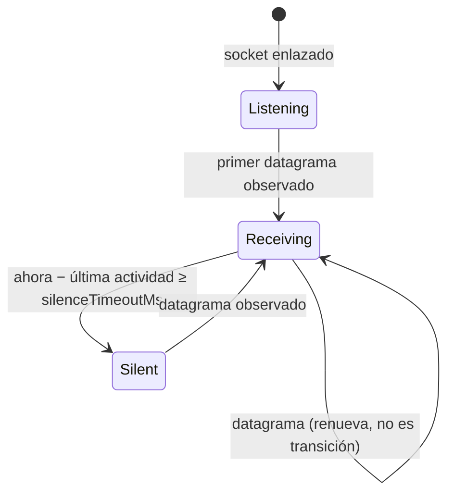
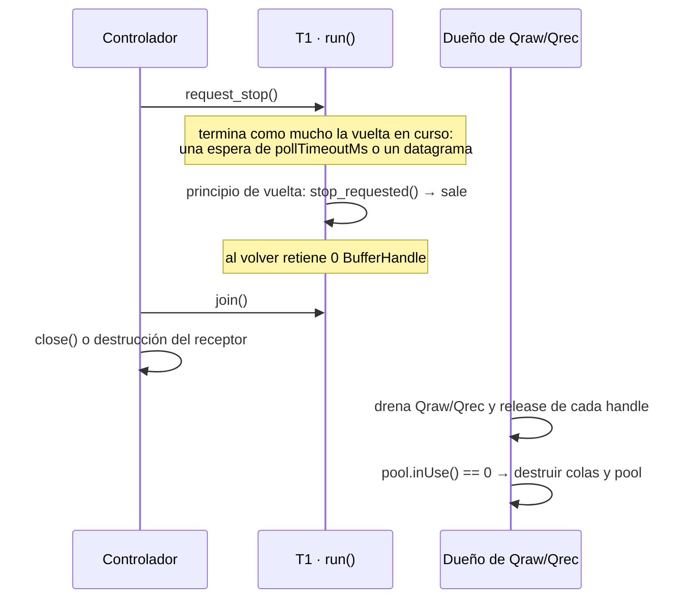
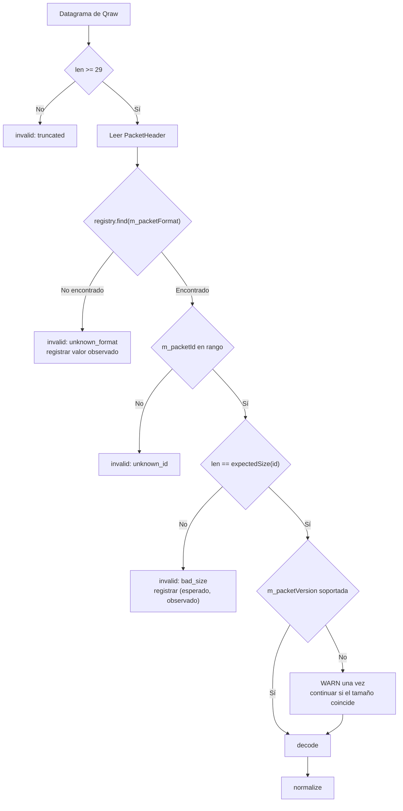
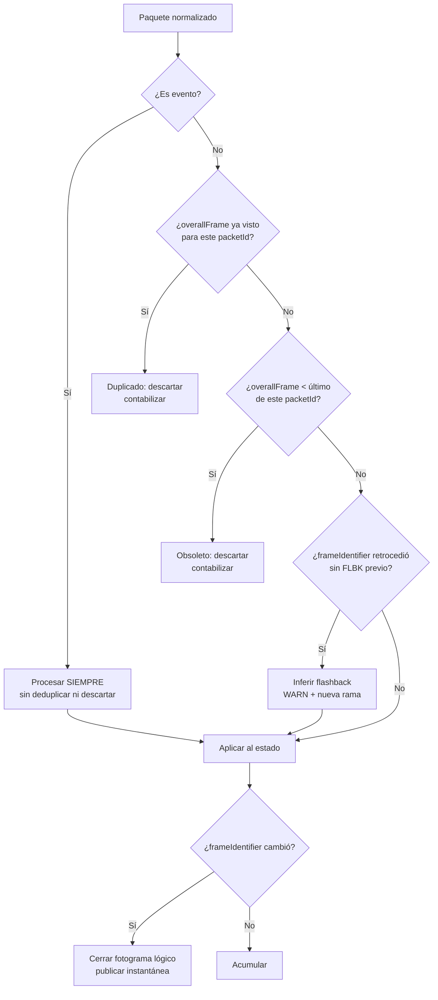
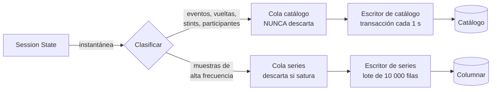
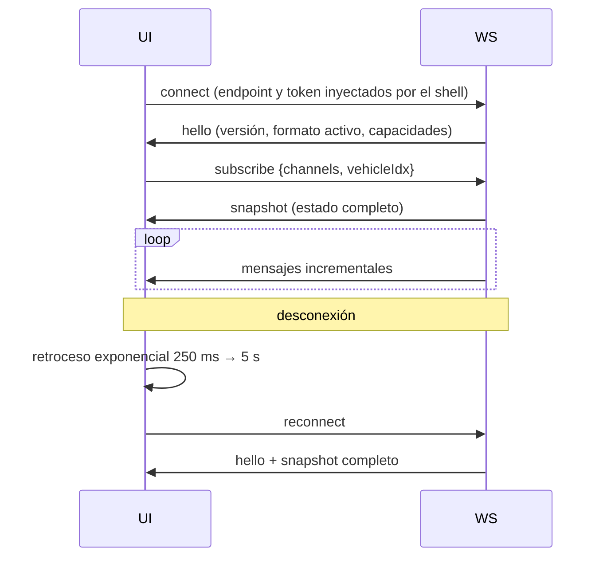
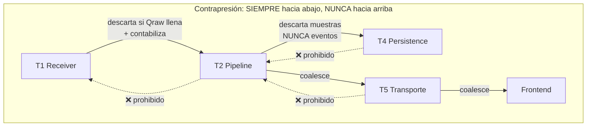
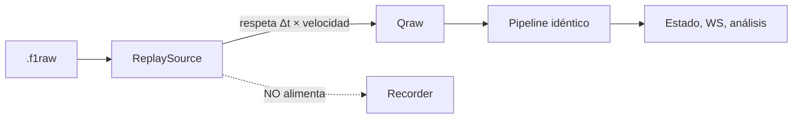

# Pipeline de tiempo real

## 1. Presupuesto de latencia

El presupuesto es el contrato. Cada etapa tiene un límite y una métrica que lo vigila.

| Etapa | Objetivo p95 | Objetivo p99 | Métrica |
|---|---|---|---|
| Red y pila del sistema operativo | 1 ms | 3 ms | — (no medible desde el proceso) |
| T1 · recepción y encolado | 20 µs | 100 µs | `recv_to_enqueue_ns` |
| Espera en `Qraw` | 200 µs | 2 ms | `queue_wait_ns{queue=raw}` |
| T2 · cabecera, decode, normalize | 50 µs | 150 µs | `decode_duration_ns` |
| T2 · aplicación al estado | 100 µs | 500 µs | `state_apply_ns` |
| Espera en `Qws` | 1 ms | 10 ms | `queue_wait_ns{queue=ws}` |
| T5 · serialización | 200 µs | 1 ms | `serialize_ns` |
| Transporte interno en bucle local | 1 ms | 5 ms | — |
| WebView2 · decodificación y estado | 5 ms | 15 ms | marca de rendimiento |
| WebView2 · renderizado | 16 ms | 33 ms | fotogramas |
| **Total UDP → píxel** | **< 150 ms** | **< 250 ms** | `end_to_end_latency_ms` |

El presupuesto tiene mucha holgura sobre la suma de las etapas. Es deliberado: el margen absorbe la planificación del sistema operativo en un PC que además está **ejecutando el juego**, que es el consumidor de recursos dominante y tiene prioridad legítima.

---

## 2. Etapa 1 — Recepción

### 2.1. Configuración del socket

| Parámetro | Valor | Motivo |
|---|---|---|
| Familia | IPv4 | El juego emite IPv4 |
| Bind | Configurable: `127.0.0.1`, `0.0.0.0` o IP concreta | Consola y LAN (RF-003) |
| Puerto | Configurable, 20777 por defecto | |
| `SO_RCVBUF` | **4 MB** | Absorbe ráfagas de ~200 ms a 60 Hz (RNF-026) |
| `SO_REUSEADDR` | **Desactivado en las dos plataformas** | PitWall quiere bind exclusivo y detectar «puerto ocupado»: ver §2.1.1 |
| `SO_BROADCAST` | Activado si procede | Modo broadcast (RF-010) |
| Modo | Bloqueante, con espera acotada **de legibilidad** (`select`/`poll`) | Sencillo y suficiente para un socket. **No** con `SO_RCVTIMEO`: ver §2.1.2 |

### 2.1.1. `SO_REUSEADDR` desactivado, y bind exclusivo

*(decidido en F1.1-04; la v1.1 de este documento lo daba por activado, y la v1.2 sólo lo desactivaba
en Windows)*

**No se activa en ninguna de las dos plataformas.** El motivo es que PitWall quiere justo lo
contrario de lo que esa opción concede:

| Lo que PitWall quiere | Por qué `SO_REUSEADDR` estorba |
|---|---|
| Que el puerto sea suyo | Amplía los casos en que otro proceso puede compartirlo |
| Detectar «puerto ocupado» con un error accionable | Un bind que triunfa cuando debería fallar no se detecta nunca (RNF-097, DoD de F1.1) |
| Reiniciar rápido tras cerrar | **No hace falta**: UDP no tiene `TIME_WAIT`, que es el problema que esa opción resuelve en TCP |

Y no hay ningún caso de uso que la pida: PitWall enlaza **un** socket, en un puerto fijo, **una vez**
al arrancar, con instancia única (RF-625). Ni siquiera el modo broadcast del juego (RF-010) la
necesita: ahí es el juego quien emite a la dirección de difusión, y PitWall sigue siendo un único
proceso escuchando.

En **Windows** se pide además exclusividad explícita con `SO_EXCLUSIVEADDRUSE`, y **es un requisito
de arranque, no una mejora opcional**: si el sistema no la concede, el bind no se intenta siquiera y
PitWall se detiene con un error accionable.

El motivo de esa dureza es que sin exclusividad otro proceso puede enlazar el puerto de PitWall si
**él** activa `SO_REUSEADDR`, y a partir de ahí cada uno recibiría una parte de los datagramas:
pérdida silenciosa e imposible de diagnosticar desde dentro. Continuar sin la opción sería seguir
prometiendo algo —que el puerto es nuestro y que «ocupado» se detecta— que ya no se puede cumplir.

La secuencia de arranque queda: **crear el socket → solicitar exclusividad → comprobar que se
concedió → enlazar**.

> **Lo que este documento NO afirma.** Que el bind por defecto garantice exclusividad frente a
> cualquier otro proceso en POSIX. No la garantiza en todos los casos —`SO_REUSEPORT` del otro lado,
> por ejemplo—, y la implementación POSIX **todavía no se ha compilado ni ejecutado en ningún Linux**.

### 2.1.2. La espera acotada va **antes** de recibir, no dentro

*(medido y decidido en F1.1-04)*

El bucle necesita despertar para comprobar su señal de parada. La forma que sale sola —poner
`SO_RCVTIMEO` al socket— **pierde datagramas**. Medido en Windows, 20 datagramas espaciados 2 ms:

| Espera | Recibidos |
|---|---|
| `SO_RCVTIMEO` de 10 ms | **16, 18, 18** de 20 |
| `SO_RCVTIMEO` de 2000 ms | 20, 20, 20 |
| `select()` de 10 ms + `recvfrom` | 20, 20, 20 |

Microsoft lo documenta: cuando un `recv` con `SO_RCVTIMEO` vence, *«el estado del socket es
indeterminado y no debería usarse»*. Un datagrama que llega mientras la espera vence desaparece sin
error y sin contador.

La forma correcta es preguntar primero si hay algo que leer, con tiempo máximo, y sólo entonces
recibir: `select()` en Windows, `poll()` en POSIX —que además no tiene el límite de `FD_SETSIZE`—.
Así `recvfrom` nunca vence.

> **Por qué esto es fácil de no ver nunca.** A 415 datagramas/s la espera casi no vence, así que la
> pérdida es mínima bajo carga. Aparece **en reposo y con tráfico espaciado**: al arrancar una sesión,
> en una pausa del juego, entre sesiones. Y no la ve ningún contador propio, porque el dato se pierde
> por debajo de la aplicación.

> **Sobre `SO_RCVBUF`.** Es el ajuste más rentable de todo el sistema. El buffer por defecto de Windows (~64 KB) se llena en ~150 ms de emisión a 60 Hz si el proceso se queda sin planificar. Ampliarlo a 4 MB da ~10 s de margen. Cuesta una llamada al sistema y evita la mayoría de las pérdidas atribuibles al receptor.

### 2.2. Bucle de recepción

```cpp
// Pseudocódigo arquitectónico: el orden y las decisiones, no la implementación.
void UdpReceiver::run(std::stop_token stop) {
    raisePriorityAboveNormal();                   // §2.3, una vez por run()

    while (!stop.stop_requested()) {              // §2.4: la señal, al principio de la vuelta
        BufferHandle buf = pool_.acquire();       // preasignado, nunca asigna
        if (!buf.valid()) {                       // no hay donde recibir
            poolExhaustions_++;                   // es un ESTADO, no una pérdida
            noteEvent(PoolExhausted);             // marcar bandera; NO registrar
            checkSilence(now()); backOffBriefly();
            continue;
        }

        auto received = socket_->receive(pool_.bytes(buf));   // espera acotada: §2.1.2
        const auto t  = now();                    // ANTES de cualquier otra cosa

        if (!received) {                          // espera vencida, interrumpida, oversized,
            handleReceiveError(received.error(), buf, t);   // fallo o cierre: §2.4
            if (received.error().kind == Closed) { return; }
            continue;                             // el buffer ya se soltó
        }

        const auto [n, origin] = received.value();
        received_++; bytes_ += n;
        noteActivity(t);                          // §2.2.3: se ha observado tráfico
        const auto source = sources_.resolve(origin);        // §2.2.2, índice estable
        sources_.record(source, n);               // por origen: datagramas y bytes
        sizeCounts_.record(n);                    // por tamaño, exacto

        if (n < kMinDatagramBytes) {              // 29 bytes: la única validación de T1
            truncated_++;
            noteEvent(Truncated);                 // marcar bandera; NO registrar
            pool_.release(buf);
            continue;
        }

        pool_.setPayloadSize(buf, n);
        const ReceivedDatagram datagram{buf, t, origin, source};   // 32 B: §3.1 de 04
        distribute(datagram);                     // retain -> tryPush -> release si falla
        pool_.release(buf);                       // la referencia de T1: la vuelta no la conserva
    }
}

// Cada cola, por separado y con su propia referencia contada.
void UdpReceiver::distribute(const ReceivedDatagram& datagram) {
    for (auto& queue : {qRaw_, qRec_}) {
        if (!pool_.retain(datagram.handle)) { continue; }        // ANTES del tryPush
        if (!queue.tryPush(datagram)) {
            pool_.release(datagram.handle);                      // la de ESTA cola
            dropped_[queue]++; noteEvent(QueueFull);             // descarte del más nuevo
        }
    }
}
```

Propiedades del bucle:

- **Cero asignaciones.** El pool se dimensiona al arrancar. Verificado con **compilación
  instrumentada** —un ejecutable que sustituye los operadores globales de reserva y cuenta las que
  ocurren en el hilo del receptor—: **0 en 10.000 datagramas válidos y 0 en 2.000 truncados**, en
  debug y en release.
  Esa medición obligó a un cambio: el error que devuelve `receive()` es un tipo **trivial** sin
  `std::string`. Reutilizar el tipo de error de arranque con el mensaje vacío bastaba en release,
  pero en Debug MSVC reserva 16 B de *container proxy* al construir un `std::string` aunque esté
  vacío. Un tipo que **no puede** asignar es más fiable que uno que promete no hacerlo.
- **Marca de tiempo lo antes posible.** Cualquier trabajo previo contamina la medición y la fidelidad del replay.
- **`tryPush` nunca bloquea.** Si una cola está llena, se descarta **el más nuevo** y se contabiliza
  (§4.3 de `04-ARCHITECTURE.md`). Cada cola lleva su propia referencia contada: `retain` antes del
  `tryPush`, `release` de **esa** referencia si el `tryPush` falla. Al final de la vuelta T1 suelta la
  suya, así que **no conserva ninguna referencia entre vueltas** (§2.4).
- **El pool agotado no es una pérdida observada.** Significa que el receptor no tenía dónde recibir;
  el datagrama puede seguir esperando en el buffer del sistema operativo y recibirse después. Se
  contabiliza como estado (`udp_pool_exhaustion_total`), no como descarte. Si el agotamiento dura, el
  buffer del sistema acabará llenándose y entonces sí habrá pérdida, pero la pierde el sistema y no
  se puede atribuir a un datagrama concreto.
- **La única validación aquí es la longitud mínima.** Todo lo demás es trabajo de T2. T1 debe volver al socket cuanto antes.

### 2.2.1. T1 no escribe en el log

*(decidido en F1.1-07, tras medirlo)*

Formatear un mensaje reserva memoria. Si T1 registrara la **primera** vez que ve cada causa
excepcional —un truncado, una cola llena, el pool agotado—, ese datagrama concreto habría provocado
una asignación en el camino caliente. «Cero **por datagrama**» (RNF-013) incluye al primero.

Así que T1 no registra nada. Lo que hace con lo excepcional es:

1. incrementar su contador, y
2. **marcar una bandera preasignada** —una escritura relajada sobre un `bool` atómico que ya existe—.

El texto accionable lo emite después `reportPendingEvents()`, desde **fuera de T1**: el hilo de
diagnóstico, el de apagado, o quien corresponda. Ese método sí puede asignar, porque no está en el
camino caliente, y registra **cada suceso una sola vez** por vida del receptor, por muchas veces que
T1 lo vuelva a marcar. El recuento exacto vive en los contadores, que es donde tiene sentido mirarlo.

**Contrato de `reportPendingEvents()`:** no puede llamarse desde T1, y es de **un solo consumidor**
—la marca de lo ya informado no está sincronizada, porque el diseño no necesita varios—. Es una
precondición explícita, no una carencia.

> Medido con la compilación instrumentada: **0 asignaciones en T1** con el contador armado *antes del
> primer datagrama*, incluyendo la primera aparición de cada causa excepcional.

### 2.2.2. Contadores por origen y por tamaño

*(decidido en F1.1-08 y F1.1-09)*

Cada datagrama leído del socket se cuenta, **antes de validarlo**, en dos tablas preasignadas. Antes
de validar porque el emisor y la longitud de un datagrama inválido son justo la pista de por qué lo
es.

**Tabla de orígenes (`SourceRegistry`, RF-009).** La identidad de un origen es el par (IP, puerto):
misma IP con otro puerto es otro origen, y el mismo puerto desde otra IP también. Se guarda en
binario —un `uint64` con un bit de ocupado, la IPv4 y el puerto— y cada origen distinto recibe un
índice pequeño y estable (`SourceIndex`) que viaja en `ReceivedDatagram` junto al origen exacto. El
índice cabe en el relleno que el struct ya tenía: el elemento de cola sigue midiendo 32 B.

| Aspecto | Decisión |
|---|---|
| Capacidad | **8, fija.** Lo normal es un origen; el caso real documentado son dos [S9]. Las 8 claves ocupan una línea de caché: buscar es recorrer 64 B contiguos, más barato que un hash y sin nada que pueda crecer |
| Tabla llena | Un origen nuevo **no desplaza a nadie**: recibe `kUnregisteredSource`, se cuenta en una ranura de desbordamiento, **se sigue entregando** y T1 marca el suceso `SourceTableFull` (§2.2.1). Nunca bloquea, nunca asigna y nunca cambia un índice existente |
| Vida de un índice | La del receptor. No se borran entradas |
| Escritor | **Sólo T1.** Escribe la clave y después publica el nuevo tamaño con `release` |
| Lectores | Cualquier hilo: `acquire` del tamaño y sólo las ranuras por debajo. Una entrada publicada es inmutable, así que la instantánea es coherente sin ningún mutex |
| Texto `a.b.c.d:puerto` | Sólo fuera de T1, al leer |

La tabla **no filtra**: el filtro por origen es F2 (RF-009, F2.4) y se apoyará en este índice.

**Contadores por tamaño (`DatagramSizeCounts`, RF-008).** Un contador por cada longitud posible, de
0 al tamaño del buffer del pool, reservado al construir (2.049 contadores, 16 KiB). Exacto y no por
cubos: cada paquete de F1 tiene un tamaño fijo, y Diagnostics compara tamaños observados con
esperados (CU-12). Incluye los truncados; no incluye los *oversized*, cuya longitud real no se conoce.

**Por qué no están en el `MetricsRegistry`.** Sus etiquetas —el texto del origen, la longitud— sólo se
conocen al recibir, y registrar una métrica nueva toma un mutex y asigna. T1 cuenta en las tablas
preasignadas, y `appendMetricSamples()` construye las muestras fuera de T1:

| Métrica | Etiquetas |
|---|---|
| `udp_packets_by_source_total` | `source=a.b.c.d:puerto` o `source=unregistered` (siempre presente, también a 0) |
| `udp_bytes_by_source_total` | ídem |
| `udp_packets_by_size_total` | `bytes=N`, sólo longitudes observadas |

Los *oversized* no se atribuyen a ningún origen: el socket no informa del emisor en ese error. Siguen
contados en `udp_packets_invalid_total{reason=oversized}`.

> Medido con la compilación instrumentada: **0 asignaciones en T1** en el primer datagrama del primer
> origen, en el primero del segundo, en un origen conocido y con la tabla llena, con el contador
> armado antes del primer datagrama; y 0 en 10.000 datagramas de 10 orígenes intercalados.

### 2.2.3. Estado de la adquisición: escuchando, recibiendo, en silencio

*(decidido en F1.1-10, RF-012)*

**UDP no establece ninguna conexión persistente.** No hay nada que el juego abra o cierre frente a
PitWall. Lo único que PitWall puede saber es si **observa** datagramas en su socket, y los estados
describen exactamente eso:

| Estado | Significado | La interfaz muestra |
|---|---|---|
| `Listening` | El socket escucha, pero desde el arranque **todavía no se ha observado ningún datagrama** | *Escuchando* |
| `Receiving` | Se ha observado un datagrama hace **menos** de `silenceTimeoutMs` | *Recibiendo* |
| `Silent` | **Había** tráfico y lleva **al menos** `silenceTimeoutMs` sin observarse un datagrama nuevo | *Desconectado* |



El silencio **no** lleva de `Listening` a `Silent`: «nunca ha llegado nada» y «llegaba y ha dejado de
llegar» son diagnósticos distintos, y la lista de comprobación de RF-624 depende de distinguirlos.
Los estados de formato y de sesión (§3, §6.3) son de capas posteriores y no están aquí.

**Tiempo de silencio.** `net.silenceTimeoutMs`, **2000 ms** por defecto, configurable entre **100 y
2000**. Mide el tiempo desde el último datagrama de **cualquier** tipo, no desde el último de un tipo
concreto. La comparación es **`ahora − última actividad ≥ silenceTimeoutMs`**: con 2000 ms, el
silencio vence **al alcanzar** los 2000 ms.

| Cota | Por qué |
|---|---|
| Mínimo 100 ms | Es la granularidad del ciclo de espera (§2.1.2) en el que se comprueba el silencio. Un valor menor no daría una resolución efectiva mejor |
| Máximo 2000 ms | Es el valor de diseño. Peor caso visible: 2000 + ~100 ms de ciclo + ~500 ms de refresco de la interfaz ≈ **2,6 s**, con margen para planificación, propagación y fluctuación antes de los 3 s de la aceptación de RF-012. Un máximo de 2400 ms llegaría a los 3 s sin ningún margen |

**Qué es actividad: la llegada observada de un datagrama**, no su validez.

| Resultado de `receive()` | ¿Renueva? | Por qué |
|---|---|---|
| Datagrama normal | Sí | Llegó |
| Datagrama truncado | Sí | Llegó; que sea inválido es otra cuestión, y ya se cuenta |
| *Oversized* (`WSAEMSGSIZE`/`EMSGSIZE`) | **Sí** | Ese error sólo existe si ha llegado un datagrama. No hay contenido ni origen, así que no se atribuye a ningún `SourceIndex`, pero renueva la actividad **global** |
| Espera vencida | No | No llegó nada. Es el momento en que se **comprueba** el silencio |
| Fallo del socket | No | No es un datagrama. También comprueba el silencio |
| Socket cerrado | No | El bucle termina; el estado se queda como estaba. **No es silencio** |
| Pool agotado | No | No se llegó a llamar a `receive()`: no se ha observado nada y no se inventa actividad. También comprueba el silencio |

**Reloj.** Monótono (`monotonicNowNs()`), el mismo que estampa `recvTimeNs`. El receptor lo recibe
como un puntero a función inyectable, que las pruebas sustituyen por un reloj manual: ninguna prueba
duerme los 2 s.

**Sin hilo ni temporizador aparte.** La espera acotada de §2.1.2 ya despierta a T1 cada ~100 ms; la
comprobación del silencio va en esa vuelta. Nada gira en vacío.

**Concurrencia.** T1 es el **único escritor** del estado, de la marca de última actividad y de los
dos contadores de entradas por estado. Cualquier hilo los lee: son atómicos por eso, y no hay mutex
porque no hay dos escritores. Cada transición guarda primero el estado y después incrementa el
contador del estado de llegada con `release`; quien lo lee con `acquire` ve un estado al menos tan
nuevo como la transición que cuenta.

**Transiciones repetibles, sin registrar desde T1.** `Receiving → Silent` puede ocurrir muchas veces
en una sesión, así que no sirve el aviso de «una vez por vida» de §2.2.1. La máquina es tan pequeña
que **dos contadores monótonos la describen entera**: entradas en `Receiving` (desde `Listening` o
desde `Silent`) y entradas en `Silent` (sólo desde `Receiving`). `reportStateTransitions()`, **fuera
de T1** y con un único consumidor, guarda el último valor visto de cada uno y calcula los deltas. Así,
si entre dos lecturas hubo `Receiving → Silent → Receiving`, el informe dice **1 entrada en `Silent`
y 1 en `Receiving`**, no «2 cambios»: no se pierde el tipo de ninguna transición. Lo que no se
conserva es el instante de cada una. `Receiving → Receiving` y `Silent → Silent` no existen, así que
no incrementan nada. Los contadores de publicación son internos; la única métrica de transiciones
sigue siendo `udp_silence_transitions_total`.

| Métrica | Tipo | Qué cuenta |
|---|---|---|
| `udp_receiver_state` | medidor | 0 `listening`, 1 `receiving`, 2 `silent` |
| `udp_silence_transitions_total` | contador | Sólo `receiving → silent` |

No se usa `transport_connected`: es la conexión de la ventana al transporte interno (§8), otro
subsistema.

> Medido con la compilación instrumentada: **0 asignaciones en T1** en las esperas de `Listening`, en
> el primer datagrama, en 50 datagramas en `Receiving`, en `Receiving → Silent`, en `Silent →
> Receiving`, en un *oversized* que renueva, en el segundo silencio y en un *oversized* que reconecta.

### 2.3. Prioridad del hilo

*(implementado en F1.1-11)*

Se eleva por encima de la normal, **no a tiempo real**. Elevar a tiempo real un hilo que compite con el motor gráfico del juego provocaría tirones en el juego —el problema que precisamente queremos evitar— por un beneficio marginal.

| Aspecto | Decisión |
|---|---|
| Windows | `SetThreadPriority(GetCurrentThread(), THREAD_PRIORITY_ABOVE_NORMAL)`: +1 sobre la base de la clase del proceso (prioridad 9 en la clase normal; el tiempo real empieza en 16). Sin privilegios especiales |
| Qué **no** se usa | `THREAD_PRIORITY_HIGHEST`, `THREAD_PRIORITY_TIME_CRITICAL`, `REALTIME_PRIORITY_CLASS`, `SetPriorityClass`, afinidad, MMCSS, `SetThreadPriorityBoost` |
| Alcance | **Sólo T1**: se llama desde dentro de `UdpReceiver::run()` con el pseudo-handle del hilo actual. La clase de prioridad del proceso no cambia |
| POSIX | **No-op deliberado**: devuelve `Unsupported`. Sin privilegios no hay equivalente —`SCHED_OTHER` no tiene niveles, un *nice* negativo exige `CAP_SYS_NICE`— y `SCHED_FIFO`/`SCHED_RR` son tiempo real. POSIX es plataforma de compilación en esta fase, no de ejecución validada |
| Cuándo | Una vez por llamada a `run()`, **antes** del bucle. Nada por datagrama |
| Si el sistema lo rechaza | **Degradación, no fallo**: T1 sigue con la prioridad que tenía, sin reintentos. Resultado `Failed`, y el suceso `PriorityNotRaised` que `reportPendingEvents()` registra como aviso **fuera de T1** (§2.2.1) |
| Observabilidad | `threadPriority()`: `NotAttempted`, `Raised`, `Failed` o `Unsupported`. Sin métrica nueva: es un hecho de arranque, no una magnitud. `Unsupported` no avisa |

La llamada vive en un adaptador de plataforma (`thread_priority_win32.cpp` /
`thread_priority_posix.cpp`), el único fichero de `pw::net` autorizado a incluir `windows.h` y
`processthreadsapi.h` (`tools/check_deps.py`).

### 2.4. Parada del receptor

*(implementado en F1.1-12, en su alcance de adquisición)*

El receptor **no gestiona hilos**: ejecuta `run(std::stop_token)` en el hilo que le dé su dueño, y
el hilo y el `stop_source` son de ese dueño. La parada es cooperativa y **nunca** cierra el socket
desde otro hilo para despertar a T1:



| Aspecto | Contrato |
|---|---|
| Latencia | Tras `request_stop()`, `run()` vuelve tras **como mucho una espera** en condiciones normales. Con el valor por defecto (`pollTimeoutMs` = 100 ms), la parada queda en el entorno de esos ~100 ms más la granularidad del temporizador y la planificación del sistema. Es un **orden de magnitud derivado** de la espera acotada, **no una garantía de plazo**: ni el sistema operativo lo promete ni PitWall lo exige. Con tráfico continuo, la parada se ve en la vuelta siguiente |
| `pollTimeoutMs` | Debe ser **> 0**. Con 0 no hay espera acotada, `recvfrom` bloquea sin límite y la parada no se vería hasta el siguiente datagrama: `open()` lo rechaza con `SocketErrorKind::InvalidConfiguration` antes de tocar el socket. La restricción es del receptor; `IUdpSocket` puede seguir admitiendo 0 |
| `close()` | **Precondición: nunca a la vez que `run()`.** Primero `request_stop()` y `join()`; después `close()` o la destrucción. Cerrar desde otro hilo no es seguro ni portable —el handle puede reutilizarse mientras T1 está en `select`/`poll` o `recvfrom`—, así que el diseño evita esa concurrencia en vez de protegerla: sin mutex, sin handle atómico, sin socket de despertar |
| Destrucción | Misma precondición: el receptor no se destruye con otro hilo dentro de `run()` |
| `BufferHandle` | Cada vuelta suelta la referencia de T1 antes de volver a mirar la señal, en todos los caminos. **Al volver `run()`, T1 retiene 0 referencias**: lo que quede pertenece sólo a las colas, una referencia por cola en la que entró |
| Drenaje | Lo hace el **consumidor o dueño** de Qraw/Qrec, **nunca T1**: vaciar sus propias colas rompería el modelo SPSC. El pool se destruye sólo tras el drenaje, con `inUse() == 0` |
| Sucesos | Una parada solicitada **no produce ninguno**. `SocketClosed` sigue siendo sólo el socket cerrado antes o durante `run()`; `SocketFailure`, un fallo real. Cerrar tras el `join` no marca nada |
| `Interrupted` | Una señal que interrumpe `poll` (`EINTR`, POSIX) **no es un fallo**: ni `socketErrors`, ni `SocketFailure`, ni actividad, ni pausa. Se comprueba el silencio y se reintenta en la vuelta siguiente, que vuelve a mirar la señal de parada |

Windows (`select` → `recvfrom` → `closesocket` tras el `join`) y POSIX (`poll` → `recvfrom` → `close`
tras el `join`) siguen el mismo orden. La rama POSIX no se ha validado todavía en un Linux real.

**Alcance.** Esto es la parte de adquisición de RNF-055. El drenaje real por T2/T3, el cierre de la
captura, la persistencia, el orden global de `Core` (`09-BACKEND-PLAN.md` §5), RF-629 desde la
ventana llegan en sus fases. `Ctrl+C` de extremo a extremo lo implementa `pw-listen` (F1.1-13): el
manejador del sistema **sólo marca una bandera**, y el hilo de control es quien llama a
`request_stop()` y ejecuta este mismo orden. La comprobación con el juego real sigue siendo manual
(`16-DEVELOPMENT-GUIDE.md` §13.3).

---

## 3. Etapa 2 — Cabecera y enrutado



### 3.1. Por qué se valida el tamaño exacto y no el mínimo

Un datagrama de 1449 bytes cuando se esperan 1448 significa **una de dos cosas**: o el protocolo cambió, o alguien está enviando basura. En ambos casos, decodificarlo produciría datos plausibles y falsos.

Rechazar por tamaño exacto y **registrar el par (esperado, observado)** convierte un fallo silencioso en un diagnóstico accionable. Es la señal principal de detección temprana de un cambio de protocolo (`03-UDP-PROTOCOL.md` §23.3).

### 3.2. Detección de cambio de formato

```cpp
if (header.packetFormat != activeFormat_) {
    if (++formatChangeStreak_ >= kFormatChangeThreshold) {   // 3 datagramas
        log_.info("cambio de formato {} -> {}", activeFormat_, header.packetFormat);
        state_.closeCurrentSession(CloseReason::FormatChanged);
        recorder_.rotate();                 // una captura, un formato
        activeFormat_ = header.packetFormat;
        bus_.publish(ProtocolFormatChanged{activeFormat_});
        formatChangeStreak_ = 0;
    }
} else {
    formatChangeStreak_ = 0;
}
```

El umbral de 3 datagramas evita reaccionar a un datagrama espurio de otra aplicación que comparta puerto —un caso real reportado por la comunidad (`02-RESEARCH.md` §5)—.

---

## 4. Etapa 3 — Decodificación

### 4.1. Estrategia: vista tipada, sin copia

```cpp
DecodeResult F1_2026_Decoder::decode(const PacketHeader& h,
                                     std::span<const std::byte> payload,
                                     DomainSink& sink) const
{
    switch (static_cast<PacketId>(h.packetId)) {
    case PacketId::CarTelemetry: {
        const auto& p = viewAs<f1_2026::PacketCarTelemetryData>(payload);
        normalize::apply(p, h, policy_, sink);
        return DecodeResult::Ok;
    }
    // …
    default:
        return DecodeResult::UnknownId;
    }
}
```

`viewAs<T>` es la única operación delicada del sistema:

```cpp
template <typename T>
const T& viewAs(std::span<const std::byte> b) {
    static_assert(std::is_trivially_copyable_v<T>);
    static_assert(sizeof(T) == expectedSizeOf<T>);
    assert(b.size() == sizeof(T));            // ya garantizado por la validación previa
    return *std::launder(reinterpret_cast<const T*>(b.data()));
}
```

**Precondiciones que la hacen segura:**

1. El tamaño ya se validó **exactamente** en la etapa 2. Sin esa validación, esto sería una vulnerabilidad.
2. Los structs son `#pragma pack(1)` y trivialmente copiables.
3. El `static_assert` garantiza la correspondencia con la especificación.
4. La plataforma objetivo es little-endian (x86-64, ARM64 en modo LE).

> **Nota de portabilidad.** Un `reinterpret_cast` sobre un buffer es técnicamente comportamiento indefinido en C++ estricto, aunque funcione en MSVC, GCC y Clang sobre x86-64. Se ofrece una variante con `memcpy` a un `T` local, activable por una opción de compilación, que los compiladores optimizan al mismo código. **Las pruebas se ejecutan con ambas variantes** para garantizar resultados idénticos. Es una concesión deliberada al pragmatismo, documentada en lugar de escondida.

### 4.2. Coste

| Operación | Coste |
|---|---|
| Vista tipada | ~0 (sólo un puntero) |
| Normalización de un paquete de 24 coches | ~2-5 µs |
| Aplicación al estado | ~5-20 µs |
| **Por datagrama** | **~10-30 µs** |

A 415 datagramas/s: **~1,2 % de un núcleo**. El presupuesto de RNF-010 (< 5 %) tiene margen de sobra.

---

## 5. Etapa 4 — Normalización

Responsabilidades, en orden:

1. **Desescalar** valores cuantizados (÷ 32767,0 direcciones, ÷ 1000,0 g-forces en 2026).
2. **Convertir centinelas** en ausencia (`03-UDP-PROTOCOL.md` §22).
3. **Traducir enumerados** dependientes del formato al enumerado de dominio.
4. **Aplicar la política de telemetría restringida** por participante.
5. **Resolver catálogos** al año correcto.
6. **Reconstruir** los tiempos de dos partes: `minutos × 60000 + ms`.

```cpp
void normalize::apply(const f1_2026::PacketCarStatusData& p,
                      const PacketHeader& h,
                      const TelemetryPolicy& policy,
                      DomainSink& sink)
{
    for (std::uint8_t i = 0; i < f1_2026::kMaxCars; ++i) {
        const auto& s = p.m_carStatusData[i];
        domain::CarStatus out;

        // Siempre visible
        out.tyreAgeLaps   = Channel<uint8_t>::raw(s.m_tyresAgeLaps);
        out.drsAllowed    = Channel<bool>::raw(s.m_drsAllowed != 0);
        out.drsActivationDistanceM = s.m_drsActivationDistance == 0
            ? Channel<uint16_t>::unavailable(Reason::NotApplicable)
            : Channel<uint16_t>::raw(s.m_drsActivationDistance);

        // Sujeto a Your Telemetry
        if (policy.isRestrictedFor(i)) {
            out.fuelKg    = Channel<float>::restricted();
            out.ersStoreJ = Channel<float>::restricted();
            out.ersMode   = Channel<domain::ErsMode>::restricted();
            // … los 12 campos de la lista oficial
        } else {
            out.fuelKg    = Channel<float>::raw(s.m_fuelInTank);
            out.ersStoreJ = Channel<float>::raw(s.m_ersStoreEnergy);
            out.ersMode   = Channel<domain::ErsMode>::raw(mapErsMode2026(s.m_ersDeployMode));
        }

        // Sólo 2026
        out.ersHarvestLimitJ = Channel<float>::raw(s.m_ersHarvestLimitPerLap);

        sink.carStatus(i, out);
    }
}
```

```cpp
// D-10: el mismo número, distinto significado según el formato
constexpr domain::ErsMode mapErsMode2025(std::uint8_t v) {
    switch (v) { case 0: return ErsMode::None;   case 1: return ErsMode::Medium;
                 case 2: return ErsMode::Hotlap; case 3: return ErsMode::Overtake;
                 default: return ErsMode::Unknown; }
}
constexpr domain::ErsMode mapErsMode2026(std::uint8_t v) {
    switch (v) { case 0: return ErsMode::None;   case 1: return ErsMode::Medium;
                 case 2: return ErsMode::Hotlap; case 3: return ErsMode::Boost;
                 default: return ErsMode::Unknown; }
}
```

La versión de 2025 que devuelve `Overtake` y la de 2026 que devuelve `Boost` conviven sin condicionales fuera del decoder. Ése es todo el truco de RNF-040.

---

## 6. Etapa 5 — Motor de estado

### 6.1. Orden de aplicación



Los eventos se procesan siempre, antes de cualquier filtro (RT-04): un `PENA` con `overallFrame` antiguo sigue siendo una penalización real.

### 6.2. Agrupación en fotogramas lógicos

La especificación garantiza que los paquetes de «rate del menú» viajan juntos `[S1]`. Se acumulan hasta detectar el cambio de `frameIdentifier` y se publica una instantánea completa, evitando que la interfaz muestre velocidad del fotograma N y marcha del N−1.

**Guarda de seguridad:** si el fotograma no se cierra en 100 ms (por pérdida del último datagrama del grupo), se publica lo acumulado marcando el fotograma como parcial.

### 6.3. Detección de sesión

```cpp
if (h.sessionUid != current_.uid) {
    if (monotonicNowNs() - lastSessionChangeNs_ < 2'000'000'000ULL) {
        metrics_.sessionBounceSuppressed++;   // rebote: ignorar
    } else {
        closeSession(CloseReason::UidChanged);
        openSession(h.sessionUid, h.packetFormat);
        lastSessionChangeNs_ = monotonicNowNs();
    }
}
```

La histéresis de 2 s (RN-003) evita que un datagrama tardío de la sesión anterior, o un rebote del juego durante una transición, destruya el estado recién construido.

---

## 7. Etapa 6 — Persistencia



**Asimetría deliberada:** la cola del catálogo **jamás descarta**. Si se llena, se registra `ERROR` y se detiene la grabación normalizada —nunca la recepción—. Perder un cierre de vuelta o una penalización corrompe el histórico; perder una muestra de telemetría entre otras 5 millones no.

### 7.1. Decimado adaptativo

Si `Qseries` supera el 70 % de ocupación de forma sostenida, el escritor **reduce la resolución** de las muestras persistidas (60 → 30 → 20 Hz), registrando el cambio en los metadatos de la sesión para que el análisis posterior sepa a qué frecuencia se guardó cada tramo.

Degradar con honestidad es preferible a perder de forma opaca.

---

## 8. Etapa 7 — Transporte interno hacia la interfaz

> Recordatorio de alcance: esto es el cable entre dos mitades del mismo proceso, no una API pública
> (ADR-002 v2). Puerto efímero, token de un solo uso, un único cliente posible: la propia ventana.


### 8.1. Formato de mensaje

**Canal de control y estado (JSON):**

```json
{
  "ch": "timing",
  "of": 128455,
  "ts": 1789080000123,
  "seq": 4821,
  "data": { "cars": [ { "idx": 4, "pos": 3, "lap": 12,
                        "last": 92451, "best": 91980,
                        "gap": { "v": 1245, "p": "raw" },
                        "tyre": { "actual": 18, "age": 9 },
                        "fuel": { "p": "restricted" } } ] }
}
```

Nótese que `fuel` viaja **sin valor y con procedencia `restricted`**. El transporte hace estructuralmente imposible enviar un cero que la interfaz pudiera confundir con un dato real (RN-001).

**Canal de telemetría (binario):**

```
[u8  channel = 2]
[u8  schemaVersion]
[u16 vehicleIdx]
[u32 overallFrame]
[u32 sampleCount]
[u32 presenceMask]        // qué canales van presentes
[f32 ...]                 // sólo los canales presentes, en orden fijo
```

La máscara de presencia resuelve elegantemente el problema de los datos restringidos y de los canales exclusivos de un formato: **lo que no está, no se envía**, y el cliente sabe distinguir «ausente» de «cero».

### 8.2. Coalescing

```cpp
bool ClientQueue::pushTelemetry(TelemetryMsg&& m) {
    if (auto* pending = findPending(m.channel, m.vehicleIdx)) {
        *pending = std::move(m);            // sustituir, no acumular
        metrics_.coalesced++;
        return true;
    }
    return ring_.tryPush(std::move(m));
}
```

Efecto: la latencia del último dato **no crece** aunque el cliente sea lento. En el peor caso, el cliente ve menos muestras, siempre las más recientes.

Los mensajes del canal `events` **no** pasan por aquí (RT-04).

### 8.2.1. Un solo cliente, y aun así con cola

Podría parecer que con un único consumidor —la ventana propia— sobra toda esta maquinaria. No sobra:
el WebView2 **también** puede quedarse atrás, por una recolección de basura del motor, por un
redimensionado de ventana o porque el usuario acaba de arrastrar la ventana entre monitores. El
coalescing sigue siendo lo que impide que la latencia crezca en esos momentos.

### 8.3. Reconexión



Tras reconectar **siempre** se envía una instantánea completa (RT-08). No se intenta reconstruir por diferencias: es más simple, más robusto y el coste es de unos pocos kilobytes.

En la aplicación de escritorio esta ruta se ejercita menos que en una web —no hay pestañas que
recargar—, pero sigue siendo necesaria: el WebView2 puede reiniciar su proceso de renderizado, y en
desarrollo la recarga en caliente de Vite provoca exactamente el mismo escenario.

---

## 9. Contrapresión de extremo a extremo



### 9.1. Escenarios de degradación

| Escenario | Detección | Respuesta | Visible para el usuario |
|---|---|---|---|
| Disco lento | `recorder_queue_depth` alta | Descartar en `Qrec`, marcar hueco en la captura | Aviso «grabación degradada» |
| Disco lleno | Comprobación previa a escribir | Detener la grabación, continuar el directo | Aviso persistente |
| Interfaz lenta | `transport_coalesced_total` creciendo | Coalescer más agresivamente | Indicador de ritmo reducido |
| Interfaz atascada | Cola llena tras 5 s | Cerrar la conexión | La interfaz reconecta sola |
| Analítica lenta | `Qanalytics` llena | Descartar muestras intermedias | Métricas menos frecuentes |
| Pipeline saturado | `Qraw` llena | Descartar y contabilizar | **Aviso en rojo**: síntoma grave |
| Pool agotado | `poolExhausted` > 0 | Descartar en recepción | **Aviso en rojo**: no debería ocurrir |

Las dos últimas se destacan porque, con los presupuestos calculados, **no deberían suceder nunca**. Si ocurren, hay un defecto, y el sistema lo dice en lugar de disimularlo.

---

## 10. El pipeline en modo replay

La única diferencia es la fuente:



Diferencias respecto al directo:

1. `RawRecorder` **no** se conecta: no se regraba lo que ya está grabado.
2. Los datagramas llevan la marca de tiempo **original**, no la de reemisión: los análisis temporales siguen siendo correctos.
3. A velocidad máxima se ignoran los `Δt`; el propio mecanismo de contrapresión regula el ritmo.
4. La persistencia puede desactivarse (modo «sólo visualizar») o activarse (modo «reprocesar», RF-413).

Que el 100 % del pipeline sea idéntico es lo que hace que las pruebas de integración prueben **el sistema real** y no una maqueta.

---

## 11. Instrumentación

✅ implementada en F1.1 · ◐ parcial · ⏳ planificada. Las métricas de la lista oficial siguen
`01-REQUIREMENTS.md` §27.2; las de tiempo por etapa (`*_ns`) son las que vigilan el presupuesto de §1.

| Punto | Métrica | Estado |
|---|---|---|
| T1 · entrada | `udp_packets_received_total`, `udp_bytes_received_total` | ✅ (las etiquetas `format`/`packet_id` de la primera, ⏳ F1.2) |
| T1 · validación | `udp_packets_invalid_total{reason}` | ◐ `truncated`, `oversized`, `socket_error` ✅; causas del decodificador ⏳ F1.2 |
| T1 · origen y tamaño | `udp_packets_by_source_total{source}`, `udp_bytes_by_source_total{source}`, `udp_packets_by_size_total{bytes}` (§2.2.2) | ✅ |
| T1 · socket | `udp_socket_receive_buffer_bytes` | ✅ |
| T1 · estado | `udp_receiver_state`, `udp_silence_transitions_total` (§2.2.3) | ✅ |
| T1 · encolado | `udp_pool_exhaustion_total`, `udp_datagrams_delivered_total` | ✅ |
| T1 · encolado | `recv_to_enqueue_ns` | ⏳ |
| Colas | `pipeline_dropped_total{queue,reason}` | ◐ `raw` y `rec` con `reason=full` ✅; resto de colas ⏳ |
| Colas | `pipeline_queue_depth{queue}`, `queue_wait_ns{queue}` | ⏳ |
| T2 · decode | `decode_duration_ns{packet_id}`, `decoder_errors_total{format,packet_id}` | ⏳ |
| T2 · estado | `state_apply_ns`, `duplicates_total`, `stale_total`, `branches_created_total` | ⏳ |
| T4 | `samples_persisted_total{entity}`, `persist_batch_duration_ns`, `decimation_level` | ⏳ |
| T5 | `transport_connected`, `transport_messages_sent_total{channel}`, `transport_coalesced_total`, `transport_rejected_total{reason}` | ⏳ |
| Global | `end_to_end_latency_ms`, `estimated_packet_loss_ratio` | ⏳ |

*(v1.3: hasta la v1.2 esta tabla usaba `pool_exhausted_total`, `queue_dropped_total` y `queue_depth`.
Eran nombres anteriores al código; los canónicos son los de arriba, que coinciden con el código y con
`01-REQUIREMENTS.md` §27.2.)*

Todas visibles en *UDP Diagnostics*, que es la herramienta de trabajo diario durante el desarrollo (RF-606).

---

## 12. Verificación del pipeline

| Prueba | Método | Umbral |
|---|---|---|
| Sin pérdida a 60 Hz | Replay de 1 h en modo inyección UDP | 0 descartes en `Qraw` |
| Sin pérdida a 3× la carga | Generador sintético a 1200 datagramas/s | 0 descartes |
| Latencia extremo a extremo | Marca de tiempo en el mensaje, medida dentro del WebView2 | p95 < 150 ms |
| Sin asignaciones en el camino caliente | Contador de asignaciones en compilación instrumentada | 0 por datagrama |
| Determinismo | Reproducir la misma captura dos veces | Huella idéntica del catálogo |
| Contrapresión | Cliente artificialmente lento (100 ms por mensaje) | Latencia acotada, sin crecimiento |
| Disco lento | Escritura limitada artificialmente | La recepción no se degrada |
| Sin carreras de datos | ThreadSanitizer sobre la suite completa | 0 hallazgos |

---

## Sources

### Official

| Título | Uso |
|---|---|
| `Data Output from F1® 25: 2026 Season Pack` v1.2 | Frecuencias, agrupación por fotograma, tamaños y datos restringidos que dimensionan el pipeline |
| `Data Output from F1® 25 Game` v3 | Ídem para 2025 |

Consultadas el 11 de septiembre de 2026.

---

*Fin de `PW-RTP-006` v1.2*
