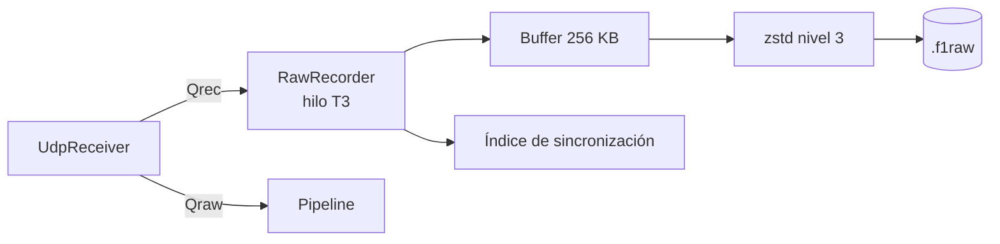
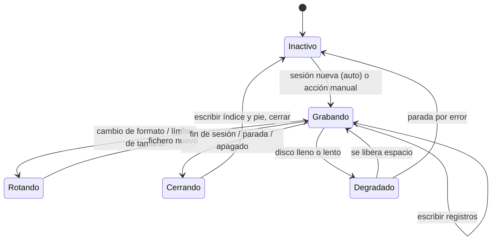
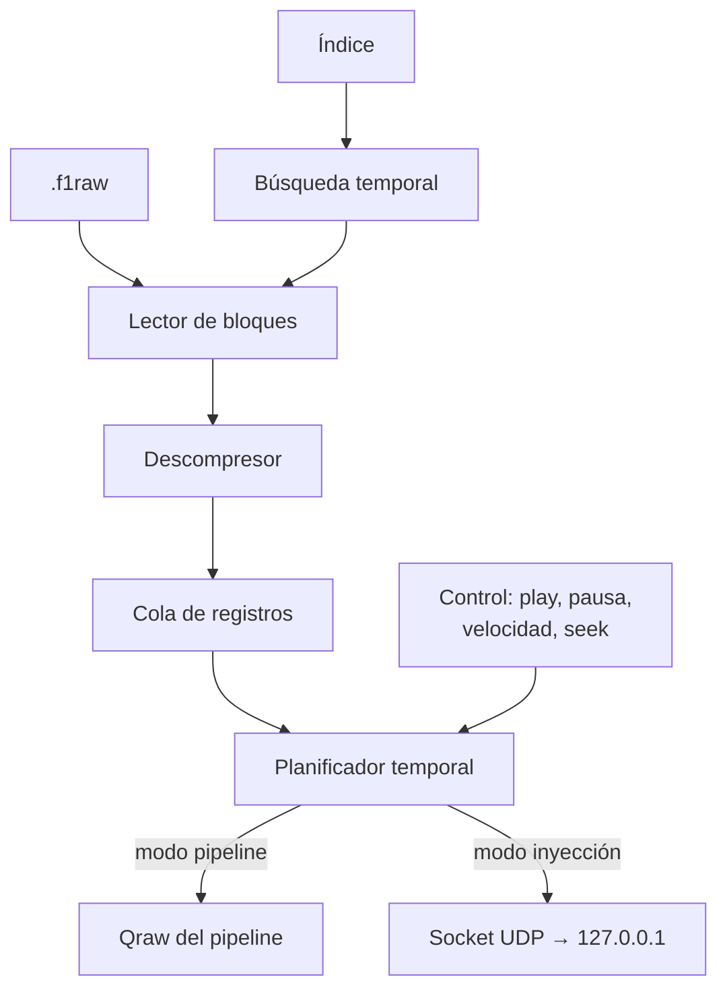
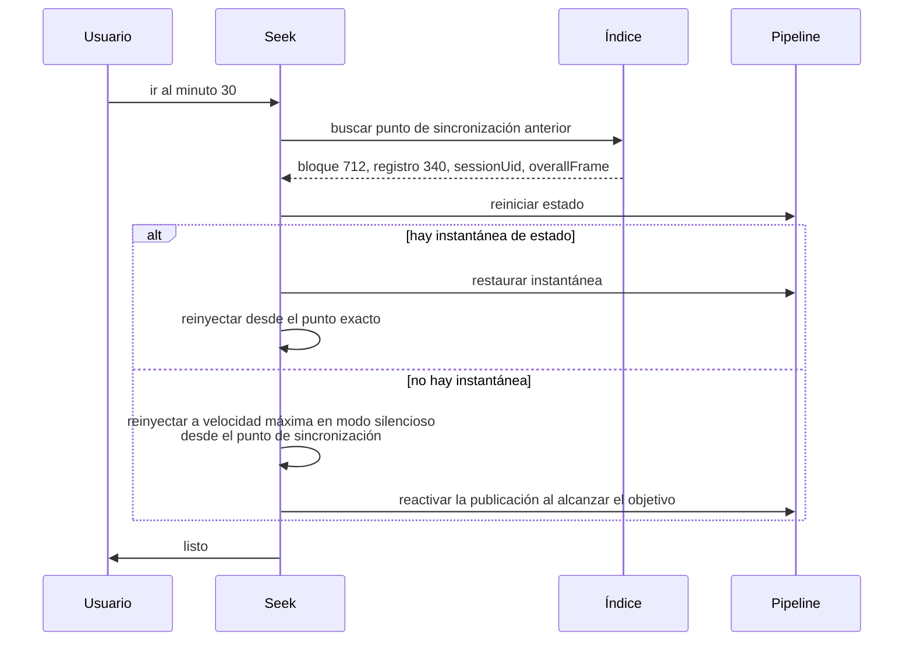
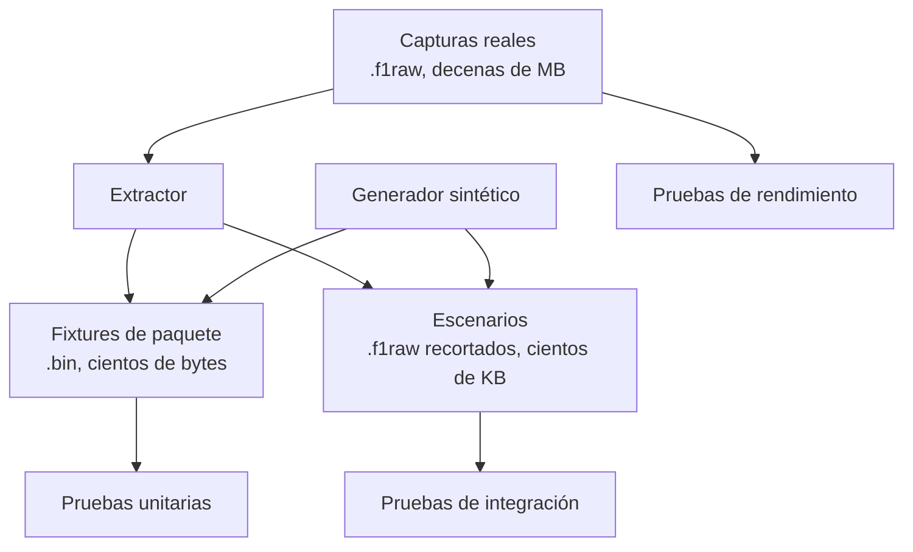

# Grabación y reproducción

## 1. Por qué esto es del MVP y no un extra

| Razón | Consecuencia |
|---|---|
| **Sin replay no hay desarrollo.** Nadie puede conducir una carrera de una hora cada vez que toca una gráfica | OBJ-06, F5 |
| **Sin replay no hay pruebas de integración reales.** Una maqueta prueba la maqueta | `10-TESTING-PLAN.md` |
| **Sin replay no hay reproducción de fallos.** Un error que ocurre una vez cada 40 minutos es indepurable sin poder repetirlo | RSK-07 |
| **Sin captura cruda no hay reproceso.** Un fallo del decoder de hoy sería una pérdida de datos permanente | P2, RF-413 |
| **Sin captura cruda no hay fixtures.** Los datos sintéticos prueban lo que imaginamos, no lo que el juego hace | TST-02 |

Diseñar el replay al final obliga a reescribir la fuente de datos, la persistencia y las pruebas. Diseñarlo primero cuesta un día y ahorra semanas.

---

## 2. Formato de captura `.f1raw`

### 2.1. Requisitos

| # | Requisito | Cómo se satisface |
|---|---|---|
| R1 | Fidelidad absoluta al byte | Se guarda el datagrama sin transformar |
| R2 | Reproducción con temporización fiel | Marca de tiempo monótona por registro |
| R3 | Recuperable tras un fallo del proceso | Registros autodelimitados, longitud primero |
| R4 | Compresión eficaz | zstd por bloques |
| R5 | Búsqueda temporal | Índice de bloques + puntos de sincronización |
| R6 | Autodescriptivo | Cabecera con formato, versión del juego y configuración |
| R7 | Compatible hacia atrás para siempre | Versión de formato en la cabecera |
| R8 | Legible por herramientas externas | Especificación publicada y herramienta de línea de órdenes |

### 2.2. Estructura

```
┌──────────────────────────────────────────┐
│ FileHeader              (128 B, sin comprimir) │
├──────────────────────────────────────────┤
│ Block 0   [BlockHeader][payload zstd]    │
│ Block 1   [BlockHeader][payload zstd]    │
│ …                                         │
├──────────────────────────────────────────┤
│ SyncPoint 0 … n         (sin comprimir)  │
├──────────────────────────────────────────┤
│ FileFooter              (opcional)       │
└──────────────────────────────────────────┘
```

```c
struct FileHeader {                 // 128 bytes
    char     magic[8];              // "PWF1RAW\0"
    uint16   formatVersion;         // versión del contenedor, actual = 1
    uint16   protocolFormat;        // 2025 o 2026
    uint8    gameMajorVersion;
    uint8    gameMinorVersion;
    uint8    gameYear;
    uint8    reserved0;
    uint64   createdAtUnixNs;       // UTC
    uint64   monotonicBaseNs;       // base del reloj monótono
    uint32   listenPort;
    uint32   flags;                 // bit 0 broadcast, bit 1 anonimizada
    char     pitwallVersion[32];
    char     sessionHint[32];       // etiqueta legible, informativa
    uint8    reserved1[24];
};

struct BlockHeader {                // 24 bytes, sin comprimir
    uint32   magic;                 // 0x504B4C42  "PKLB"
    uint32   compressedSize;
    uint32   uncompressedSize;
    uint32   recordCount;
    uint64   firstRecordTimeNs;
};

struct Record {                     // dentro del bloque descomprimido
    uint32   length;                // longitud del datagrama; PRIMERO (R3)
    uint64   recvTimeNs;            // monótono, relativo a monotonicBaseNs
    uint16   originId;              // índice en la tabla de orígenes
    uint16   flags;                 // bit 0 truncado, bit 1 inválido
    uint8    data[length];
};

struct SyncPoint {                  // cada 10 s aproximadamente
    uint64   timeNs;
    uint64   blockOffset;
    uint32   recordIndexInBlock;
    uint64   sessionUid;
    uint32   overallFrameIdentifier;
    uint32   stateSnapshotOffset;   // 0 si no hay instantánea
};
```

### 2.3. Decisiones de formato y su porqué

| Decisión | Alternativa | Motivo |
|---|---|---|
| Longitud **antes** de los datos | Delimitador de fin | Permite saltar un registro corrupto y recuperarse. Un delimitador puede aparecer dentro de datos binarios |
| zstd **por bloques**, no del fichero | Comprimir el fichero entero | La búsqueda temporal exige descomprimir sólo el bloque necesario |
| Bloques de ~1 MB | Bloques pequeños | Equilibrio entre ratio de compresión y granularidad de búsqueda: ~2,5 s de sesión a 60 Hz |
| Reloj **monótono** | Reloj de pared | Inmune a ajustes de hora y a cambios de horario |
| Tabla de orígenes por índice | IP completa por registro | Ahorra 6 B por registro; permite anonimizar sustituyendo la tabla |
| Cabecera sin comprimir | Todo comprimido | Se puede identificar una captura sin descomprimir nada |
| Los datagramas inválidos **también se graban**, marcados | Descartarlos | Son la evidencia de un cambio de protocolo. Descartarlos destruiría la prueba |

Este último punto es contraintuitivo y deliberado: si mañana EA cambia un tamaño de paquete, la captura de hoy contiene los datagramas que empezaron a fallar, y con ellos se puede escribir el decoder nuevo sin esperar a volver a capturar.

### 2.4. Compresión: elección del nivel

| Nivel zstd | Ratio | CPU a 415 datagramas/s | Veredicto |
|---|---|---|---|
| 1 | ~2,8× | ~0,3 % | Insuficiente ratio |
| **3** | **~3,5×** | **~0,6 %** | **Adoptado** |
| 9 | ~4,2× | ~4 % | El 20 % extra de ratio no compensa 7× de CPU |
| 19 | ~4,8× | > 40 % | Descartado |

Con nivel 3, la hora de sesión a 60 Hz pasa de ~1,5 GB a **~430 MB**.

---

## 3. El grabador

### 3.1. Posición en el pipeline



Se conecta **antes** del decoder (corrección C2 de `04-ARCHITECTURE.md`): graba lo que llegó, no lo que entendimos.

### 3.2. Ciclo de vida



**Invariante crítico:** en ningún estado el grabador devuelve contrapresión al receptor. En `Degradado` descarta y contabiliza; en error se detiene solo.

### 3.3. Rotación

| Disparador | Acción |
|---|---|
| Cambio de `m_packetFormat` | **Obligatoria.** Una captura pertenece a un único formato |
| Tamaño configurado alcanzado (1 GB por defecto) | Rotación con continuidad lógica registrada |
| Fin de sesión con la opción «un fichero por sesión» | Cierre y apertura |

### 3.4. Anonimización

Los nombres de jugadores viven **dentro** de los datagramas de Participants y Lobby Info (PRV-03). El anonimizador:

1. Descomprime bloque a bloque.
2. Localiza los paquetes 4 y 9.
3. Sustituye `m_name` por `PLAYER_01`, `PLAYER_02`… de forma **estable dentro de la captura**.
4. Pone a cero `m_networkId`.
5. Vacía la tabla de orígenes.
6. Marca el bit 1 de `flags`.
7. Recomprime.

Es obligatorio antes de versionar una captura o compartirla (TST-03). Se ofrece también como acción para el usuario final.

---

## 4. El motor de replay

### 4.1. Arquitectura



### 4.2. Los dos modos

| Modo | Destino | Uso |
|---|---|---|
| **Pipeline** | Inyección directa en `Qraw` | Análisis, pruebas de integración, revisión de sesiones. Sin coste de red |
| **Inyección UDP** | Datagramas reales a `127.0.0.1:<puerto>` | Prueba del receptor de extremo a extremo, y alimentar aplicaciones de terceros (RP-07) |

El modo de inyección es el único que ejercita el socket, la validación de longitud y la configuración de red. Es imprescindible en la suite de aceptación.

### 4.3. Planificación temporal

```cpp
void ReplayScheduler::run(std::stop_token stop) {
    const auto wallStart = monotonicNowNs();
    const auto captureStart = firstRecordTimeNs_;

    while (!stop.stop_requested() && reader_.next(rec)) {
        if (paused_) { waitUntilResumed(); continue; }

        if (speed_ != Speed::Max) {
            const auto captureElapsed = rec.recvTimeNs - captureStart;
            const auto target = wallStart + static_cast<uint64_t>(captureElapsed / speedFactor_);
            const auto now = monotonicNowNs();

            if (target > now) {
                preciseSleepUntil(target);        // espera híbrida
            } else if (now - target > kLagWarnNs) {
                metrics_.replayLagNs = now - target;   // vamos por detrás
            }
        }
        emit(rec);
    }
}
```

**`preciseSleepUntil`** combina espera del sistema operativo hasta ~1,5 ms del objetivo y luego espera activa con `_mm_pause`. La resolución del temporizador de Windows es de ~15,6 ms por defecto, insuficiente para el objetivo de ±5 ms (RP-03). Se solicita resolución de 1 ms mientras dura el replay y se restaura al terminar.

### 4.4. Velocidades

| Velocidad | Factor | Datagramas/s equivalentes (60 Hz) | Nota |
|---|---|---|---|
| 0,25× | 0,25 | ~104 | Análisis fotograma a fotograma |
| 0,5× | 0,5 | ~208 | Revisión detallada |
| **1×** | 1,0 | ~415 | **Fidelidad verificada** |
| 2× | 2,0 | ~830 | Revisión rápida |
| 4× | 4,0 | ~1660 | **Prueba de carga incorporada** |
| Máxima | ∞ | Lo que el sistema procese | Pruebas de integración, reproceso |

La velocidad 4× ejercita el sistema a **4 veces la carga real**, lo que valida RNF-001 sin necesidad de un generador aparte.

### 4.5. Búsqueda temporal



El modo silencioso desactiva la publicación en el bus y la persistencia mientras se reconstruye, para que la interfaz no vea un avance rápido caótico.

Con puntos de sincronización cada 10 s, el peor caso reinyecta 10 s de datos (~4150 datagramas), lo que a velocidad máxima tarda decenas de milisegundos.

### 4.6. Determinismo

Reproducir dos veces la misma captura debe producir **exactamente** el mismo estado final (RP-08). Requisitos:

1. Ninguna decisión del estado depende del reloj de pared; sólo de `recvTimeNs` y de los identificadores del protocolo.
2. Ningún contenedor con orden de iteración no determinista influye en el resultado.
3. Los identificadores generados (`stintId`, `captureId`) se derivan de forma determinista o se excluyen de la huella comparada.
4. Los cálculos en punto flotante usan el mismo modo de redondeo y sin optimizaciones no conformes (`/fp:precise`).

La verificación es una prueba de la suite: se calcula una huella criptográfica del catálogo tras cada reproducción y se comparan.

---

## 5. Fixtures

### 5.1. Jerarquía



### 5.2. Fixtures de paquete

Uno por `(formato, packetId)` como mínimo. Formato:

```
tests/fixtures/packets/
├── 2025/
│   ├── 00_motion.bin           + 00_motion.json      (valores esperados)
│   ├── 01_session.bin          + 01_session.json
│   └── … 15_lap_positions
└── 2026/
    ├── 00_motion.bin           + 00_motion.json
    ├── … 16_car_telemetry2.bin + 16_car_telemetry2.json
```

El `.json` acompañante contiene los valores esperados de un subconjunto de campos, **verificados a mano** contra la especificación la primera vez. Es lo que convierte el fixture en una prueba real y no en una comparación consigo mismo.

**Fixtures adicionales obligatorios:**

- Un fixture por **código de evento** (25 en 2026, 21 en 2025).
- Un fixture con telemetría **restringida** y otro con telemetría **pública**, para el mismo escenario.
- Un fixture con **24 coches activos** y otro con 4.

### 5.3. Escenarios

Recortes de capturas reales, anonimizados, de 30 s a 2 min:

| Escenario | Qué prueba |
|---|---|
| `2026_race_start` | Semáforo, salida, primera vuelta, colisiones |
| `2026_flashback_simple` | CU-16 |
| `2026_flashback_chained` | Ramas múltiples |
| `2026_safety_car` | Estado de dirección de carrera |
| `2026_red_flag` | Congelación de cronometraje |
| `2026_pit_stop` | Stints, entrada y salida de boxes |
| `2026_active_aero` | CarTelemetry2, zonas, `PMEN`/`OVEN` |
| `2026_multiplayer_restricted` | RN-001 |
| `2026_session_transition` | Clasificación → carrera |
| `2025_race_full` | Regresión del formato anterior |
| `2025_to_2026_switch` | Cambio de formato en caliente (sintético) |

### 5.4. Generador sintético

Produce lo que **no se puede capturar de forma fiable** (RP-12):

| Caso | Por qué es sintético |
|---|---|
| Datagrama truncado a 10 B | El juego no los emite |
| Tamaño incorrecto (±1 B) | Ídem |
| `m_packetFormat = 2027` | No existe todavía |
| `m_packetId = 99` | Ídem |
| `m_packetVersion = 7` | Ídem |
| Bytes completamente aleatorios | Corpus semilla de fuzzing |
| Duplicados exactos | Difícil de provocar a voluntad |
| Reordenación controlada | Ídem |
| Pérdida del 1 %, 5 %, 20 % | Reproducible sólo por construcción |
| `FLBK` eliminado de un flashback real | Prueba RF-208 |
| Cambio 2025 ↔ 2026 en caliente | Concatenación de dos capturas |
| 24 coches saturando el ancho de banda | Amplificación de una captura real |

El generador **parte de fixtures reales y los degrada**, en lugar de inventar paquetes desde cero. Así los casos negativos siguen siendo realistas.

---

## 6. Herramienta de línea de órdenes

```
pw-capture info      <fichero>                  metadatos y estadísticas
pw-capture verify    <fichero>                  integridad, huecos, truncamiento
pw-capture extract   <fichero> --packet 16 --index 0 --out <bin>
pw-capture slice     <fichero> --from 00:12:30 --to 00:14:00 --out <f1raw>
pw-capture anonymize <fichero> --out <f1raw>
pw-capture replay    <fichero> --speed 1x --mode udp --port 20777
pw-capture stats     <fichero>                  conteo por tipo, ritmo, pérdida estimada
pw-capture diff      <a> <b>                    comparación de estado resultante
pw-capture reprocess <fichero>                  regenerar el catálogo (RF-413)
```

Que sea una herramienta separada del ejecutable principal permite usarla en integración continua y en depuración sin arrancar la interfaz.

---

## 7. Casos borde

| Caso | Comportamiento |
|---|---|
| Captura truncada por caída | Se lee hasta el último bloque íntegro; `integrity = truncated`; se reproduce con aviso |
| Bloque corrupto en medio | Se salta con aviso; se continúa desde el siguiente `BlockHeader` localizado por su número mágico |
| Formato de contenedor futuro | Se rechaza con mensaje claro; nunca se intenta interpretar |
| Formato de protocolo no soportado | Se rechaza; se sugiere la versión de PitWall necesaria |
| Captura de 0 registros | Se rechaza como vacía |
| Disco lleno durante la grabación | Estado `Degradado`, aviso, directo intacto |
| Reloj del sistema modificado durante la grabación | Sin efecto: el reloj es monótono |
| Dos capturas con el mismo `sessionUid` | Se distinguen por `captureId`; el `sessionKey` incorpora un discriminador |
| Replay más lento que 1× por falta de recursos | Se muestra `replayLagNs` y se avisa |

---

## 8. Verificación

| Prueba | Criterio |
|---|---|
| Ida y vuelta | Grabar 5 min y reproducir produce un estado idéntico |
| Fidelidad temporal | Error de intervalo p95 < 5 ms a 1× |
| Determinismo | Dos reproducciones, misma huella del catálogo |
| Recuperación | Truncar el fichero al 50 % permite reproducir hasta ahí |
| Compresión | Ratio ≥ 3× sobre captura real |
| Coste de grabar | < 1 % de CPU adicional |
| Búsqueda | Saltar al minuto 30 de 60 en < 5 s |
| Anonimización | Ningún nombre original permanece; la captura sigue siendo reproducible |
| Compatibilidad hacia atrás | Una captura de la versión 1 del contenedor se lee con el lector actual |
| Modo inyección | El receptor sin modificar procesa la sesión completa |

---

## Sources

### Official

| Título | Uso |
|---|---|
| `Data Output from F1® 25: 2026 Season Pack` v1.2 | Tamaños y frecuencias que dimensionan bloques, buffers y ratios; identificación de los paquetes que contienen nombres de jugadores |
| `Data Output from F1® 25 Game` v3 | Ídem para 2025 |

Consultadas el 11 de septiembre de 2026.

---

*Fin de `PW-REC-007` v1.0*
