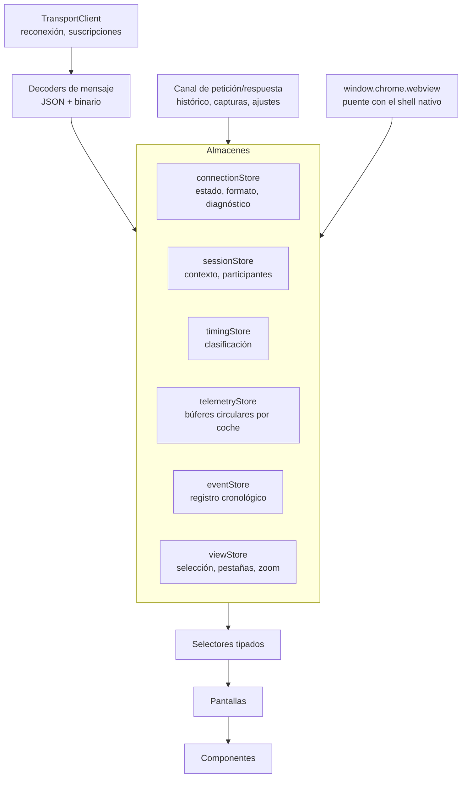
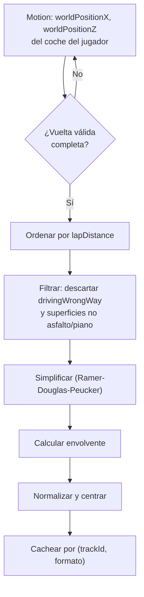

# Plan de frontend

## 0. Dónde vive esta interfaz

> **La interfaz de PitWall no se abre en un navegador.** Se renderiza dentro de un control
> **WebView2** alojado por `PitWall.exe`, ocupando el área cliente de su ventana (ADR-002 v2).

Consecuencias prácticas para quien la desarrolla:

| Aspecto | Qué cambia respecto a una web |
|---|---|
| Motor | **Uno solo**: WebView2 (Chromium de Edge). No hay matriz de navegadores que soportar |
| Origen | Los recursos llegan de un **nombre de host virtual** mapeado a la carpeta del ejecutable. Sin CORS, sin certificados, sin política de contenido cruzada |
| Navegación | La aplicación **no navega**. Todo enlace externo lo intercepta el shell y lo abre en el navegador del sistema (SEC-20) |
| Diálogos de fichero | Los del sistema, invocados por el shell (RF-631), no los del motor web |
| Herramientas de desarrollo | Disponibles en la compilación de desarrollo; **desactivadas** en la de distribución |
| Vocabulario visible | Prohibido mostrar puerto, URL, `localhost` o «WebSocket» fuera de *UDP Diagnostics* (RF-633) |
| Recarga en caliente | En desarrollo el WebView2 apunta al servidor de Vite; en distribución, a los ficheros locales |

Lo que **no** cambia: React, TypeScript, el canvas, el decimado de gráficas, los búferes circulares y
todo lo demás de este documento. Es el mismo código, en otra ventana.

---

## 1. Alcance y responsabilidad

La interfaz **presenta y explora**. No decodifica el protocolo, no mantiene la verdad del estado y no calcula métricas de dominio.

| La interfaz sí | La interfaz no |
|---|---|
| Renderizar el estado recibido | Parsear paquetes UDP |
| Mantener estado de **vista** (pestaña, selección, zoom) | Ser propietaria del estado de sesión |
| Interpolar suavemente entre muestras para animar | Extrapolar más allá del umbral configurado |
| Solicitar datos históricos | Calcular deltas, degradación o métricas derivadas |
| Distinguir visualmente las cinco procedencias | Inventar valores cuando falta un dato |

Esta frontera es la que permitió que el cambio a aplicación de escritorio (ADR-002 v2) no tocara ni una línea del núcleo: sólo cambió dónde se aloja la interfaz, no quién sabe qué.

---

## 2. Stack

| Pieza | Elección | Motivo |
|---|---|---|
| Anfitrión | **WebView2**, alojado por el shell C++ | Aplicación de escritorio real, sin empaquetar un navegador (ADR-002 v2) |
| Framework | **React 19 + TypeScript** en modo estricto | Ecosistema, tipado, familiaridad |
| Empaquetador | **Vite** | Arranque instantáneo, recarga en caliente, compilación estática simple |
| Estado del núcleo | Almacén ligero alimentado por el transporte interno | Sin librería de datos remotos: no hay REST que cachear |
| Estado de vista | Almacén minimalista con selectores | Evita repintados en cascada |
| Gráficas | Librería sobre **canvas**, no SVG | Ver §5 |
| Mapa | **Canvas 2D** propio | Ver §6 |
| Estilos | CSS con variables de diseño y módulos | Sin dependencia de un framework de utilidades |
| Enrutado | Enrutador ligero con rutas por pantalla | |
| Pruebas | Ejecutor de pruebas de componentes + automatización por **depuración remota del WebView2** para extremo a extremo (Q-11) | |

**Sin librería de componentes de terceros.** La identidad debe ser propia (RF-611) y los componentes son pocos y muy específicos: una torre de tiempos y un mapa de pista no salen de una biblioteca genérica.

**Ventaja de tener un solo motor.** Al no existir matriz de navegadores, se pueden usar sin reservas
las capacidades modernas de Chromium —`OffscreenCanvas`, `ResizeObserver`, contenedores de consulta,
`structuredClone`— sin comprobar compatibilidad ni cargar rellenos de compatibilidad. Es una de las
pocas cosas que este cambio de enfoque hace **más fácil**, no más difícil.

---

## 3. Arquitectura



El **puente con el shell** (`HOST`) es el único componente nuevo respecto a una web: por él llegan el
puerto efímero y el token del transporte interno al arrancar, y por él se piden los diálogos nativos
de fichero y la apertura de enlaces externos. Es deliberadamente delgado: todo lo demás sigue yendo
por el transporte normal.

No existe cliente HTTP. Las consultas de histórico viajan como **petición y respuesta sobre el mismo
canal** que el estado, con un identificador de correlación.

### 3.1. Separación por frecuencia de actualización

Es la decisión de rendimiento más importante del frontend:

| Almacén | Frecuencia | Estrategia |
|---|---|---|
| `connectionStore`, `sessionStore` | Baja | Estado de React normal |
| `timingStore` | 5-10 Hz | Estado de React con selectores por fila |
| `eventStore` | Esporádica | Estado de React, lista virtualizada |
| **`telemetryStore`** | **20-60 Hz** | **Fuera de React.** Búferes circulares mutables leídos directamente por el lienzo en cada fotograma |

Meter la telemetría de alta frecuencia en el estado de React provocaría cientos de reconciliaciones por segundo. Se mantiene en estructuras mutables y sólo el bucle de renderizado del lienzo las lee.

```ts
class RingBuffer {
  private readonly data: Float32Array;
  private readonly channels: number;
  private head = 0;
  private count = 0;

  push(sample: Float32Array): void { /* escribe en head, avanza circularmente */ }
  /** Vista sin copia de los últimos n valores de un canal */
  channelView(channel: number, n: number): Float32Array { /* … */ }
}
```

Un búfer de 60 s a 60 Hz con 40 canales ocupa 3600 × 40 × 4 B = **576 KB por coche**. Se mantienen sólo los coches suscritos, no los 24.

---

## 4. Pantallas

### 4.1. Inventario

| # | Ruta | Pantalla | Fase | Prioridad |
|---|---|---|---|---|
| 1 | `/` | **Estado** *(antes Home / Connection)* | F1 | Crítica |
| 2 | `/live` | Live Session | F1 | Alta |
| 3 | `/timing` | Timing Tower | F1 | Crítica |
| 4 | `/driver/:idx` | Driver Detail | F1 | Alta |
| 5 | `/telemetry` | Telemetry | F1 | Alta |
| 6 | `/map` | Track Map | F1 | Alta |
| 7 | `/tyres` | Tyres | F1 | Alta |
| 8 | `/strategy` | Strategy | F3 | Media |
| 9 | `/damage` | Damage | F1 | Media |
| 10 | `/compare` | Lap Comparison | F1 | Crítica |
| 11 | `/history` | Session History | F1 | Alta |
| 12 | `/replay` | Replay | F1 | Alta |
| 13 | `/settings` | Settings | F1 | Media |
| 14 | `/diagnostics` | **UDP Diagnostics** | F1 | **Crítica** |

*UDP Diagnostics* es crítica porque es la herramienta que más se usa **durante el desarrollo**, no durante el uso.

### 4.2. Estado

Ya no hay nada que conectar: la recepción arranca sola con la ventana (RF-622). Esta pantalla ya no
pregunta, **informa**. Debe resolver por sí sola el problema de «lo he abierto y no pasa nada», que
es el 90 % del soporte de este tipo de aplicaciones.

- Estado grande e inequívoco: **Escuchando · Recibiendo · Desconectado · Error**.
- Lo detectado: formato, versión del juego, circuito, tipo de sesión, coche del jugador, ritmo observado.
- **Lista de comprobación accionable** cuando no llega nada, en este orden: UDP activado en el juego,
  IP y puerto configurados, formato seleccionado, cortafuegos de Windows, otra aplicación ocupando el puerto.
- Cuando se puede leer `hardware_settings_config.xml` (RF-011), la lista deja de ser genérica y
  **señala el valor concreto que está mal**: «el juego está enviando al puerto 20778 y PitWall escucha
  en el 20777».
- Botón de **configuración asistida** (RF-011b), sólo con el juego cerrado, que explica exactamente
  qué va a cambiar, hace copia de seguridad y pide confirmación.
- Si se detecta contenido 2026 bajo formato 2025: aviso destacado con instrucciones (RF-104).
- **Nunca** muestra el puerto del transporte interno ni ninguna URL (RF-633).

### 4.3. Timing Tower

Fila por coche con: posición · variación de posición · número · nombre · barra de color de equipo · vuelta · sector actual con color · último tiempo · mejor tiempo · intervalo · diferencia al líder · compuesto y edad · paradas · penalizaciones · banderas · estado en pista.

| Aspecto | Solución |
|---|---|
| Reordenación | Transición animada de posición, no reordenación instantánea del DOM |
| Cifras | Tipografía **tabular**: los dígitos no bailan al cambiar |
| Colores de sector | Morado mejor de sesión, verde mejor personal, amarillo el resto |
| Restringido | Estilo diferenciado + explicación al pasar el cursor |
| Coches inactivos | Sección separada, no en posición 0 |
| Safety Car / VSC / bandera roja | Banda de estado global sobre la tabla |

### 4.4. Telemetry

Trazas deslizantes sincronizadas: velocidad, acelerador y freno, marcha y RPM, dirección, ERS, temperaturas.

Ventana temporal configurable (5, 15, 30, 60 s). Cursor común. Valores instantáneos numéricos junto a cada traza.

### 4.5. Track Map

Ver §6.

### 4.6. Tyres y Damage

Cuatro esquinas en **orden RL, RR, FL, FR** (RN-007), con desgaste, daño, ampollas, temperatura de superficie e interior, presión y temperatura de freno. Silueta del coche con daños por zona y barras de desgaste de los seis componentes de motor.

Si el coche seleccionado tiene telemetría restringida, **todo el bloque** se sustituye por un estado explicativo, no por ceros con escala de color.

### 4.7. Lap Comparison

La pantalla más densa del producto.

- Selector de dos vueltas de cualquier sesión del histórico.
- **Curva de delta** en la parte superior, eje X en **distancia** (RN-009).
- Debajo, gráficas apiladas: velocidad, acelerador, freno, dirección, marcha, RPM, ERS y —si ambas son de 2026— Active Aero y Overtake Mode.
- Cursor sincronizado en todas, con lectura numérica en un panel lateral.
- Marcadores de puntos de frenada y velocidades mínimas por curva.
- Zoom por arrastre en el eje X, compartido entre todas las gráficas.
- Aviso explícito si los canales disponibles difieren entre las dos vueltas (comparación 2025 vs 2026).

### 4.8. UDP Diagnostics

Los 13 indicadores exigidos (RF-606) más el volcado hexadecimal de datagramas no reconocidos, la IP de origen, y las cinco señales de detección temprana de cambio de protocolo (`03-UDP-PROTOCOL.md` §23.3).

Vista técnica y densa, sin concesiones estéticas: es una consola de instrumentos.

---

## 5. Gráficas

### 5.1. Requisitos

| Requisito | Valor |
|---|---|
| Puntos simultáneos | ≥ 100 000 sin degradar |
| Fotogramas por segundo | 60 con actualización continua |
| Sincronización | Cursor y zoom compartidos entre varias gráficas |
| Series con huecos | **Obligatorio**: un hueco no se dibuja, no se interpola |
| Tecnología | Canvas o WebGL. **SVG descartado** |
| Peso | Ligero, sin cadena de dependencias grande |

El requisito de huecos elimina de entrada a la mayoría de las librerías generalistas: casi todas unen los puntos adyacentes, lo que aquí produciría una línea recta atravesando una zona sin datos (CU-10 E1). Si la librería elegida no lo soporta de forma nativa, se emula partiendo la serie en segmentos con `NaN` como separador, comprobando que la librería lo respeta.

### 5.2. Decimado por nivel de detalle

Con 100 000 puntos y 1200 píxeles de ancho, dibujar todos es tirar el 99 % del trabajo.

```ts
/** Reduce n puntos a `width` columnas conservando mínimo y máximo de cada una,
 *  de modo que los picos nunca desaparecen. */
function decimateMinMax(x: Float32Array, y: Float32Array, width: number): Path {
  // por cada columna de píxel: emitir (min, max) del intervalo
}
```

Conservar mínimo y máximo por columna es esencial: un decimado por muestreo simple **haría desaparecer los picos de frenada**, que es justo lo que se quiere ver.

### 5.3. Alineación por distancia

Todo el análisis de vueltas usa **distancia** como eje X, nunca tiempo (RN-009). El backend entrega las vueltas ya remuestreadas a una rejilla común, de modo que el frontend sólo dibuja.

---

## 6. Mapa de pista

### 6.1. Reconstrucción del trazado

**No se usan imágenes de mapas dibujadas a mano** (RF-603). El trazado se reconstruye desde la telemetría:



### 6.2. Proyección

El juego entrega coordenadas 3D en metros. La proyección es directa:

```ts
// X y Z forman el plano del suelo; Y es la altura y se descarta
const sx = (p.x - bounds.minX) / bounds.width;
const sy = (p.z - bounds.minZ) / bounds.height;
```

Se preserva la **relación de aspecto real** del circuito: escalar cada eje por separado deformaría el trazado y haría irreconocible el circuito.

**Limitación honesta:** al descartar Y se pierde la elevación. En Spa o Austria el mapa es geométricamente correcto en planta, pero no refleja los desniveles. Se documenta y no se disimula (`05-DATA-MODEL.md` §6.7).

### 6.3. Renderizado

Dos lienzos superpuestos:

| Capa | Contenido | Frecuencia |
|---|---|---|
| Estática | Trazado, sectores, zonas de marshal, zonas de DRS y Active Aero, línea de meta, boxes | Se redibuja sólo al cambiar el circuito o el tamaño |
| Dinámica | Coches, etiquetas, banderas activas, coche seleccionado | 60 fps |

Separar las capas evita recalcular el trazado en cada fotograma, que es el error habitual y el que hunde el rendimiento.

### 6.4. Interpolación de posiciones

Las muestras llegan a 20-60 Hz y la pantalla refresca a 60 fps. Se interpola entre la última posición conocida y la anterior usando la velocidad, **hasta un máximo de 250 ms** (RT-06). Superado ese umbral, el coche se atenúa y deja de moverse: no se extrapola una posición inventada.

### 6.5. Zonas de 2026

Las zonas de Active Aero (completas y parciales) y de DRS llegan como fracciones 0..1 de la vuelta. Se convierten a puntos del trazado mediante la distancia acumulada. El mapa conmuta entre zonas completas y parciales según `m_activeAeroTrackStatus` y los eventos `PMEN`/`PMDI`.

---

## 7. Sistema de diseño

### 7.1. Identidad

Muro de boxes e instrumental de ingeniería. **No** la gráfica televisiva de la Fórmula 1 (RF-611, `01-REQUIREMENTS.md` §26.3).

| Elemento | Decisión |
|---|---|
| Tema | Oscuro por defecto; claro disponible |
| Fondo | Gris muy oscuro neutro, no negro puro (reduce el halo en pantallas OLED) |
| Acento | Un único color de acento del producto, distinto de los colores semánticos |
| Tipografía de interfaz | Familia legible de sistema |
| Tipografía de cifras | **Monoespaciada tabular**, obligatoria en todo dato numérico |
| Densidad | Alta en vistas de ingeniería, baja en vistas de conducción |
| Bordes y sombras | Mínimos. La jerarquía se construye con espacio y contraste |

### 7.2. Colores semánticos

Cada color tiene **un solo** significado en todo el producto:

| Color | Significado |
|---|---|
| Morado | Mejor de sesión |
| Verde | Mejor personal / bandera verde / dentro de rango |
| Amarillo | Bandera amarilla / advertencia |
| Azul | Bandera azul |
| Rojo | Bandera roja / crítico |
| Naranja | Safety Car / VSC |
| Gris | Inactivo / desconocido |

**Nunca se codifica información sólo por color** (RF-612): siempre acompañado de icono, texto o posición.

### 7.3. Representación de las procedencias

| Procedencia | Representación |
|---|---|
| `RAW` | Valor normal |
| `DERIVED` | Valor normal + marca discreta `∆` |
| `ESTIMATED` | Valor en cursiva + marca `≈` + margen de error si existe |
| `UNAVAILABLE` | Texto «—» atenuado + explicación al pasar el cursor |
| `RESTRICTED` | Icono de candado + texto «Restringido» + explicación |

Cinco estados distinguibles **sin depender del color**. Es el mecanismo que hace visible el principio P1 en cada píxel.

### 7.4. Antigüedad del dato

Todo valor lleva implícita su antigüedad (UX-02):

| Antigüedad | Aspecto |
|---|---|
| < 1 s | Normal |
| 1-3 s | Ligeramente atenuado |
| > 3 s | Muy atenuado + marca de tiempo al pasar el cursor |
| Sin datos de la sesión | Estado explícito |

Especialmente relevante en Tyre Sets y Session History, que ciclan a ~1,2 s por coche (RN-010).

---

## 8. Rendimiento

### 8.1. Presupuesto por fotograma (16,6 ms)

| Actividad | Presupuesto |
|---|---|
| Decodificación de mensajes del transporte | < 1 ms |
| Actualización de búferes circulares | < 0,5 ms |
| Reconciliación de React (sólo baja frecuencia) | < 4 ms |
| Dibujo del lienzo del mapa | < 3 ms |
| Dibujo de gráficas | < 5 ms |
| Margen | ~3 ms |

### 8.2. Técnicas aplicadas

| Técnica | Dónde |
|---|---|
| Telemetría fuera del estado de React | `telemetryStore` |
| Búferes circulares con `Float32Array` | Sin asignaciones por muestra |
| Decimado por nivel de detalle | Todas las gráficas |
| Capas de lienzo separadas | Mapa |
| Virtualización de listas | Registro de eventos, histórico |
| Selectores memoizados por fila | Torre de tiempos |
| Suscripción sólo a lo visible | Se desuscribe la telemetría al salir de la pantalla |
| Un único bucle de animación compartido | Evita N bucles compitiendo |
| `OffscreenCanvas` en trabajador | Si el perfilado lo justifica (no en MVP) |

### 8.3. Gestión de memoria

| Estructura | Límite |
|---|---|
| Búfer de telemetría por coche | 60 s (~576 KB) |
| Coches suscritos simultáneamente | 4 por defecto, 24 como máximo |
| Registro de eventos | 5000 entradas, ventana deslizante |
| Vueltas cargadas en comparación | 4 |
| **Total objetivo** | **< 800 MB tras 1 h** (RNF-015) |

Verificación: instantáneas de memoria a los 5, 30 y 60 min. Un crecimiento monótono es un defecto bloqueante.

---

## 9. Accesibilidad y usabilidad

| ID | Requisito |
|---|---|
| A11Y-01 | Contraste mínimo 4,5:1 en texto, 3:1 en elementos gráficos |
| A11Y-02 | Ninguna información codificada sólo por color |
| A11Y-03 | Navegación completa por teclado en las acciones frecuentes |
| A11Y-04 | Respeto de la preferencia de movimiento reducido del sistema |
| A11Y-05 | Escalado de la interfaz al 125 %, 150 % y 200 % |
| A11Y-06 | Foco visible en todo elemento interactivo |
| A11Y-07 | Ninguna animación parpadeante durante la conducción (UX-03) |
| A11Y-08 | Modo de alto contraste para las vistas de conducción |
| A11Y-09 | Respetar el escalado de PPP del sistema y el tema claro/oscuro de Windows (RF-627, RF-628) |

---

## 10. Comunicación con el backend

### 10.0. Arranque: cómo encuentra la interfaz a su núcleo

El usuario nunca ve un puerto ni una URL (RF-633), así que la interfaz tampoco los tiene escritos. El
shell los inyecta antes de que la página cargue:

```ts
// Inyectado por el shell mediante el script de inicialización del WebView2
declare global {
  interface Window {
    __pitwall: {
      endpoint: string;   // p. ej. "ws://127.0.0.1:53127"  — puerto efimero
      token: string;      // token de un solo uso (RF-307)
      version: string;
      mode: 'dev' | 'dist';
    };
  }
}
```

Si `window.__pitwall` no existe, la interfaz **no intenta adivinar** una dirección: muestra un error
claro de que se ha abierto fuera de su anfitrión. Es también la señal inequívoca de que alguien ha
abierto los ficheros en un navegador, que no es un uso soportado (OUT-10).

### 10.1. Protocolo del cliente

```ts
type ClientMessage =
  | { t: 'hello';       token: string }
  | { t: 'subscribe';   channels: Channel[]; vehicles?: number[] }
  | { t: 'unsubscribe'; channels: Channel[] }
  | { t: 'setRate';     channel: Channel; hz: number }
  | { t: 'query';       id: number; op: QueryOp; params: unknown }
  | { t: 'replay';      action: 'play'|'pause'|'seek'|'speed'; value?: number }
  | { t: 'ping';        ts: number };

type ServerMessage =
  | { ch: 'hello';       version: string; format: number; capabilities: string[] }
  | { ch: 'snapshot';    data: FullState }
  | { ch: 'session'|'timing'|'events'|'diagnostics'|'replay';
      of: number; ts: number; seq: number; data: unknown }
  | { ch: 'pong';        ts: number; serverTs: number };
```

La telemetría de alta frecuencia llega como **tramas binarias**, no como JSON (§8.1 de `06-REALTIME-PIPELINE.md`). Las respuestas a `query` llegan por el mismo canal con el `id` de correlación.

### 10.2. Reconexión

Retroceso exponencial de 250 ms a 5 s con fluctuación aleatoria. Al reconectar se pide siempre una instantánea completa. Mientras está desconectada, la interfaz muestra el último estado **claramente marcado como obsoleto**, en lugar de vaciarse.

### 10.2.1. Puente con el shell nativo

Sólo cuatro operaciones, y ninguna de ellas transporta datos de telemetría:

```ts
interface HostBridge {
  openFileDialog(filter: FileFilter): Promise<string | null>;   // RF-631
  saveFileDialog(name: string): Promise<string | null>;         // RF-631
  openExternal(url: string): void;                              // SEC-20
  setAlwaysOnTop(on: boolean): void;                            // RF-630
}
```

Cuanto más delgado sea este puente, menos código específico de Windows habrá en el frontend. Si algo
puede ir por el transporte normal, va por el transporte normal.

### 10.3. Medición de latencia

`ping`/`pong` cada 2 s estiman el desfase de reloj entre el núcleo y el motor web. Con él, cada mensaje puede convertir su `ts` de servidor en antigüedad real, y la métrica `end_to_end_latency_ms` se calcula en el cliente, que es donde de verdad importa.

---

## 11. Estructura de carpetas

```
ui/
├── src/
│   ├── app/                 arranque, enrutado, disposición
│   ├── net/                 cliente del transporte, decodificadores, puente con el shell
│   ├── stores/              almacenes por dominio
│   ├── screens/             una carpeta por pantalla
│   ├── components/
│   │   ├── primitives/      botón, panel, pestaña, indicador de estado
│   │   ├── data/            valor con procedencia, cifra tabular, indicador de antigüedad
│   │   ├── charts/          gráfica de línea, delta, decimado
│   │   ├── track/           lienzo del mapa, capas, proyección
│   │   └── timing/          fila, torre, bloque de sectores
│   ├── domain/              tipos compartidos con el backend
│   ├── design/              tokens, temas, tipografía
│   └── utils/
├── public/
└── tests/
    ├── unit/
    └── e2e/
```

`src/domain/` contiene los tipos del modelo normalizado. **Se generan** a partir de las definiciones del backend para que no puedan divergir: es el único punto donde dos lenguajes describen la misma cosa.

---

## 12. Plan de implementación

| Fase | Contenido | Depende de |
|---|---|---|
| FE-00 | Arranque dentro del WebView2: puente con el shell, `window.__pitwall`, modo desarrollo contra Vite | Shell (F1.5) |
| FE-01 | Andamiaje, enrutado, sistema de diseño, primitivas | — |
| FE-02 | Cliente del transporte interno, decodificadores, almacenes | Backend transporte |
| FE-03 | Pantalla de Estado + UDP Diagnostics | FE-02 |
| FE-04 | Timing Tower | FE-02 |
| FE-05 | Telemetry con gráficas deslizantes | FE-02 |
| FE-06 | Track Map | FE-05 |
| FE-07 | Tyres y Damage | FE-04 |
| FE-08 | Driver Detail | FE-05, FE-07 |
| FE-09 | Session History | API de histórico |
| FE-10 | Lap Comparison | FE-09 |
| FE-11 | Replay | FE-09 |
| FE-12 | Settings | — |
| FE-13 | Accesibilidad y pulido | Todas |

**FE-03 va antes que todo lo demás** salvo el andamiaje: sin diagnósticos no se puede depurar nada del resto.

---

## Sources

### Official

| Título | Uso |
|---|---|
| `Data Output from F1® 25: 2026 Season Pack` v1.2 | Campos a representar, orden de ruedas, zonas de 2026, semántica de banderas y de datos restringidos |
| `Data Output from F1® 25 Game` v3 | Ídem para 2025 |

Consultadas el 11 de septiembre de 2026.

---

*Fin de `PW-FE-008` v1.1*
