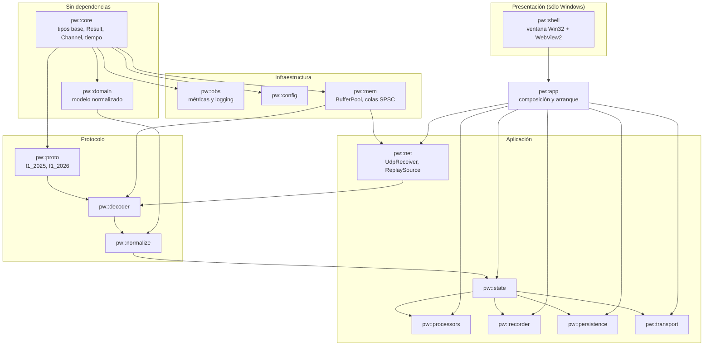

# Plan de backend

## 1. Entorno

| Aspecto | Elección | Motivo |
|---|---|---|
| Estándar | **C++20**, con adopción selectiva de C++23 | C++20 da `concepts`, `span`, `bit_cast`, `jthread`, `format`. C++23 aporta `expected` y `mdspan` donde el compilador lo soporte |
| Compilador principal | MSVC (Visual Studio 2022+) | Plataforma objetivo |
| Compilador secundario | Clang | Segunda opinión del compilador y acceso a desinfectantes y fuzzing |
| Construcción | **CMake** con presets | Estándar de facto, multiplataforma |
| Dependencias | Gestor por **manifiesto**, fijadas por versión | Reproducibilidad (RNF-092) |
| Advertencias | `/W4` en MSVC, `-Wall -Wextra -Wpedantic` en Clang, **como errores** en integración continua | RNF-086 |
| Protecciones | `/GS`, `/guard:cf`, `/sdl` | RNF-068 |
| Punto flotante | `/fp:precise` | Determinismo del replay (RP-08) |

### 1.1. Reglas de estilo con consecuencia técnica

| Regla | Motivo |
|---|---|
| **Ningún `new` ni `delete` manual.** RAII y contenedores | Fuga y doble liberación imposibles por construcción |
| **`std::span` en lugar de puntero + tamaño** | El tamaño viaja con el dato |
| **`const` por defecto** | |
| **`noexcept` en el camino caliente** | Evita rutas de desenrollado en el bucle de recepción |
| **`constexpr` en todo lo evaluable en compilación** | Tablas de tamaños y de enumerados sin coste en ejecución |
| **Ninguna variable global mutable** | Testabilidad y ausencia de estado oculto entre hilos |
| **`enum class` siempre** | Sin conversiones implícitas entre identificadores distintos |
| **Interfaces con destructor virtual** | |
| **Ninguna excepción en T1 ni T2** | Se usa un tipo de resultado para los errores esperados |

Las excepciones se reservan para fallos de arranque (no se puede enlazar el socket, no se puede abrir la base de datos). Un datagrama malformado **no es excepcional**: es lo normal, y se modela como un valor de retorno.

---

## 2. Mapa de módulos



`pw::shell` es el **único módulo específico de Windows**. Está en la cima del grafo: nadie depende de
él, y él depende de `pw::app`. Quitarlo deja un núcleo que compila y se ejecuta sin interfaz —que es
exactamente lo que necesita la integración continua en Linux y lo que usan las pruebas de integración.

**Verificación automática:** una prueba de integración continua comprueba que `pw::domain` no incluye ninguna cabecera de `pw::proto`, `pw::decoder` ni `pw::net`, y que las APIs específicas de plataforma sólo aparecen en **adaptadores de plataforma explícitos y controlados**. `pw::shell` es el propietario general de la API Win32 de interfaz; fuera de él sólo hay excepciones estrechas para adaptadores de bajo nivel —los sockets y la prioridad de T1, ambos en `pw::net`—, declaradas fichero a fichero y cabecera a cabecera en `tools/check_deps.py`. Es la propiedad que se rompe primero cuando hay prisa, así que se vigila con una herramienta y no con la memoria.

---

## 3. Módulos

### 3.1. `pw::core`

```cpp
namespace pw {

template <typename T, typename E>
class Result;                      // std::expected donde esté disponible

enum class Provenance : std::uint8_t {
    Raw, Derived, Estimated, Unavailable, Restricted
};

template <typename T>
class Channel {                    // valor y procedencia, inseparables
public:
    static Channel raw(T v) noexcept;
    static Channel derived(T v) noexcept;
    static Channel estimated(T v, float uncertainty = 0.f) noexcept;
    static Channel unavailable(Reason) noexcept;
    static Channel restricted() noexcept;

    bool       known()      const noexcept;
    Provenance provenance() const noexcept;
    const T&   value()      const;                 // precondición: known()
    T          valueOr(T fallback) const noexcept;
private:
    std::optional<T> v_;
    Provenance       p_;
    Reason           reason_;
};

std::uint64_t monotonicNowNs() noexcept;

} // namespace pw
```

`Channel<T>` no tiene conversión implícita a `T`. Obtener el valor exige comprobar `known()`. El principio P1 deja de depender de la disciplina y pasa a depender del compilador.

### 3.2. `pw::mem`

```cpp
class BufferPool {                 // preasignado, sin asignaciones en ejecución
public:
    explicit BufferPool(std::size_t count, std::size_t bufferSize);
    BufferHandle acquire() noexcept;     // nulo si agotado
    void         release(BufferHandle) noexcept;
    std::size_t  available() const noexcept;
};

template <typename T, std::size_t Capacity>
class SpscRing {                   // un productor, un consumidor, sin bloqueos
public:
    bool tryPush(T&&) noexcept;
    bool tryPop(T&) noexcept;
    std::size_t size() const noexcept;
    static constexpr std::size_t capacity() noexcept { return Capacity; }
};
```

Detalles que importan:

- Los índices de cabeza y cola viven en **líneas de caché distintas** (alineación a 64 B) para evitar compartición falsa. Sin esa alineación, el rendimiento de la cola cae varias veces.
- `BufferHandle` es un índice al pool más un recuento de referencias, no un puntero. Un uso tras liberación es detectable.

### 3.3. `pw::proto`

Un fichero de cabecera por formato. Sólo `struct`, constantes y `static_assert`.

```cpp
namespace pw::proto::f1_2026 {

inline constexpr std::uint32_t kMaxCars               = 24;
inline constexpr std::uint32_t kMaxMarshalZones       = 21;
inline constexpr std::uint32_t kMaxActiveAeroZones    = 8;
inline constexpr std::uint32_t kMaxDrsZones           = 4;

#pragma pack(push, 1)

struct CarTelemetryData {
    std::uint16_t m_speed;
    float         m_throttle;
    float         m_steer;
    float         m_brake;
    std::uint8_t  m_clutch;
    std::int8_t   m_gear;
    std::uint16_t m_engineRPM;
    std::uint8_t  m_drs;
    std::uint8_t  m_revLightsPercent;
    std::uint16_t m_revLightsBitValue;
    std::uint16_t m_brakesTemperature[4];
    std::uint8_t  m_tyresSurfaceTemperature[4];
    std::uint8_t  m_tyresInnerTemperature[4];
    std::uint8_t  m_engineTemperature;      // uint16 en 2025 — D-05
    float         m_tyresPressure[4];
    std::uint8_t  m_surfaceType[4];
};
static_assert(sizeof(CarTelemetryData) == 59);

struct PacketCarTelemetryData {
    PacketHeader     m_header;
    CarTelemetryData m_carTelemetryData[kMaxCars];
    std::uint8_t     m_mfdPanelIndex;
    std::uint8_t     m_mfdPanelIndexSecondaryPlayer;
    std::int8_t      m_suggestedGear;
};
static_assert(sizeof(PacketCarTelemetryData) == 1448,   // valor oficial
              "Car Telemetry 2026 distinto de la especificacion");

#pragma pack(pop)

} // namespace pw::proto::f1_2026
```

Los `static_assert` son **la prueba de protocolo** exigida por el enunciado. Se ejecutan en cada compilación, con coste cero y sin poder olvidarse.

Se añade además una comprobación aritmética redundante que valida la relación entre el tamaño del paquete y el tamaño por coche:

```cpp
static_assert(sizeof(PacketCarTelemetryData)
              == sizeof(PacketHeader) + kMaxCars * sizeof(CarTelemetryData) + 3);
```

Esta segunda comprobación detecta un error que la primera no ve: haber transcrito mal un campo **y** haber compensado el número total.

### 3.4. `pw::decoder`

```cpp
enum class DecodeStatus : std::uint8_t {
    Ok, Truncated, BadSize, UnknownFormat, UnknownId, UnknownVersion, MalformedPayload
};

class IProtocolDecoder {
public:
    virtual ~IProtocolDecoder() = default;
    virtual std::uint16_t formatId() const noexcept = 0;
    virtual std::optional<std::size_t> expectedSize(PacketId) const noexcept = 0;
    virtual bool supportsVersion(PacketId, std::uint8_t) const noexcept = 0;
    virtual DecodeStatus decode(const PacketHeader&,
                                std::span<const std::byte> payload,
                                const TelemetryPolicy&,
                                DomainSink&) const noexcept = 0;
};

class DecoderRegistry {
public:
    void registerDecoder(std::unique_ptr<IProtocolDecoder>);
    const IProtocolDecoder* find(std::uint16_t formatId) const noexcept;
    std::span<const std::uint16_t> supportedFormats() const noexcept;
};
```

Las tablas de tamaños son `constexpr`, por lo que `expectedSize` es una consulta a un array en tiempo de ejecución sin búsqueda.

### 3.5. `pw::domain`

Tipos que describen una sesión de carreras. Sin `m_`, sin años, sin dependencias.

```cpp
namespace pw::domain {

struct CarTelemetryFrame {
    VehicleIndex          vehicle;
    Channel<float>        speedKph;
    Channel<float>        throttle;
    Channel<float>        brake;
    Channel<float>        steer;
    Channel<std::int8_t>  gear;
    Channel<std::uint16_t> engineRpm;
    Channel<bool>         drs;
    std::array<Channel<float>, 4> tyreSurfaceTempC;   // orden RL, RR, FL, FR
    // …
    // Sólo formato 2026; en 2025 llegan como Unavailable
    Channel<ActiveAeroMode> activeAeroMode;
    Channel<std::uint16_t>  activeAeroActivationDistanceM;
    Channel<bool>           overtakeActive;
    Channel<std::uint16_t>  overtakeActivationDistanceM;
};

enum class ErsMode : std::uint8_t { None, Medium, Hotlap, Overtake, Boost, Unknown };

} // namespace pw::domain
```

`ErsMode` incluye a la vez `Overtake` y `Boost`. No son dos nombres del mismo valor: son dos conceptos distintos que cada formato expresa con el número 3 (D-10). El dominio los distingue; el decoder decide cuál corresponde.

### 3.6. `pw::state`

```cpp
class SessionStateEngine {
public:
    void apply(const PacketHeader&, const DecodedPacket&);
    std::shared_ptr<const SessionSnapshot> snapshot() const noexcept;
    void subscribe(BusChannel, BusSink*);
private:
    bool isDuplicate(const PacketHeader&) const noexcept;
    bool isStale(const PacketHeader&) const noexcept;
    void detectSessionChange(const PacketHeader&);
    void detectFlashback(const PacketHeader&);
    void closeLogicalFrame();

    SessionState                          state_;      // propiedad exclusiva
    std::array<std::uint32_t, kMaxPacketIds> lastOverallFrame_{};
    std::uint32_t                         lastFrameId_ = 0;
    BranchId                              branch_ = 0;
    std::uint64_t                         lastSessionChangeNs_ = 0;
};
```

`snapshot()` devuelve un puntero contado a una estructura **inmutable**. Los consumidores la leen sin bloqueos y la sueltan cuando terminan.

### 3.7. `pw::recorder` y `pw::persistence`

```cpp
class RawRecorder {
public:
    Result<void, RecorderError> start(const CaptureConfig&);
    void write(const ReceivedDatagram&) noexcept;      // encola, nunca bloquea
    void rotate();
    void stop();
    RecorderStats stats() const noexcept;
};

class CatalogStore {               // transaccional
public:
    void upsertSession(const domain::Session&);
    void insertLap(const domain::LapRecord&);
    void insertEvent(const domain::SessionEvent&);
    void commitBatch();
    std::vector<SessionSummary> querySessions(const SessionFilter&) const;
};

class SeriesStore {                // columnar por lotes
public:
    void appendTelemetry(std::span<const domain::TelemetrySample>);
    void flush();
    LapSeries loadLap(SessionKey, VehicleIndex, LapNumber) const;
};
```

### 3.8. `pw::transport` — Transporte interno

```cpp
class LocalTransport {
public:
    // Enlaza 127.0.0.1 en puerto EFÍMERO; devuelve el puerto concedido y el token.
    Result<Endpoint, NetError> listenLoopbackEphemeral();
    std::string_view sessionToken() const noexcept;   // un solo uso (RF-307)

    void publish(BusChannel, std::span<const std::byte> payload);
    void publishJson(BusChannel, std::string_view json);

    // Petición/respuesta sobre el mismo canal, con id de correlación
    void registerQueryHandler(QueryOp, QueryHandler);

    bool connected() const noexcept;                  // 0 o 1: sólo la ventana propia
};
```

**Cambio respecto a la versión anterior de este plan.** Ya no hay `HttpApi` ni servidor de ficheros
estáticos. Las consultas de histórico viajan como **petición y respuesta** por el mismo canal, con un
identificador de correlación, y los recursos de la interfaz los sirve el WebView2 desde el disco por
mapeo de nombre de host virtual (RF-308).

El resultado es **un solo socket escuchando** en todo el producto, en bucle local, en un puerto
efímero y con token. Es más simple que antes y menos superficie de ataque.

### 3.9. `pw::shell` — La aplicación de escritorio *(sólo Windows)*

```cpp
class DesktopShell {
public:
    // Devuelve el código de salida del proceso.
    int run(HINSTANCE, const Config&);

private:
    Result<void, ShellError> ensureWebView2Runtime();   // RF-632
    Result<void, ShellError> acquireSingleInstance();   // RF-625
    void createWindow();                                 // RF-620, RF-626, RF-627
    void createWebView();                                // RF-621
    void mapVirtualHostToAppFolder();                    // RF-308
    void injectBootstrapScript(const Endpoint&, std::string_view token);
    void wireHostBridge();                               // diálogos, enlaces externos
    void startCore();                                    // RF-622: escuchar sin que nadie lo pida
    void onClose();                                      // RF-629: cierre ordenado
};
```

Responsabilidades y el requisito que las justifica, en `04-ARCHITECTURE.md` §3.10.

**Regla de contención.** Todo lo que sea Win32 de interfaz o WebView2 vive aquí y **sólo** aquí.
Fuera del shell, una cabecera de Windows sólo puede aparecer en un adaptador de plataforma declarado
en `tools/check_deps.py` —hoy, los sockets (`*_win32` de `pw::net`, sólo Winsock) y la prioridad de T1
(`thread_priority_win32.cpp`, sólo `windows.h` y `processthreadsapi.h`)—, cada uno con su equivalente
POSIX. Cualquier otro `#include <windows.h>` hace fallar la verificación del grafo. Es lo que mantiene
al núcleo compilando en Linux (RNF-091) y lo que hace que el shell sea sustituible el día que haga
falta otra cosa.

---

## 4. Composición y arranque

```cpp
// PitWall.exe — punto de entrada de una aplicación de escritorio Windows.
// El shell arranca primero: la ventana debe existir antes de que algo pueda fallar (§6.4 de 04-ARCHITECTURE).
int WINAPI wWinMain(HINSTANCE hInst, HINSTANCE, PWSTR cmdLine, int) {
    auto cfg = config::load(cmdLine);

    if (!shell::acquireSingleInstance()) {          // RF-625
        shell::activateExistingWindow();
        return 0;
    }
    if (auto r = shell::ensureWebView2Runtime(); !r) {   // RF-632
        shell::showRuntimeMissingDialog(r.error());
        return 1;
    }

    DesktopShell shell{hInst, cfg};
    shell.createWindow();                           // la ventana YA está en pantalla
    shell.createWebView();

    Core core{cfg};                                 // …y ahora se levanta el núcleo detrás
    const auto ep = core.start();                   // RF-622: escuchar sin que nadie lo pida
    shell.injectBootstrap(ep.endpoint, ep.token);   // RF-307
    shell.navigateToApp();                          // RF-308

    const int code = shell.runMessageLoop();
    core.stop();                                    // RF-629: drenar, cerrar captura, liberar socket
    return code;
}
```

El `Core` encapsula lo que antes vivía suelto en `main`. Nótese que **no conoce al shell**: expone
`start()` y `stop()`, y devuelve el endpoint que el shell tendrá que inyectar en la interfaz.

```cpp
class Core {
public:
    explicit Core(const Config& cfg)
        : cfg_{cfg}
        , logger_{cfg.logging}
        , pool_{cfg.net.poolSize, 2048}
        , state_{metrics_}
        , recorder_{cfg.recording, qRec_, metrics_}
        , catalog_{cfg.storage.catalogPath}
        , series_{cfg.storage.seriesPath}
        , persistence_{catalog_, series_, metrics_}
        , transport_{cfg.transport}
    {
        registry_.registerDecoder(std::make_unique<F1_2025_Decoder>());
        registry_.registerDecoder(std::make_unique<F1_2026_Decoder>());

        state_.subscribe(BusChannel::All, &persistence_);
        state_.subscribe(BusChannel::All, &transport_);
        registerQueryHandlers(transport_, catalog_, series_);   // histórico: petición/respuesta
    }

    /// Enlaza el transporte interno y arranca los hilos. RF-622: nadie tiene que pedirlo.
    TransportEndpoint start() {
        const auto ep = transport_.listenLoopbackEphemeral().value();   // 127.0.0.1:0 + token

        source_ = cfg_.mode == Mode::Replay
            ? std::unique_ptr<IDatagramSource>{std::make_unique<ReplaySource>(cfg_.replay, pool_, qRaw_)}
            : std::unique_ptr<IDatagramSource>{std::make_unique<UdpReceiver>(cfg_.net, pool_, qRaw_, qRec_, metrics_)};

        pipeline_.emplace(qRaw_, pool_, registry_, state_, metrics_);

        threads_.spawn("pw-udp-rx",    [&](auto st) { source_->run(st); });
        threads_.spawn("pw-pipeline",  [&](auto st) { pipeline_->run(st); });
        threads_.spawn("pw-recorder",  [&](auto st) { recorder_.run(st); });
        threads_.spawn("pw-persist",   [&](auto st) { persistence_.run(st); });
        threads_.spawn("pw-transport", [&](auto st) { transport_.run(st); });
        return ep;
    }

    /// RF-629: drenar colas, cerrar la captura en curso, liberar el socket.
    void stop() { threads_.requestStopAndJoin(); recorder_.stop(); persistence_.flush(); }

private:
    const Config&                     cfg_;
    obs::Logger                       logger_;
    obs::Metrics                      metrics_;
    mem::BufferPool                   pool_;
    mem::SpscRing<BufferHandle, 8192> qRaw_, qRec_;
    DecoderRegistry                   registry_;
    SessionStateEngine                state_;
    RawRecorder                       recorder_;
    CatalogStore                      catalog_;
    SeriesStore                       series_;
    PersistenceWriter                 persistence_;
    LocalTransport                    transport_;
    std::unique_ptr<IDatagramSource>  source_;
    std::optional<Pipeline>           pipeline_;
    ThreadGroup                       threads_;
};
```

Todo se construye explícitamente y se pasa por referencia. **Sin contenedor de inyección de dependencias, sin singletons.** El grafo es estático, conocido y visible de un vistazo, que es exactamente lo que un contenedor destruiría.

**Dos detalles del orden de arranque que importan:**

1. **La ventana existe antes que el núcleo.** Si el bind del puerto UDP falla, si el disco está lleno
   o si el catálogo está corrupto, hay una interfaz donde explicarlo (RF-624, RNF-097). Al revés, el
   usuario vería un ejecutable que «no hace nada».
2. **La instancia única se comprueba lo primero.** Dos procesos no pueden enlazar el mismo puerto
   UDP, así que un segundo arranque activa la ventana existente en lugar de fallar de forma confusa.

**Modo sin interfaz.** El mismo núcleo se compila y arranca sin `pw::shell` mediante `pitwall-cli`,
que es lo que usan las pruebas de integración, la reproducción por lotes y la integración continua en
Linux. Es la prueba práctica de que el shell no contamina nada.

---

## 5. Manejo de errores

| Clase de error | Mecanismo | Ejemplo |
|---|---|---|
| **Esperado y frecuente** | Valor de retorno (`DecodeStatus`, `Result`) | Datagrama truncado, tamaño incorrecto |
| **Esperado e infrecuente** | `Result` con tipo de error | Disco lleno, cliente desconectado |
| **De arranque** | Excepción, aborta el arranque | No se puede enlazar el puerto, base de datos corrupta |
| **Fallo de programación** | `assert` en depuración, contabilizado en producción | Invariante roto |

**Ninguna excepción cruza las fronteras de T1 ni de T2.** Cada bucle de hilo tiene un `catch(...)` de último recurso que registra el error y detiene ordenadamente su hilo, para que un fallo imprevisto en un consumidor no derribe el proceso.

---

## 6. Configuración

```toml
[net]
bind = "127.0.0.1"
port = 20777
receiveBufferBytes = 4194304
poolSize = 20480             # ≥ 16.387: la SUMA de Qraw y Qrec más los buffers en vuelo (§8)
originFilter = []            # vacío = aceptar cualquier origen
silenceTimeoutMs = 2000      # RF-012: sin datagramas ≥ esto → «Desconectado». Rango 100..2000

[recording]
enabled = true
autoStartOnSession = true
directory = "%LOCALAPPDATA%/PitWall/data/captures"
compressionLevel = 3
maxFileSizeBytes = 1073741824
syncPointIntervalSeconds = 10

[storage]
catalogPath = "%LOCALAPPDATA%/PitWall/data/catalog.db"
seriesPath  = "%LOCALAPPDATA%/PitWall/data/series"
retentionRawGb = 20
retentionSeriesGb = 50
retentionDays = 90

[transport]
# El transporte interno NO es configurable: siempre 127.0.0.1 en puerto efímero
# con token de un solo uso (ADR-002 v2, SEC-13, SEC-14). Sólo se configuran los ritmos.
timingRateHz = 10
telemetryRateHz = 20

[shell]
startMaximized = false
rememberWindowState = true   # RF-626
alwaysOnTop = false          # RF-630
devTools = false             # true sólo en compilaciones de desarrollo
uiSource = "embedded"        # "embedded" | "dev-server"
devServerUrl = "http://localhost:5173"

[logging]
level = "info"
directory = "%LOCALAPPDATA%/PitWall/data/logs"
maxFileSizeMb = 32
maxFiles = 10

[analysis]
distanceStepMeters = 1.0
brakingThreshold = 0.15
minCleanLapsForDegradation = 5
maxInterpolationGapMeters = 25
```

Precedencia: valores por defecto → fichero → variables de entorno → argumentos de línea de órdenes. Toda la configuración se valida al arrancar con mensajes que dicen **qué** está mal y **qué** valor se esperaba.

---

## 7. Plan de implementación de módulos

| Orden | Módulo | Entregable verificable | Depende de |
|---|---|---|---|
| 1 | `pw::core` | `Channel<T>`, `Result`, tiempo monótono, con pruebas | — |
| 2 | `pw::obs` | Métricas y logging estructurado | core |
| 3 | `pw::config` | Carga y validación | core |
| 4 | `pw::mem` | `BufferPool`, `SpscRing` con pruebas de estrés | core |
| 5 | `pw::net` (recepción) | Socket que recibe y cuenta | mem, obs |
| 6 | `pw::proto::f1_2026` | Structs con todos los `static_assert` en verde | core |
| 7 | `pw::decoder` (cabecera + registro) | Enrutado por formato | proto |
| 8 | `pw::domain` | Modelo normalizado | core |
| 9 | `pw::normalize` (2026) | Un paquete decodificado y normalizado extremo a extremo | proto, domain |
| 10 | `pw::proto::f1_2025` + normalización | Ambos formatos | 6, 9 |
| 11 | `pw::recorder` | `.f1raw` que se escribe y se lee | net, mem |
| 12 | `pw::net` (replay) | Reproducción con fidelidad temporal | recorder |
| 13 | `pw::state` | Sesiones, vueltas, stints, ramas | normalize |
| 14 | `pw::transport` | Estado fuera del núcleo, listo para la interfaz | state |
| 15 | `pw::persistence` (catálogo) | Sesiones y vueltas persistidas | state |
| 16 | `pw::persistence` (series) | Telemetría columnar | 15 |
| 17 | `pw::processors` | Métricas de vuelta y comparación | state, 16 |
| 18 | `pw::transport` (petición/respuesta) | Consultas de histórico | 15, 16 |
| — | `pw::shell` | **Ventana, WebView2, instancia única, arranque automático** | transport. Se implementa en la fase F1.6b, **antes** que las vistas |

**El orden no es arbitrario.** El módulo 11 (grabador) va antes que el 13 (estado) porque, en cuanto existe el grabador, todo lo posterior se desarrolla contra capturas reales sin abrir el juego. Es la inversión que más tiempo ahorra en el conjunto del proyecto.

Y `pw::shell` se implementa **antes** que las vistas de producto, aunque en el grafo esté en la cima:
en cuanto existe la ventana, todo el desarrollo de interfaz ocurre ya en el entorno real, y no se
descubren sorpresas del WebView2 al final. Es el mismo razonamiento que con el grabador.

---

## 8. Rendimiento: reglas y verificación

| Regla | Verificación |
|---|---|
| Cero asignaciones por datagrama en T1 y T2 | Contador de asignaciones en compilación instrumentada |
| Cero bloqueos en el camino caliente | Revisión de código + ThreadSanitizer |
| Tablas de tamaños y enumerados `constexpr` | Inspección del ensamblador en los puntos calientes |
| Alineación a línea de caché en las colas | `static_assert` de `alignof` |
| Pool dimensionado por el modelo de propiedad | `poolSize ≥ Qraw + Qrec + consumidores + productor = 16.387`; el valor por defecto es **20.480** |
| Sin copias del payload | `std::span` en toda la ruta de decodificación |

> **Por qué el mínimo es 16.387 y no 4.150.** Hay dos restricciones distintas sobre el mismo número,
> y manda la mayor:
>
> | Restricción | Mínimo | De dónde sale |
> |---|---|---|
> | Ráfaga de 10 s | 4.150 | 415 datagramas/s × 10 s |
> | **Modelo de propiedad** | **16.387** | `Qraw` 8192 + `Qrec` 8192 + 2 consumidores + 1 productor |
>
> La segunda es la que decide. `Qraw` y `Qrec` mantienen **cada una su propia referencia** sobre el
> mismo buffer (§4.4 de `04-ARCHITECTURE.md`), y dos colas que avanzan a ritmos distintos acaban
> refiriéndose a conjuntos de buffers **disjuntos**: la lenta retiene los antiguos mientras la rápida
> trabaja con los nuevos. En el peor caso, por tanto, los buffers vivos son la **suma** de las
> capacidades, no la mayor de ellas.
>
> Por debajo de ese número el pool se agota **antes** de que ninguna cola se llene, y eso tiene una
> consecuencia que va más allá de perder capacidad: **las políticas de desbordamiento por cola no
> llegan a ejecutarse**, y el atasco de un consumidor se contagia al otro. Con un pool de 8192 y el
> grabador parado, los 8192 buffers quedan retenidos por `Qrec` y el pipeline se queda sin ninguno:
> se pierde también el directo. Está medido en `core/tests/unit/mem/test_pool_sizing.cpp`, que a
> escala reducida entrega 32 de 500 datagramas con el pool infradimensionado y 500 de 500 con el pool
> correcto.
>
> El valor por defecto es **20.480**: el mínimo con margen, múltiplo de 1024, unos 49 s de ráfaga y
> 41 MiB de memoria reservada con buffers de 2048 B — muy por debajo del presupuesto de RNF-011.
> La regla vive en `pw::mem::poolSizeForQueues` y una prueba verifica que el valor por defecto de
> `pw::config` la cumple, para que la discrepancia no pueda reaparecer.
>
> *Historia de esta nota: la v1.1 fijaba `poolSize = 4096`, por debajo del mínimo que exigía esta
> misma sección. La v1.2 lo corrigió a 8192 razonando sobre la capacidad de **una** cola, que también
> se queda corto. La v1.3 lo corrige con la suma, comprobada al implementar `BufferPool` en F1.1-01.*

---

## 9. Seguridad en el backend

Materialización de SEC-01 … SEC-18:

```cpp
// SEC-06: acotar SIEMPRE los contadores recibidos antes de usarlos como índice
const auto n = std::min<std::size_t>(p.m_numActiveCars, f1_2026::kMaxCars);
for (std::size_t i = 0; i < n; ++i) { /* … */ }

// SEC-13/14: el transporte interno se enlaza en puerto efímero y exige token
auto ep = transport.listenLoopbackEphemeral();   // NO hay puerto fijo ni configurable
// El token sólo se entrega al WebView2 propio mediante el script de arranque del shell.

// SEC-11: los nombres son texto no confiable
domain::PlayerName sanitizeName(std::span<const char, 32> raw) {
    const auto len = std::min(std::strnlen(raw.data(), raw.size()), raw.size());
    return domain::PlayerName::fromUtf8Lossy({raw.data(), len});   // valida y sustituye inválidos
}
```

`m_numActiveCars` es un `uint8` que llega por la red: puede valer 255. Sin el `min`, sería una lectura fuera de límites de 231 elementos. Es el vector de ataque más probable de todo el sistema y por eso tiene su propia regla, su propia prueba y su propio caso de fuzzing.

---

## 10. Observabilidad en el backend

```cpp
namespace pw::obs {

class Counter   { void inc(std::uint64_t = 1) noexcept; };   // atómico relajado
class Gauge     { void set(std::int64_t) noexcept; };
class Histogram { void observe(std::uint64_t ns) noexcept; }; // cubos fijos, sin asignación

#define PW_TIMED(hist) ScopedTimer _t{hist}

} // namespace pw::obs
```

Contadores atómicos con orden relajado: el coste es de unos pocos nanosegundos y no introduce sincronización entre hilos. Los histogramas usan cubos fijos preasignados, sin asignación en ejecución (OBS-02).

---

## Sources

### Official

| Título | Uso |
|---|---|
| `Data Output from F1® 25: 2026 Season Pack` v1.2 | Transcripción literal de structs, tamaños y constantes; datos restringidos |
| `Data Output from F1® 25 Game` v3 | Ídem para 2025 |

### Reference implementations

| Proyecto | Uso |
|---|---|
| `volodymyr-fed/F1Game.UDP` (MIT) | Confirmación del patrón de mapeo directo de structs y de registro por formato |

Consultadas el 11 de septiembre de 2026.

---

*Fin de `PW-BE-009` v1.3*
