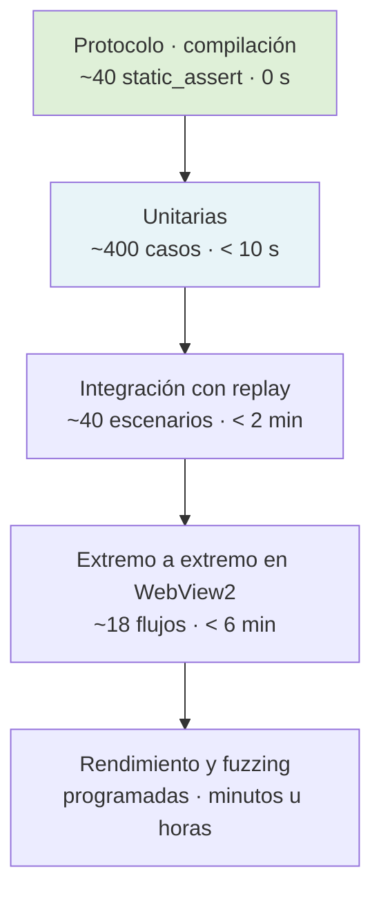
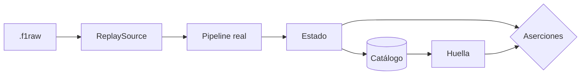
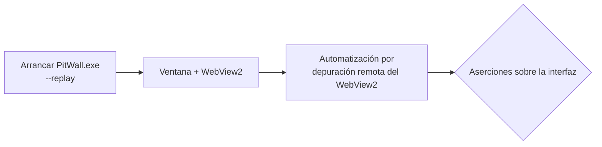
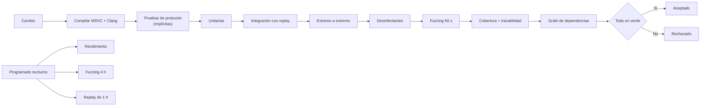

# Plan de pruebas

## 1. Principio rector

> **La suite completa debe ejecutarse sin el juego instalado.**

No es una comodidad: es la condición que hace viable el proyecto. Un desarrollador que necesita conducir una hora para probar un cambio en una gráfica, no prueba.

De ahí se derivan todas las demás decisiones: la captura cruda, el motor de replay, los fixtures extraídos de sesiones reales y el generador sintético.

---

## 2. Pirámide



| Nivel | Cuándo se ejecuta | Objetivo de tiempo |
|---|---|---|
| Protocolo | En cada compilación | 0 s (es el propio compilador) |
| Unitarias | En cada guardado / cambio | < 10 s |
| Integración | En cada cambio subido | < 2 min |
| Extremo a extremo | En cada cambio subido | < 5 min |
| Rendimiento | Programada, nocturna | < 30 min |
| Fuzzing | Corto en cada cambio; largo programado | 60 s / 4 h |

---

## 3. Nivel 1 — Pruebas de protocolo

Se ejecutan en **tiempo de compilación**. No pueden olvidarse ni tardan nada.

```cpp
// 1. Tamaño total del paquete frente al valor oficial
static_assert(sizeof(f1_2026::PacketMotionData)            == 1325);
static_assert(sizeof(f1_2026::PacketSessionData)           == 926);
static_assert(sizeof(f1_2026::PacketLapData)               == 1399);
static_assert(sizeof(f1_2026::PacketEventData)             == 45);
static_assert(sizeof(f1_2026::PacketParticipantsData)      == 1470);
static_assert(sizeof(f1_2026::PacketCarSetupData)          == 1233);
static_assert(sizeof(f1_2026::PacketCarTelemetryData)      == 1448);
static_assert(sizeof(f1_2026::PacketCarStatusData)         == 1445);
static_assert(sizeof(f1_2026::PacketFinalClassificationData) == 1134);
static_assert(sizeof(f1_2026::PacketLobbyInfoData)         == 1062);
static_assert(sizeof(f1_2026::PacketCarDamageData)         == 1133);
static_assert(sizeof(f1_2026::PacketSessionHistoryData)    == 1460);
static_assert(sizeof(f1_2026::PacketTyreSetsData)          == 231);
static_assert(sizeof(f1_2026::PacketMotionExData)          == 273);
static_assert(sizeof(f1_2026::PacketTimeTrialData)         == 104);
static_assert(sizeof(f1_2026::PacketLapPositionsData)      == 1231);
static_assert(sizeof(f1_2026::PacketCarTelemetry2Data)     == 269);

// 2. Coherencia aritmética: cabecera + N coches + extras
static_assert(sizeof(f1_2026::PacketCarTelemetryData)
              == 29 + 24 * sizeof(f1_2026::CarTelemetryData) + 3);

// 3. Offsets de campos críticos, para detectar un campo mal colocado
//    que compense el tamaño total
static_assert(offsetof(PacketHeader, m_sessionUID)              == 7);
static_assert(offsetof(PacketHeader, m_overallFrameIdentifier)  == 23);
static_assert(offsetof(f1_2026::CarTelemetryData, m_engineTemperature) == 41);

// 4. Requisitos de layout
static_assert(std::is_trivially_copyable_v<f1_2026::PacketCarTelemetryData>);
static_assert(alignof(f1_2026::PacketCarTelemetryData) == 1);
```

**Las cuatro capas son necesarias.** El tamaño total detecta la mayoría de errores; la aritmética detecta errores compensados; los offsets detectan campos reordenados; el layout detecta un `#pragma pack` mal cerrado.

Se replica íntegramente para el formato 2025.

---

## 4. Nivel 2 — Pruebas unitarias

### 4.1. Decoder

| Grupo | Casos |
|---|---|
| Cabecera | Los 12 campos de un fixture verificado byte a byte |
| Un fixture por `(formato, packetId)` | 16 en 2025 + 17 en 2026 = **33** |
| Desescalado | Direcciones ÷ 32767,0 y g-forces ÷ 1000,0 con valores conocidos |
| Tiempos en dos partes | Sector de 1:23,456 → `1 × 60000 + 23456` |
| Centinelas | 255, 65535, −1 y 0 → ausencia, para cada campo afectado |
| Unión de eventos | Los 25 códigos de 2026 y los 21 de 2025 |
| Rechazos | Truncado, tamaño ±1, id 99, formato 2027, versión 7 |
| Enumerados desconocidos | `trackId = 99` → «desconocido», no fallo |
| `ersDeployMode = 3` | `Overtake` en 2025, `Boost` en 2026 |
| Compuesto 22 | C6 como real en F1, duro como visual en F2 |

### 4.2. Normalizador

| Grupo | Casos |
|---|---|
| Telemetría restringida | Los 30 campos de la lista oficial → `RESTRICTED`, no 0 |
| Telemetría pública | Los mismos campos → `RAW` |
| Cambio de restringida a pública a mitad | Hacia adelante sí, retroactivamente no |
| Canales exclusivos de 2026 | En 2025 → `UNAVAILABLE` con razón |
| `Motion Ex` de un rival | Nunca se produce fila |
| Catálogos por formato | `teamId = 486` → «Cadillac '26» en 2026, desconocido en 2025 |
| Orden de ruedas | Un fixture con las cuatro ruedas distintas verifica RL, RR, FL, FR |

### 4.3. Motor de estado

| Grupo | Casos |
|---|---|
| Ciclo de sesión | Inicio por UID, inicio por `SSTA`, fin por `SEND`, fin por clasificación |
| Histéresis | Rebote de UID en < 2 s no duplica sesión |
| Vueltas | Cierre correcto, vuelta inválida, vuelta con boxes |
| Stints | Cambio de compuesto, parada, correspondencia con `Session History` |
| Flashback | Con evento, sin evento, encadenados, sin duplicar vueltas |
| Deduplicación | Duplicar la captura entera no altera el estado |
| Obsoletos | Barajar dentro de 100 ms produce el mismo estado |
| Eventos | Un evento «obsoleto» **sí** se procesa |
| Fotograma lógico | No se mezclan dos fotogramas; guarda de 100 ms |

### 4.4. Cálculos derivados

| Grupo | Casos |
|---|---|
| Delta | Dos vueltas sintéticas con diferencia conocida → delta esperado ±50 ms |
| Remuestreo | Longitud igual, monotonía de la distancia |
| Huecos | Hueco > umbral → sin línea, no interpolación |
| Puntos de frenada | Fixture con frenadas conocidas |
| Velocidad mínima por curva | Prominencia y separación mínimas respetadas |
| Degradación | Serie con pendiente conocida → misma pendiente; < 5 vueltas → sin resultado |
| Consistencia | Desviación típica conocida |
| Trazado | Vuelta sintética circular → círculo con relación de aspecto correcta |

### 4.5. Infraestructura

| Grupo | Casos |
|---|---|
| `SpscRing` | Vacío, lleno, envolvente, estrés con dos hilos |
| `BufferPool` | Agotamiento, liberación, recuento de referencias |
| `Channel<T>` | No compila la conversión implícita a `T` (prueba de no compilación) |
| Reloj monótono | No decreciente ante cambio de hora del sistema |
| Configuración | Valores por defecto, precedencia, validación, mensajes de error |

---

## 5. Nivel 3 — Integración con replay



Se ejercita **el sistema real**, no una maqueta. La única pieza sustituida es la fuente de datagramas.

### 5.1. Escenarios

| Escenario | Aserciones |
|---|---|
| `2026_race_full` | Nº de vueltas, clasificación final, eventos, 0 descartes |
| `2026_flashback_simple` | Recuento de vueltas correcto, rama creada, delta sin salto |
| `2026_flashback_chained` | N ramas, sin duplicados |
| `2026_flashback_no_event` | Rama inferida por retroceso de `frameIdentifier` |
| `2026_safety_car` | Transiciones de estado en orden |
| `2026_red_flag` | Cronometraje congelado |
| `2026_pit_stop` | Stints correctos, tiempos de boxes |
| `2026_active_aero` | `CarTelemetry2` presente, zonas, `PMEN`/`OVEN` |
| `2026_multiplayer_restricted` | **0 valores restringidos expuestos como reales** |
| `2026_session_transition` | Clasificación cerrada, carrera abierta, sin mezcla |
| `2026_spectator` | Se sigue el coche espectado |
| `2026_time_trial` | PB y rival correctos |
| `2025_race_full` | Regresión del formato anterior |
| `2025_to_2026_switch` | Dos sesiones, sin estado mezclado |
| `synthetic_packet_loss_5pct` | Estado coherente, pérdida estimada ≈ 5 % |
| `synthetic_reorder` | Mismo estado final |
| `synthetic_duplicates` | Mismo estado final |
| `synthetic_malformed_mix` | 0 caídas, todos contabilizados |
| `synthetic_24_cars_60hz` | 0 descartes |

### 5.2. Determinismo

```
Ejecutar A: replay → huella(catálogo) = H1
Ejecutar B: replay → huella(catálogo) = H2
Aserción:   H1 == H2
```

Es la prueba que sostiene todas las demás: sin determinismo, un fallo intermitente sería indepurable (RP-08).

---

## 6. Nivel 4 — Extremo a extremo



Se prueba **el ejecutable real**, con su ventana y su WebView2, no una página en un navegador. El
control se hace conectando al protocolo de depuración remota que el propio WebView2 expone cuando se
arranca con el argumento correspondiente, algo que hay que verificar en la fase F1.6b (Q-11); si
resultara frágil, la alternativa registrada es ejecutar las pruebas de interfaz contra la misma
compilación servida en modo desarrollo.

| Flujo | Aserciones |
|---|---|
| Conexión | El estado pasa a «Recibiendo»; formato correcto |
| Torre de tiempos | Nº de filas, orden por posición, tiempos coincidentes con el catálogo |
| Telemetría | Las trazas se mueven; los valores coinciden |
| Mapa | Nº de coches, trazado reconstruido, no plano en blanco |
| Neumáticos | Orden RL, RR, FL, FR verificado en el texto accesible |
| **Restringidos** | Los campos afectados muestran «Restringido», **nunca `0`** |
| Comparación | Dos vueltas cargadas, delta dibujado, cursor sincronizado |
| Diagnósticos | Los 13 indicadores presentes y con valores no nulos |
| Replay | Las seis velocidades; el progreso avanza |
| Reconexión | Reiniciar el backend repuebla la interfaz en < 2 s |
| Histórico | Las sesiones del catálogo aparecen y se abren |
| 2025 vs 2026 | Active Aero visible en 2026, `UNAVAILABLE` en 2025 |
| Accesibilidad | Contraste, foco, navegación por teclado |
| Rendimiento | 60 fps con 24 coches y una gráfica activa |
| **Ventana** | Doble clic abre una ventana propia y ningún navegador (A-40) |
| **Arranque automático** | La recepción está activa desde el primer instante, sin acción (A-41) |
| **Detección** | Con el replay inyectando, pasa a *Recibiendo* en ≤ 2 s (A-42) |
| **Sin UDP** | Sin datos, la ventana explica la causa y los pasos (A-43) |
| **Instancia única** | Un segundo arranque activa la ventana existente (A-44) |
| **Vocabulario** | Ninguna pantalla salvo *Diagnostics* muestra puerto ni URL (A-45) |
| Memoria | Sin crecimiento monótono en 10 min |

La prueba de «restringidos» se ejecuta **también** como captura de pantalla comparada, porque el fallo típico no es mostrar el texto equivocado sino pintar una barra de progreso al 0 %.

---

## 7. Nivel 5 — Fuzzing

### 7.1. Objetivo

```cpp
extern "C" int LLVMFuzzerTestOneInput(const std::uint8_t* data, std::size_t size) {
    static DecoderRegistry registry = makeFullRegistry();

    if (size < 29) return 0;
    PacketHeader h{};
    std::memcpy(&h, data, 29);

    if (const auto* dec = registry.find(h.m_packetFormat)) {
        // El decoder valida e identifica; no traduce a dominio (04 §3.3).
        const auto packet =
            dec->decode(h, {reinterpret_cast<const std::byte*>(data), size});
        if (packet) { consumeEveryField(*packet); }   // recorre la vista tipada
    }
    return 0;
}
```

### 7.2. Corpus semilla

Los 33 fixtures reales más mutaciones dirigidas: contadores al máximo (`m_numActiveCars = 255`, `m_numMarshalZones = 255`, `m_numLaps = 255`), longitudes límite, cadenas sin terminador nulo, valores de punto flotante especiales (NaN, infinitos, subnormales).

### 7.3. Criterios

| Criterio | Umbral |
|---|---|
| Caídas | **0** |
| Hallazgos del desinfectante de direcciones | **0** |
| Lecturas fuera de límites | **0** |
| Asignaciones no acotadas | **0** |
| Bucles infinitos | 0 (tiempo límite de 1 s por entrada) |
| Cobertura del decoder alcanzada por fuzzing | ≥ 70 % |

Toda entrada que provoque un fallo se **añade permanentemente** como caso de regresión.

---

## 8. Nivel 6 — Rendimiento

| Prueba | Método | Umbral |
|---|---|---|
| Recepción sostenida | Inyección UDP a 415 datagramas/s durante 1 h | 0 pérdidas |
| Recepción a 2,4× | 1000 datagramas/s durante 30 min | 0 pérdidas (RNF-001) |
| Ráfagas | 5000 datagramas en 200 ms | 0 pérdidas con `SO_RCVBUF` de 4 MB |
| Latencia de decodificación | Histograma sobre 1 M de datagramas | p99 < 50 µs |
| Latencia extremo a extremo | Marca de tiempo medida dentro del WebView2 | p95 < 150 ms |
| CPU | 1 h a 60 Hz | < 5 % de un núcleo |
| Memoria | 1 h a 60 Hz | < 300 MB, sin crecimiento |
| Asignaciones | Compilación instrumentada | 0 por datagrama |
| Escritura de captura | 1 h a 60 Hz | Ratio ≥ 3×, < 1 % de CPU |
| Carga de vuelta | Sesión de 1 h | < 500 ms |
| Consulta de histórico | 500 sesiones | < 200 ms |
| Renderizado | 24 coches + gráfica | 60 fps |

Las pruebas de rendimiento se ejecutan de forma **programada, no en cada cambio** (TST-06): son lentas y sensibles al ruido de la máquina. Los resultados se registran para poder detectar regresiones por tendencia, no por un único valor.

---

## 9. Análisis estático y dinámico

| Herramienta | Cuándo | Criterio |
|---|---|---|
| `/W4` y `-Wall -Wextra -Wpedantic` como errores | Cada compilación | 0 advertencias |
| Analizador estático del compilador | En integración continua | 0 hallazgos de gravedad alta |
| `clang-tidy` con conjunto de reglas del proyecto | En integración continua | 0 hallazgos |
| Desinfectante de direcciones | Suite completa | 0 hallazgos |
| Desinfectante de comportamiento indefinido | Suite completa | 0 hallazgos |
| **ThreadSanitizer** | Suite de integración | **0 hallazgos** |
| Cobertura | En integración continua | ≥ 80 % en decoder, normalizador y estado |
| Verificación del grafo de dependencias | En integración continua | `pw::domain` no incluye `pw::proto` |

---

## 10. Trazabilidad requisito ↔ prueba

Cada prueba declara el requisito que verifica:

```cpp
TEST_CASE("RF-211: la telemetria restringida no se expone como cero", "[normalize][RF-211]") {
    const auto pkt = fixtures::load("2026/07_car_status_restricted.bin");
    TelemetryPolicy policy; policy.setRestricted(3, true);

    DomainCapture sink;
    const auto vp = decoder.decode(pkt.header(), pkt.bytes()).value();
    normalize::apply(viewAs<f1_2026::PacketCarStatusData>(vp), *vp.header, policy, sink);

    const auto& car = sink.carStatus(3);
    REQUIRE(car.fuelKg.provenance() == Provenance::Restricted);
    REQUIRE_FALSE(car.fuelKg.known());
    REQUIRE(car.ersStoreJ.provenance() == Provenance::Restricted);
}
```

Un informe de integración continua cruza los identificadores de las etiquetas con los requisitos de `01-REQUIREMENTS.md` y **falla si algún requisito `MUST` no tiene prueba** (RNF-085, TST-04).

---

## 11. Gestión de fixtures y capturas

| Artefacto | Dónde vive | Tamaño |
|---|---|---|
| Fixtures de paquete | En el repositorio | < 2 KB cada uno |
| Escenarios cortos | En el repositorio, con almacenamiento de ficheros grandes | 100 KB – 2 MB |
| Capturas de rendimiento | **Fuera del repositorio**, descargables | 100 MB – 1 GB |
| Generador sintético | En el repositorio | Código |

Reglas:

1. **Toda captura versionada está anonimizada** (TST-03, PRV-03).
2. Cada fixture lleva un `.json` con los valores esperados **verificados a mano** la primera vez.
3. Los fixtures se regeneran tras un cambio de protocolo, y el diff se revisa a mano.
4. Una captura de referencia por formato es requisito de salida de la Fase 1 (TST-07).

### 11.1. Dos clases de fixture, y no son intercambiables

| | **Fixture sintético verificado** | **Fixture real** |
|---|---|---|
| Origen | Bytes construidos a mano desde la especificación | Datagrama **capturado del juego** |
| Cómo se obtiene | Se escribe en el propio repositorio de pruebas | Se extrae de una captura con una **herramienta del repositorio** (TST-02, F1.4-17) |
| Para qué sirve | Tamaños, offsets, despacho, rechazos, eventos, centinelas y catálogos | Todo lo anterior **y** el comportamiento real del juego |
| Qué **no** demuestra | Que el juego emita realmente eso | — |
| Satisface TST-02 | **No** | Sí |

Los dos son legítimos y se usan en fases distintas: un decoder nuevo se puede escribir y probar entero contra sintéticos —es lo que hacen los `static_assert` y las pruebas de nivel 1 y 2—, pero **un formato no se da por cerrado hasta que sus fixtures reales existen**. Los 33 fixtures del corpus de fuzzing (§7.2) y de la tabla de nivel 1 son **reales**.

> Llamar «fixture» a las dos cosas sin distinguirlas es la manera más fácil de creer que un formato está verificado contra el juego cuando sólo está verificado contra la lectura que alguien hizo del PDF.

---

## 12. Integración continua



| Fase | Bloqueante | Tiempo objetivo |
|---|---|---|
| Compilación | Sí | < 3 min |
| Unitarias | Sí | < 10 s |
| Integración | Sí | < 2 min |
| Extremo a extremo | Sí | < 5 min |
| Desinfectantes | Sí | < 5 min |
| Fuzzing corto | Sí | 60 s |
| Cobertura y trazabilidad | Sí | < 1 min |
| Rendimiento | No (informativo) | Nocturno |

---

## 13. Estrategia por fase

| Fase | Foco de pruebas |
|---|---|
| F1.1 Recepción | Unitarias de infraestructura, prueba de carga básica |
| F1.2 Decoders | **Protocolo + unitarias + fuzzing.** El foco más intenso del proyecto |
| F1.3 Estado | Unitarias del estado, integración con escenarios |
| F1.4 Grabación y replay | Ida y vuelta, determinismo, fidelidad temporal |
| F1.5 Transporte | Integración, latencia |
| F1.6 Interfaz | Extremo a extremo, accesibilidad, rendimiento de renderizado |
| F1.7 Análisis | Unitarias de cálculos con series sintéticas de resultado conocido |
| F2 Robustez | Todos los casos borde, fuzzing largo, sesiones de 24 h |
| F3 Ingeniero | Unitarias de reglas con capturas de resultado conocido |

---

## 14. Qué se prueba manualmente

Reconocido explícitamente, porque fingir que todo está automatizado sería falso:

| Aspecto | Por qué es manual | Frecuencia |
|---|---|---|
| Calidad visual del diseño | Juicio estético | Cada hito |
| Legibilidad a 1 m durante la conducción | Requiere conducir | Cada hito |
| Corrección de la telemetría frente a la sensación real | Sólo el piloto lo sabe | Cada hito |
| Configuración en consola | Requiere hardware | Al implementar RF-003 |
| Instalación en máquina limpia | Requiere una máquina o VM limpia | Cada hito |
| Ausencia de WebView2 Runtime | Requiere un Windows 10 sin él | Antes de V1 |
| Comportamiento de la ventana entre monitores con PPP distinto | Requiere dos monitores | Al implementar RF-627 |
| Comportamiento con un parche nuevo del juego | Requiere el parche | Al publicarse |
| Utilidad de las conclusiones del ingeniero | Juicio de dominio | Fase 3 |

Cada uno tiene una lista de comprobación escrita en `docs/16-DEVELOPMENT-GUIDE.md`, para que la sesión de pruebas manuales sea repetible aunque no sea automática.

---

## Sources

### Official

| Título | Uso |
|---|---|
| `Data Output from F1® 25: 2026 Season Pack` v1.2 | Tamaños oficiales usados en los `static_assert`; lista de datos restringidos; códigos de evento |
| `Data Output from F1® 25 Game` v3 | Ídem para 2025 |

Consultadas el 11 de septiembre de 2026.

---

*Fin de `PW-TST-010` v1.1*
