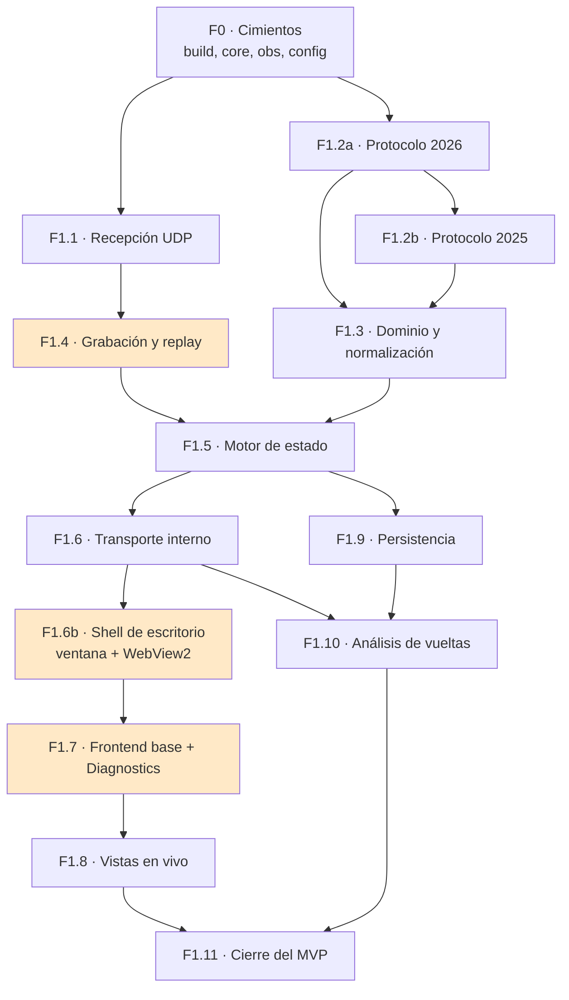

# Plan de implementación

## 1. Cómo leer este documento

Cada fase tiene **objetivo, tareas numeradas, dependencias y una Definition of Done verificable**. La granularidad es deliberadamente alta: el plan debe poder ejecutarse sin improvisar y sin volver a diseñar nada.

**Regla de oro:** una fase no se cierra hasta que su Definition of Done se cumple **por completo**. No se empieza la siguiente con deuda de la anterior. Es la principal defensa contra RSK-08 (sobreingeniería) y RSK-04 (sobrecoste de aprendizaje).

### 1.1. Convenios

- `F<fase>.<subfase>-<n>` identifica una tarea.
- **DoD** = Definition of Done.
- Cada tarea indica los requisitos que satisface.

---

## 2. Grafo de dependencias

**Las tres fases destacadas son las que más ahorran tiempo después.** F1.4 permite trabajar sin el
juego; F1.6b pone la ventana real antes de construir nada dentro de ella; F1.7 (Diagnostics) permite
depurar todo lo demás.

> **Por qué el shell va antes que las vistas.** Es el mismo razonamiento que con el grabador: en
> cuanto existe la ventana, todo el desarrollo de interfaz ocurre ya en el entorno definitivo. Si el
> WebView2 tiene sorpresas —con el caudal binario, con el escalado de PPP, con la automatización de
> pruebas— aparecen con una pantalla construida, no con catorce.

### 2.1. Trabajo paralelizable

| Se pueden solapar | Motivo |
|---|---|
| F1.2b (protocolo 2025) con F1.3 | Son estructuras independientes; 2025 se transcribe mientras se normaliza 2026 |
| F1.4 (grabación) con F1.2 | El grabador no depende del decoder por diseño |
| F1.7 (frontend base) con F1.5 | Se desarrolla contra un transporte simulado, en modo desarrollo contra Vite |
| F1.9 (persistencia) con F1.8 (vistas) | Consumidores independientes del bus |

---

## 3. FASE F0 — Cimientos

**Objetivo.** Un repositorio que compila, prueba y ejecuta un binario vacío pero bien estructurado.

**Duración estimada.** 3-4 días.

### Tareas

| # | Tarea | Detalle |
|---|---|---|
| F0-01 | Inicializar el repositorio | Git, `.gitignore` (incluye `spec/`, `build/`, `data/`), licencia, `README` con el aviso legal de `01-REQUIREMENTS.md` §26.3 |
| F0-02 | Estructura de carpetas | Según `17-PROJECT-STRUCTURE.md` |
| F0-03 | CMake con presets | `debug`, `release`, `asan`, `tsan`, `fuzz`. Estándar C++20, advertencias como errores |
| F0-04 | Manifiesto de dependencias | Versiones fijadas; verificación de licencias permisivas |
| F0-05 | `pw::core` — tipos base | `Result<T,E>`, `Reason`, tipos fuertes (`VehicleIndex`, `LapNumber`, `SessionKey`) |
| F0-06 | `pw::core` — `Channel<T>` | Con prueba de **no compilación** de la conversión implícita a `T` |
| F0-07 | `pw::core` — tiempo monótono | `monotonicNowNs()` y prueba de no decrecimiento |
| F0-08 | `pw::obs` — métricas | `Counter`, `Gauge`, `Histogram` de cubos fijos, registro consultable |
| F0-09 | `pw::obs` — logging | Estructurado, asíncrono, 5 niveles, rotación, agregación de repetidos |
| F0-10 | `pw::config` | Carga TOML, precedencia, validación con mensajes accionables |
| F0-11 | Marco de pruebas | Integrado en CMake, ejecutable con una orden |
| F0-12 | Integración continua | Compilación MSVC + Clang, pruebas, desinfectantes, advertencias como errores |
| F0-13 | Verificador del grafo de dependencias | Script que falla si `pw::domain` incluye `pw::proto` |
| F0-14 | Ejecutable vacío | Arranca, lee la configuración, registra «PitWall iniciado», termina limpio |

### DoD de F0

- [ ] `cmake --preset debug && cmake --build --preset debug` funciona en una máquina limpia en < 10 min
- [ ] La suite de pruebas se ejecuta y pasa
- [ ] Compilación sin advertencias con `/W4` y `-Wall -Wextra -Wpedantic`
- [ ] Los desinfectantes de direcciones e hilos se ejecutan sin hallazgos
- [ ] `Channel<T>` no permite obtener el valor sin comprobar `known()`, verificado por prueba de no compilación
- [ ] La integración continua está en verde
- [ ] El `README` explica cómo compilar y ejecutar
- [ ] El verificador del grafo de dependencias está activo

---

## 4. FASE F1.1 — Recepción UDP

**Objetivo.** Recibir datagramas reales del juego, validarlos mínimamente y contarlos.

**Duración estimada.** 3-4 días. **Depende de:** F0.

### Tareas

| # | Tarea | Detalle | Requisitos |
|---|---|---|---|
| F1.1-01 | `BufferPool` | Preasignado, `acquire`/`release`, recuento de referencias, contador de agotamiento | RNF-013 |
| F1.1-02 | `SpscRing` | Lock-free, índices en líneas de caché separadas, `static_assert` de alineación | RNF-051 |
| F1.1-03 | Prueba de estrés de la cola | Dos hilos, 10 M de elementos, sin pérdida ni corrupción | RNF-054 |
| F1.1-04 | Capa de abstracción del socket | Winsock e implementación POSIX tras una interfaz común | RNF-091 |
| F1.1-05 | `UdpReceiver` — bind | Dirección y puerto configurables; error accionable si falla | RF-002, RF-003, RNF-097 |
| F1.1-06 | `SO_RCVBUF` a 4 MB | Verificar el valor efectivo concedido por el sistema y registrarlo | RNF-026 |
| F1.1-07 | Bucle de recepción | Sin asignaciones, marca de tiempo primero, validación de longitud mínima | RF-001, RF-004, RF-007 |
| F1.1-08 | Contadores | Por tamaño, por origen, inválidos por causa | RF-008 |
| F1.1-09 | Registro de origen | IP y puerto; tabla de orígenes por índice | RF-009 |
| F1.1-10 | Detección de desconexión | Sin datagramas durante N s → estado desconectado | RF-012 |
| F1.1-11 | Prioridad del hilo | Por encima de la normal, **no** tiempo real | — |
| F1.1-12 | Apagado ordenado | Cierre del socket, drenaje, unión de hilos | RNF-055 |
| F1.1-13 | Herramienta `pw-listen` | Utilidad mínima: escucha e imprime estadísticas por consola | — |
| F1.1-14 | Prueba de carga sintética | Generador que emite a 1000 datagramas/s | RNF-001 |

**Estado de F1.1-08 y F1.1-09 frente a sus requisitos** *(v1.2)*:

| Tarea / requisito | Estado |
|---|---|
| F1.1-08 | **Completa** para el alcance de esta fase |
| RF-008 · por tamaño | ✅ F1.1 |
| RF-008 · por origen | ✅ F1.1 |
| RF-008 · inválidos por causa del receptor | ✅ F1.1 (`truncated`, `oversized`, `socket_error`) |
| RF-008 · por `format` | ⏳ F1.2: requiere el decodificador |
| RF-008 · por `packetId` | ⏳ F1.2: requiere el decodificador |
| F1.1-09 | **Completa** para el registro y la identidad del origen |
| RF-009 · registro e identidad (IP + puerto, índice estable) | ✅ F1.1 |
| RF-009 · filtro por origen | ⏳ F2.4, según la hoja de ruta actual |

**Estado de F1.1-12 frente a RNF-055** *(v1.4)*:

| Parte | Estado |
|---|---|
| F1.1-12 | **Completa** en su alcance de adquisición (`06-REALTIME-PIPELINE.md` §2.4) |
| T1 para en tiempo acotado (≈ una espera de `pollTimeoutMs`) | ✅ F1.1 |
| `join` antes de `close`; socket liberado sin cierre concurrente | ✅ F1.1 |
| T1 no retiene `BufferHandle` al salir; contrato de drenaje probado | ✅ F1.1 |
| Una parada normal no produce sucesos de error | ✅ F1.1 |
| **RNF-055 completo** | **Parcial** |
| T2/T3 drenan realmente sus colas | ⏳ con T2 y T3 |
| Cierre de la captura y persistencia | ⏳ F1.4 y persistencia |
| Orden global en `Core` / `ThreadGroup` | ⏳ `pw::app` |
| RF-629, cierre desde la ventana | ⏳ F1.6b |
| `Ctrl+C` de extremo a extremo | ⏳ F1.1-13 (`pw-listen`) |

### DoD de F1.1

- [ ] Con el juego emitiendo, `pw-listen` muestra un flujo estable de datagramas
- [ ] Con bind `0.0.0.0`, se reciben datagramas de otra máquina de la LAN
- [ ] Un datagrama de 10 bytes se cuenta como truncado y no provoca fallo
- [ ] 1000 datagramas/s durante 30 min: 0 pérdidas, 0 agotamientos del pool
- [ ] 0 asignaciones por datagrama, verificado con compilación instrumentada
- [ ] ThreadSanitizer sin hallazgos sobre la prueba de estrés
- [ ] `Ctrl+C` cierra limpiamente sin fugas ni bloqueos
- [ ] El error de puerto ocupado dice qué hacer

> **Hito de aprendizaje.** Al cerrar F1.1 se habrá practicado: sockets, colas lock-free, alineación de caché, pools de memoria, prioridades de hilo y apagado ordenado. Es un fin de fase natural para revisar el código con calma antes de seguir.

---

## 5. FASE F1.2a — Protocolo 2026

**Objetivo.** Transcribir el formato 2026 completo y decodificarlo con seguridad.

**Duración estimada.** 5-7 días. **Depende de:** F0. **Paralelizable con:** F1.1.

### Tareas

| # | Tarea | Detalle | Requisitos |
|---|---|---|---|
| F1.2a-01 | `PacketHeader` | 29 B, `static_assert` de tamaño y de offsets | RF-100 |
| F1.2a-02 | Constantes del formato | `kMaxCars = 24` y las demás, en un solo lugar | — |
| F1.2a-03 | Tabla de tamaños esperados | `constexpr`, indexada por `packetId` | RNF-041 |
| F1.2a-04 | Structs de los paquetes 0-8 | Motion, Session, Lap Data, Event, Participants, Car Setups, Car Telemetry, Car Status, Final Classification | RF-103 |
| F1.2a-05 | Structs de los paquetes 9-16 | Lobby Info, Car Damage, Session History, Tyre Sets, Motion Ex, Time Trial, Lap Positions, **Car Telemetry 2** | RF-103 |
| F1.2a-06 | Los 4 niveles de `static_assert` | Tamaño total, aritmética, offsets críticos, layout | `10-TESTING-PLAN.md` §3 |
| F1.2a-07 | `viewAs<T>` seguro | Con precondición de tamaño; variante con `memcpy` activable | SEC-02, SEC-03 |
| F1.2a-08 | `IProtocolDecoder` y registro | Interfaz y `DecoderRegistry` | RF-101 |
| F1.2a-09 | `F1_2026_Decoder` | Despacho por `packetId`, validación de tamaño exacto y de versión | RF-103, RF-005 |
| F1.2a-10 | Unión de eventos | Los **25** códigos, incluidos `PMEN`, `PMDI`, `OVEN`, `OVDI` y `PartialModeEnabled` | RF-106, RF-107 |
| F1.2a-11 | Acotación de contadores | `min(m_numActiveCars, kMaxCars)` y equivalentes en **todos** los contadores recibidos | **SEC-06** |
| F1.2a-12 | Catálogos 2026 | Equipos (incluidos 485 Audi y 486 Cadillac), pilotos hasta 207, circuitos con 42 Madrid, nacionalidades, modos, penalizaciones, infracciones | RF-110 |
| F1.2a-13 | Resolución tolerante | Un identificador desconocido produce «Desconocido (n)», nunca fallo | RF-111 |
| F1.2a-14 | Captura de fixtures reales | Uno por `packetId` (17), extraídos de una sesión real | TST-02 |
| F1.2a-15 | Ficheros `.json` de valores esperados | **Verificados a mano** contra la especificación | TST-02 |
| F1.2a-16 | Pruebas unitarias del decoder | Los 17 paquetes + rechazos + centinelas | — |
| F1.2a-17 | Objetivo de fuzzing | Con corpus semilla de los fixtures | SEC-16 |

### DoD de F1.2a

- [ ] Los 17 tipos de paquete se decodifican desde fixtures reales
- [ ] Los 4 niveles de `static_assert` en verde para los 17 paquetes
- [ ] Los 25 códigos de evento producen el tipo correcto
- [ ] Un datagrama con un byte de más se rechaza y registra el par (esperado, observado)
- [ ] `m_numActiveCars = 255` **no** provoca lectura fuera de límites (prueba explícita)
- [ ] Fuzzing de 1 h: 0 caídas, 0 hallazgos del desinfectante de direcciones
- [ ] `teamId = 486` resuelve a «Cadillac '26»; `trackId = 42` a «Madrid»
- [ ] `trackId = 99` muestra «Circuito desconocido (99)»
- [ ] p99 de decodificación < 50 µs

---

## 6. FASE F1.2b — Protocolo 2025

**Objetivo.** El formato anterior, aprovechando toda la infraestructura de F1.2a.

**Duración estimada.** 2-3 días. **Depende de:** F1.2a.

| # | Tarea | Requisitos |
|---|---|---|
| F1.2b-01 | Constantes 2025 (`kMaxCars = 22`) | — |
| F1.2b-02 | Structs de los 16 paquetes | RF-102 |
| F1.2b-03 | Los 4 niveles de `static_assert` | — |
| F1.2b-04 | `F1_2025_Decoder` y registro | RF-102 |
| F1.2b-05 | Unión de eventos con los 21 códigos y `Collision` **sin** `severity` | RF-106 |
| F1.2b-06 | Catálogos 2025 (sin Madrid, sin bloque '26) | RF-110 |
| F1.2b-07 | 16 fixtures reales + `.json` | TST-02 |
| F1.2b-08 | Pruebas unitarias | — |
| F1.2b-09 | Detección de cambio de formato con umbral de 3 datagramas | RF-105 |
| F1.2b-10 | Captura sintética de cambio 2025 ↔ 2026 | TST-02 |

### DoD de F1.2b

- [ ] Los 16 paquetes decodificados desde fixtures reales
- [ ] `static_assert` en verde
- [ ] Los dos decoders coexisten en el registro
- [ ] La captura de cambio de formato conmuta sin estado mezclado
- [ ] Un datagrama 2025 y otro 2026 seguidos se enrutan correctamente
- [ ] Fuzzing sobre ambos decoders sin hallazgos

---

## 7. FASE F1.3 — Dominio y normalización

**Objetivo.** Que 2025 y 2026 produzcan el mismo modelo, con procedencias correctas.

**Duración estimada.** 5-6 días. **Depende de:** F1.2a, F1.2b.

| # | Tarea | Requisitos |
|---|---|---|
| F1.3-01 | Modelo de dominio: entidades estáticas y de baja frecuencia | RF-200 |
| F1.3-02 | Modelo de dominio: telemetría y movimiento | RF-200 |
| F1.3-03 | Modelo de dominio: eventos | RF-200 |
| F1.3-04 | `DomainSink` | Interfaz de escritura sin asignación | RNF-013 |
| F1.3-05 | Normalización 2026 de los 17 paquetes | RF-201 |
| F1.3-06 | Normalización 2025 de los 16 paquetes | RF-201 |
| F1.3-07 | Desescalado de cuantizados (÷ 32767,0 y ÷ 1000,0) | RF-108 |
| F1.3-08 | Reconstrucción de tiempos en dos partes | `03-UDP-PROTOCOL.md` §6.2 |
| F1.3-09 | Conversión de **todos** los centinelas a ausencia | RF-109 |
| F1.3-10 | `TelemetryPolicy` por participante | RF-211 |
| F1.3-11 | Aplicación de restricciones a los 30 campos oficiales | **RN-001** |
| F1.3-12 | Canales exclusivos de 2026 → `UNAVAILABLE` en 2025 | RF-201 |
| F1.3-13 | Traducción de `ersDeployMode` 3 por formato | RN-011 |
| F1.3-14 | `Motion Ex` sólo para el coche del jugador | RN-012 |
| F1.3-15 | Verificación del aislamiento del dominio | RNF-084 |
| F1.3-16 | Pruebas de equivalencia entre formatos | RF-201 |

### DoD de F1.3

- [ ] Una captura 2025 y otra 2026 producen entidades del **mismo tipo**
- [ ] Ningún tipo de `pw::domain` menciona un año ni empieza por `m_`
- [ ] `pw::domain` no incluye ninguna cabecera de `pw::proto`, verificado automáticamente
- [ ] Con `m_yourTelemetry = 0`, los 30 campos llegan como `RESTRICTED`, ninguno como 0
- [ ] Active Aero es `UNAVAILABLE` con razón explícita en 2025
- [ ] `ersDeployMode = 3` produce `Overtake` en 2025 y `Boost` en 2026
- [ ] Ningún centinela llega al dominio como número
- [ ] Cobertura ≥ 80 % en el normalizador

---

## 8. FASE F1.4 — Grabación y replay

**Objetivo.** Poder desarrollar el resto del proyecto sin abrir el juego. **La fase que más tiempo ahorra.**

**Duración estimada.** 5-7 días. **Depende de:** F1.1.

| # | Tarea | Requisitos |
|---|---|---|
| F1.4-01 | Estructuras del formato `.f1raw` | RF-401 |
| F1.4-02 | Escritor: cabecera, bloques, registros | RF-400 |
| F1.4-03 | Compresión zstd nivel 3 por bloques | RF-402 |
| F1.4-04 | Puntos de sincronización cada 10 s | RF-408 |
| F1.4-05 | Hilo T3 con cola propia, sin contrapresión hacia arriba | RNF-032 |
| F1.4-06 | Rotación por formato y por tamaño | RF-400 |
| F1.4-07 | Gestión de disco lleno y lento | RF-403 |
| F1.4-08 | Lector con recuperación tras truncamiento | RF-403 |
| F1.4-09 | `ReplaySource` implementando `IDatagramSource` | RF-405 |
| F1.4-10 | Planificador temporal con espera de precisión | RP-03 |
| F1.4-11 | Las seis velocidades | RF-406 |
| F1.4-12 | Pausa y avance fotograma a fotograma | RF-407 |
| F1.4-13 | Búsqueda temporal con puntos de sincronización | RF-408 |
| F1.4-14 | Modo de inyección UDP real | RF-409 |
| F1.4-15 | Herramienta `pw-capture` con todos sus subcomandos | `07-RECORDING-AND-REPLAY.md` §6 |
| F1.4-16 | Anonimizador de capturas | PRV-03, TST-03 |
| F1.4-17 | Extractor de fixtures | TST-02 |
| F1.4-18 | Generador sintético de casos degradados | RP-12 |
| F1.4-19 | Prueba de determinismo | RP-08 |
| F1.4-20 | **Capturar 3 sesiones reales**: una 2026 y una 2025, y una multijugador si es posible | TST-07 |

### DoD de F1.4

- [ ] Grabar 5 min y reproducir produce el mismo estado
- [ ] Reproducir dos veces produce huellas idénticas
- [ ] Error de intervalo p95 < 5 ms a velocidad 1×
- [ ] Las seis velocidades funcionan
- [ ] Truncar el fichero al 50 % permite reproducir hasta ahí, con aviso
- [ ] Ratio de compresión ≥ 3× sobre captura real
- [ ] Grabar cuesta < 1 % de CPU adicional
- [ ] Saltar al minuto 30 de 60 tarda < 5 s
- [ ] El modo de inyección alimenta al receptor sin modificarlo
- [ ] La captura anonimizada no contiene ningún nombre original y sigue siendo reproducible
- [ ] **Existen capturas de referencia de ambos formatos en el repositorio**

> **A partir de aquí, el juego deja de ser necesario para el desarrollo diario.**

---

## 9. FASE F1.5 — Motor de estado

**Objetivo.** La verdad de la sesión, correcta también en los casos difíciles.

**Duración estimada.** 7-9 días. **Depende de:** F1.3, F1.4.

| # | Tarea | Requisitos |
|---|---|---|
| F1.5-01 | Estructura del estado y propiedad exclusiva | RNF-053 |
| F1.5-02 | Instantáneas inmutables con recuento de referencias | RNF-053 |
| F1.5-03 | Detección de sesión con histéresis de 2 s | RF-203, RN-003 |
| F1.5-04 | Cierre de sesión por `SEND` y por clasificación | RF-204 |
| F1.5-05 | Estado de participantes y política de telemetría | RF-202 |
| F1.5-06 | Estado de coches | RF-202 |
| F1.5-07 | Reconstrucción de vueltas | RF-205 |
| F1.5-08 | Reconstrucción de sectores | RF-205 |
| F1.5-09 | Detección de stints | RF-206 |
| F1.5-10 | Ramas de flashback con evento `FLBK` | RF-207 |
| F1.5-11 | Inferencia de flashback sin evento | RF-208 |
| F1.5-12 | Deduplicación por `(overallFrame, packetId)` | RF-214 |
| F1.5-13 | Descarte de obsoletos, **excepto eventos** | RF-215 |
| F1.5-14 | Agrupación en fotograma lógico con guarda de 100 ms | RF-209 |
| F1.5-15 | Estado de dirección de carrera, incluidos Partial y Overtake Mode | RF-212 |
| F1.5-16 | Histórico propio de vueltas sin el límite de 100 | RF-213 |
| F1.5-17 | Bus interno con canales | RT-01 |
| F1.5-18 | Métricas del estado | RF-800 |
| F1.5-19 | Pruebas de integración de los escenarios de `10-TESTING-PLAN.md` §5.1 | — |

### DoD de F1.5

- [ ] Una carrera completa produce el número correcto de vueltas y la clasificación esperada
- [ ] El escenario de flashback simple no duplica ninguna vuelta
- [ ] El escenario de flashbacks encadenados crea N ramas coherentes
- [ ] Con el evento `FLBK` eliminado, la rama se crea igualmente
- [ ] Duplicar la captura entera no altera el estado final
- [ ] Barajar dentro de 100 ms produce el mismo estado final
- [ ] Un evento «obsoleto» **sí** se procesa
- [ ] Las transiciones de Safety Car y bandera roja son correctas
- [ ] La transición clasificación → carrera no mezcla estado
- [ ] Cobertura ≥ 80 % en el motor de estado
- [ ] ThreadSanitizer sin hallazgos

---

## 10. FASE F1.6 — Transporte interno

**Objetivo.** Llevar el estado hasta la interfaz con latencia acotada. Es un cable interno, no una API pública (ADR-002 v2).

**Duración estimada.** 4-5 días. **Depende de:** F1.5.

| # | Tarea | Requisitos |
|---|---|---|
| F1.6-01 | Servidor en `127.0.0.1`, **puerto efímero**, con token de un solo uso | RF-300, RF-307, SEC-13, SEC-14 |
| F1.6-02 | Protocolo de mensajes: `hello`, `subscribe`, `snapshot` | RT-08 |
| F1.6-03 | Canal `session` (JSON) | RF-301 |
| F1.6-04 | Canal `timing` (JSON) a 10 Hz | RF-301 |
| F1.6-05 | Canal `telemetry` (**binario** con máscara de presencia) | RF-302 |
| F1.6-06 | Canal `events` fiable y no coalescible | RF-305, RT-04 |
| F1.6-07 | Canal `diagnostics` a 2 Hz | RF-806 |
| F1.6-08 | Suscripción por canal y por `vehicleIdx` | RF-303 |
| F1.6-09 | Cola por cliente con coalescing | RF-304, RT-09 |
| F1.6-10 | Instantánea completa al conectar y al reconectar | RF-306 |
| F1.6-11 | Límites por conexión | SEC-15, SEC-16 |
| F1.6-12 | `ping`/`pong` y estimación de desfase de reloj | RT-10 |
| F1.6-13 | Serialización de las **cinco** procedencias | RF-612 |
| F1.6-14 | Canal de **petición/respuesta** con id de correlación, para el histórico (sustituye a la API HTTP) | RF-607 |
| F1.6-15 | Generación de tipos TypeScript desde el dominio | `08-FRONTEND-PLAN.md` §11 |

### DoD de F1.6

- [ ] Un cliente de prueba conecta con token, se suscribe y recibe estado
- [ ] Un cliente artificialmente lento no aumenta la latencia de los rápidos
- [ ] El coalescing mantiene la latencia acotada bajo un cliente lento
- [ ] Ningún evento se pierde bajo carga
- [ ] Una conexión sin token es rechazada y contabilizada
- [ ] Un campo restringido viaja **sin valor** y con procedencia `restricted`
- [ ] Una muestra binaria ocupa al menos 5× menos que su equivalente JSON
- [ ] Los tipos TypeScript se generan y compilan

---

## 10bis. FASE F1.6b — Shell de escritorio

**Objetivo.** Que exista `PitWall.exe`: una ventana propia que se abre, escucha sola y aloja la
interfaz. Es la fase que convierte un motor de telemetría en un producto.

**Duración estimada.** 8-10 días. **Depende de:** F1.6.

| # | Tarea | Detalle | Requisitos |
|---|---|---|---|
| F1.6b-01 | Proyecto `pw::shell` aislado | Único módulo con Win32 de interfaz; fuera de él, sólo los adaptadores de plataforma declarados; verificado por `check_deps` | RNF-084 |
| F1.6b-02 | SDK de WebView2 por manifiesto | Versión fijada, licencia verificada | RNF-092 |
| F1.6b-03 | Ventana Win32 | Registro de clase, creación, bucle de mensajes, icono, tamaño mínimo 1280×720 | RF-620 |
| F1.6b-04 | Consciencia de PPP por monitor v2 | Declarada en el manifiesto de la aplicación | RF-627 |
| F1.6b-05 | Creación del entorno y del control WebView2 | Ajuste al área cliente en cada redimensionado | RF-621 |
| F1.6b-06 | Comprobación del WebView2 Runtime | Detección y diálogo accionable si falta | RF-632, RSK-13 |
| F1.6b-07 | Mapeo de nombre de host virtual a la carpeta de recursos | Sustituye al servidor HTTP, que se **elimina** | RF-308 |
| F1.6b-08 | Script de arranque inyectado | `window.__pitwall` con endpoint efímero, token, versión y modo | RF-307 |
| F1.6b-09 | Arranque automático del núcleo tras crear la ventana | La recepción empieza sin que nadie la pida | **RF-622** |
| F1.6b-10 | Instancia única | Mutex con nombre; activar la ventana existente | RF-625 |
| F1.6b-11 | Puente con el shell | Diálogos nativos, enlaces externos, siempre visible | RF-631, SEC-20, RF-630 |
| F1.6b-12 | Persistencia del estado de ventana | Posición, tamaño, maximizado | RF-626 |
| F1.6b-13 | Cierre ordenado desde la ventana | Confirmar si hay grabación; drenar, cerrar, liberar | RF-629 |
| F1.6b-14 | Modo desarrollo | `uiSource = "dev-server"` apunta el WebView2 a Vite, con recarga en caliente | — |
| F1.6b-15 | Ejecutable sin interfaz `pitwall-cli` | El mismo núcleo sin shell, para pruebas y para Linux | RNF-091 |
| F1.6b-16 | **Medición del caudal binario dentro del WebView2** | Comparar con la línea base del navegador | **Q-10, RSK-14** |
| F1.6b-17 | **Prueba de concepto de automatización** por depuración remota del WebView2 | Decide la estrategia de pruebas de extremo a extremo | **Q-11, RSK-15** |

### DoD de F1.6b

- [ ] Doble clic en `PitWall.exe` abre una ventana propia; **no se abre ningún navegador**
- [ ] La recepción UDP está activa desde el arranque, sin ninguna acción del usuario
- [ ] La interfaz carga desde la carpeta de recursos, **sin ningún socket HTTP escuchando**
- [ ] Un segundo arranque activa la ventana existente y no abre otra
- [ ] Sin WebView2 Runtime, la aplicación lo explica con un mensaje accionable
- [ ] Cerrar con la X no deja una captura corrupta
- [ ] `pitwall-cli` ejecuta el mismo núcleo sin interfaz y compila en Linux
- [ ] **Q-10 respondida con una medición**, no con una suposición
- [ ] **Q-11 respondida con una prueba de concepto que funciona**
- [ ] Fuera del shell, `#include <windows.h>` sólo aparece en adaptadores de plataforma declarados, verificado automáticamente

> **Hito de producto.** Al cerrar F1.6b, PitWall deja de ser un proceso y pasa a ser una aplicación.
> Es el momento natural para enseñárselo a alguien.

---

## 11. FASE F1.7 — Frontend base y UDP Diagnostics

**Objetivo.** Poder ver lo que ocurre. **La segunda fase que más tiempo ahorra.**

**Duración estimada.** 5-6 días. **Depende de:** F1.6b.

| # | Tarea | Requisitos |
|---|---|---|
| F1.7-00 | Arranque dentro del WebView2: leer `window.__pitwall`, conectar con token, error claro si se abre fuera de su anfitrión | RF-633 |
| F1.7-01 | Andamiaje con Vite, React y TypeScript estricto | — |
| F1.7-02 | Sistema de diseño: tokens, temas, tipografía tabular | RF-611 |
| F1.7-03 | Primitivas: panel, pestaña, indicador de estado, cifra | — |
| F1.7-04 | Componente `ValueWithProvenance` con los 5 estados | RF-612 |
| F1.7-05 | Componente de antigüedad del dato | UX-02 |
| F1.7-06 | Cliente del transporte interno con reconexión y retroceso exponencial | RT-08 |
| F1.7-07 | Decodificador binario de telemetría | RF-302 |
| F1.7-08 | Almacenes por dominio | `08-FRONTEND-PLAN.md` §3 |
| F1.7-09 | Búferes circulares fuera de React | `08-FRONTEND-PLAN.md` §3.1 |
| F1.7-10 | Pantalla de **Estado** (ya no de conexión) | RF-600 |
| F1.7-11 | Lista de comprobación accionable + lectura de `hardware_settings_config.xml` | RF-600, RF-011, RF-624 |
| F1.7-12 | **Pantalla UDP Diagnostics completa** | RF-606 |
| F1.7-13 | Volcado hexadecimal de no reconocidos | RF-803 |
| F1.7-14 | Aviso de contenido 2026 bajo formato 2025 | RF-104 |
| F1.7-15 | Pruebas extremo a extremo de estas dos pantallas | — |

### DoD de F1.7

- [ ] La interfaz conecta y muestra el estado en < 1 s
- [ ] *Diagnostics* muestra los **13 indicadores** exigidos con valores reales
- [ ] Enviar basura al puerto la muestra con su volcado hexadecimal, sin afectar al resto
- [ ] Los 5 estados de procedencia son distinguibles **sin depender del color**
- [ ] Reiniciar el backend repuebla la interfaz en < 2 s
- [ ] La lista de comprobación resuelve el caso «no llega nada»
- [ ] Contraste ≥ 4,5:1 verificado

---

## 12. FASE F1.8 — Vistas en vivo

**Objetivo.** El producto empieza a ser útil.

**Duración estimada.** 10-12 días. **Depende de:** F1.7.

| # | Tarea | Requisitos |
|---|---|---|
| F1.8-01 | Timing Tower: estructura y filas | RF-601 |
| F1.8-02 | Timing Tower: sectores con código de color, intervalos, neumáticos, penalizaciones | RF-601 |
| F1.8-03 | Timing Tower: transición animada de posición | UX-03 |
| F1.8-04 | Timing Tower: banda de Safety Car, VSC y bandera roja | RF-601 |
| F1.8-05 | Gráfica de líneas sobre canvas con decimado mínimo-máximo | RF-613 |
| F1.8-06 | Series con huecos: **sin interpolar** | CU-10 E1 |
| F1.8-07 | Cursor y zoom sincronizados | RF-503 |
| F1.8-08 | Pantalla Telemetry con trazas deslizantes | RF-602 |
| F1.8-09 | Reconstrucción del trazado del circuito | RF-603 |
| F1.8-10 | Mapa: capa estática | RF-603 |
| F1.8-11 | Mapa: capa dinámica con interpolación acotada a 250 ms | RF-603, RT-06 |
| F1.8-12 | Mapa: sectores, zonas de marshal, DRS y Active Aero | RF-603 |
| F1.8-13 | Pantalla Tyres con orden RL, RR, FL, FR | RF-604, RN-007 |
| F1.8-14 | Pantalla Damage | RF-604 |
| F1.8-15 | Bloque de Active Aero y Overtake Mode | RF-602, CU-14 |
| F1.8-16 | Pantalla Driver Detail | RF-602 |
| F1.8-17 | Registro cronológico de eventos virtualizado | RF-601 |
| F1.8-18 | Vista Live Session | RF-601 |
| F1.8-19 | Pruebas extremo a extremo de todas las vistas | — |
| F1.8-20 | Perfilado y ajuste de rendimiento | RNF-005 |

### DoD de F1.8

- [ ] La torre muestra los 24 coches con todos los campos exigidos
- [ ] El trazado se reconstruye sin usar ninguna imagen precargada
- [ ] El mapa muestra los coches moviéndose de forma fluida a 60 fps
- [ ] Al detenerse `Motion`, los coches se congelan y se atenúan, no saltan al origen
- [ ] Neumáticos y daños respetan el orden RL, RR, FL, FR
- [ ] Con telemetría restringida, el bloque completo se sustituye por explicación
- [ ] En 2026, Active Aero y Overtake Mode muestran estado y distancia
- [ ] En 2025, el mismo bloque muestra `UNAVAILABLE` con el motivo
- [ ] 60 fps con 24 coches y una gráfica activa
- [ ] Latencia UDP → píxel p95 < 150 ms, **medida**

---

## 13. FASE F1.9 — Persistencia

**Objetivo.** Que las sesiones sobrevivan al cierre de la aplicación.

**Duración estimada.** 6-7 días. **Depende de:** F1.5. **Paralelizable con:** F1.8.

| # | Tarea | Requisitos |
|---|---|---|
| F1.9-01 | Esquema del catálogo y migraciones | PER-05 |
| F1.9-02 | Escritor del catálogo con transacciones agrupadas | RF-410 |
| F1.9-03 | Índices, incluido el parcial de vueltas válidas | `05-DATA-MODEL.md` §4.3 |
| F1.9-04 | Escritor de series columnares por lotes | RF-411 |
| F1.9-05 | Particionado por sesión y vehículo | `05-DATA-MODEL.md` §4.2 |
| F1.9-06 | Hilo T4 con colas asimétricas (catálogo nunca descarta) | `06-REALTIME-PIPELINE.md` §7 |
| F1.9-07 | Decimado adaptativo bajo saturación | `06-REALTIME-PIPELINE.md` §7.1 |
| F1.9-08 | Indexación de vueltas por distancia | RF-500 |
| F1.9-09 | Manejadores de consulta del histórico sobre el canal de petición/respuesta | RF-607 |
| F1.9-10 | Pantalla Session History | RF-607 |
| F1.9-11 | Pantalla Replay con controles | RF-608 |
| F1.9-12 | Política de retención con papelera de 24 h | RF-412, PER-07 |
| F1.9-13 | Marcado de sesión protegida | RNF-031 |
| F1.9-14 | Pruebas de persistencia y de consulta | — |

### DoD de F1.9

- [ ] Una sesión completa se persiste y sobrevive al reinicio
- [ ] Cargar una vuelta de una sesión de 1 h tarda < 500 ms
- [ ] Consultar 500 sesiones tarda < 200 ms
- [ ] La escritura no bloquea la recepción con el disco limitado artificialmente
- [ ] Con disco lleno, la grabación se detiene pero el directo continúa
- [ ] La retención elimina lo más antiguo y respeta lo protegido
- [ ] Una caída del proceso no deja el catálogo incoherente
- [ ] Las seis velocidades de replay son accesibles desde la interfaz

---

## 14. FASE F1.10 — Análisis de vueltas

**Objetivo.** La funcionalidad que da valor real al histórico.

**Duración estimada.** 6-8 días. **Depende de:** F1.9, F1.6.

| # | Tarea | Requisitos |
|---|---|---|
| F1.10-01 | Remuestreo a rejilla común de distancia | RF-501 |
| F1.10-02 | Cálculo del delta acumulado | RF-502 |
| F1.10-03 | Detección de puntos de frenada | RF-505 |
| F1.10-04 | Velocidad mínima por curva y máxima por recta | RF-506 |
| F1.10-05 | Métricas de vuelta completas | RF-506 |
| F1.10-06 | Caché de vueltas remuestreadas | `05-DATA-MODEL.md` L3 |
| F1.10-07 | API de comparación | RF-605 |
| F1.10-08 | Pantalla Lap Comparison | RF-605 |
| F1.10-09 | Gráficas apiladas sincronizadas de 8+ canales | RF-503 |
| F1.10-10 | Canales de Active Aero y Overtake Mode en 2026 | RF-504 |
| F1.10-11 | Aviso de canales no comunes entre formatos | CU-10 A3 |
| F1.10-12 | Bloqueo de comparación entre circuitos distintos | CU-10 A1 |
| F1.10-13 | Documentación de las métricas derivadas | RF-509 |
| F1.10-14 | Pruebas con series sintéticas de resultado conocido | — |

### DoD de F1.10

- [ ] Dos vueltas de la misma sesión se comparan con delta correcto
- [ ] Dos vueltas de sesiones distintas se comparan
- [ ] El delta final coincide con la diferencia oficial ±50 ms
- [ ] Se grafican al menos 8 canales alineados **por distancia**
- [ ] El cursor está sincronizado en todas las gráficas
- [ ] Comparar una vuelta 2025 con una 2026 avisa de los canales omitidos
- [ ] Comparar circuitos distintos se bloquea con explicación
- [ ] Un hueco de datos **no** se interpola por encima del umbral
- [ ] Cada métrica derivada tiene su ficha documentada

---

## 15. FASE F1.11 — Cierre del MVP

**Objetivo.** Comprobar objetivamente que el MVP está terminado.

**Duración estimada.** 4-5 días. **Depende de:** F1.8, F1.10.

| # | Tarea |
|---|---|
| F1.11-01 | Pantalla Settings completa |
| F1.11-02 | Repaso de las 8 pantallas del MVP |
| F1.11-03 | Sesión real de 1 h grabada y verificada extremo a extremo |
| F1.11-04 | Verificación de los **35 criterios** de `01-REQUIREMENTS.md` §31 |
| F1.11-05 | Campaña de fuzzing de 4 h |
| F1.11-06 | Pruebas de rendimiento completas |
| F1.11-07 | Revisión de accesibilidad |
| F1.11-08 | Instalación desde cero en una máquina limpia, cronometrada; y prueba en una máquina **sin WebView2 Runtime** |
| F1.11-09 | Actualización de los 18 documentos |
| F1.11-10 | Regeneración de todos los PDF |
| F1.11-11 | Etiquetado de la versión `v0.1.0-mvp` |

### DoD del MVP

- [ ] **Los 35 criterios de aceptación en verde**
- [ ] Fuzzing de 4 h sin hallazgos
- [ ] Todas las métricas de rendimiento dentro de umbral
- [ ] Instalación desde cero en < 10 min en una máquina limpia
- [ ] Documentación al día y PDF regenerados
- [ ] Versión etiquetada

---

## 16. Fases posteriores

### F2 — Alpha: robustez (≈ 4 semanas)

| Bloque | Contenido |
|---|---|
| F2.1 | Los 30 casos borde de `10-TESTING-PLAN.md` §5.1 cubiertos con escenario propio |
| F2.2 | Estabilidad: sesión continua de 24 h sin degradación |
| F2.3 | Reproceso de capturas (RF-413) |
| F2.4 | Filtro por origen y coexistencia con otras herramientas (RF-009) |
| F2.5 | Lectura de `hardware_settings_config.xml` (RF-011) |
| F2.6 | Estado de ventana, PPP por monitor, diálogos nativos y configuración asistida del XML (RF-626, RF-627, RF-631, RF-011b) |
| F2.7 | Comparación de hasta 4 vueltas (RF-508) |
| F2.8 | Exportación a CSV y Parquet (RF-414) |

### F3 — Beta: estrategia e ingeniero (≈ 6 semanas)

| Bloque | Contenido |
|---|---|
| F3.1 | Motor de reglas auditable (RF-700) |
| F3.2 | Degradación por stint con corrección por combustible (RF-702) |
| F3.3 | Sobrecalentamiento de neumáticos y frenos (RF-703) |
| F3.4 | Bloqueo de rueda y patinaje, sólo coche propio (RF-701) |
| F3.5 | Consumo y proyección (RF-704) |
| F3.6 | Pantalla Strategy (RF-610) |
| F3.7 | Ventana de parada, undercut y overcut (RF-705) |
| F3.8 | Detección de tráfico y consistencia (RF-706, RF-707) |
| F3.9 | Comparación de trazadas sobre el mapa (RF-507) |

### F4 — V1: distribución y pulido (≈ 4 semanas)

**Instalador de Windows** con comprobación del WebView2 Runtime, variante portable, documentación de
usuario, primera ejecución guiada, ajuste fino de rendimiento, accesibilidad completa y preparación
para un formato 2027.

---

## 17. Estimación global

| Fase | Días laborables |
|---|---|
| F0 | 3-4 |
| F1.1 | 3-4 |
| F1.2a | 5-7 |
| F1.2b | 2-3 |
| F1.3 | 5-6 |
| F1.4 | 5-7 |
| F1.5 | 7-9 |
| F1.6 | 4-5 |
| **F1.6b** | **8-10** |
| F1.7 | 5-6 |
| F1.8 | 10-12 |
| F1.9 | 6-7 |
| F1.10 | 6-8 |
| F1.11 | 4-5 |
| **MVP** | **73-93 días** |

Con solapamiento de las fases paralelizables (§2.1), el camino crítico se reduce a **62-78 días laborables**. El shell añade 8-10 días que no estaban en la versión anterior de este plan: es el coste directo del cambio a aplicación de escritorio, y no se disimula repartiéndolo entre otras fases.

> **Advertencia honesta sobre la estimación.** Estas cifras suponen dedicación continuada y un nivel de C++ ya adquirido. Con el objetivo formativo declarado (RSK-04), es razonable esperar un **50-80 % adicional** en las primeras fases —especialmente F1.1 y F1.2a, donde se concentra el aprendizaje de concurrencia y de layout binario— y una convergencia hacia la estimación a partir de F1.5. Preferimos decirlo aquí a que la desviación parezca un fracaso del plan.

---

## 18. Riesgos del plan y su mitigación

| Riesgo | Señal temprana | Mitigación |
|---|---|---|
| F1.2a se alarga por la transcripción de 17 structs | Más de 3 días sin cerrar los `static_assert` | Transcribir por bloques de 4 paquetes, cerrando `static_assert` en cada bloque |
| F1.5 se complica con los flashbacks | Vueltas duplicadas persistentes | Implementar primero el camino sin flashback y añadir ramas después, con escenario dedicado |
| F1.8 se dilata por el pulido visual | Rehacer la misma pantalla más de dos veces | Tiempo acotado por pantalla; el pulido va a F4 |
| Falta de capturas reales bloquea F1.5 | No hay fixtures de un escenario | El generador sintético de F1.4-18 lo cubre provisionalmente |
| Sobreingeniería en F0 | Abstracciones sin un segundo caso de uso | Regla: ninguna interfaz con una sola implementación, salvo `IDatagramSource` y `IProtocolDecoder`, que tienen dos por diseño |
| F1.6b se alarga por detalles de Win32 (PPP, estado de ventana, temas) | Más de 4 días sin tener ventana con WebView2 dentro | Orden estricto: ventana → WebView2 → arranque del núcleo → **DoD parcial**; PPP, estado de ventana y tema son SHOULD/COULD y se mueven a F2 si hace falta |
| Q-10 o Q-11 salen mal en F1.6b | Medición o prueba de concepto negativa | Ambas tienen alternativa registrada (RSK-14, RSK-15). Por eso se responden en F1.6b y no al final |

---

*Fin de `PW-IMP-011` v1.1*
