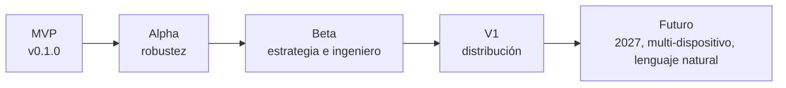

# Definición del MVP

## 1. Qué debe demostrar el MVP

> **Se abre `PitWall.exe`, se abre el juego, y todo lo demás pasa solo:** una sesión completa de F1 25
> o del 2026 Season Pack se recibe, se muestra en vivo, se graba, se reproduce y se analiza — sin
> perder un solo dato, sin inventarse ninguno y **sin un solo paso manual de conexión**.

Si esa frase es cierta y demostrable, el MVP está terminado. Todo lo demás es alcance de fases posteriores.

---

## 2. Alcance incluido

### 2.0. Aplicación de escritorio

| # | Capacidad | Requisitos |
|---|---|---|
| 0a | **Un `PitWall.exe` que abre su propia ventana.** Sin navegador, sin terminal | RF-620 |
| 0b | Interfaz React alojada en **WebView2** dentro de esa ventana | RF-621 |
| 0c | **La recepción UDP arranca sola.** Ningún paso manual de conexión | RF-622 |
| 0d | Detección automática de recepción, formato, sesión, jugador y estado | RF-623 |
| 0e | Si no llega nada, la ventana **explica qué falta**, leyendo el XML del juego para concretarlo | RF-624, RF-011 |
| 0f | Instancia única | RF-625 |
| 0g | Comprobación del WebView2 Runtime con mensaje accionable | RF-632 |
| 0h | Cierre ordenado sin corromper la captura en curso | RF-629 |
| 0i | Ninguna pantalla salvo *Diagnostics* muestra puerto, URL ni `localhost` | RF-633 |

### 2.1. Núcleo

| # | Capacidad | Requisitos |
|---|---|---|
| 1 | Recepción UDP con puerto y bind configurables | RF-001 … RF-004 |
| 2 | Validación estricta de tamaño y de identificadores | RF-005, SEC-02 … SEC-06 |
| 3 | **Decoder completo del formato 2025** (16 paquetes) | RF-102 |
| 4 | **Decoder completo del formato 2026** (17 paquetes) | RF-103 |
| 5 | **Detección automática de formato** y conmutación en caliente | RF-101, RF-105 |
| 6 | Modelo de dominio normalizado independiente del formato | RF-200, RF-201 |
| 7 | Taxonomía de procedencia en todos los canales | RF-210 |
| 8 | **Política de telemetría restringida** | RF-211, RN-001 |
| 9 | Motor de estado: sesiones, participantes, vueltas, sectores, stints | RF-202 … RF-206 |
| 10 | **Gestión de flashbacks con ramas** | RF-207 |
| 11 | Deduplicación y descarte de obsoletos | RF-214, RF-215 |
| 12 | Estado de dirección de carrera | RF-212 |

### 2.2. Grabación y reproducción

| # | Capacidad | Requisitos |
|---|---|---|
| 13 | Grabación cruda `.f1raw` comprimida | RF-400 … RF-403 |
| 14 | Reproducción determinista a seis velocidades | RF-405, RF-406 |
| 15 | Pausa y búsqueda temporal | RF-407, RF-408 |
| 16 | Modo de inyección UDP real | RF-409 |
| 17 | Herramienta `pw-capture` | `07-RECORDING-AND-REPLAY.md` §6 |
| 18 | Anonimización de capturas | PRV-03 |

### 2.3. Persistencia

| # | Capacidad | Requisitos |
|---|---|---|
| 19 | Catálogo persistente de sesiones, vueltas y eventos | RF-410 |
| 20 | Series de alta frecuencia en formato columnar | RF-411 |
| 21 | Indexación de vueltas por distancia | RF-500 |
| 22 | Retención configurable con papelera | RF-412 |

### 2.4. Tiempo real

| # | Capacidad | Requisitos |
|---|---|---|
| 23 | Transporte **interno** en bucle local, puerto efímero y token, con canales diferenciados | RF-300 … RF-303, RF-307, RT-01 |
| 24 | Telemetría en binario compacto | RF-302 |
| 25 | Coalescing con latencia acotada | RF-304 |
| 26 | Eventos fiables y no coalescibles | RF-305 |
| 27 | Reconexión con instantánea completa | RF-306 |

### 2.5. Interfaz — 8 pantallas

| # | Pantalla | Requisitos |
|---|---|---|
| 28 | Pantalla de **Estado** con resolución de problemas accionable | RF-600, RF-624 |
| 29 | **UDP Diagnostics** con los 13 indicadores | RF-606 |
| 30 | Timing Tower completa | RF-601 |
| 31 | Telemetry con trazas en vivo | RF-602 |
| 32 | Track Map reconstruido desde telemetría | RF-603 |
| 33 | Tyres y Damage | RF-604 |
| 34 | Lap Comparison por distancia | RF-605 |
| 35 | Session History y Replay | RF-607, RF-608 |

### 2.6. Contenido de 2026

| # | Capacidad | Requisitos |
|---|---|---|
| 36 | 24 coches | RF-103 |
| 37 | Active Aero: modo, disponibilidad, distancia de activación | CU-14 |
| 38 | Overtake Mode: disponibilidad, estado activo, distancia | CU-14 |
| 39 | Zonas de Active Aero (completas y parciales) y de DRS en el mapa | RF-603 |
| 40 | Eventos `PMEN`, `PMDI`, `OVEN`, `OVDI` | RF-107 |
| 41 | Severidad de colisión | RF-106 |
| 42 | `ersHarvestLimitPerLap` | RF-103 |
| 43 | Catálogos 2026: Madrid, Audi, Cadillac, pilotos hasta 207 | RF-110 |
| 44 | `m_2026Regulations` por coche | CU-14 A2 |

---

## 3. Alcance excluido explícitamente

| # | Fuera del MVP | Dónde entra |
|---|---|---|
| 1 | Motor de reglas del ingeniero de carrera | F3 |
| 2 | Estimación de degradación | F3 |
| 3 | Ventana de parada, undercut, overcut | F3 |
| 4 | Detección de bloqueo de rueda y patinaje | F3 |
| 5 | Proyección de consumo | F3 |
| 6 | Pantalla Strategy | F3 |
| 7 | **Cualquier IA o aprendizaje automático** | F4, si acaso |
| 8 | Exportación a CSV y Parquet | F2 |
| 9 | Reproceso de capturas | F2 |
| 10 | **Acceso a la interfaz desde la LAN** | **Retirado del producto** (OUT-11) |
| 11 | Comparación de más de 2 vueltas | F2 |
| 12 | Comparación de trazadas sobre el mapa | F3 |
| 13 | *(movido: la **lectura** del XML pasa a ser MUST del MVP, RF-011; sólo la escritura asistida queda para F2)* | F1 / F2 |
| 14 | Formatos UDP anteriores a 2025 | Fuera de alcance (OUT-07) |
| 15 | Empaquetado con instalador (el MVP se distribuye como carpeta portable) | F4 |
| 16 | Fuente secundaria de datos de la F1 real | F4, si acaso |
| 17 | Control de hardware | Fuera de alcance (OUT-08) |
| 18 | Superposición sobre el juego | Fuera de alcance |
| 19 | **Uso desde un navegador** | **Fuera de alcance** (OUT-10) |
| 20 | **Docker** | **Fuera de alcance** (OUT-12, ADR-016) |
| 21 | Estado de ventana, PPP por monitor, tema del sistema, siempre visible | F2 / F3 |
| 22 | Configuración asistida del XML del juego | F2 |

**Regla de disciplina.** Si durante el MVP surge la tentación de construir algo de esta lista, la respuesta es no. La justificación está en RSK-08: la sobreingeniería es el riesgo más probable del proyecto, y su antídoto es una frontera escrita.

---

## 4. Criterios de aceptación

Los **35 criterios** son los de `01-REQUIREMENTS.md` §31. Se reproducen aquí como lista de verificación operativa.

### 4.0. Aplicación de escritorio (6)

| # | Criterio | Cómo se comprueba | ☐ |
|---|---|---|---|
| A-40 | Doble clic abre una ventana propia; **no se abre ningún navegador** | Observación en máquina limpia | ☐ |
| A-41 | Al abrir la ventana, la recepción ya está activa sin ninguna acción | Contadores de *Diagnostics* desde el arranque | ☐ |
| A-42 | Al abrir el juego, pasa a *Recibiendo* y detecta formato, sesión y jugador en 2 s o menos | Cronometrado | ☐ |
| A-43 | Sin UDP configurado, la ventana explica la causa concreta y los pasos | Prueba con UDP desactivado | ☐ |
| A-44 | Un segundo `PitWall.exe` activa la ventana existente | Observación | ☐ |
| A-45 | Ninguna pantalla salvo *Diagnostics* muestra puerto, URL ni `localhost` | Revisión de las 8 pantallas | ☐ |

### 4.1. Núcleo (8)

| # | Criterio | Cómo se comprueba | ☐ |
|---|---|---|---|
| A-01 | Recibe UDP con puerto y bind configurables | Recepción desde `127.0.0.1` y desde otra máquina de la LAN | ☐ |
| A-02 | Decodifica los 16 paquetes de 2025 | Pruebas de protocolo + captura real procesada | ☐ |
| A-03 | Decodifica los 17 paquetes de 2026 | Ídem | ☐ |
| A-04 | Detecta el formato y conmuta en caliente | Captura sintética `2025_to_2026_switch` | ☐ |
| A-05 | 0 datagramas válidos descartados en 1 h a 60 Hz | Contadores al final de la sesión | ☐ |
| A-06 | Ningún datagrama malformado provoca caída | Fuzzing de 4 h | ☐ |
| A-07 | La telemetría restringida se presenta como restringida | Escenario `2026_multiplayer_restricted` + captura de pantalla | ☐ |
| A-08 | Un flashback no corrompe el histórico | Escenarios de flashback simple y encadenado | ☐ |

### 4.2. Funcionalidad (11)

| # | Criterio | ☐ |
|---|---|---|
| A-10 | La torre muestra posición, vueltas, tiempos, sectores, intervalos, neumáticos, paradas, penalizaciones y banderas | ☐ |
| A-11 | El panel de telemetría muestra todos los canales disponibles | ☐ |
| A-12 | Tyres y Damage con orden RL, RR, FL, FR | ☐ |
| A-13 | El mapa se reconstruye desde telemetría y muestra los 24 coches | ☐ |
| A-14 | En 2026, Active Aero y Overtake Mode con estado y distancia | ☐ |
| A-15 | Registro cronológico de eventos consultable | ☐ |
| A-16 | Una sesión se graba automáticamente y aparece en el histórico | ☐ |
| A-17 | Una sesión grabada se reproduce a las seis velocidades | ☐ |
| A-18 | Dos vueltas se comparan por distancia con delta y ≥ 8 canales | ☐ |
| A-19 | *Diagnostics* muestra los 13 indicadores | ☐ |
| A-20 | Todos los valores llevan su procedencia visible | ☐ |

### 4.3. Calidad (10)

| # | Criterio | Umbral | ☐ |
|---|---|---|---|
| A-30 | Latencia UDP → píxel | p95 < 150 ms | ☐ |
| A-31 | CPU del núcleo a 60 Hz | < 5 % de un núcleo | ☐ |
| A-32 | Memoria del núcleo tras 1 h | < 300 MB, sin crecimiento | ☐ |
| A-33 | Cobertura de decoder, normalizador y estado | ≥ 80 % | ☐ |
| A-34 | Suite completa sin el juego | 100 % | ☐ |
| A-35 | Compilación limpia y desinfectantes | 0 hallazgos | ☐ |
| A-36 | Instalación desde cero | < 10 min | ☐ |
| A-37 | Documentación al día | Revisión | ☐ |
| A-38 | El producto arranca y funciona en una máquina limpia con Windows 11 | Máquina virtual limpia | ☐ |
| A-39 | En una máquina sin WebView2 Runtime, lo explica en lugar de fallar | Windows 10 limpio | ☐ |

---

## 5. Demostración de aceptación

Guion de una sesión de 30 minutos que recorre todo el MVP. Es la prueba definitiva y se ejecuta ante testigo.

| # | Paso | Resultado esperado |
|---|---|---|
| 0 | Doble clic en `PitWall.exe` | Se abre una ventana propia en menos de 3 s. **No se abre ningún navegador** |
| 1 | Observar la ventana con el juego cerrado | Estado *Escuchando* **sin haber pulsado nada**; *Diagnostics* accesible y a cero |
| 1b | Volver a ejecutar `PitWall.exe` | Se activa la ventana existente; no aparece una segunda |
| 2 | Abrir F1 25 con el 2026 Season Pack y activar UDP a 60 Hz, formato 2026 | Estado *Recibiendo* **por sí solo**; formato 2026 detectado; ~415 datagramas/s |
| 3 | Entrar en una carrera de 25 % con 24 coches | Sesión detectada; 24 participantes con nombre y equipo |
| 4 | Abrir Timing Tower durante la carrera | Clasificación en vivo coherente con el HUD del juego |
| 5 | Abrir Track Map | Trazado reconstruido; coches moviéndose con fluidez |
| 6 | Provocar un adelantamiento con Overtake Mode | El indicador muestra activo y la distancia de activación |
| 7 | Provocar una colisión | Evento `COLL` con severidad en el registro |
| 8 | Usar un flashback | El histórico no duplica vueltas; el delta no salta |
| 9 | Entrar en boxes | Stint cerrado; nuevo stint con compuesto correcto |
| 10 | Abrir Tyres | Cuatro esquinas en orden RL, RR, FL, FR con datos coherentes |
| 11 | Terminar la carrera | Clasificación final consolidada |
| 12 | Cerrar el juego | Estado *Desconectado*; el último estado permanece visible y marcado como obsoleto |
| 13 | Abrir Session History | La sesión aparece con sus vueltas |
| 14 | Comparar la mejor vuelta con otra | Delta por distancia y 8+ canales sincronizados |
| 15 | Reproducir la sesión a 4× | La interfaz se comporta como en directo |
| 16 | Buscar el minuto 10 | Estado reconstruido en < 5 s |
| 17 | Revisar *Diagnostics* | 0 inválidos, 0 descartes, pérdida estimada ≈ 0 |
| 18 | Cambiar el juego a formato UDP 2025 y volver a entrar en sesión | Formato 2025 detectado; Active Aero como `UNAVAILABLE` con motivo |
| 19 | Unirse a una sesión multijugador | Los rivales muestran «Restringido», nunca ceros |
| 20 | Comprobar el consumo de recursos | Núcleo: CPU < 5 %, memoria < 300 MB. Proceso completo < 1,1 GB |
| 21 | Desactivar UDP en el juego y volver a la ventana | Explica la causa concreta y los pasos, no un error genérico |
| 22 | Cerrar con la X durante una grabación | Pide confirmación y cierra la captura sin corromperla |

Si los 24 pasos se completan sin defectos, el MVP está aceptado.

---

## 6. Lo que el MVP conscientemente hace peor

Honestidad sobre las concesiones, para que no se confundan con defectos:

| Aspecto | Estado en el MVP | Cuándo mejora |
|---|---|---|
| Diseño visual | Funcional y coherente, no pulido | F4 |
| Mensajes de error | Correctos y accionables, no siempre elegantes | F4 |
| Configuración | Fichero TOML más una pantalla básica | F2 |
| Ventana | Funcional: se abre, se redimensiona, se cierra bien. **Sin** persistencia de estado, PPP fino ni tema del sistema | F2 / F3 |
| Rendimiento del frontend | Cumple los umbrales, con margen escaso en el peor caso | F2 |
| Búsqueda temporal | Funciona; puede tardar hasta 5 s | F2 |
| Estimación de pérdida | Sobrestima tras un flashback | F2 |
| Métricas derivadas | Las básicas; sin corrección por combustible | F3 |
| Distribución | Carpeta portable con `PitWall.exe` y sus recursos; **sin instalador** | F4 |

---

## 7. Después del MVP

Detalle en `14-ROADMAP.md`.

---

*Fin de `PW-MVP-012` v1.1*
