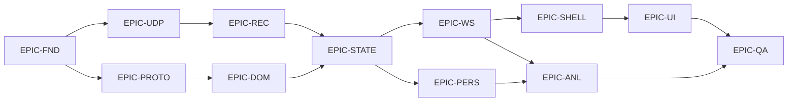

# Backlog

## 1. Convenios

| Elemento | Formato | Ejemplo |
|---|---|---|
| Epic | `EPIC-<AREA>` | `EPIC-UDP` |
| Historia | `STORY-<AREA>-<nnn>` | `STORY-UDP-001` |
| Tarea | `TASK-<AREA>-<nnn>-<nn>` | `TASK-UDP-001-01` |

**Prioridad:** `P0` bloqueante del MVP · `P1` del MVP · `P2` Alpha · `P3` Beta · `P4` futuro.

**Esfuerzo:** puntos de historia en escala de Fibonacci. 1 ≈ media jornada, 2 ≈ 1 día, 3 ≈ 1,5 días, 5 ≈ 2,5 días, 8 ≈ 4 días, 13 ≈ una semana.

---

## 2. Índice de epics

| Epic | Área | Fase | Puntos |
|---|---|---|---|
| `EPIC-FND` | Cimientos, construcción y observabilidad | F0 | 21 |
| `EPIC-UDP` | Recepción UDP | F1.1 | 21 |
| `EPIC-PROTO` | Protocolo y decoders | F1.2 | 42 |
| `EPIC-DOM` | Dominio y normalización | F1.3 | 29 |
| `EPIC-REC` | Grabación y reproducción | F1.4 | 34 |
| `EPIC-STATE` | Motor de estado | F1.5 | 42 |
| `EPIC-WS` | Transporte interno hacia la interfaz | F1.6 | 21 |
| **`EPIC-SHELL`** | **Shell de escritorio: ventana, WebView2, arranque automático** | **F1.6b** | **34** |
| `EPIC-UI` | Interfaz | F1.7-F1.8 | 63 |
| `EPIC-PERS` | Persistencia | F1.9 | 34 |
| `EPIC-ANL` | Análisis de vueltas | F1.10 | 34 |
| `EPIC-QA` | Calidad y cierre | F1.11 | 21 |
| `EPIC-ROB` | Robustez | F2 | 34 |
| `EPIC-ENG` | Ingeniero de carrera | F3 | 55 |
| `EPIC-DIST` | Distribución | F4 | 21 |
| **Total MVP** | | | **396** |

---

## 3. EPIC-FND — Cimientos

### STORY-FND-001 — Sistema de construcción reproducible
**P0 · 5 puntos · sin dependencias**

Como desarrollador, quiero clonar el repositorio y compilar en menos de diez minutos, para poder empezar sin fricción.

| Tarea | Detalle |
|---|---|
| `TASK-FND-001-01` | CMake con presets `debug`, `release`, `asan`, `tsan`, `fuzz` |
| `TASK-FND-001-02` | Manifiesto de dependencias con versiones fijadas |
| `TASK-FND-001-03` | Verificación de licencias permisivas de todas las dependencias |
| `TASK-FND-001-04` | Advertencias como errores en ambos compiladores |
| `TASK-FND-001-05` | Estructura de carpetas de `17-PROJECT-STRUCTURE.md` |
| `TASK-FND-001-06` | `.gitignore` que excluye `spec/`, `build/`, `data/` |

**Criterios de aceptación**
- [ ] `cmake --preset debug && cmake --build --preset debug` funciona en máquina limpia
- [ ] Los cinco presets configuran correctamente
- [ ] Ninguna dependencia tiene licencia copyleft fuerte
- [ ] `spec/` no está versionado

### STORY-FND-002 — Tipos base con procedencia obligatoria
**P0 · 5 puntos · dep. STORY-FND-001**

Como arquitecto, quiero que sea imposible exponer un valor sin su procedencia, para que el principio P1 no dependa de la disciplina.

| Tarea | Detalle |
|---|---|
| `TASK-FND-002-01` | `Result<T,E>` |
| `TASK-FND-002-02` | Tipos fuertes: `VehicleIndex`, `LapNumber`, `SessionKey`, `BranchId` |
| `TASK-FND-002-03` | `Channel<T>` con las cinco procedencias |
| `TASK-FND-002-04` | Prueba de **no compilación** de la conversión implícita a `T` |
| `TASK-FND-002-05` | `monotonicNowNs()` |

**Criterios de aceptación**
- [ ] `Channel<T>` no permite obtener el valor sin comprobar `known()`
- [ ] La prueba de no compilación forma parte de la suite
- [ ] El reloj no decrece al cambiar la hora del sistema

### STORY-FND-003 — Observabilidad desde el primer día
**P0 · 8 puntos · dep. STORY-FND-002**

| Tarea | Detalle |
|---|---|
| `TASK-FND-003-01` | `Counter`, `Gauge`, `Histogram` de cubos fijos |
| `TASK-FND-003-02` | Registro de métricas consultable |
| `TASK-FND-003-03` | Logging estructurado asíncrono con 5 niveles |
| `TASK-FND-003-04` | Rotación por tamaño y antigüedad |
| `TASK-FND-003-05` | Agregación de mensajes repetidos |
| `TASK-FND-003-06` | Cambio de nivel en caliente |

**Criterios de aceptación**
- [ ] Coste de instrumentación < 1 % de CPU medido
- [ ] Los logs no crecen sin límite
- [ ] Un mensaje repetido 1000 veces produce una entrada agregada

### STORY-FND-004 — Configuración validada
**P1 · 3 puntos · dep. STORY-FND-002**

| Tarea | Detalle |
|---|---|
| `TASK-FND-004-01` | Carga desde fichero TOML |
| `TASK-FND-004-02` | Precedencia: defectos → fichero → entorno → línea de órdenes |
| `TASK-FND-004-03` | Validación con mensajes que dicen qué se esperaba |

---

## 4. EPIC-UDP — Recepción

### STORY-UDP-001 — Socket que no pierde datagramas
**P0 · 8 puntos · dep. EPIC-FND**

Como sistema, quiero recibir todos los datagramas que emite el juego, porque UDP no los retransmite.

| Tarea | Detalle |
|---|---|
| `TASK-UDP-001-01` | Capa de abstracción del socket (Winsock y POSIX) |
| `TASK-UDP-001-02` | Bind con dirección y puerto configurables |
| `TASK-UDP-001-03` | `SO_RCVBUF` a 4 MB, verificando el valor concedido |
| `TASK-UDP-001-04` | Bucle de recepción sin asignaciones |
| `TASK-UDP-001-05` | Marca de tiempo monótona **antes** de cualquier otro trabajo |
| `TASK-UDP-001-06` | Validación de longitud mínima de 29 bytes |
| `TASK-UDP-001-07` | Contadores por causa de invalidez |
| `TASK-UDP-001-08` | Prioridad del hilo por encima de la normal |
| `TASK-UDP-001-09` | Apagado ordenado |
| `TASK-UDP-001-10` | Error accionable al fallar el bind |
| `TASK-UDP-001-11` | Prueba de carga a 1000 datagramas/s durante 30 min |
| `TASK-UDP-001-12` | Prueba de datagrama truncado |

**Criterios de aceptación**
- [ ] 1000 datagramas/s durante 30 min: 0 pérdidas
- [ ] Un datagrama de 10 B se cuenta como truncado sin fallo
- [ ] 0 asignaciones por datagrama
- [ ] El error de puerto ocupado indica la solución

### STORY-UDP-002 — Infraestructura de memoria y colas
**P0 · 8 puntos · dep. EPIC-FND**

| Tarea | Detalle |
|---|---|
| `TASK-UDP-002-01` | `BufferPool` preasignado con recuento de referencias |
| `TASK-UDP-002-02` | `SpscRing` lock-free |
| `TASK-UDP-002-03` | Alineación a línea de caché con `static_assert` |
| `TASK-UDP-002-04` | Métricas de profundidad y de descartes |
| `TASK-UDP-002-05` | Prueba de estrés de dos hilos con 10 M de elementos |

**Criterios de aceptación**
- [ ] ThreadSanitizer sin hallazgos
- [ ] Ninguna pérdida ni corrupción en la prueba de estrés
- [ ] El agotamiento del pool se contabiliza, no provoca fallo

### STORY-UDP-003 — Origen y desconexión
**P1 · 3 puntos · dep. STORY-UDP-001**

| Tarea | Detalle |
|---|---|
| `TASK-UDP-003-01` | Registro de IP y puerto de origen |
| `TASK-UDP-003-02` | Tabla de orígenes por índice |
| `TASK-UDP-003-03` | Detección de desconexión tras N segundos |

### STORY-UDP-004 — Herramienta `pw-listen`
**P1 · 2 puntos · dep. STORY-UDP-001**

Utilidad de consola que escucha e imprime estadísticas. Es la primera prueba real contra el juego.

---

## 5. EPIC-PROTO — Protocolo y decoders

### STORY-PROTO-001 — Cabecera y enrutado
**P0 · 5 puntos · dep. EPIC-FND**

| Tarea | Detalle |
|---|---|
| `TASK-PROTO-001-01` | `PacketHeader` de 29 B con `static_assert` de tamaño y offsets |
| `TASK-PROTO-001-02` | `IProtocolDecoder` y `DecoderRegistry` |
| `TASK-PROTO-001-03` | Enrutado por `m_packetFormat` |
| `TASK-PROTO-001-04` | Detección de cambio de formato con umbral de 3 datagramas |
| `TASK-PROTO-001-05` | Formato desconocido: contabilizar y avisar una vez |

**Criterios de aceptación**
- [ ] Los 12 campos coinciden con un fixture verificado byte a byte
- [ ] Añadir un decoder no requiere tocar el receptor
- [ ] Un formato 2027 se ignora contabilizándolo

### STORY-PROTO-002 — Structs del formato 2026
**P0 · 13 puntos · dep. STORY-PROTO-001**

| Tarea | Detalle |
|---|---|
| `TASK-PROTO-002-01` | Constantes del formato |
| `TASK-PROTO-002-02` | Paquetes 0-4: Motion, Session, Lap Data, Event, Participants |
| `TASK-PROTO-002-03` | Paquetes 5-8: Car Setups, Car Telemetry, Car Status, Final Classification |
| `TASK-PROTO-002-04` | Paquetes 9-12: Lobby Info, Car Damage, Session History, Tyre Sets |
| `TASK-PROTO-002-05` | Paquetes 13-16: Motion Ex, Time Trial, Lap Positions, **Car Telemetry 2** |
| `TASK-PROTO-002-06` | Los 4 niveles de `static_assert` para los 17 paquetes |
| `TASK-PROTO-002-07` | Tabla `constexpr` de tamaños esperados |

**Criterios de aceptación**
- [ ] Los 17 tamaños coinciden con la especificación oficial
- [ ] La comprobación aritmética cabecera + N coches + extras pasa
- [ ] Los offsets críticos están verificados

### STORY-PROTO-003 — Decoder 2026
**P0 · 8 puntos · dep. STORY-PROTO-002**

| Tarea | Detalle |
|---|---|
| `TASK-PROTO-003-01` | `viewAs<T>` con precondición de tamaño y variante `memcpy` |
| `TASK-PROTO-003-02` | Despacho por `packetId` |
| `TASK-PROTO-003-03` | Validación de tamaño exacto y de versión |
| `TASK-PROTO-003-04` | Unión de eventos: los **25** códigos |
| `TASK-PROTO-003-05` | **Acotación de todos los contadores recibidos** |
| `TASK-PROTO-003-06` | Objetivo de fuzzing con corpus semilla |

**Criterios de aceptación**
- [ ] `m_numActiveCars = 255` no provoca lectura fuera de límites
- [ ] Los 25 códigos producen el tipo correcto
- [ ] Fuzzing de 1 h sin caídas ni hallazgos
- [ ] p99 de decodificación < 50 µs

### STORY-PROTO-004 — Catálogos 2026
**P0 · 5 puntos · dep. STORY-PROTO-002**

| Tarea | Detalle |
|---|---|
| `TASK-PROTO-004-01` | Equipos, incluidos 485 Audi '26 y 486 Cadillac '26 |
| `TASK-PROTO-004-02` | Pilotos hasta el identificador 207 |
| `TASK-PROTO-004-03` | Circuitos, incluido 42 Madrid |
| `TASK-PROTO-004-04` | Nacionalidades, modos de juego, ruleset, superficies |
| `TASK-PROTO-004-05` | Penalizaciones e infracciones |
| `TASK-PROTO-004-06` | Resolución tolerante de identificadores desconocidos |

### STORY-PROTO-005 — Formato 2025 completo
**P0 · 8 puntos · dep. STORY-PROTO-003**

| Tarea | Detalle |
|---|---|
| `TASK-PROTO-005-01` | Constantes con `kMaxCars = 22` |
| `TASK-PROTO-005-02` | Structs de los 16 paquetes con `static_assert` |
| `TASK-PROTO-005-03` | `F1_2025_Decoder` |
| `TASK-PROTO-005-04` | Unión de eventos con 21 códigos y `Collision` sin `severity` |
| `TASK-PROTO-005-05` | Catálogos 2025 |

### STORY-PROTO-006 — Fixtures
**P0 · 3 puntos · dep. STORY-PROTO-003, STORY-PROTO-005**

| Tarea | Detalle |
|---|---|
| `TASK-PROTO-006-01` | 17 fixtures de 2026 extraídos de sesión real |
| `TASK-PROTO-006-02` | 16 fixtures de 2025 |
| `TASK-PROTO-006-03` | `.json` de valores esperados **verificados a mano** |
| `TASK-PROTO-006-04` | Fixtures por código de evento |
| `TASK-PROTO-006-05` | Fixtures con telemetría restringida y pública |

---

## 6. EPIC-DOM — Dominio y normalización

### STORY-DOM-001 — Modelo normalizado
**P0 · 8 puntos · dep. EPIC-PROTO**

| Tarea | Detalle |
|---|---|
| `TASK-DOM-001-01` | Entidades estáticas y de baja frecuencia |
| `TASK-DOM-001-02` | Telemetría y movimiento |
| `TASK-DOM-001-03` | Eventos |
| `TASK-DOM-001-04` | `DomainSink` sin asignación |
| `TASK-DOM-001-05` | Verificador automático de aislamiento del dominio |

**Criterios de aceptación**
- [ ] Ningún tipo menciona un año ni empieza por `m_`
- [ ] `pw::domain` no incluye ninguna cabecera de `pw::proto`, verificado en integración continua

### STORY-DOM-002 — Normalización de 2026
**P0 · 8 puntos · dep. STORY-DOM-001**

| Tarea | Detalle |
|---|---|
| `TASK-DOM-002-01` | Los 17 paquetes |
| `TASK-DOM-002-02` | Desescalado ÷ 32767,0 y ÷ 1000,0 |
| `TASK-DOM-002-03` | Reconstrucción de tiempos en dos partes |
| `TASK-DOM-002-04` | Conversión de todos los centinelas |
| `TASK-DOM-002-05` | `ersDeployMode = 3` → `Boost` |

### STORY-DOM-003 — Normalización de 2025 y equivalencia
**P0 · 5 puntos · dep. STORY-DOM-002**

| Tarea | Detalle |
|---|---|
| `TASK-DOM-003-01` | Los 16 paquetes |
| `TASK-DOM-003-02` | `ersDeployMode = 3` → `Overtake` |
| `TASK-DOM-003-03` | Canales exclusivos de 2026 → `UNAVAILABLE` con razón |
| `TASK-DOM-003-04` | Pruebas de equivalencia entre formatos |

### STORY-DOM-004 — Política de telemetría restringida
**P0 · 8 puntos · dep. STORY-DOM-002**

Como usuario, quiero que un dato que no puedo conocer se muestre como desconocido, para no tomar decisiones sobre información falsa.

| Tarea | Detalle |
|---|---|
| `TASK-DOM-004-01` | `TelemetryPolicy` por participante |
| `TASK-DOM-004-02` | Los 12 campos de Car Status |
| `TASK-DOM-004-03` | Los 18 campos de Car Damage |
| `TASK-DOM-004-04` | Tyre Sets: paquete completo |
| `TASK-DOM-004-05` | Cambio de restringida a pública sólo hacia adelante |
| `TASK-DOM-004-06` | `Motion Ex` sólo para el coche del jugador |

**Criterios de aceptación**
- [ ] **Ningún campo restringido llega al dominio como 0**
- [ ] El cambio a pública se refleja en ≤ 5 s, sin rellenar el pasado
- [ ] `Motion Ex` de un rival nunca produce fila

---

## 7. EPIC-REC — Grabación y reproducción

### STORY-REC-001 — Formato `.f1raw`
**P0 · 8 puntos · dep. EPIC-UDP**

| Tarea | Detalle |
|---|---|
| `TASK-REC-001-01` | Estructuras de cabecera, bloque y registro |
| `TASK-REC-001-02` | Escritor con buffer de 256 KB |
| `TASK-REC-001-03` | Compresión zstd nivel 3 por bloques |
| `TASK-REC-001-04` | Puntos de sincronización cada 10 s |
| `TASK-REC-001-05` | Lector con recuperación tras truncamiento |
| `TASK-REC-001-06` | Los datagramas inválidos también se graban, marcados |

**Criterios de aceptación**
- [ ] Ratio ≥ 3× sobre captura real
- [ ] Truncar al 50 % permite leer hasta ahí

### STORY-REC-002 — Grabador
**P0 · 5 puntos · dep. STORY-REC-001**

| Tarea | Detalle |
|---|---|
| `TASK-REC-002-01` | Hilo T3 con cola propia |
| `TASK-REC-002-02` | Grabación automática al detectar sesión |
| `TASK-REC-002-03` | Rotación por formato y por tamaño |
| `TASK-REC-002-04` | Estado degradado con disco lleno o lento |

**Criterios de aceptación**
- [ ] Grabar cuesta < 1 % de CPU adicional
- [ ] El grabador **nunca** devuelve contrapresión al receptor
- [ ] Con disco lleno, el directo continúa

### STORY-REC-003 — Motor de replay
**P0 · 13 puntos · dep. STORY-REC-001**

| Tarea | Detalle |
|---|---|
| `TASK-REC-003-01` | `ReplaySource` implementando `IDatagramSource` |
| `TASK-REC-003-02` | Planificador con espera de precisión |
| `TASK-REC-003-03` | Resolución del temporizador a 1 ms mientras dura |
| `TASK-REC-003-04` | Las seis velocidades |
| `TASK-REC-003-05` | Pausa y avance fotograma a fotograma |
| `TASK-REC-003-06` | Búsqueda temporal con modo silencioso |
| `TASK-REC-003-07` | Modo de inyección UDP real |
| `TASK-REC-003-08` | Métrica de retraso del replay |
| `TASK-REC-003-09` | Prueba de determinismo |

**Criterios de aceptación**
- [ ] Error de intervalo p95 < 5 ms a 1×
- [ ] Dos reproducciones producen huellas idénticas
- [ ] Saltar al minuto 30 de 60 tarda < 5 s
- [ ] El modo de inyección alimenta al receptor sin modificarlo

### STORY-REC-004 — Herramienta `pw-capture`
**P1 · 5 puntos · dep. STORY-REC-003**

Subcomandos `info`, `verify`, `extract`, `slice`, `anonymize`, `replay`, `stats`, `diff`, `reprocess`.

### STORY-REC-005 — Generador sintético
**P0 · 3 puntos · dep. STORY-REC-001**

Los 12 casos degradados de `07-RECORDING-AND-REPLAY.md` §5.4, partiendo de fixtures reales.

---

## 8. EPIC-STATE — Motor de estado

### STORY-STATE-001 — Ciclo de vida de sesión
**P0 · 8 puntos · dep. EPIC-DOM, EPIC-REC**

| Tarea | Detalle |
|---|---|
| `TASK-STATE-001-01` | Propiedad exclusiva del estado |
| `TASK-STATE-001-02` | Instantáneas inmutables con recuento de referencias |
| `TASK-STATE-001-03` | Detección de sesión con histéresis de 2 s |
| `TASK-STATE-001-04` | Cierre por `SEND` y por clasificación |
| `TASK-STATE-001-05` | Estado parcial si se conecta con la sesión empezada |
| `TASK-STATE-001-06` | Estado de lobby |

### STORY-STATE-002 — Vueltas, sectores y stints
**P0 · 13 puntos · dep. STORY-STATE-001**

| Tarea | Detalle |
|---|---|
| `TASK-STATE-002-01` | Reconstrucción de vueltas |
| `TASK-STATE-002-02` | Reconstrucción de sectores |
| `TASK-STATE-002-03` | Marcado de vueltas inválidas con razón |
| `TASK-STATE-002-04` | Detección de stints |
| `TASK-STATE-002-05` | Correspondencia con `Session History` |
| `TASK-STATE-002-06` | Histórico propio sin el límite de 100 vueltas |
| `TASK-STATE-002-07` | Entrada y salida de boxes |

**Criterios de aceptación**
- [ ] El recuento de vueltas coincide con `Session History` al final
- [ ] Los stints coinciden con `m_tyreStintsHistoryData`
- [ ] Una sesión de 120 vueltas conserva las 120

### STORY-STATE-003 — Flashbacks
**P0 · 8 puntos · dep. STORY-STATE-002**

Como usuario, quiero que un flashback no corrompa mi histórico, para poder seguir confiando en los datos.

| Tarea | Detalle |
|---|---|
| `TASK-STATE-003-01` | Ramas con `branchId` |
| `TASK-STATE-003-02` | Marcado de muestras superadas sin borrarlas |
| `TASK-STATE-003-03` | Reversión de contadores de vuelta |
| `TASK-STATE-003-04` | Flashbacks encadenados |
| `TASK-STATE-003-05` | **Inferencia sin evento `FLBK`** |
| `TASK-STATE-003-06` | Escenarios de prueba de los tres casos |

**Criterios de aceptación**
- [ ] Ninguna vuelta se cuenta dos veces
- [ ] El delta no salta tras el flashback
- [ ] Con el evento eliminado, la rama se crea igualmente
- [ ] Los datos de la rama superada siguen consultables

### STORY-STATE-004 — Robustez frente a la red
**P0 · 5 puntos · dep. STORY-STATE-001**

| Tarea | Detalle |
|---|---|
| `TASK-STATE-004-01` | Deduplicación por `(overallFrame, packetId)` |
| `TASK-STATE-004-02` | Descarte de obsoletos |
| `TASK-STATE-004-03` | **Los eventos se procesan siempre** |
| `TASK-STATE-004-04` | Estimación de pérdida por huecos |
| `TASK-STATE-004-05` | Agrupación en fotograma lógico con guarda de 100 ms |

### STORY-STATE-005 — Dirección de carrera
**P0 · 5 puntos · dep. STORY-STATE-001**

Banderas, Safety Car, VSC, bandera roja, DRS, y en 2026 Partial Mode y Overtake Mode.

### STORY-STATE-006 — Bus de eventos
**P0 · 3 puntos · dep. STORY-STATE-001**

Los seis canales con sus garantías diferenciadas.

---

## 9. EPIC-WS — Transporte

### STORY-WS-001 — Servidor y protocolo
**P0 · 8 puntos · dep. EPIC-STATE**

| Tarea | Detalle |
|---|---|
| `TASK-WS-001-01` | Servidor en `127.0.0.1`, **puerto efímero**, token de un solo uso |
| `TASK-WS-001-02` | `hello`, `subscribe`, `snapshot` |
| `TASK-WS-001-03` | Suscripción por canal y por vehículo |
| `TASK-WS-001-04` | Límites por conexión |
| `TASK-WS-001-05` | `ping`/`pong` y desfase de reloj |

### STORY-WS-002 — Canales y serialización
**P0 · 8 puntos · dep. STORY-WS-001**

| Tarea | Detalle |
|---|---|
| `TASK-WS-002-01` | Canal `session` en JSON |
| `TASK-WS-002-02` | Canal `timing` en JSON a 10 Hz |
| `TASK-WS-002-03` | Canal `telemetry` binario con máscara de presencia |
| `TASK-WS-002-04` | Canal `events` fiable |
| `TASK-WS-002-05` | Canal `diagnostics` |
| `TASK-WS-002-06` | Serialización de las cinco procedencias |

**Criterios de aceptación**
- [ ] Una muestra binaria ocupa ≥ 5× menos que su JSON
- [ ] Un campo restringido viaja sin valor y con procedencia

### STORY-WS-003 — Contrapresión y coalescing
**P0 · 5 puntos · dep. STORY-WS-002**

| Tarea | Detalle |
|---|---|
| `TASK-WS-003-01` | Cola por cliente |
| `TASK-WS-003-02` | Coalescing en canales de alta frecuencia |
| `TASK-WS-003-03` | Eventos **exentos** de coalescing |
| `TASK-WS-003-04` | Desconexión de cliente atascado tras 5 s |
| `TASK-WS-003-05` | Canal de petición/respuesta para el histórico (sustituye a la API HTTP) |

---

## 9bis. EPIC-SHELL — Shell de escritorio

### STORY-SHELL-001 — Una ventana propia
**P0 · 13 puntos · dep. EPIC-WS**

Como usuario, quiero abrir `PitWall.exe` y ver una ventana de la aplicación, para no tener que usar
un navegador ni saber qué es un puerto.

| Tarea | Detalle |
|---|---|
| `TASK-SHELL-001-01` | Módulo `pw::shell` aislado; único con Win32 de interfaz (fuera de él, sólo adaptadores de plataforma declarados) |
| `TASK-SHELL-001-02` | SDK de WebView2 por manifiesto, versión fijada y licencia verificada |
| `TASK-SHELL-001-03` | Ventana Win32: clase, creación, bucle de mensajes, icono, tamaño mínimo 1280×720 |
| `TASK-SHELL-001-04` | Consciencia de PPP por monitor v2 en el manifiesto de la aplicación |
| `TASK-SHELL-001-05` | Entorno y control WebView2 ajustado al área cliente |
| `TASK-SHELL-001-06` | Comprobación del WebView2 Runtime con diálogo accionable |
| `TASK-SHELL-001-07` | Mapeo de nombre de host virtual a la carpeta de recursos |
| `TASK-SHELL-001-08` | Eliminar el servidor HTTP de estáticos |

**Criterios de aceptación**
- [ ] Doble clic abre una ventana propia; **no se abre ningún navegador**
- [ ] La interfaz carga **sin ningún socket HTTP escuchando**
- [ ] Sin WebView2 Runtime, se explica con un mensaje accionable
- [ ] Fuera del shell, `#include <windows.h>` sólo aparece en adaptadores de plataforma declarados, verificado automáticamente

### STORY-SHELL-002 — Que funcione solo
**P0 · 8 puntos · dep. STORY-SHELL-001**

Como usuario, quiero que la telemetría se reciba y se detecte sin que yo conecte nada, porque
conectar no es una tarea que aporte nada.

| Tarea | Detalle |
|---|---|
| `TASK-SHELL-002-01` | Arranque del núcleo tras crear la ventana, no antes |
| `TASK-SHELL-002-02` | Recepción UDP activa desde el primer instante |
| `TASK-SHELL-002-03` | Script de arranque inyectado con endpoint efímero, token, versión y modo |
| `TASK-SHELL-002-04` | Instancia única con mutex; activar la ventana existente |
| `TASK-SHELL-002-05` | Cierre ordenado con confirmación si hay grabación en curso |

**Criterios de aceptación**
- [ ] La recepción está activa al abrir, sin ninguna acción del usuario
- [ ] Al abrir el juego, pasa a *Recibiendo* en 2 s o menos
- [ ] Un segundo arranque activa la ventana existente
- [ ] Cerrar con la X no deja una captura corrupta

### STORY-SHELL-003 — Puente nativo y comportamiento de ventana
**P1 · 8 puntos · dep. STORY-SHELL-001**

| Tarea | Detalle |
|---|---|
| `TASK-SHELL-003-01` | Diálogos nativos de abrir y guardar |
| `TASK-SHELL-003-02` | Enlaces externos al navegador del sistema, nunca dentro |
| `TASK-SHELL-003-03` | Persistencia de posición, tamaño y maximizado |
| `TASK-SHELL-003-04` | Modo siempre visible |
| `TASK-SHELL-003-05` | Barra de título según el tema del sistema |

### STORY-SHELL-004 — Modo desarrollo y verificaciones abiertas
**P0 · 5 puntos · dep. STORY-SHELL-001**

| Tarea | Detalle |
|---|---|
| `TASK-SHELL-004-01` | `uiSource = "dev-server"` apuntando a Vite, con recarga en caliente |
| `TASK-SHELL-004-02` | Ejecutable sin interfaz `pitwall-cli` para pruebas y para Linux |
| `TASK-SHELL-004-03` | **Medir el caudal binario dentro del WebView2** frente a la línea base (Q-10) |
| `TASK-SHELL-004-04` | **Prueba de concepto de automatización** por depuración remota (Q-11) |

**Criterios de aceptación**
- [ ] Q-10 y Q-11 respondidas **con medición y con código que funciona**, no con suposiciones
- [ ] `pitwall-cli` ejecuta el mismo núcleo sin interfaz y compila en Linux

---

## 10. EPIC-UI — Interfaz

| Historia | Título | Prio. | Puntos | Depende de |
|---|---|---|---|---|
| `STORY-UI-000` | Arranque dentro del WebView2: `window.__pitwall`, conexión con token, error claro fuera del anfitrión | P0 | 3 | EPIC-SHELL |
| `STORY-UI-001` | Andamiaje y sistema de diseño | P0 | 5 | EPIC-SHELL |
| `STORY-UI-002` | Cliente del transporte interno, decodificadores y almacenes | P0 | 8 | UI-001 |
| `STORY-UI-003` | Componente de valor con procedencia y antigüedad | P0 | 3 | UI-001 |
| `STORY-UI-004` | Pantalla de **Estado** con resolución de problemas accionable y lectura del XML del juego | P0 | 8 | UI-002 |
| `STORY-UI-005` | **UDP Diagnostics** | P0 | 8 | UI-002 |
| `STORY-UI-006` | Timing Tower | P0 | 13 | UI-002 |
| `STORY-UI-007` | Gráfica sobre canvas con decimado y huecos | P0 | 8 | UI-002 |
| `STORY-UI-008` | Pantalla Telemetry | P0 | 5 | UI-007 |
| `STORY-UI-009` | Reconstrucción y renderizado del mapa | P0 | 13 | UI-002 |
| `STORY-UI-010` | Tyres y Damage | P0 | 8 | UI-003 |
| `STORY-UI-011` | Driver Detail | P1 | 5 | UI-008, UI-010 |
| `STORY-UI-012` | Registro de eventos virtualizado | P1 | 3 | UI-002 |
| `STORY-UI-013` | Bloque de Active Aero y Overtake Mode | P0 | 5 | UI-008 |
| `STORY-UI-014` | Settings | P1 | 3 | UI-001 |
| `STORY-UI-015` | Accesibilidad y rendimiento | P1 | 5 | todas |

**Criterios de aceptación destacados**
- `STORY-UI-005`: los 13 indicadores presentes con valores reales
- `STORY-UI-009`: el trazado se reconstruye **sin ninguna imagen precargada**
- `STORY-UI-010`: orden RL, RR, FL, FR verificado en el texto accesible
- `STORY-UI-007`: un hueco de datos **no** se dibuja como línea recta

---

## 11. EPIC-PERS — Persistencia

| Historia | Título | Prio. | Puntos |
|---|---|---|---|
| `STORY-PERS-001` | Esquema del catálogo, migraciones e índices | P0 | 8 |
| `STORY-PERS-002` | Escritor transaccional agrupado | P0 | 5 |
| `STORY-PERS-003` | Series columnares particionadas por lotes | P0 | 8 |
| `STORY-PERS-004` | Hilo T4 con colas asimétricas y decimado adaptativo | P0 | 5 |
| `STORY-PERS-005` | Consultas de histórico sobre el canal de petición/respuesta | P0 | 5 |
| `STORY-PERS-006` | Pantallas Session History y Replay | P0 | 8 |
| `STORY-PERS-007` | Retención con papelera y sesiones protegidas | P1 | 5 |

**Criterios de aceptación destacados**
- Cargar una vuelta de una sesión de 1 h tarda < 500 ms
- La cola del catálogo **nunca** descarta
- Una caída no deja el catálogo incoherente

---

## 12. EPIC-ANL — Análisis de vueltas

| Historia | Título | Prio. | Puntos |
|---|---|---|---|
| `STORY-ANL-001` | Indexación por distancia y remuestreo | P0 | 8 |
| `STORY-ANL-002` | Delta acumulado | P0 | 5 |
| `STORY-ANL-003` | Métricas de vuelta | P1 | 8 |
| `STORY-ANL-004` | API de comparación y caché | P0 | 5 |
| `STORY-ANL-005` | Pantalla Lap Comparison | P0 | 13 |
| `STORY-ANL-006` | Canales de 2026 y aviso de canales no comunes | P0 | 3 |

**Criterios de aceptación destacados**
- El delta final coincide con la diferencia oficial ±50 ms
- Comparar 2025 con 2026 avisa de los canales omitidos
- Comparar circuitos distintos se bloquea con explicación

---

## 13. EPIC-QA — Calidad y cierre

| Historia | Título | Prio. | Puntos |
|---|---|---|---|
| `STORY-QA-001` | Verificación de los 35 criterios | P0 | 5 |
| `STORY-QA-002` | Campaña de fuzzing de 4 h | P0 | 3 |
| `STORY-QA-003` | Pruebas de rendimiento completas | P0 | 5 |
| `STORY-QA-004` | Instalación desde cero cronometrada | P0 | 3 |
| `STORY-QA-005` | Documentación al día y PDF regenerados | P0 | 5 |

---

## 14. EPIC-ROB — Robustez (Alpha)

| Historia | Título | Prio. | Puntos |
|---|---|---|---|
| `STORY-ROB-001` | Los 30 casos borde con escenario propio | P2 | 13 |
| `STORY-ROB-002` | Sesión continua de 24 h sin degradación | P2 | 5 |
| `STORY-ROB-003` | Reproceso de capturas | P2 | 5 |
| `STORY-ROB-004` | Filtro por origen y coexistencia | P2 | 3 |
| `STORY-ROB-005` | Ventana pulida: estado persistente, PPP por monitor, tema del sistema | P2 | 5 |
| `STORY-ROB-006` | Configuración asistida del XML del juego, con consentimiento y copia de seguridad | P2 | 5 |

---

## 15. EPIC-ENG — Ingeniero de carrera (Beta)

| Historia | Título | Prio. | Puntos |
|---|---|---|---|
| `STORY-ENG-001` | Motor de reglas auditable | P3 | 13 |
| `STORY-ENG-002` | Degradación con corrección por combustible | P3 | 8 |
| `STORY-ENG-003` | Sobrecalentamiento de neumáticos y frenos | P3 | 5 |
| `STORY-ENG-004` | Bloqueo de rueda y patinaje | P3 | 8 |
| `STORY-ENG-005` | Consumo y proyección | P3 | 5 |
| `STORY-ENG-006` | Pantalla Strategy | P3 | 8 |
| `STORY-ENG-007` | Ventana de parada, undercut y overcut | P3 | 8 |

**Restricción transversal de la epic:** ninguna conclusión se emite sin su procedencia `ESTIMATED`, su fórmula documentada y su margen de error. Sin IA generativa (P6).

---

## 16. EPIC-DIST — Distribución (V1)

| Historia | Título | Prio. | Puntos |
|---|---|---|---|
| `STORY-DIST-001` | **Instalador de Windows** con comprobación del WebView2 Runtime, y variante portable | P4 | 13 |
| `STORY-DIST-002` | Documentación de usuario | P4 | 5 |
| `STORY-DIST-003` | Primera ejecución guiada | P4 | 5 |
| `STORY-DIST-004` | Preparación para el formato 2027 | P4 | 3 |

---

## 17. Orden de ejecución recomendado

**Consejo de secuencia:** `EPIC-SHELL` va **antes** que `EPIC-UI`, y dentro de `EPIC-UI`,
`STORY-UI-005` (Diagnostics) va **antes** que cualquier vista de producto.

El motivo es el mismo en los dos casos: construir en el entorno definitivo y con instrumentos. Si el
shell llega al final, catorce pantallas se desarrollan en un navegador y luego hay que revalidarlas
todas dentro del WebView2. Si Diagnostics llega al final, todo lo anterior se depura a ciegas.

---

*Fin de `PW-BKL-013` v1.1*
