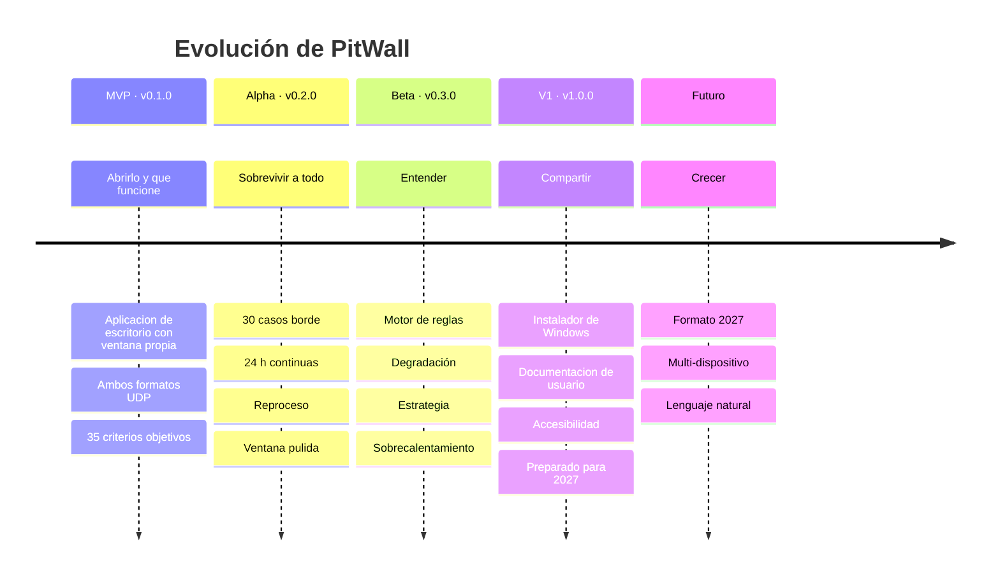

# Roadmap

## 1. Visión general

---

## 2. Criterios de promoción entre hitos

Ningún hito se declara alcanzado por fecha: se alcanza por criterio.

| De → A | Criterio de promoción |
|---|---|
| — → **MVP** | Los 35 criterios de `12-MVP.md` §4 en verde y la demostración de 24 pasos completada |
| MVP → **Alpha** | 0 defectos críticos abiertos · los 30 casos borde con escenario propio · 24 h de sesión continua sin degradación |
| Alpha → **Beta** | El motor de reglas produce conclusiones verificables sobre capturas de resultado conocido · toda conclusión declara su procedencia y su fórmula |
| Beta → **V1** | Instalable por un tercero sin ayuda · documentación de usuario completa · accesibilidad verificada |
| V1 → futuro | Por definir |

---

## 3. MVP — v0.1.0

**Objetivo.** *Abrirlo y que funcione.* Recibir, mostrar, grabar, reproducir y comparar — desde una ventana propia y sin un solo paso manual.

| Bloque | Contenido |
|---|---|
| **Escritorio** | `PitWall.exe` con ventana propia y WebView2, arranque automático de la recepción, detección sin intervención, instancia única y explicación cuando falta configuración |
| Núcleo | Recepción sin pérdidas, decoders 2025 y 2026, detección automática, dominio normalizado, motor de estado con flashbacks |
| Datos | Grabación cruda comprimida, replay determinista a seis velocidades, catálogo y series columnares |
| Interfaz | Estado, Diagnostics, Timing Tower, Telemetry, Track Map, Tyres, Damage, Lap Comparison, Session History, Replay |
| 2026 | 24 coches, Active Aero, Overtake Mode, zonas, eventos nuevos, catálogos nuevos |

**Duración estimada.** 62-78 días laborables de camino crítico (`11-IMPLEMENTATION-PLAN.md` §17). Ocho a diez de ellos son el shell de escritorio: es el coste directo del cambio de enfoque, y se declara en lugar de repartirse.

**No incluye.** Ingeniero de carrera, estrategia, IA, exportación, reproceso ni instalador. Tampoco navegador ni acceso desde la LAN, que quedan **fuera del producto** (OUT-10, OUT-11).

**Cómo se sabe que está.** Los 35 criterios y la demostración de 24 pasos.

---

## 4. Alpha — v0.2.0

**Objetivo.** *Sobrevivir a todo lo que el juego y la red puedan hacer.*

| # | Entrega | Justificación |
|---|---|---|
| A-1 | Los 30 casos borde con escenario de prueba dedicado | Un caso borde sin escenario es un defecto esperando |
| A-2 | Estabilidad de 24 h continuas sin degradación de memoria ni latencia | Las fugas lentas sólo aparecen con tiempo |
| A-3 | Reproceso de capturas con decoder o analítica actualizados (RF-413) | Materializa el valor de haber guardado el crudo |
| A-4 | Filtro por origen y coexistencia con otras herramientas (RF-009) | Problema real reportado por la comunidad |
| A-5 | **Configuración asistida** del `hardware_settings_config.xml`, con consentimiento explícito y copia de seguridad previa (RF-011b) | Elimina el último paso manual que queda: configurar el juego |
| A-6 | Ventana pulida: estado persistente, PPP por monitor, tema del sistema, diálogos nativos (RF-626, RF-627, RF-628, RF-631) | Es lo que separa «funciona» de «se comporta como una aplicación de Windows» |
| A-7 | Comparación de hasta 4 vueltas (RF-508) | Petición natural en cuanto se usa la de 2 |
| A-8 | Exportación a CSV y Parquet (RF-414) | Permite análisis externo sin encerrar los datos |
| A-9 | Búsqueda temporal por debajo de 1 s | El umbral de 5 s del MVP resulta molesto en uso real |
| A-10 | Estimación de pérdida corregida por ramas de flashback | Elimina la sobrestimación conocida |

**Duración estimada.** 4 semanas.

**Riesgo dominante.** A-1 puede revelar defectos profundos en el motor de estado. Se aborda **primero** por eso.

---

## 5. Beta — v0.3.0

**Objetivo.** *Que la aplicación no sólo muestre datos, sino que explique lo que ocurre.*

| # | Entrega | Procedencia de sus salidas |
|---|---|---|
| B-1 | Motor de reglas auditable: cada disparo registra regla, entradas e instante | — |
| B-2 | Degradación por stint con corrección por carga de combustible | `ESTIMATED` con `R²` |
| B-3 | Sobrecalentamiento de neumáticos y frenos por umbrales configurables | `DERIVED` |
| B-4 | Bloqueo de rueda y patinaje mediante `slipRatio` (**sólo coche propio**) | `DERIVED` |
| B-5 | Consumo y proyección de vueltas restantes | `ESTIMATED`, junto al valor del juego |
| B-6 | Pantalla Strategy con stints, degradación y ventana de parada | Mixta |
| B-7 | Ventana de parada, undercut y overcut | `ESTIMATED` con margen |
| B-8 | Detección de tráfico y marcado de vueltas afectadas | `ESTIMATED` |
| B-9 | Índice de consistencia por stint | `DERIVED` |
| B-10 | Comparación de trazadas sobre el mapa | `DERIVED` |

**Duración estimada.** 6 semanas.

**Restricción innegociable de la fase.** Toda conclusión se deriva de **reglas y matemáticas documentadas** (P6). Ninguna sale sin su procedencia, su fórmula y —si es `ESTIMATED`— su margen de error o su indicador de calidad de ajuste.

**Limitación estructural que se hará visible.** B-4 sólo puede aplicarse al coche del jugador, porque `Motion Ex` no existe para los rivales (LIM-05). La interfaz lo explicará, en lugar de mostrar una sección vacía.

---

## 6. V1 — v1.0.0

**Objetivo.** *Que otra persona pueda instalarlo y usarlo sin ayuda.*

| # | Entrega |
|---|---|
| V-1 | **Instalador de Windows** con acceso directo y comprobación del WebView2 Runtime; más una variante portable |
| V-2 | Documentación de usuario con capturas y guía de configuración del juego |
| V-3 | Primera ejecución guiada que detecta la configuración del juego y ofrece corregirla |
| V-4 | Ajuste fino de rendimiento en el frontend |
| V-5 | Accesibilidad completa verificada |
| V-6 | Preparación explícita para un formato 2027: guía de extensión y plantilla de decoder |
| V-7 | Publicación del repositorio con licencia y aviso legal |

**Duración estimada.** 4 semanas.

**Criterio de salida.** Una persona ajena al proyecto, con F1 25 instalado y sin conocimientos técnicos, pasa de descargar a ver su telemetría en menos de 10 minutos sin preguntar nada, sin abrir un navegador y sin tocar un terminal.

---

## 7. Futuro

Sin compromiso de fecha. Cada elemento requerirá su propia decisión registrada.

| Idea | Requisito previo | Nota |
|---|---|---|
| Soporte del formato **2027** | Que EA lo publique | El diseño ya lo contempla: 3-5 días de trabajo (RNF-040) |
| Modo pit wall multi-dispositivo | **Reabrir OUT-11 con un ADR nuevo** | Varias pantallas sincronizadas. Hoy contradice el enfoque de escritorio |
| Traducción de conclusiones a lenguaje natural | Motor de reglas (B-1) | **Sobre resultados ya calculados.** Nunca como fuente de la conclusión |
| Fuente secundaria opcional con datos de la F1 real | Caso de uso concreto | Desactivada por defecto y claramente separada (RF-901) |
| Soporte de otro simulador | Otra implementación de `IDatagramSource` | El diseño lo permite; no se compromete |
| Aplicación móvil como segundo cliente | **Reabrir OUT-11 con un ADR nuevo** | El transporte lo permitiría técnicamente, pero hoy es interno por decisión de producto |
| Recomendación de reglajes | Volumen de datos suficiente | Requiere validación empírica seria antes de prometer nada |

### 7.1. Lo que seguirá fuera de alcance

| Nunca | Motivo |
|---|---|
| Modificación del juego, inyección o lectura de memoria | OUT-02 |
| Servicio en la nube con cuentas | OUT-03, contradice P4 |
| Reproducción de la identidad gráfica de la F1 | OUT-04, riesgo de marca |
| Uso desde un navegador como forma soportada | OUT-10 |
| Docker para ejecutar o distribuir el producto | OUT-12, ADR-016 |
| Redistribución de la especificación de EA o de assets del juego | Licencia |
| IA generativa como **fuente** de una conclusión técnica | P6 |

---

## 8. Dependencias externas del roadmap

| Dependencia | Impacto | Plan |
|---|---|---|
| Revisión de la especificación por EA | Puede invalidar structs a mitad de una fase | Detección temprana (`03-UDP-PROTOCOL.md` §23.3) y decoders aislados |
| Publicación del formato 2027 | Nueva fase de trabajo | Ya presupuestada en 3-5 días |
| Parche del juego que cambie comportamientos | Casos borde nuevos | Las capturas antiguas siguen siendo reproducibles |
| Disponibilidad del 2026 Season Pack para pruebas | Bloquearía la validación final | El generador sintético permite avanzar mientras tanto |

---

## 9. Métricas de seguimiento del roadmap

| Métrica | Qué indica | Objetivo |
|---|---|---|
| Criterios de aceptación en verde / totales | Avance real, no percibido | Monotónico creciente |
| Defectos críticos abiertos | Salud del hito | 0 al promocionar |
| Cobertura de decoder, normalizador y estado | Confianza en el núcleo | ≥ 80 % |
| Escenarios de caso borde cubiertos | Robustez | 30/30 en Alpha |
| Latencia p95 UDP → píxel | Cumplimiento de F3 | < 150 ms |
| Días desde la última regeneración de la documentación | Deriva documental | < 14 |

Esta última métrica existe porque la deriva entre documentación y código es el modo de fallo más silencioso de un proyecto con esta cantidad de diseño escrito.

---

## 10. Revisión del roadmap

Se revisa al cerrar cada hito. Una revisión puede:

- Mover un elemento entre hitos, registrando el motivo.
- Añadir un elemento, si un criterio de aceptación lo exige.
- **Eliminar** un elemento, si deja de tener justificación. Eliminar es tan legítimo como añadir, y bastante más raro de lo que debería.

Todo cambio de alcance que afecte a una decisión arquitectónica exige un ADR nuevo en `15-ADR.md`.

---

*Fin de `PW-RMP-014` v1.1*
